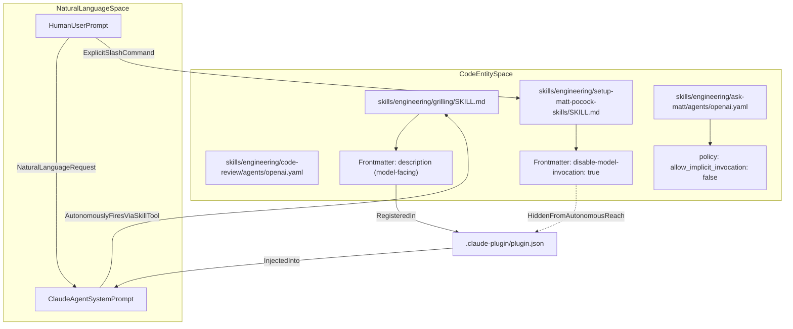
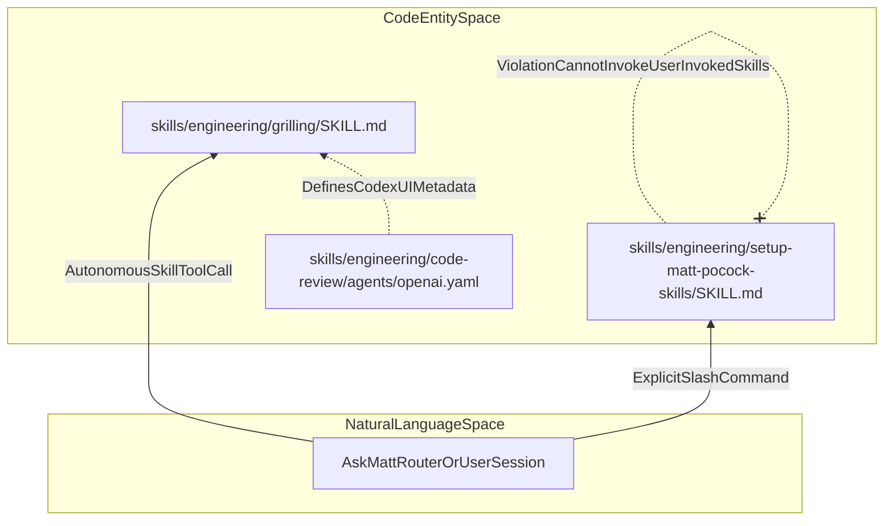

<!-- source: DeepWiki mcp.deepwiki.com · repo mattpocock/skills · page 2.1 Skill Invocation Model · fetched 2026-10-26 -->

# Skill Invocation Model

Relevant source files

The following files were used as context for generating this wiki page:

- [.agents/invocation.md](.agents/invocation.md)
- [.agents/writing-docs.md](.agents/writing-docs.md)
- [AGENTS.md](AGENTS.md)
- [CLAUDE.md](CLAUDE.md)
- [scripts/link-skills.sh](scripts/link-skills.sh)
- [skills/engineering/ask-matt/agents/openai.yaml](skills/engineering/ask-matt/agents/openai.yaml)
- [skills/engineering/grill-with-docs/SKILL.md](skills/engineering/grill-with-docs/SKILL.md)

## Purpose and Scope

This document details the taxonomy of skill invocation within the repository. It explains the distinction between **user-invoked** and **model-invoked** skills, the technical implementation of these modes via frontmatter flags and companion configuration files, and the architectural rules governing inter-skill communication. This model balances context load (token usage in the agent window) against cognitive load (the human's need to remember available commands) [[.agents/invocation.md:3-7]().

Sources: [.agents/invocation.md:3-7]()

---

## Invocation Taxonomy

The skills framework distinguishes between two primary modes of invocation based on whether the AI agent can "see" and autonomously trigger the skill [[.agents/invocation.md:3-6]().

### User-Invoked Skills
A user-invoked skill is reachable **only by the human typing its name** (e.g., `/setup-matt-pocock-skills`). It is completely invisible to the agent's autonomous planning [[.agents/invocation.md:5]().
- **Frontmatter**: Must set `disable-model-invocation: true` for Claude Code and `policy.allow_implicit_invocation: false` in `agents/openai.yaml` for Codex [[.agents/invocation.md:5-10]().
- **Description**: Human-facing. It provides a concise, one-line summary for a person browsing slash-commands, with trigger lists ("Use when...") stripped [[.agents/invocation.md:5]().
- **Frontmatter Quoting**: Descriptions containing colons or complex prose must be explicitly quoted in YAML frontmatter to prevent parsing failures during plugin discovery [[.changeset/fix-yaml-fontmatter-colons.md:5]().

### Model-Invoked Skills
A model-invoked skill is reachable by **both the model and the user**. The agent can fire it autonomously based on the user's natural language request [[.agents/invocation.md:6]().
- **Frontmatter**: Omit the `disable-model-invocation` flag and the `policy` block [[.agents/invocation.md:6]().
- **Description**: Model-facing. It retains rich trigger phrasing ("Use when the user wants..., mentions..., asks for...") to help the LLM identify when to fire the skill [[.agents/invocation.md:6]().
- **Validation**: The test for model-invocation is whether the model could usefully reach for the skill autonomously [[.agents/invocation.md:6]().

Sources: [.agents/invocation.md:3-10](), [.changeset/fix-yaml-fontmatter-colons.md:5]()

---

## Implementation and Data Flow

The invocation mode is determined by frontmatter metadata in `SKILL.md` and UI settings in `agents/openai.yaml`. These configuration files are parsed to populate the plugin manifest (`.claude-plugin/plugin.json`).

Sources: [.agents/invocation.md:5-10](), [skills/engineering/ask-matt/agents/openai.yaml:1-5]()

---

## Dependency Rules and Tool Invocation

To maintain predictability and prevent execution failures, the framework enforces strict rules for inter-skill communication [[.agents/invocation.md:14-22]().

### The Invocation Invariants
1. **User-invoked skills** may invoke **model-invoked skills** via the Skill tool [[.agents/invocation.md:8]().
2. **User-invoked skills** can **NEVER** reach another **user-invoked skill** [[.agents/invocation.md:8-9]().
3. **Model-invoked skills** can **NEVER** reach a **user-invoked skill** [[.agents/invocation.md:22]().

### Calling Convention
Dependencies are expressed as an explicit instruction to **Call the Skill tool** with the named skill (e.g., `Call the Skill tool with "grilling"`), rather than deep cross-references (`../other-skill/FILE.md`) or bare `/skill`-style names [[.agents/invocation.md:16](). 
- The Skill tool takes **one skill per call**. If a step requires two skills, issue two separate instructions (`Call the Skill tool twice, for "grilling" and "domain-modeling"`), never a single call with multiple names [[.agents/invocation.md:20]().
- **User-Prerequisites**: Because a user-invoked skill (such as `setup-matt-pocock-skills`) cannot be called programmatically by any skill, workflows requiring it must instruct the agent to prompt the human directly ("tell the user to run `/setup-matt-pocock-skills`") [[.agents/invocation.md:22](), [.changeset/user-invoked-skill-invocation.md:7]().

Sources: [.agents/invocation.md:8-22](), [.changeset/user-invoked-skill-invocation.md:5-9]()

---

## Description Conventions and OpenAI Metadata

Every skill pairs its `SKILL.md` with an `agents/openai.yaml` file containing Codex UI metadata [[.agents/invocation.md:10](), [skills/engineering/code-review/agents/openai.yaml:1-3]().

| Feature | Model-Invoked Description | User-Invoked Description |
| :--- | :--- | :--- |
| **Primary Audience** | AI Agent | Human User |
| **Trigger Phrases** | Rich ("Use when user wants...") | Stripped (Human-facing summary) |
| **Frontmatter** | Omitted (`disable-model-invocation`) | `disable-model-invocation: true` [[.agents/invocation.md:5-6]]() |
| **Codex Policy** | Omitted (`policy`) | `policy.allow_implicit_invocation: false` [[.agents/invocation.md:5-10]]() |

Sources: [.agents/invocation.md:5-10](), [skills/engineering/code-review/agents/openai.yaml:1-3]()

---

