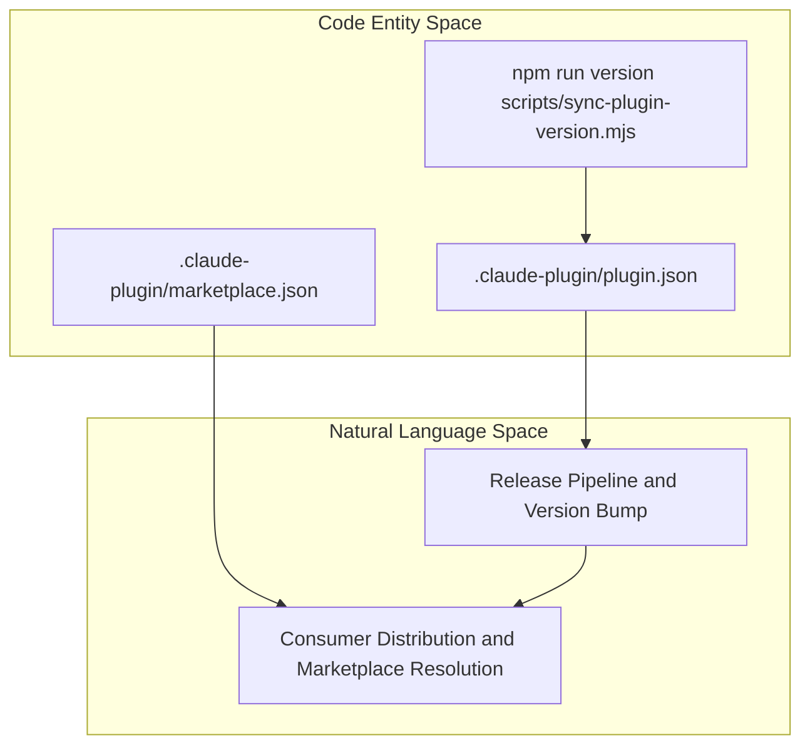
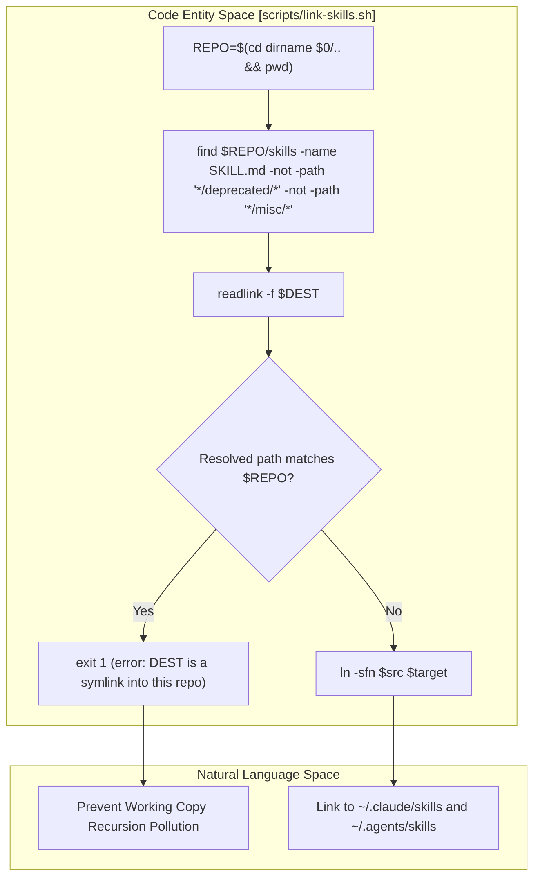

<!-- source: DeepWiki mcp.deepwiki.com · repo mattpocock/skills · page 2.2 Plugin Manifest and Deployment · fetched 2026-10-26 -->

# Plugin Manifest and Deployment

Relevant source files

The following files were used as context for generating this wiki page:

- [.agents/adr/0002-ship-as-a-claude-code-plugin.md](.agents/adr/0002-ship-as-a-claude-code-plugin.md)
- [.agents/install-block.md](.agents/install-block.md)
- [.agents/writing-docs.md](.agents/writing-docs.md)
- [.claude-plugin/marketplace.json](.claude-plugin/marketplace.json)
- [.claude-plugin/plugin.json](.claude-plugin/plugin.json)
- [CLAUDE.md](CLAUDE.md)
- [scripts/link-skills.sh](scripts/link-skills.sh)
- [skills/in-progress/README.md](skills/in-progress/README.md)

## Purpose and Scope

This document details the technical infrastructure used to manage, deploy, and validate the skills in this repository. It covers the `.claude-plugin/plugin.json` manifest structure, the `.claude-plugin/marketplace.json` fallback, the promoted versus non-promoted bucket taxonomy, the canonical install block defined in [.agents/install-block.md](), and the local symlink deployment script `scripts/link-skills.sh` along with its recursion guard and plugin validation mechanics.

Sources: [.claude-plugin/plugin.json:1-50](), [.claude-plugin/marketplace.json:1-23](), [CLAUDE.md:1-27](), [scripts/link-skills.sh:1-62](), [.agents/install-block.md:1-121]()

---

## Plugin Manifests and Marketplace Architecture

The `.claude-plugin/plugin.json` file acts as the central registry for the repository. It defines the active surface area of the toolkit by explicitly listing paths to individual skill directories [`./skills/engineering/...`, `./skills/productivity/...`] [.claude-plugin/plugin.json:21-49](). This manifest allows the repository to function as a native Claude Code plugin, enabling users to subscribe to the skills as a managed, read-only bundle [.agents/adr/0002-ship-as-a-claude-code-plugin.md:3-5]().

### Manifest Schema and Version Synchronization
The manifest contains a JSON object with structural keys including `name` (`mattpocock-skills`) [.claude-plugin/plugin.json:2](), `version` (which tracks `package.json`) [.claude-plugin/plugin.json:3](), and `skills` (an array of explicit directory strings) [.claude-plugin/plugin.json:21-49](). Version synchronization across the release pipeline is automated by scripts that keep `.claude-plugin/plugin.json` aligned with `package.json` [.agents/adr/0002-ship-as-a-claude-code-plugin.md:27-29]().

### Marketplace Integration
The repository includes `.claude-plugin/marketplace.json` to allow the codebase to function as its own single-plugin marketplace [.claude-plugin/marketplace.json:1-23](). While promoted skills are published through Claude Code's official marketplace (`claude-plugins-official`), `marketplace.json` remains as a fallback mechanism for installing unreleased commits or forks [.agents/adr/0002-ship-as-a-claude-code-plugin.md:30-35]().

Sources: [.claude-plugin/plugin.json:1-50](), [.claude-plugin/marketplace.json:1-23](), [.agents/adr/0002-ship-as-a-claude-code-plugin.md:1-53]()

---

## Promoted vs Non-Promoted Bucket Taxonomy

Skills are organized into bucket folders under `skills/` [CLAUDE.md:1-8](). The distinction between promoted and non-promoted buckets controls what ships inside the plugin manifest.

| Bucket | Purpose | Promotion Status |
| :--- | :--- | :--- |
| `engineering/` | Daily code work | **Promoted** [CLAUDE.md:3]() |
| `productivity/` | Daily non-code workflow tools | **Promoted** [CLAUDE.md:4]() |
| `misc/` | Kept around but rarely used | Not Promoted [CLAUDE.md:5]() |
| `in-progress/` | Beta: public on purpose, feedback wanted | Not Promoted [CLAUDE.md:6]() |
| `deprecated/` | No longer used | Not Promoted [CLAUDE.md:7]() |

Every skill in `engineering/` or `productivity/` must have an entry in `.claude-plugin/plugin.json`'s `skills` array [CLAUDE.md:9](). Skills in `misc/`, `in-progress/`, and `deprecated/` must be excluded from the plugin manifest [CLAUDE.md:9]().

Sources: [CLAUDE.md:1-10](), [.agents/adr/0002-ship-as-a-claude-code-plugin.md:7-17](), [skills/in-progress/README.md:1-16]()

---

## Canonical Installation via .agents/install-block.md

Installation instructions across documentation files are standardized through [.agents/install-block.md]() [.agents/install-block.md:1-4](). 

*   **Claude Code Users**: Because `mattpocock-skills` is registered in Claude Code's official marketplace (`claude-plugins-official`), installation is executed via `claude plugin install mattpocock-skills@claude-plugins-official` [.agents/install-block.md:24-34()]. Updates are handled automatically by the host harness [.agents/install-block.md:12-19()].
*   **Codex and Copilot Users**: Users rely on marketplace management commands such as `codex plugin marketplace add mattpocock/skills` [.agents/install-block.md:36-72()].
*   **Other Agents (skills.sh)**: Non-managed harnesses consume skills via `npx skills@latest add mattpocock/skills` [.agents/install-block.md:89-101()].

The plugin subscription model and the editable `skills.sh` approach are mutually exclusive, as installing both duplicates skill execution surfaces [.agents/install-block.md:119-122()].

Sources: [.agents/install-block.md:1-121]()

---

## Local Symlink Deployment and Recursion Guard

For maintainers managing local development workflows, `scripts/link-skills.sh` links repository skills into local agent directories (`~/.claude/skills` and `~/.agents/skills`) [scripts/link-skills.sh:1-16()].

### Script Implementation and Recursion Guard
The script collects all `SKILL.md` files while explicitly filtering out `deprecated/` and `misc/` directories, though `in-progress/` skills are included for active developer feedback [scripts/link-skills.sh:18-31()]. To prevent recursive pollution of the repository working copy when a destination folder is incorrectly symlinked, `scripts/link-skills.sh` runs a safety check using `readlink -f` [scripts/link-skills.sh:37-46()].

Sources: [scripts/link-skills.sh:1-62]()

---

## Plugin Validation

Maintainers must validate schema and path integrity by executing `claude plugin validate . --strict` after touching either `.claude-plugin/plugin.json` or `.claude-plugin/marketplace.json` [CLAUDE.md:11](). This validation command checks that every declared skill path resolves correctly to a directory containing a valid `SKILL.md` file, ensuring that the published plugin bundle remains free of broken references or unauthorized non-promoted inclusions.

Sources: [CLAUDE.md:1-12](), [.claude-plugin/plugin.json:1-50]()

---

