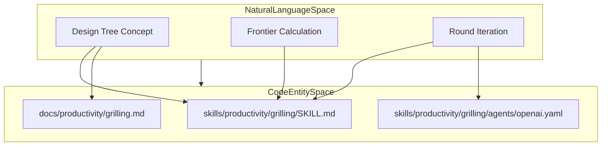
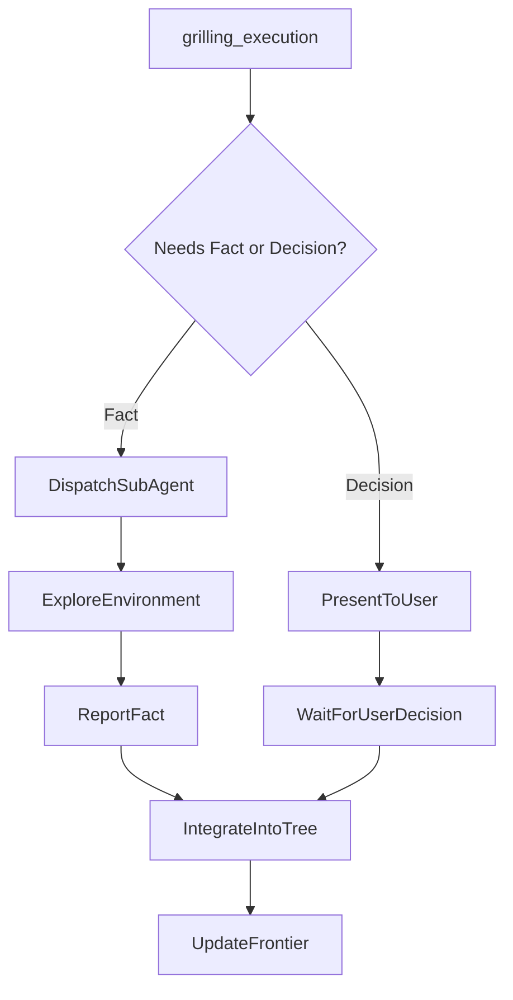
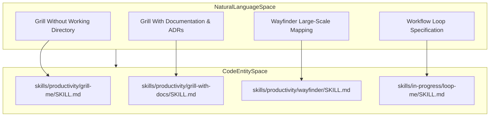

<!-- source: DeepWiki mcp.deepwiki.com · repo mattpocock/skills · page 3.1 The Grilling Primitive · fetched 2026-10-26 -->

# The Grilling Primitive

Relevant source files

The following files were used as context for generating this wiki page:

- [.changeset/grilling-yes-accepts-recommendation.md](.changeset/grilling-yes-accepts-recommendation.md)
- [.out-of-scope/question-limits.md](.out-of-scope/question-limits.md)
- [docs/productivity/grilling.md](docs/productivity/grilling.md)
- [skills/in-progress/loop-me/SKILL.md](skills/in-progress/loop-me/SKILL.md)
- [skills/productivity/grilling/SKILL.md](skills/productivity/grilling/SKILL.md)
- [skills/productivity/grilling/agents/openai.yaml](skills/productivity/grilling/agents/openai.yaml)

The `grilling` skill is a model-invoked interview loop designed to stress-test plans, decisions, or ideas before implementation [docs/productivity/grilling.md:1-3](). It systematically explores a subject by mapping it as a design tree, ensuring all assumptions are surfaced and addressed [docs/productivity/grilling.md:3](). This page details its core mechanics, including the design tree, frontier, rounds, the distinction between facts and decisions, sub-agent fact-finding, question formatting, and the confirmation gate, along with the wrapper skills that consume it.

Sources:
- [docs/productivity/grilling.md:1-6]()
- [skills/productivity/grilling/SKILL.md:1-4]()

## Core Concepts: Design Tree, Frontier, and Rounds

The `grilling` skill operates on three fundamental concepts defined within its execution schema: the design tree, the frontier, and rounds [docs/productivity/grilling.md:23-25]().

### Design Tree

The **design tree** is a conceptual model of the subject under discussion. It represents decisions with other decisions hanging off them, illustrating dependencies and relationships [docs/productivity/grilling.md:3](). This tree structure ensures a comprehensive exploration of all facets of a plan or idea.

Sources:
- [docs/productivity/grilling.md:3]()
- [skills/productivity/grilling/SKILL.md:6]()

### Frontier

The **frontier** is the set of decisions whose prerequisites are all settled [docs/productivity/grilling.md:5](). These are the only questions that can be honestly asked at a given moment, as they do not depend on answers to other, as-yet-unasked questions [docs/productivity/grilling.md:5](). As decisions are settled, the frontier moves outward, unblocking new questions [docs/productivity/grilling.md:5]().

Sources:
- [docs/productivity/grilling.md:5]()
- [skills/productivity/grilling/SKILL.md:7-8]()

### Rounds

A **round** consists of asking the entire current frontier of questions [docs/productivity/grilling.md:5](). All questions within a round are independent of each other; if one question depends on another, they belong to different rounds [docs/productivity/grilling.md:5](). The skill waits for the user's answers to a round before recomputing the frontier and proceeding to the next round [skills/productivity/grilling/SKILL.md:8]().

Sources:
- [docs/productivity/grilling.md:5]()
- [skills/productivity/grilling/SKILL.md:7-8]()

### Natural Language Space to Code Entity Space: Grilling Architecture

**Grilling Architecture Mapping**

Sources:
- [docs/productivity/grilling.md:1-30]()
- [skills/productivity/grilling/SKILL.md:1-28]()
- [skills/productivity/grilling/agents/openai.yaml:1-3]()

## Facts vs. Decisions and Sub-Agent Fact-Finding

A critical distinction in `grilling` is between facts and decisions [docs/productivity/grilling.md:29]().

### Facts

**Facts** are information that the skill itself is responsible for finding [docs/productivity/grilling.md:28](). When a frontier question requires environmental data (e.g., from the filesystem or tools), the skill dispatches a sub-agent to retrieve it [docs/productivity/grilling.md:28](). This fact-finding process does not block the entire session; only questions downstream of the ongoing exploration wait for the sub-agent's report [docs/productivity/grilling.md:28]().

Sources:
- [docs/productivity/grilling.md:28]()
- [skills/productivity/grilling/SKILL.md:26]()

### Decisions

**Decisions** are the user's responsibility [docs/productivity/grilling.md:28](). The skill presents these to the user and must wait for their input [docs/productivity/grilling.md:28](). An agent that answers its own decisions is considered to have broken the skill's intended behavior [docs/productivity/grilling.md:29]().

Sources:
- [docs/productivity/grilling.md:28-29]()
- [skills/productivity/grilling/SKILL.md:26-27]()

### Sub-Agent Fact-Finding Execution Flow

**Fact-Finding and Decision-Making Flow**

Sources:
- [docs/productivity/grilling.md:28-29]()
- [skills/productivity/grilling/SKILL.md:26-27]()

## Question Formatting and Recommendations

Questions within a round adhere to a strict structural format to ensure clarity and ease of response [docs/productivity/grilling.md:27]().

Each question is:
* Numbered and titled, preceded by a `❓` symbol [docs/productivity/grilling.md:27]().
* Followed by a body that may span multiple paragraphs and include multiple choices [skills/productivity/grilling/SKILL.md:13-14]().
* Concluded with the agent's recommended answer on a `➡️` line [docs/productivity/grilling.md:27]().
* Worded such that answering "yes" accepts the recommended answer [.changeset/grilling-yes-accepts-recommendation.md:5]().

Consecutive questions within a round are separated by a horizontal rule (`---`) [skills/productivity/grilling/SKILL.md:17](). This formatting allows users to answer by number rather than quoting the questions back [docs/productivity/grilling.md:27]().

Sources:
- [docs/productivity/grilling.md:26-27]()
- [skills/productivity/grilling/SKILL.md:10-22]()
- [.changeset/grilling-yes-accepts-recommendation.md:1-5]()

## Confirmation Gate

The `grilling` session is not considered finished simply when the frontier is empty [docs/productivity/grilling.md:61](). Instead, it concludes only when the user explicitly confirms that a shared understanding has been reached [docs/productivity/grilling.md:30](). This confirmation gate prevents the skill from acting on agreements prematurely and ensures alignment between the user and the agent [docs/productivity/grilling.md:61]().

Sources:
- [docs/productivity/grilling.md:30]()
- [docs/productivity/grilling.md:61]()
- [skills/productivity/grilling/SKILL.md:30]()

## Wrapping Skills and Ecosystem Integration

`grilling` is a model-invoked skill, meaning it is typically called by other wrapper skills rather than invoked directly by the user via a slash command [docs/productivity/grilling.md:9]().

### Natural Language Space to Code Entity Space: Grilling Wrappers Architecture

**Grilling Wrapper Architecture Mapping**

Sources:
- [docs/productivity/grilling.md:13-19]()
- [skills/in-progress/loop-me/SKILL.md:3-8]()

---

