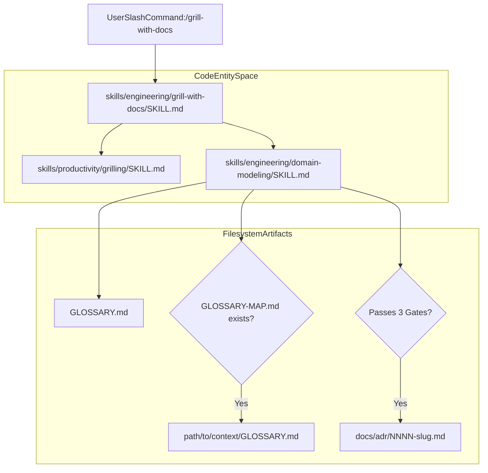
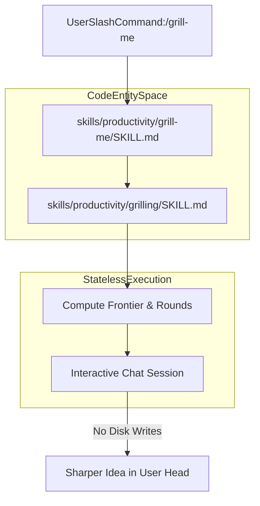

<!-- source: DeepWiki mcp.deepwiki.com · repo mattpocock/skills · page 3.2 Grill-With-Docs and Grill-Me · fetched 2026-10-26 -->

# Grill-With-Docs and Grill-Me

Relevant source files

The following files were used as context for generating this wiki page:

- [.agents/invocation.md](.agents/invocation.md)
- [docs/engineering/grill-with-docs.md](docs/engineering/grill-with-docs.md)
- [docs/productivity/grill-me.md](docs/productivity/grill-me.md)
- [skills/engineering/grill-with-docs/SKILL.md](skills/engineering/grill-with-docs/SKILL.md)
- [skills/productivity/grill-me/agents/openai.yaml](skills/productivity/grill-me/agents/openai.yaml)

This page covers two core grilling skills: the stateful `grill-with-docs` skill and the stateless `grill-me` skill [docs/engineering/grill-with-docs.md:3-5](), [docs/productivity/grill-me.md:3-5](). Both skills leverage the underlying `grilling` primitive to conduct a structured, round-based interview, but they differ significantly in their statefulness, repository integration, output artifacts, and intended use cases [docs/engineering/grill-with-docs.md:3-5](), [docs/productivity/grill-me.md:71-74]().

Sources: [docs/engineering/grill-with-docs.md:3-5](), [docs/productivity/grill-me.md:3-5]()

## Stateful Grill-With-Docs

The `grill-with-docs` skill is a specialized engineering workflow designed to stress-test implementation plans against a project's existing domain model and architectural history [docs/engineering/grill-with-docs.md:1-3](). It facilitates a relentless interview process where the agent challenges the user's plan to ensure alignment with documented decisions in `GLOSSARY.md` and Architectural Decision Records (ADRs) [docs/engineering/grill-with-docs.md:3-5]().

### Purpose and Scope

The primary goal of `grill-with-docs` is to prevent domain drift and architectural erosion. It is a **stateful** skill [docs/engineering/grill-with-docs.md:5](); while other grilling skills leave the session in the user's head, this one persists resolved terms and decisions directly to disk [docs/engineering/grill-with-docs.md:5]().

The skill's `SKILL.md` acts as a thin delegation wrapper that invokes the Skill tool for both `grilling` and `domain-modeling` [skills/engineering/grill-with-docs/SKILL.md:1-7]():
1. **`grilling`**: Supplies the interview structure, frontier computation, and round-based questioning [docs/engineering/grill-with-docs.md:27]().
2. **`domain-modeling`**: Supplies the writing logic, vocabulary enforcement, and ADR generation rules [docs/engineering/grill-with-docs.md:27]().

Sources: [skills/engineering/grill-with-docs/SKILL.md:1-7](), [docs/engineering/grill-with-docs.md:1-27]()

### When to Reach for It

`grill-with-docs` is explicitly invoked by the user via `/grill-with-docs`, as it has `disable-model-invocation: true` set in its frontmatter [docs/engineering/grill-with-docs.md:9](), [skills/engineering/grill-with-docs/SKILL.md:4](). It is recommended for:
* The start of a change in a repository when the plan is still fuzzy and terminology is not settled [docs/engineering/grill-with-docs.md:11]().
* Single-session planning for a change that can be settled within one session [docs/engineering/grill-with-docs.md:16]().
* Aiming at an entire repository with no domain docs to establish initial project vocabulary [docs/engineering/grill-with-docs.md:18]().

It is distinct from `grill-me` (which requires no working directory) and `wayfinder` (which handles multi-session planning for large efforts) [docs/engineering/grill-with-docs.md:13-21]().

Sources: [skills/engineering/grill-with-docs/SKILL.md:1-5](), [docs/engineering/grill-with-docs.md:9-21]()

### Documentation Formats and the Three ADR Gates

The skill maintains a paper trail consisting of glossary terms and architectural decisions [docs/engineering/grill-with-docs.md:29-37]():
* **`GLOSSARY.md` Vocabulary**: Terms are recorded inline the moment they resolve during the interview [docs/engineering/grill-with-docs.md:5,35](). The glossary holds the project's own words, ensuring shared understanding across humans and agents [docs/engineering/grill-with-docs.md:41]().
* **ADRs under `docs/adr/`**: Decisions that meet strict criteria are written to `docs/adr/` [docs/engineering/grill-with-docs.md:36](). A decision must pass **all three ADR gates** to qualify:
  1. **Hard to reverse**: Significant cost to change later [docs/engineering/grill-with-docs.md:36]().
  2. **Surprising without context**: The choice is not the obvious default [docs/engineering/grill-with-docs.md:36]().
  3. **Real trade-off**: A deliberate choice was made between valid alternatives [docs/engineering/grill-with-docs.md:36]().

Sources: [docs/engineering/grill-with-docs.md:5-36]()

### Multi-Context Repositories and GLOSSARY-MAP.md

In larger multi-context repositories, a root `GLOSSARY-MAP.md` file maps specific repository paths to their corresponding bounded contexts [docs/engineering/grill-with-docs.md:25](). When resolved terms are written, `grill-with-docs` consults this map to route terms to the correct regional `GLOSSARY.md` rather than a single monolithic root glossary [docs/engineering/grill-with-docs.md:25]().

Sources: [docs/engineering/grill-with-docs.md:25]()

### Natural Language to Code Entity Mapping: Grill-With-Docs Execution

Sources: [skills/engineering/grill-with-docs/SKILL.md:1-7](), [docs/engineering/grill-with-docs.md:25-36]()

---

## Stateless Grill-Me

The `grill-me` skill is a **stateless** grilling skill designed to sharpen a loose idea into a committed plan through a structured interview [docs/productivity/grill-me.md:3-5](). It writes no files and leaves no workspace behind, existing solely to refine the idea in the user's head [docs/productivity/grill-me.md:5]().

### Purpose and Scope

`grill-me` requires no repository, workspace, or setup, and the subject does not have to be code [docs/productivity/grill-me.md:72](). People use it for business decisions, writing outlines, and determining what to do next [docs/productivity/grill-me.md:72](). 

It is invoked explicitly by typing `/grill-me`, carrying `disable-model-invocation: true` in its frontmatter [docs/productivity/grill-me.md:9](), [skills/productivity/grill-me/agents/openai.yaml:4-5](). It should be started in a fresh conversation rather than on top of an existing agent-written plan [docs/productivity/grill-me.md:9]().

Sources: [docs/productivity/grill-me.md:3-72](), [skills/productivity/grill-me/agents/openai.yaml:1-5]()

### The Interview Mechanics and Grillable Boundaries

`grill-me` operates in **rounds** [docs/productivity/grill-me.md:3](). Each round presents the entire **frontier**—every question whose prerequisites have already been settled—ensuring the agent never asks something dependent on an unanswered question [docs/productivity/grill-me.md:3]().

When hitting **ungrillable** questions (such as subjective UI feel or open-ended design forms requiring visual feedback), grilling stops; the user builds a throwaway version using the `prototype` skill and returns to answer in one line [docs/productivity/grill-me.md:33-35]().

Sources: [docs/productivity/grill-me.md:3-35]()

### Natural Language to Code Entity Mapping: Grill-Me Execution

Sources: [docs/productivity/grill-me.md:3-5](), [skills/productivity/grill-me/agents/openai.yaml:1-5]()

---

## When to Use Each and Downstream Handoffs

Choosing between `grill-me`, `grill-with-docs`, and `wayfinder` depends entirely on context and session scope [docs/engineering/grill-with-docs.md:13-21](), [docs/productivity/grill-me.md:13-18]().

| Feature | `grill-me` | `grill-with-docs` |
| :--- | :--- | :--- |
| **Statefulness** | Stateless (writes no files) [docs/productivity/grill-me.md:5]() | Stateful (writes `GLOSSARY.md` and ADRs) [docs/engineering/grill-with-docs.md:5]() |
| **Environment** | Any environment or non-code topic [docs/productivity/grill-me.md:72]() | Inside an active code repository [docs/engineering/grill-with-docs.md:16]() |
| **Primary Output** | Clarified idea in the user's mind [docs/productivity/grill-me.md:5]() | Persistent domain vocabulary and ADRs [docs/engineering/grill-with-docs.md:35-36]() |
| **Invocation** | `/grill-me` (user-invoked) [docs/productivity/grill-me.md:9]() | `/grill-with-docs` (user-invoked) [docs/engineering/grill-with-docs.md:9]() |

### Downstream Handoffs

Neither grilling skill produces a complete software specification [docs/engineering/grill-with-docs.md:39](). Most decisions agreed upon during a grilling session exist solely within the active context window [docs/engineering/grill-with-docs.md:39](). 
* To transition a grilled session into actionable engineering work, hand the conversation directly to the `to-spec` skill rather than clearing the context [docs/engineering/grill-with-docs.md:39](), [docs/productivity/grill-me.md:65]().
* When the effort exceeds a single session, hand off to `wayfinder` instead [docs/engineering/grill-with-docs.md:21]().
* When uncertain which flow applies, use the `ask-matt` router skill for guidance [docs/productivity/grill-me.md:76]().

Sources: [docs/engineering/grill-with-docs.md:13-55](), [docs/productivity/grill-me.md:13-76]()

---

