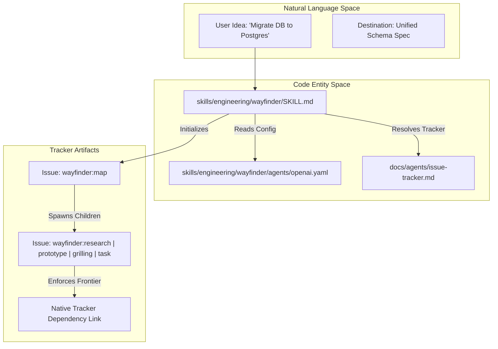
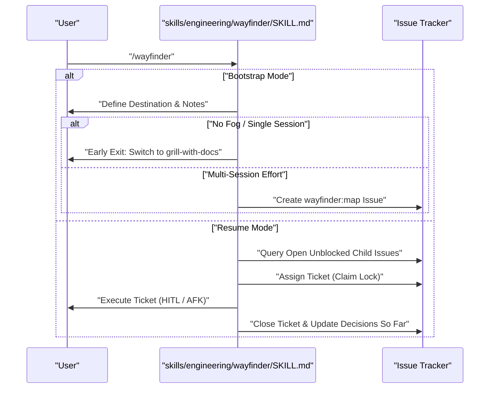

<!-- source: DeepWiki mcp.deepwiki.com · repo mattpocock/skills · page 3.3 Wayfinder: Mapping Large Efforts · fetched 2026-10-26 -->

# Wayfinder: Mapping Large Efforts

Relevant source files

The following files were used as context for generating this wiki page:

- [.changeset/wayfinder-labels-refs-research-prs.md](.changeset/wayfinder-labels-refs-research-prs.md)
- [docs/engineering/research.md](docs/engineering/research.md)
- [docs/engineering/wayfinder.md](docs/engineering/wayfinder.md)
- [skills/engineering/triage/SKILL.md](skills/engineering/triage/SKILL.md)
- [skills/engineering/wayfinder/SKILL.md](skills/engineering/wayfinder/SKILL.md)

The purpose of this page is to detail the **Wayfinder** skill (`skills/engineering/wayfinder/SKILL.md`), a stateful planning primitive designed to chart massive efforts across multiple agent sessions using a shared decision map on an issue tracker [skills/engineering/wayfinder/SKILL.md:1-8](). Scope includes the map artifact schema, ticket types, fog-of-war and frontier dynamics, claim/assign locking mechanisms, bootstrap versus resume flows, early exit criteria, and the downstream handoff to `/to-spec`.

Sources: [skills/engineering/wayfinder/SKILL.md:1-8]()

## The Map Artifact

The **Map** is the canonical artifact of a wayfinder effort, physically represented as a single issue on the project's tracker labeled `wayfinder:map` [skills/engineering/wayfinder/SKILL.md:20-21](). It acts as an **index, not a store**; individual decisions live entirely within their respective child tickets, while the map indexes them with brief gists and links [skills/engineering/wayfinder/SKILL.md:22-23]().

### Map Structure
The map body conforms to a strict template layout defined in `skills/engineering/wayfinder/SKILL.md`:

| Section | Purpose |
| :--- | :--- |
| **Destination** | One or two lines defining what reaching the end of the map looks like (spec, decision, or migration) [skills/engineering/wayfinder/SKILL.md:32-34](). |
| **Notes** | Domain context, standing preferences, and mandatory skills for every session [skills/engineering/wayfinder/SKILL.md:36-39](). |
| **Decisions so far** | An index listing closed tickets with a one-line answer gist and reference link [skills/engineering/wayfinder/SKILL.md:40-45](). |
| **Not yet specified** | The **Fog of War**: in-scope unknowns that cannot yet be phrased as tickets [skills/engineering/wayfinder/SKILL.md:46-48](). |
| **Out of scope** | Work ruled beyond the destination; closed items that never graduate [skills/engineering/wayfinder/SKILL.md:50-53](). |

Sources: [skills/engineering/wayfinder/SKILL.md:20-53](), [docs/engineering/wayfinder.md:30-38]()

## Ticket Types and HITL/AFK Classification

Every ticket is a child issue carrying a `wayfinder:<type>` label [skills/engineering/wayfinder/SKILL.md:57-65](). Tickets resolve decisions rather than execute build tasks [skills/engineering/wayfinder/SKILL.md:11-13](). They are categorized by interaction model into **HITL** (Human-In-The-Loop) or **AFK** (Away-From-Keyboard) execution [skills/engineering/wayfinder/SKILL.md:75]().

| Type | Mode | Description | Resolution Mechanism |
| :--- | :--- | :--- | :--- |
| **Research** | AFK | Reading external documentation or APIs to surface facts [skills/engineering/wayfinder/SKILL.md:77](). | `/research` subagent invocation [skills/engineering/wayfinder/SKILL.md:77](). |
| **Prototype** | HITL | Raising discussion fidelity via rough artifacts or stubs [skills/engineering/wayfinder/SKILL.md:78](). | `/prototype` skill [skills/engineering/wayfinder/SKILL.md:78](). |
| **Grilling** | HITL | Conversational decision-making (default case) [skills/engineering/wayfinder/SKILL.md:79](). | `/grilling` plus `/domain-modeling` [skills/engineering/wayfinder/SKILL.md:79](). |
| **Task** | Either | Manual prerequisite work that unblocks a decision [skills/engineering/wayfinder/SKILL.md:80](). | Agent (AFK) or human checklist (HITL) [skills/engineering/wayfinder/SKILL.md:80](). |

Sources: [skills/engineering/wayfinder/SKILL.md:73-81](), [docs/engineering/wayfinder.md:42-53]()

## Technical Implementation and Data Flow

Wayfinder bridges Natural Language intent to Code Entity structures and issue tracker primitives.

Title: "Wayfinder System Architecture"

Sources: [skills/engineering/wayfinder/SKILL.md:20-26](), [skills/engineering/wayfinder/SKILL.md:65](), [skills/engineering/wayfinder/agents/openai.yaml:1-5]()

## Operational Lifecycle

### Bootstrap vs Resume Modes and No-Fog Early Exit
Wayfinder operates in two primary execution modes:
*   **Bootstrap Mode:** Initial invocation where the agent engages the user to define the destination and scaffold the `wayfinder:map` issue [skills/engineering/wayfinder/SKILL.md:7-9](). If bootstrap analysis reveals **no fog of war** and the effort fits into a single session, it executes a **no-fog early exit**, recommending `/grill-with-docs` or direct implementation instead [docs/engineering/wayfinder/SKILL.md:11-16]().
*   **Resume Mode:** When resuming an existing effort, the session loads the map at low resolution, queries open unblocked child issues, and identifies the current frontier [skills/engineering/wayfinder/SKILL.md:29]().

Sources: [skills/engineering/wayfinder/SKILL.md:7-9](), [docs/engineering/wayfinder.md:11-16]()

### Claiming and Locking
To prevent race conditions across concurrent sessions, a session must **claim** a ticket before starting work [skills/engineering/wayfinder/SKILL.md:67-68](). Claiming is performed by setting the issue assignee to the active developer [skills/engineering/wayfinder/SKILL.md:67-68](). Unassigned open tickets remain unclaimed [skills/engineering/wayfinder/SKILL.md:67-68]().

Sources: [skills/engineering/wayfinder/SKILL.md:67-68]()

### The Frontier and Fog of War
*   **The Frontier:** The set of open, unblocked, and unclaimed child issues representing the immediate boundary of known work [skills/engineering/wayfinder/SKILL.md:69]().
*   **Fog of War:** In-scope unknowns listed under `## Not yet specified` [skills/engineering/wayfinder/SKILL.md:46-48](). Resolving frontier tickets clears the fog ahead, graduating specifiable items into new child tickets [skills/engineering/wayfinder/SKILL.md:84]().

Sources: [skills/engineering/wayfinder/SKILL.md:46-48](), [skills/engineering/wayfinder/SKILL.md:69](), [skills/engineering/wayfinder/SKILL.md:84]()

Title: "Wayfinder Execution Lifecycle"

Sources: [skills/engineering/wayfinder/SKILL.md:20-84](), [docs/engineering/wayfinder.md:11-38]()

## Handoff to To-Spec

Wayfinder strictly adheres to a planning-only mandate: tickets resolve decisions rather than implement features [skills/engineering/wayfinder/SKILL.md:11-14](). Once all decision tickets are cleared, Wayfinder concludes and hands off execution to downstream specification workflows, typically invoking `/to-spec` to consolidate the decisions into a formal specification issue [docs/engineering/wayfinder/SKILL.md:18]().

Sources: [skills/engineering/wayfinder/SKILL.md:11-14](), [docs/engineering/wayfinder.md:18]()

---

