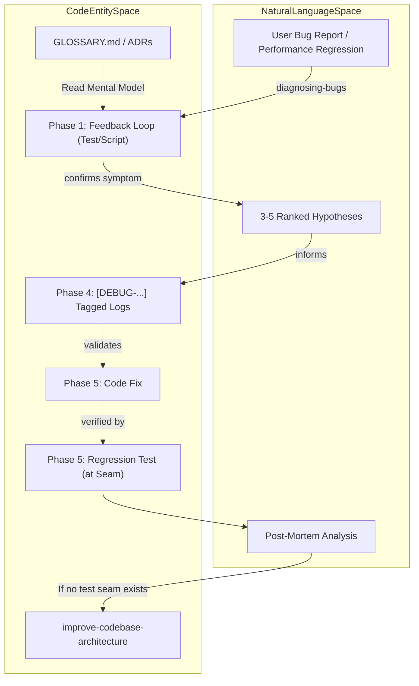
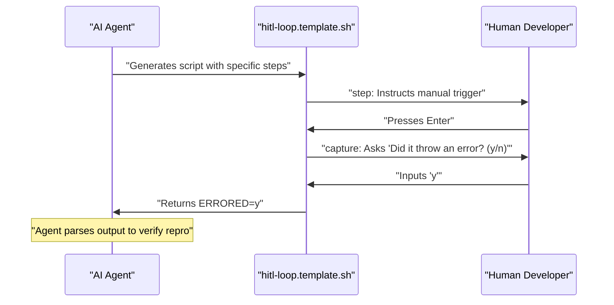
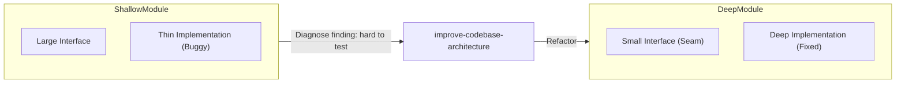

<!-- source: DeepWiki mcp.deepwiki.com · repo mattpocock/skills · page 4.3 Diagnosing Bugs · fetched 2026-10-26 -->

# Diagnosing Bugs

Relevant source files

The following files were used as context for generating this wiki page:

- [.changeset/diagnosing-bugs-prove-mutation.md](.changeset/diagnosing-bugs-prove-mutation.md)
- [docs/engineering/diagnosing-bugs.md](docs/engineering/diagnosing-bugs.md)
- [docs/engineering/resolving-merge-conflicts.md](docs/engineering/resolving-merge-conflicts.md)
- [docs/engineering/setup-matt-pocock-skills.md](docs/engineering/setup-matt-pocock-skills.md)
- [docs/productivity/teach.md](docs/productivity/teach.md)
- [skills/engineering/codebase-design/DEEPENING.md](skills/engineering/codebase-design/DEEPENING.md)
- [skills/engineering/diagnosing-bugs/SKILL.md](skills/engineering/diagnosing-bugs/SKILL.md)
- [skills/engineering/diagnosing-bugs/scripts/hitl-loop.template.sh](skills/engineering/diagnosing-bugs/scripts/hitl-loop.template.sh)
- [skills/engineering/domain-modeling/ADR-FORMAT.md](skills/engineering/domain-modeling/ADR-FORMAT.md)

## Purpose and Scope

The `diagnosing-bugs` skill provides a rigorous, six-phase framework for resolving complex bugs and performance regressions `[skills/engineering/diagnosing-bugs/SKILL.md:2-3]()`. It prioritizes the construction of a deterministic feedback loop over passive code analysis, ensuring that every fix is verified by a reliable pass/fail signal `[skills/engineering/diagnosing-bugs/SKILL.md:18-20]()`. The skill is specifically designed to block the common agent failure mode of jumping straight to a hypothesis without a reproduction `[skills/engineering/diagnosing-bugs/SKILL.md:66-67]()`.

Sources: `[skills/engineering/diagnosing-bugs/SKILL.md:2-3]`, `[skills/engineering/diagnosing-bugs/SKILL.md:18-20]`, `[skills/engineering/diagnosing-bugs/SKILL.md:66-67]()`

---

## The Six-Phase Diagnosis Loop

The core implementation of the `diagnosing-bugs` skill follows a strict sequence. Phases should only be skipped if explicitly justified to the user `[skills/engineering/diagnosing-bugs/SKILL.md:8-9]()`. When exploring the codebase, the agent is instructed to read `GLOSSARY.md` for the mental model and check relevant ADRs `[skills/engineering/diagnosing-bugs/SKILL.md:10-10]()`.

### Phase 1: Build a Feedback Loop

This is the most critical phase. The agent is instructed to spend disproportionate effort here to create a fast, deterministic signal `[skills/engineering/diagnosing-bugs/SKILL.md:20-22]()`. Ten strategies are provided for constructing this loop:

1. **Failing Test:** Unit, integration, or e2e tests at the closest relevant seam `[skills/engineering/diagnosing-bugs/SKILL.md:26-26]()`.
2. **Curl / HTTP Script:** Direct requests against a running dev server `[skills/engineering/diagnosing-bugs/SKILL.md:27-27]()`.
3. **CLI Invocation:** Running a command with fixture input and diffing stdout against a known-good snapshot `[skills/engineering/diagnosing-bugs/SKILL.md:28-28]()`.
4. **Headless Browser Script:** Using Playwright or Puppeteer to drive the UI `[skills/engineering/diagnosing-bugs/SKILL.md:29-29]()`.
5. **Replay Captured Trace:** Replaying real network payloads or event logs through the code path in isolation `[skills/engineering/diagnosing-bugs/SKILL.md:30-30]()`.
6. **Throwaway Harness:** Minimal system subset with mocked dependencies `[skills/engineering/diagnosing-bugs/SKILL.md:31-31]()`.
7. **Property / Fuzz Loop:** Running 1000+ random inputs to find edge-case failures `[skills/engineering/diagnosing-bugs/SKILL.md:32-32]()`.
8. **Bisection Harness:** Automating `git bisect run` between known good/bad states `[skills/engineering/diagnosing-bugs/SKILL.md:33-33]()`.
9. **Differential Loop:** Comparing outputs between two different versions or configurations `[skills/engineering/diagnosing-bugs/SKILL.md:34-34]()`.
10. **HITL Bash Script:** A structured fallback using `scripts/hitl-loop.template.sh` for bugs requiring human interaction `[skills/engineering/diagnosing-bugs/SKILL.md:35-35]()`.

Phase 1 is complete only when a **red-capable**, **deterministic**, **fast**, and **agent-runnable** command exists `[skills/engineering/diagnosing-bugs/SKILL.md:57-65]()`.

### Phase 2: Reproduce + Minimise

The agent runs the feedback loop to confirm the bug matches the user's description and captures the exact symptom `[skills/engineering/diagnosing-bugs/SKILL.md:70-77]()`. Crucially, the agent must then **minimise** the repro—shrinking it to the smallest possible scenario where it still fails by cutting inputs and config one at a time `[skills/engineering/diagnosing-bugs/SKILL.md:78-82]()`.

### Phase 3: Hypothesise

The agent generates **3–5 ranked, falsifiable hypotheses** before testing any of them to avoid anchoring `[skills/engineering/diagnosing-bugs/SKILL.md:88-90]()`. Each must follow the format: *"If `<X>` is the cause, then `<changing Y>` will make the bug disappear / `<changing Z>` will make it worse"* `[skills/engineering/diagnosing-bugs/SKILL.md:92-94]()`. These are presented to the user for domain-specific ranking before testing `[skills/engineering/diagnosing-bugs/SKILL.md:98-99]()`.

### Phase 4: Instrument

The agent applies probes one variable at a time `[skills/engineering/diagnosing-bugs/SKILL.md:100-102]()`.
* **Debug Logs:** Must be tagged with a unique prefix (e.g., `[DEBUG-a4f2]`) for easy cleanup `[skills/engineering/diagnosing-bugs/SKILL.md:110-110]()`.
* **Performance:** For regressions, the agent establishes a baseline measurement (profiler, query plan) rather than using standard logs `[skills/engineering/diagnosing-bugs/SKILL.md:111-112]()`.

### Phase 5: Fix + Regression Test

A regression test is written before the fix, incorporating the mutation proof requirement introduced in `.changeset/diagnosing-bugs-prove-mutation.md`: the agent `diff`s a forced mutation against a pristine copy before trusting the red signal, ensuring an edit that silently changed nothing cannot pass as a failing test `[.changeset/diagnosing-bugs-prove-mutation.md:1-5]()`. If no seam allows for a reliable test, the agent documents this as an architectural deficiency `[docs/engineering/diagnosing-bugs.md:55-56]()`.

### Phase 6: Cleanup + Post-Mortem

The agent removes all tagged logs, deletes throwaway prototypes, and verifies the fix against the original Phase 1 loop `[skills/engineering/diagnosing-bugs/SKILL.md:124-125]()`. It concludes by identifying the root cause of the root cause to prevent future regressions `[skills/engineering/diagnosing-bugs/SKILL.md:126-127]()`.

Sources: `[skills/engineering/diagnosing-bugs/SKILL.md:8-127]`, `[.changeset/diagnosing-bugs-prove-mutation.md:1-6]`, `[docs/engineering/diagnosing-bugs.md:55-56]()`

---

## Data Flow: Diagnosis to Architecture Improvement

The following diagram illustrates how the `diagnosing-bugs` skill transitions from Natural Language bug reports to Code Entity Space, eventually handing off to architectural improvements.

### Diagnosis Workflow and Handoff

Sources: `[skills/engineering/diagnosing-bugs/SKILL.md:3-10]`, `[skills/engineering/diagnosing-bugs/SKILL.md:57-67]`, `[skills/engineering/diagnosing-bugs/SKILL.md:88-99]`, `[skills/engineering/diagnosing-bugs/SKILL.md:114-127]`, `[docs/engineering/diagnosing-bugs.md:21-21]()`

---

## Human-in-the-Loop (HITL) Fallback

When a bug cannot be automated (e.g., requires specific UI interactions), the skill uses the `skills/engineering/diagnosing-bugs/scripts/hitl-loop.template.sh` bash template to maintain a structured loop. This script provides helpers `step` for instructions and `capture` for recording user feedback `[skills/engineering/diagnosing-bugs/scripts/hitl-loop.template.sh:9-11]()`.

### HITL Interaction Diagram

Sources: `[skills/engineering/diagnosing-bugs/SKILL.md:35-35]`, `[skills/engineering/diagnosing-bugs/scripts/hitl-loop.template.sh:1-44]`, `[docs/engineering/diagnosing-bugs.md:36-36]()`

---

## Architectural Handoff

The `diagnosing-bugs` skill serves as a sensor for codebase health. If a bug is difficult to lock down because of architectural friction, the agent is required to trigger the `improve-codebase-architecture` skill `[skills/engineering/diagnosing-bugs/SKILL.md:126-127]()`.

### Criteria for Handoff
* **Absence of Seams:** The bug cannot be tested at a unit or integration level without excessive mocking `[skills/engineering/diagnosing-bugs/SKILL.md:121-122]()`. This often indicates a lack of proper module boundaries or dependency injection points, as described in `DEEPENING.md` `[skills/engineering/codebase-design/DEEPENING.md:1-37]()`.
* **Observability Gaps:** The bug required significant temporary instrumentation because existing logs/metrics were insufficient `[skills/engineering/diagnosing-bugs/SKILL.md:126-127]()`.
* **Deepening Opportunities:** The diagnosis revealed a shallow module (large interface, thin implementation) that should be deepened to encapsulate the failing logic `[docs/engineering/diagnosing-bugs.md:54-55]()`.

### Relationship to Deep Modules

Sources: `[skills/engineering/diagnosing-bugs/SKILL.md:121-127]`, `[docs/engineering/diagnosing-bugs.md:54-55]`, `[skills/engineering/codebase-design/DEEPENING.md:1-37]()`

---

