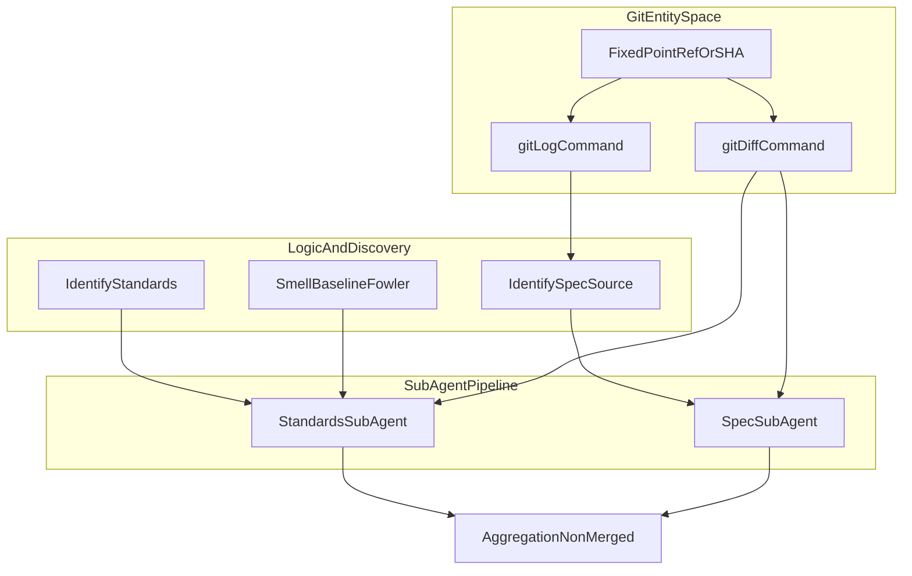
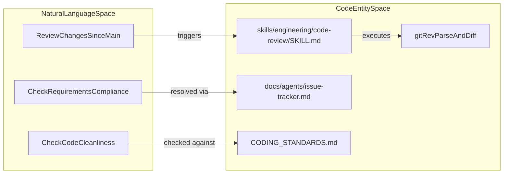

<!-- source: DeepWiki mcp.deepwiki.com · repo mattpocock/skills · page 4.4 Code Review · fetched 2026-10-26 -->

# Code Review

Relevant source files

The following files were used as context for generating this wiki page:

- [.changeset/code-review-standards-and-subagents.md](.changeset/code-review-standards-and-subagents.md)
- [docs/engineering/code-review.md](docs/engineering/code-review.md)
- [skills/engineering/code-review/SKILL.md](skills/engineering/code-review/SKILL.md)
- [skills/engineering/to-spec/SKILL.md](skills/engineering/to-spec/SKILL.md)
- [skills/in-progress/claude-handoff/SKILL.md](skills/in-progress/claude-handoff/SKILL.md)

The `code-review` skill provides a rigorous, two-axis evaluation of code changes since a fixed point (commit, branch, tag, or merge-base). It is designed to ensure that code is not only technically sound according to repository conventions (**Standards**) but also functionally correct according to the originating requirements (**Spec**) [skills/engineering/code-review/SKILL.md:2-3]().

Sources: [skills/engineering/code-review/SKILL.md:2-3]()

## Evaluation Methodology: The Two-Axis Approach

The skill avoids the "blended verdict" trap where a passing axis masks a failing one. A change may follow every repo convention but implement the wrong feature, or implement the right feature while violating all style guides [docs/engineering/code-review.md:5-6](). By separating these concerns into parallel sub-agents, the skill ensures that reasoning from one axis does not pollute the other [skills/engineering/code-review/SKILL.md:11-11]().

| | Standards | Spec |
| :--- | :--- | :--- |
| **Question** | Is it built right? | Is it the right thing? |
| **Reads** | The repo's documented standards, plus the smell baseline | The originating issue or spec |
| **Reports** | Documented breaches (can be hard), and smells (always judgement calls) | Missing or partial requirements, scope creep, requirements implemented wrongly |
| **Every finding cites** | The standards file and the rule, or the named smell plus the hunk | The line of the spec |

Sources: [skills/engineering/code-review/SKILL.md:8-11](), [docs/engineering/code-review.md:37-43]()

## Pipeline Implementation and Data Flow

The skill follows a structured execution pipeline managed by `skills/engineering/code-review/SKILL.md`: discovery, parallel execution, and non-merged aggregation.

### 1. Fixed-Point Git Diffing
The skill requires a user-supplied "fixed point" (a commit SHA, branch name, tag, `main`, `HEAD~5`, etc.) [skills/engineering/code-review/SKILL.md:19-19](). It captures a three-dot diff using `git diff <fixed-point>...HEAD` to compare against the merge-base, and retrieves commit logs via `git log <fixed-point>..HEAD --oneline` [skills/engineering/code-review/SKILL.md:21-21](). It validates that the ref resolves (`git rev-parse <fixed-point>`) and that the diff is non-empty before spawning any sub-agents [skills/engineering/code-review/SKILL.md:23-23]().

Sources: [skills/engineering/code-review/SKILL.md:17-24]()

### 2. Discovery Phases
*   **Spec Discovery**: The skill searches for requirements in order: issue references in commit messages (`#123`, `Closes #45`, GitLab `!67`) fetched via the tracker doc, a user-passed path, or a spec file under `docs/`, `specs/`, or `.scratch/` [skills/engineering/code-review/SKILL.md:27-31](). If no spec is found, the user is asked; if none exists, the Spec sub-agent is skipped [skills/engineering/code-review/SKILL.md:31-32]().
*   **Standards Discovery**: It searches the repository for documentation on coding conventions, explicitly incorporating `CODING_STANDARDS.md` or `CONTRIBUTING.md` when present [skills/engineering/code-review/SKILL.md:34-36](). Additionally, it enforces a built-in **Smell Baseline** derived from Fowler's *Refactoring* (ch. 3) covering twelve code smells (e.g., Mysterious Name, Duplicated Code, Feature Envy, Data Clumps, Primitive Obsession, Repeated Switches, Shotgun Surgery, Divergent Change, Speculative Generality, Message Chains, Middle Man, Refused Bequest) [skills/engineering/code-review/SKILL.md:38-57](). Documented repository standards always override the baseline [skills/engineering/code-review/SKILL.md:39-40]().

Sources: [skills/engineering/code-review/SKILL.md:25-57]()

### 3. Parallel Sub-Agent Execution
The skill spawns two independent sub-agents in the foreground and aggregates their reports [skills/engineering/code-review/SKILL.md:58-60]().
*   **Standards Sub-Agent**: Evaluates the diff against discovered standards and the smell baseline, distinguishing hard violations from judgement calls [skills/engineering/code-review/SKILL.md:62-66]().
*   **Spec Sub-Agent**: Evaluates the diff against the identified spec, reporting missing requirements, scope creep, and incorrectly implemented behavior with line citations [skills/engineering/code-review/SKILL.md:68-72]().

Sources: [skills/engineering/code-review/SKILL.md:58-74]()

### 4. Aggregation
Findings are presented under separate `## Standards` and `## Spec` headings without cross-axis merging or reranking [skills/engineering/code-review/SKILL.md:76-78](). The report concludes with a one-line summary of findings and the worst issue within each axis [skills/engineering/code-review/SKILL.md:80-80]().

Sources: [skills/engineering/code-review/SKILL.md:76-80]()

### Code Entity Mapping: Review Logic
The following diagram maps the logical phases of the review process to underlying git operations and file system artifacts.

Title: "Review Execution Flow"

Sources: [skills/engineering/code-review/SKILL.md:15-79](), [docs/engineering/code-review.md:26-34]()

## System Architecture: Natural Language to Code Entities

The `code-review` skill bridges high-level natural language user requests with specific repository files and execution commands.

Title: "Entity Mapping: NL Space to Code Space"

Sources: [skills/engineering/code-review/SKILL.md:1-13](), [docs/engineering/code-review.md:24-33]()

## Known Rough Edges

### Claude Code Name Collision
Claude Code provides its own built-in `/code-review` command focused on hunting runtime bugs, which collides with and is shadowed by this skill when installed via plain file installation [docs/engineering/code-review.md:50-55](). Users often resolve this by removing built-in Claude Code skills or forking the skill to a custom name [docs/engineering/code-review.md:52-57]().

Sources: [docs/engineering/code-review.md:50-57]()

### Sub-Agent Fan-out Bug
Sub-agents are not explicitly restricted from calling skills in their base prompts, which can cause them to recursively re-invoke `/code-review` and spawn expanding numbers of sub-agents [docs/engineering/code-review.md:59-61](). Workarounds involve appending anti-recursion guards to sub-agent briefs [docs/engineering/code-review.md:61-62]().

Sources: [docs/engineering/code-review.md:59-62](), [skills/engineering/code-review/SKILL.md:60-70]()

### Reviewing in the Same Session
Running `code-review` in the same session that authored the code risks confirmation bias because the context window holds the assumptions that shaped the implementation [docs/engineering/code-review.md:63-65](). It is recommended to execute the review in a fresh, independent session [docs/engineering/code-review.md:63-65]().

Sources: [docs/engineering/code-review.md:63-65]()

---

