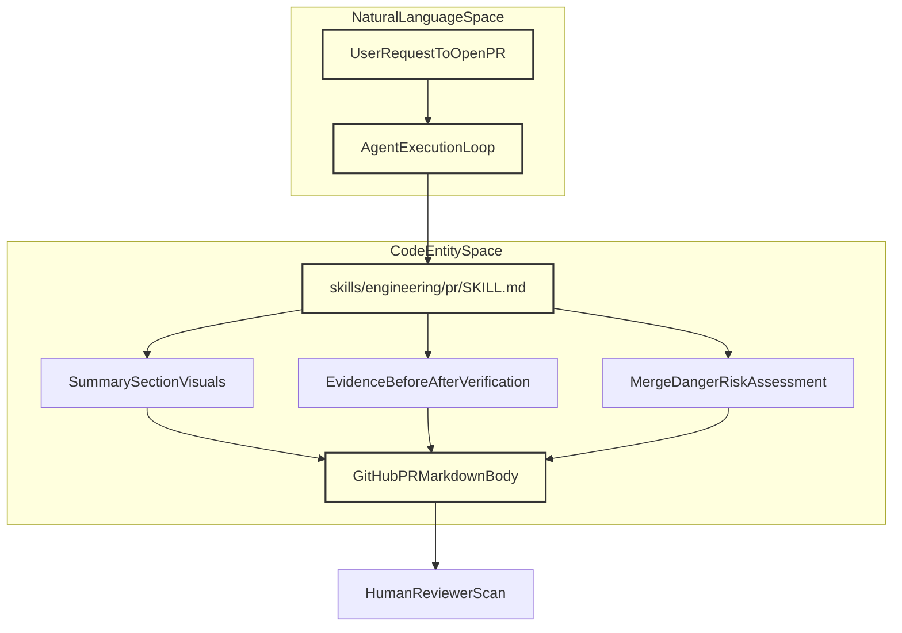
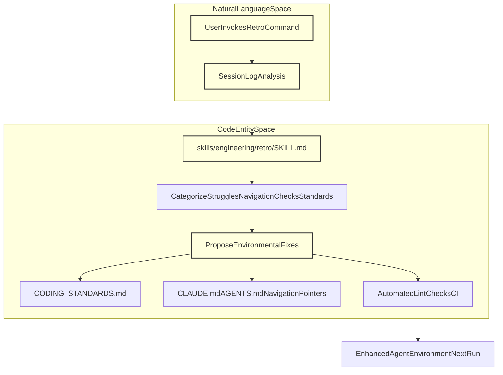

<!-- source: DeepWiki mcp.deepwiki.com · repo mattpocock/skills · page 4.5 Pull Requests and Retrospectives · fetched 2026-10-26 -->

# Pull Requests and Retrospectives

<details>
<summary>Relevant source files</summary>

The following files were used as context for generating this wiki page:

- [docs/engineering/diagnosing-bugs.md](docs/engineering/diagnosing-bugs.md)
- [docs/engineering/implement-spec.md](docs/engineering/implement-spec.md)
- [docs/engineering/pr.md](docs/engineering/pr.md)
- [docs/engineering/resolving-merge-conflicts.md](docs/engineering/resolving-merge-conflicts.md)
- [docs/engineering/retro.md](docs/engineering/retro.md)
- [docs/engineering/setup-matt-pocock-skills.md](docs/engineering/setup-matt-pocock-skills.md)
- [docs/productivity/teach.md](docs/productivity/teach.md)
- [skills/engineering/pr/CREDITS.md](skills/engineering/pr/CREDITS.md)
- [skills/engineering/pr/SKILL.md](skills/engineering/pr/SKILL.md)
- [skills/engineering/pr/agents/openai.yaml](skills/engineering/pr/agents/openai.yaml)
- [skills/engineering/retro/SKILL.md](skills/engineering/retro/SKILL.md)
- [skills/engineering/retro/agents/openai.yaml](skills/engineering/retro/agents/openai.yaml)

</details>


This page documents two implementation-wrapup and reflection skills: `pr` and `retro`. The `pr` skill defines the structural architecture for Pull Request (PR) bodies, focusing on scanability, visual summaries, rigorous before/after evidence, and explicit merge-danger door classifications. The `retro` skill provides a post-session architectural improvement loop, allowing agents to learn from historical session records by proposing environmental enhancements rather than direct code patches. This page also documents archived and removed skills such as `resolving-merge-conflicts`.

Sources:
- [docs/engineering/pr.md:1-3]()
- [docs/engineering/retro.md:1-6]()
- [docs/engineering/resolving-merge-conflicts.md:1-1]()

---

## The `pr` Skill: Pull Request Body Architecture

The `pr` skill provides a strict structural reference for writing Pull Request descriptions. It is a format specification rather than an active workflow tool; it does not push git branches, open PRs, or determine branch contents. Instead, it dictates the exact format an agent uses when authoring a PR body `[docs/engineering/pr.md:3-3]()`.

### What it Does

The skill structures the PR body into three required sections: **Summary**, **Evidence**, and **Merge Danger** `[docs/engineering/pr.md:19-24]()`. 

* **Summary**: Replaces default verbose prose with high-signal visuals. Reviewers already have access to the raw git diff; therefore, the summary provides the smallest contextual view that clarifies the change's shape (such as pseudocode, call trees, component trees, file trees, Mermaid diagrams, or shaped diffs) `[docs/engineering/pr.md:5-5]`, `[skills/engineering/pr/SKILL.md:39-41]()`.
* **Evidence**: Requires a rigorous "before and after" demonstration. Visual changes prefer screenshots, while backend or algorithmic changes require execution-based output, such as a failing test run vs. a passing test run written as pseudocode `[docs/engineering/pr.md:22-22]`, `[skills/engineering/pr/SKILL.md:160-164]()`.
* **Merge Danger**: Evaluates risk by declaring whether the change is a **one-way door** (hard or destructive to reverse, such as schema migrations or public API removals) or a **two-way door** (cheaply reversed). It also defines the **blast radius** (the potential impact or scope, such as layout shifts or consumer breakages) `[docs/engineering/pr.md:23-24]`, `[skills/engineering/pr/SKILL.md:166-170]()`.

### When to Reach for It

Type `/pr` or let the agent reach for it automatically whenever it is tasked with writing a pull request body `[docs/engineering/pr.md:9-9]()`. If code has been written but not reviewed, execute `code-review` first before invoking `pr` `[docs/engineering/pr.md:14-14]()`.

### PR Body Template and Structure

The underlying template defined in `skills/engineering/pr/SKILL.md` is structured as follows:

```markdown
## Summary

<diagram, diff-sketch, or tree>

## Evidence

- **Before:** <screenshot/output/failing test run>
  **After:** <screenshot/output/passing test run>

## Merge Danger

**Door:** <one-way or two-way>

<optional: description>

**Blast Radius:** <one-word description>

<optional: potential ramifications of merge>
```
`[skills/engineering/pr/SKILL.md:15-33]()`

#### Summary Visual Options
The summary section permits several layout archetypes depending on the domain scope:
- **Pseudocode**: For logic or algorithms `[skills/engineering/pr/SKILL.md:43-51]()`.
- **Call Tree**: For runtime control flow `[skills/engineering/pr/SKILL.md:53-61]()`.
- **Component Tree**: For UI structure, state, and module boundaries `[skills/engineering/pr/SKILL.md:63-70]()`.
- **File Tree**: For file responsibility or broad file-layout refactors `[skills/engineering/pr/SKILL.md:72-79]()`.
- **Mermaid Diagram**: For component interaction or control/data flow `[skills/engineering/pr/SKILL.md:81-91]()`.
- **Shaped Diff**: To highlight changes in text/structure without showing the whole file `[skills/engineering/pr/SKILL.md:93-141]()`.

### Diagram: `pr` Execution and Entity Flow


*Figure 1: Bridging natural language PR requests to structured markdown bodies via `skills/engineering/pr/SKILL.md`.*

Sources:
- [docs/engineering/pr.md:3-25]()
- [skills/engineering/pr/SKILL.md:15-33]()
- [skills/engineering/pr/SKILL.md:39-170]()

### Credits

The summary menu of visuals and structural layout guidance originate from Dex Horthy's `show-me` skill from Humanlayer, embedded locally inside `skills/engineering/pr/CREDITS.md` to avoid hard plugin dependencies `[skills/engineering/pr/CREDITS.md:1-3]()`.

Sources:
- [skills/engineering/pr/CREDITS.md:1-3]()

---

## The `retro` Skill: Post-Session Improvement Loop

The `retro` skill reviews a completed or in-progress coding session log, identifies areas where the agent struggled, and proposes candidates to improve the agent's persistent **environment** rather than patching the code itself `[docs/engineering/retro.md:1-6]()`.

### What it Does

`retro` inspects session logs (the current session by default) and evaluates performance against specific improvement categories `[docs/engineering/retro.md:3-4]`, `[skills/engineering/retro/SKILL.md:13-23]`:

1. **Navigation**: Proposes navigation pointers if the agent spent excessive time locating files `[skills/engineering/retro.md:19-19]`, `[skills/engineering/retro/SKILL.md:17-17]()`.
2. **Automated Checks**: Flags machine-catchable mistakes that lacked deterministic guardrails. A repository lacking pre-commit hooks or CI test jobs is surfaced as a structural finding `[docs/engineering/retro.md:20-20]`, `[skills/engineering/retro/SKILL.md:18-18]()`.
3. **Coding Standards**: Routes reviewer-missed judgment calls into `CODING_STANDARDS.md`. Mechanical failures (import shapes, banned APIs) prefer custom linter checks over prose rules `[docs/engineering/retro.md:21-21]`, `[skills/engineering/retro/SKILL.md:19-19]()`.
4. **Global Steering Pruning**: Identifies large `AGENTS.md` or `CLAUDE.md` steering files and trims bloat `[docs/engineering/retro.md:22-22]`, `[skills/engineering/retro/SKILL.md:20-20]()`.
5. **Tool Economy**: Reviews token efficiency and expensive or redundant tool calls `[docs/engineering/retro.md:23-23]`, `[skills/engineering/retro/SKILL.md:21-21]()`.
6. **No-op Pruning**: Deletes steering rules that fail to modify agent behavior `[docs/engineering/retro.md:24-24]`, `[skills/engineering/retro/SKILL.md:22-22]()`.
7. **Information Access**: Widens runtime access (e.g., teeing dev server logs) when crucial data was missing `[docs/engineering/retro.md:25-25]`, `[skills/engineering/retro/SKILL.md:23-23]()`.

### Implementation vs. Reviewer Context Pressure
The core guiding philosophy of `retro` is that **coding standards belong to the reviewer, not the implementer**. The implementing agent operates under extreme context pressure (exploration, debugging, code writing), whereas the reviewer receives a static diff. Therefore, new judgment rules are assigned to reviewer-facing mechanisms (`CODING_STANDARDS.md`) rather than cluttering `AGENTS.md` `[docs/engineering/retro.md:27-27]`, `[skills/engineering/retro/SKILL.md:30-35]()`.

### Diagram: `retro` Improvement Processing


*Figure 2: `retro` session analysis mapping to code entity environment adjustments.*

Sources:
- [docs/engineering/retro.md:1-29]()
- [skills/engineering/retro/SKILL.md:13-35]()

---

## Archived and Removed Skills

Certain skills have been deprecated and removed from the active plugin rotation. 

- **`resolving-merge-conflicts`**: Removed from the plugin in v1.3.0. Modern coding models and harnesses handle git rebase and merge conflicts natively without requiring a specialized dedicated skill. The historical documentation page under `docs/engineering/resolving-merge-conflicts.md` is preserved strictly for reference `[docs/engineering/resolving-merge-conflicts.md:1-7]()`.

Sources:
- [docs/engineering/resolving-merge-conflicts.md:1-7]()

---

