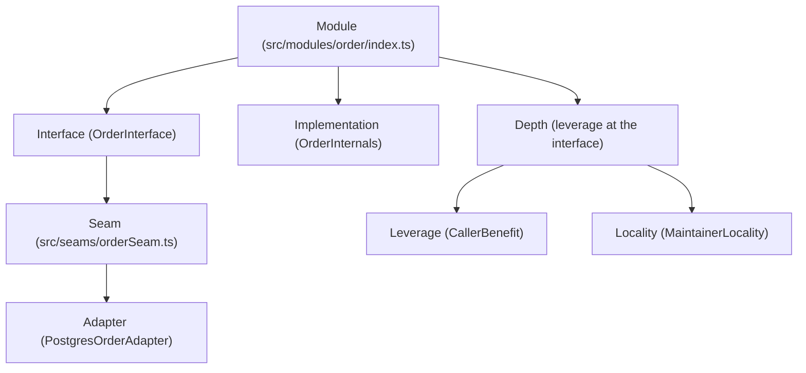
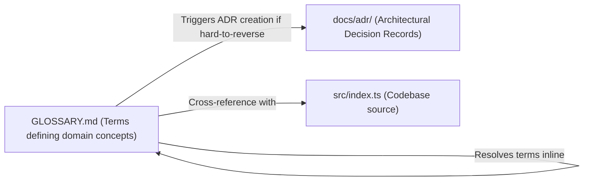
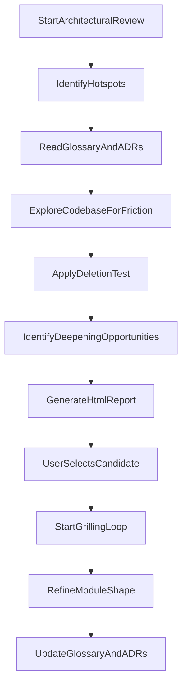
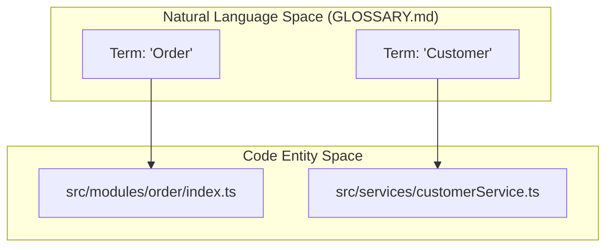
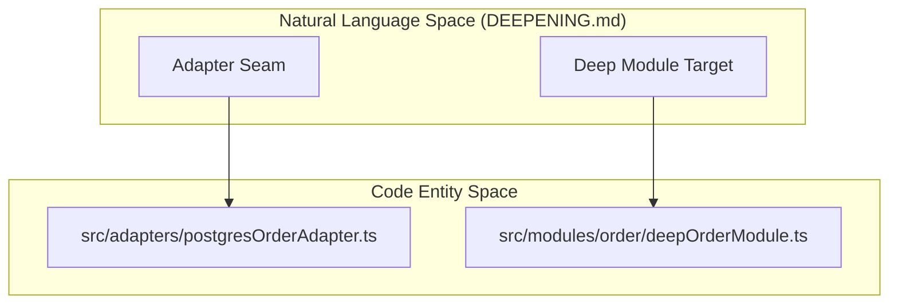

<!-- source: DeepWiki mcp.deepwiki.com · repo mattpocock/skills · page 5 Design Vocabulary and Codebase Health · fetched 2026-10-26 -->

# Design Vocabulary and Codebase Health

Relevant source files

The following files were used as context for generating this wiki page:

- [docs/engineering/codebase-design.md](docs/engineering/codebase-design.md)
- [docs/engineering/domain-modeling.md](docs/engineering/domain-modeling.md)

This page provides an overview of the foundational vocabulary and continuous refinement processes that underpin effective software engineering within this codebase. It introduces the core concepts from `codebase-design` and `domain-modeling` that establish a shared language for discussing architecture and domain concepts. It also outlines the `improve-codebase-architecture` skill, which drives the ongoing process of architectural refinement. These skills collectively ensure that the codebase remains healthy, maintainable, and aligned with its domain.

This page serves as a high-level introduction. For detailed information on each topic, please refer to the linked child pages.

---

## Design Vocabulary: The Foundation

A consistent and precise vocabulary is crucial for effective communication about software design. This codebase leverages two key skills to establish this vocabulary: `codebase-design` for architectural concepts and `domain-modeling` for domain-specific language.

### Codebase Design: Deep Modules and Seams

The `codebase-design` skill provides a precise vocabulary for discussing module shape and architectural principles. It defines terms like **module**, **interface**, **depth**, **seam**, **adapter**, **leverage**, and **locality**, explicitly banning vague substitutes like "component" or "service" [docs/engineering/codebase-design.md:2-3](). This skill is a reference that establishes a common language for design discussions, rather than a process that produces artifacts [docs/engineering/codebase-design.md:4-6]().

For details, see [Codebase Design: Deep Modules and Seams](#5.1).

> **Module Glossary and Relationships**

Sources: [docs/engineering/codebase-design.md:2-46]()

---

### Domain Modeling, GLOSSARY.md and ADRs

The `domain-modeling` skill focuses on building and sharpening a project's **ubiquitous language**. It actively challenges vague terms, forces precision, and stress-tests relationships with concrete scenarios [docs/engineering/domain-modeling.md:3-4](). This skill directly updates `GLOSSARY.md` with resolved terms and offers to create Architectural Decision Records (ADRs) under `docs/adr/` for significant architectural choices [docs/engineering/domain-modeling.md:5-6, 25-27]().

For details, see [Domain Modeling, GLOSSARY.md and ADRs](#5.2).

> **Domain Modeling Artifacts**

Sources: [docs/engineering/domain-modeling.md:3-66]()

---

## Continuous Architectural Refinement

Architectural health is not a one-time achievement but an ongoing process. The `improve-codebase-architecture` skill provides a structured approach to continuously identify and address architectural friction, leading to a more maintainable, testable, and AI-navigable codebase.

### Improving Codebase Architecture

The `improve-codebase-architecture` skill scans the codebase for **deepening opportunities**—places where shallow modules can be redesigned into deep modules, improving testability and modularity while clarifying domain boundaries [skills/engineering/improve-codebase-architecture/SKILL.md:9-9](). It leverages both the domain model (`GLOSSARY.md`) and the shared design vocabulary from `codebase-design` to inform exploration and refinement [skills/engineering/improve-codebase-architecture/SKILL.md:11-14]().

For details, see [Improving Codebase Architecture](#5.3).

> **Architectural Refinement Flow**

Sources: [skills/engineering/improve-codebase-architecture/SKILL.md:9-71]()

---

### Bridging Natural Language Space to Code Entities

To maintain architectural alignment, system design vocabulary bridges directly to concrete code paths and implementation entities.

> **Natural Language to Code Entity Mapping: Domain Concepts**

Sources: [docs/engineering/domain-modeling.md:3-66](), [docs/engineering/codebase-design.md:2-46]()

> **Natural Language to Code Entity Mapping: Architectural Refinement Seams**

Sources: [skills/engineering/improve-codebase-architecture/SKILL.md:9-71](), [docs/engineering/codebase-design.md:2-46]()

---

This page defines the essential vocabulary and process loop for maintaining a healthy codebase architecture. The skills introduced here underlie many other engineering skills by providing a shared language and continuous feedback mechanisms.

For full technical details, visit the child pages:
- [Codebase Design: Deep Modules and Seams](#5.1)
- [Domain Modeling, GLOSSARY.md and ADRs](#5.2)
- [Improving Codebase Architecture](#5.3)

---

