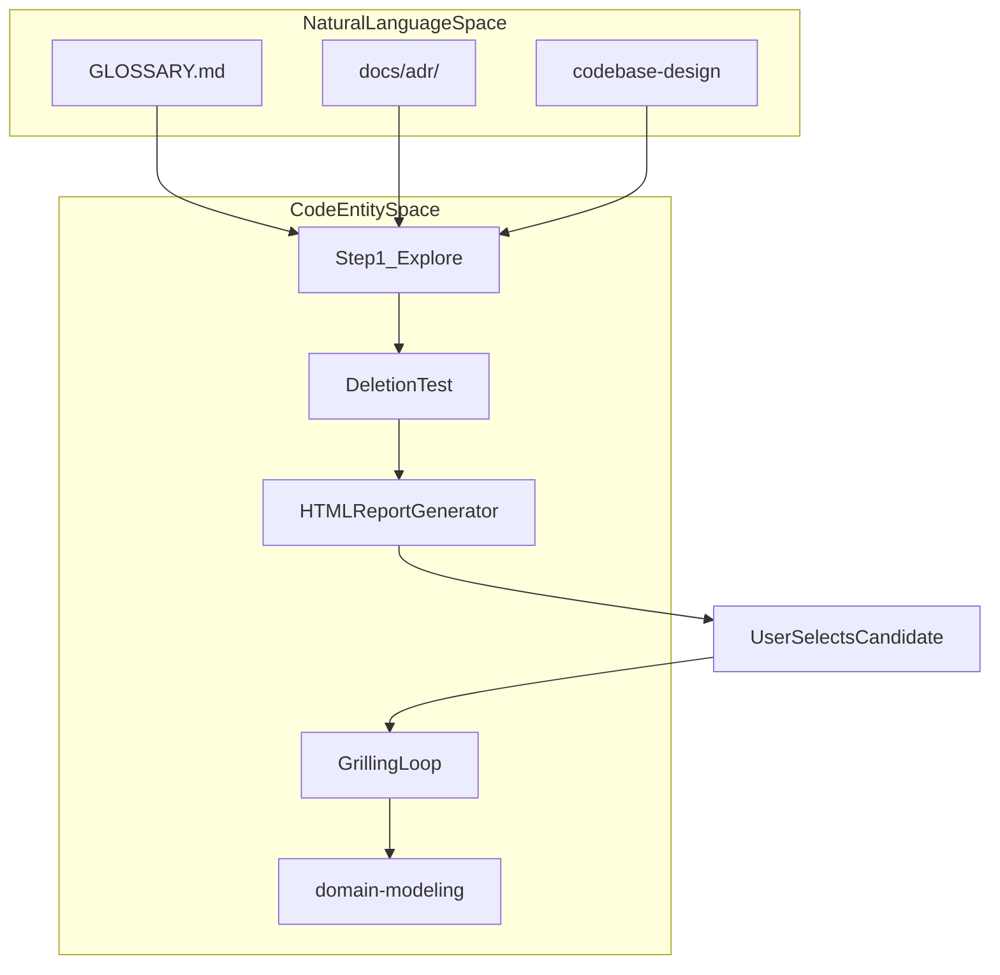
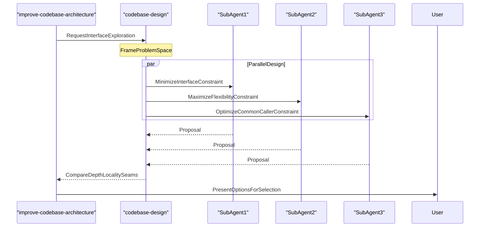

<!-- source: DeepWiki mcp.deepwiki.com · repo mattpocock/skills · page 5.3 Improving Codebase Architecture · fetched 2026-10-26 -->

# Improving Codebase Architecture

<details>
<summary>Relevant source files</summary>

The following files were used as context for generating this wiki page:

- [docs/engineering/improve-codebase-architecture.md](docs/engineering/improve-codebase-architecture.md)
- [skills/engineering/codebase-design/DESIGN-IT-TWICE.md](skills/engineering/codebase-design/DESIGN-IT-TWICE.md)
- [skills/engineering/improve-codebase-architecture/HTML-REPORT.md](skills/engineering/improve-codebase-architecture/HTML-REPORT.md)
- [skills/engineering/improve-codebase-architecture/SKILL.md](skills/engineering/improve-codebase-architecture/SKILL.md)

</details>


The `improve-codebase-architecture` skill surveys a codebase to surface architectural friction and propose **deepening opportunities**—refactoring efforts that transform shallow modules into deep ones [skills/engineering/improve-codebase-architecture/SKILL.md:7-9](). The primary goals are to increase testability and AI-navigability by ensuring that complex logic is encapsulated behind simple, high-leverage interfaces [skills/engineering/improve-codebase-architecture/SKILL.md:9-13]().

This skill operates within a specific philosophical framework: it favors **depth** (significant behavior behind a small interface) over **shallow** abstractions where the interface is nearly as complex as the implementation [docs/engineering/improve-codebase-architecture.md:35-37]().

### Architectural Vocabulary

To maintain consistency and avoid language drift, the skill uses a strict set of terms derived from `/codebase-design` [skills/engineering/improve-codebase-architecture/SKILL.md:13-14]().

| Term | Definition |
| :--- | :--- |
| **Module** | Anything with an interface and an implementation [skills/engineering/improve-codebase-architecture/HTML-REPORT.md:110](). |
| **Interface** | The surface area exposed to callers; ideally much smaller than the implementation [skills/engineering/improve-codebase-architecture/HTML-REPORT.md:87-88](). |
| **Depth** | A measure of how much functionality is hidden behind a small, stable interface [docs/engineering/improve-codebase-architecture.md:35-36](). |
| **Seam** | The public boundary where behavior is observed and tested [skills/engineering/improve-codebase-architecture/SKILL.md:13](). |
| **Adapter** | Implementations that justify a seam (e.g., "Two adapters justify the seam: HTTP in prod, in-memory in tests") [skills/engineering/improve-codebase-architecture/HTML-REPORT.md:119](). |
| **Leverage** | The benefit of a small interface exercising large internal complexity [skills/engineering/improve-codebase-architecture/HTML-REPORT.md:121](). |
| **Locality** | The concentration of bugs and logic in one module rather than leaking across seams [skills/engineering/improve-codebase-architecture/HTML-REPORT.md:121](). |

Sources: [skills/engineering/improve-codebase-architecture/SKILL.md:7-15](), [skills/engineering/improve-codebase-architecture/HTML-REPORT.md:107-123](), [docs/engineering/improve-codebase-architecture.md:35-37]()

---

### The Explore-Present-Grill Pipeline

The skill executes through a three-stage pipeline designed to identify valid refactoring candidates and stress-test their design [skills/engineering/improve-codebase-architecture/SKILL.md:16-71]().

#### 1. Explore (with YAGNI Scoping)
The agent walks the codebase organically to find friction points [skills/engineering/improve-codebase-architecture/SKILL.md:27-28](). To ensure the refactor provides actual value, it applies a **YAGNI scoping filter**: unless a specific path is provided, it walks back commit history via `git log --oneline` to find hot spots—files that change frequently [skills/engineering/improve-codebase-architecture/SKILL.md:18-24]().

It identifies friction points where understanding a concept requires bouncing between small modules, or where pure functions were extracted just for testability without **locality** [skills/engineering/improve-codebase-architecture/SKILL.md:29-33](). A key heuristic used here is the **Deletion Test**: if you delete the module, does complexity concentrate (signal of a shallow module) or just move around? [skills/engineering/improve-codebase-architecture/SKILL.md:35-36]().

#### 2. Present Candidates as an HTML Report
The agent generates a self-contained HTML report in the OS temp directory (resolved from `$TMPDIR`) using Tailwind and Mermaid via CDN [skills/engineering/improve-codebase-architecture/SKILL.md:39-41](). This report uses specific visualization patterns like **Mass Diagrams** (interface surface area vs implementation size) and **Call-graph collapse** [skills/engineering/improve-codebase-architecture/HTML-REPORT.md:86-93](). Each candidate includes a **Recommendation strength** badge: `Strong`, `Worth exploring`, or `Speculative` [skills/engineering/improve-codebase-architecture/SKILL.md:50]().

The report structure is defined in `HTML-REPORT.md` [skills/engineering/improve-codebase-architecture/HTML-REPORT.md:1-104](). Each candidate is rendered as an `<article>` with a title, badge row, files involved, before/after diagram, problem, solution, benefits, and an optional ADR callout [skills/engineering/improve-codebase-architecture/HTML-REPORT.md:44-54](). The report concludes with a **Top recommendation** section [skills/engineering/improve-codebase-architecture/SKILL.md:52]().

##### HTML Report Scaffold
```html
<!doctype html>
<html lang="en">
  <head>
    <meta charset="utf-8" />
    <title>Architecture review for {{repo name}}</title>
    <script src="https://cdn.tailwindcss.com"></script>
    <script type="module">
      import mermaid from "https://cdn.jsdelivr.net/npm/mermaid@11/dist/mermaid.esm.min.mjs";
      mermaid.initialize({ startOnLoad: true, theme: "neutral", securityLevel: "loose" });
    </script>
    <style>
      .seam { stroke-dasharray: 4 4; }
      .leak { stroke: #dc2626; }
      .deep { background: linear-gradient(135deg, #0f172a, #1e293b); }
    </style>
  </head>
  <body class="bg-stone-50 text-slate-900 font-sans">
    <main class="max-w-5xl mx-auto px-6 py-12 space-y-12">
      <header>...</header>
      <section id="candidates" class="space-y-10">...</section>
      <section id="top-recommendation">...</section>
    </main>
  </body>
</html>
```
Sources: [skills/engineering/improve-codebase-architecture/SKILL.md:39-58](), [skills/engineering/improve-codebase-architecture/HTML-REPORT.md:1-104]()

#### 3. Grilling Loop
Once a candidate is selected, the agent triggers the `grilling` skill to walk the decision tree [skills/engineering/improve-codebase-architecture/SKILL.md:63-64](). This process stress-tests constraints, the shape of the deepened module, and what tests will survive the refactor [skills/engineering/improve-codebase-architecture/SKILL.md:64-65]().

Title: Architecture Improvement Pipeline

Sources: [skills/engineering/improve-codebase-architecture/SKILL.md:18-71](), [docs/engineering/improve-codebase-architecture.md:3-8](), [skills/engineering/improve-codebase-architecture/HTML-REPORT.md:1-104]()

---

### Dependency Categories & Testing Strategy

When deepening a module, the report tags candidates by dependency category to determine the appropriate testing and seam strategy [skills/engineering/improve-codebase-architecture/HTML-REPORT.md:47-48]().

| Category | Description | Strategy |
| :--- | :--- | :--- |
| **in-process** | Pure logic or in-memory state. | Consolidate into the deep module; test through the public interface [skills/engineering/improve-codebase-architecture/HTML-REPORT.md:47](). |
| **local-substitutable** | Dependencies that can be replaced by local fakes. | Use fakes in tests to maintain a fast feedback loop [skills/engineering/improve-codebase-architecture/HTML-REPORT.md:47](). |
| **ports & adapters** | External dependencies that require an adapter for isolation. | Define a **seam** with a high-fidelity adapter [skills/engineering/improve-codebase-architecture/HTML-REPORT.md:47](). |
| **mock** | Dependencies that are mocked for testing. | Abstract behind an interface; use mocks to isolate the core logic [skills/engineering/improve-codebase-architecture/HTML-REPORT.md:47](). |

#### Testing Principles
- **The Interface is the Test Surface**: Move tests to the public interface so implementation details can change without breaking tests [docs/engineering/improve-codebase-architecture.md:36-37]().
- **Locality over Extraction**: Avoid extracting pure functions solely for testability if it destroys locality [skills/engineering/improve-codebase-architecture/SKILL.md:31-32]().
- **Two Adapters Rule**: One adapter represents a hypothetical seam; two adapters (Production and In-Memory) justify a real seam [skills/engineering/improve-codebase-architecture/SKILL.md:13]().

Sources: [skills/engineering/improve-codebase-architecture/SKILL.md:13-33](), [skills/engineering/improve-codebase-architecture/HTML-REPORT.md:47-53](), [docs/engineering/improve-codebase-architecture.md:35-37]()

---

### Interface Design: "Design It Twice"

If the user wants to explore alternative interfaces for a deepened module, the agent can run the `codebase-design` skill using its **design-it-twice** parallel sub-agent pattern [skills/engineering/improve-codebase-architecture/SKILL.md:71](). This follows the principle that the first design idea is rarely the best [skills/engineering/codebase-design/DESIGN-IT-TWICE.md:3]().

Title: Interface Design Parallel Execution

Sources: [skills/engineering/improve-codebase-architecture/SKILL.md:71](), [skills/engineering/codebase-design/DESIGN-IT-TWICE.md:1-44]()

---

### Integration with Knowledge Management

The `improve-codebase-architecture` skill is integrated with the repository's documentation system to ensure architectural improvements are both informed by and contribute to shared knowledge.

- **GLOSSARY.md**: The agent reads the domain glossary to use correct terminology [skills/engineering/improve-codebase-architecture/SKILL.md:25](). If a deepened module is named after a new concept, it is added to `GLOSSARY.md` [skills/engineering/improve-codebase-architecture/SKILL.md:68](). If a fuzzy term is sharpened during conversation, `GLOSSARY.md` is updated [skills/engineering/improve-codebase-architecture/SKILL.md:69]().
- **ADRs (Architecture Decision Records)**: The agent checks `docs/adr/` to avoid re-litigating past decisions [skills/engineering/improve-codebase-architecture/SKILL.md:25](). If a user rejects a candidate for a load-bearing reason, the agent offers to record it as an ADR to prevent future re-suggestions [skills/engineering/improve-codebase-architecture/SKILL.md:70]().
- **ADR Conflicts**: Candidates contradicting existing ADRs are only surfaced if friction is severe enough to justify revisiting the decision, marked with a warning callout in the report [skills/engineering/improve-codebase-architecture/SKILL.md:56-57]().

Sources: [skills/engineering/improve-codebase-architecture/SKILL.md:25-26](), [skills/engineering/improve-codebase-architecture/SKILL.md:56-57](), [skills/engineering/improve-codebase-architecture/SKILL.md:63-71]()

---

