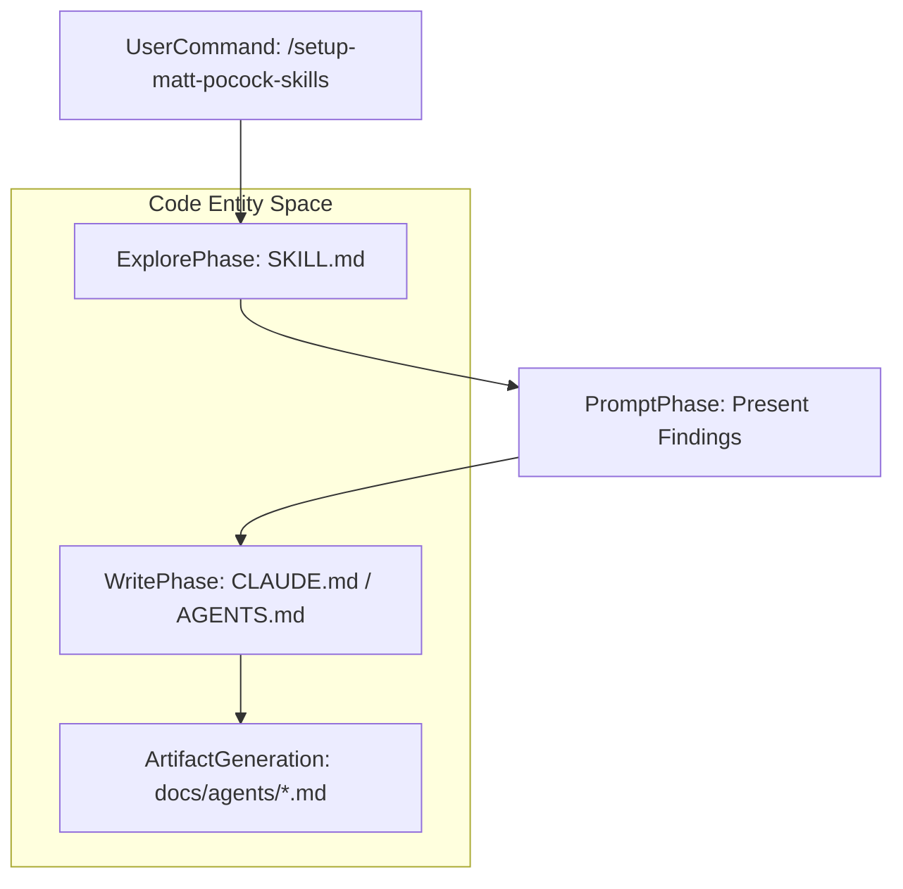
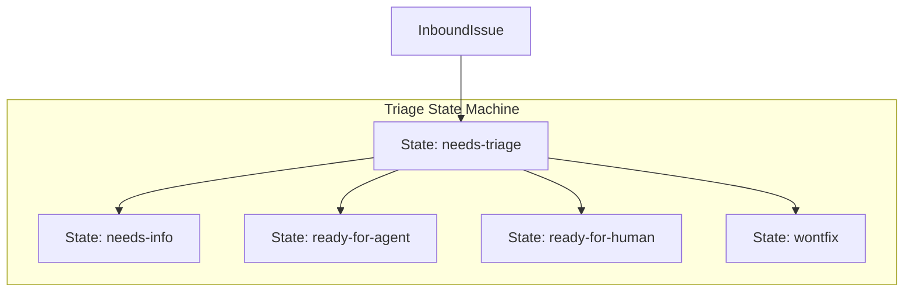

<!-- source: DeepWiki mcp.deepwiki.com · repo mattpocock/skills · page 6 Repository Setup and Work Intake · fetched 2026-10-26 -->

# Repository Setup and Work Intake

Relevant source files

The following files were used as context for generating this wiki page:

- [.changeset/setup-tracker-fixes.md](.changeset/setup-tracker-fixes.md)
- [skills/engineering/setup-matt-pocock-skills/SKILL.md](skills/engineering/setup-matt-pocock-skills/SKILL.md)
- [skills/engineering/setup-matt-pocock-skills/issue-tracker-gitlab.md](skills/engineering/setup-matt-pocock-skills/issue-tracker-gitlab.md)
- [skills/engineering/setup-matt-pocock-skills/issue-tracker-local.md](skills/engineering/setup-matt-pocock-skills/issue-tracker-local.md)
- [skills/engineering/setup-matt-pocock-skills/triage-labels.md](skills/engineering/setup-matt-pocock-skills/triage-labels.md)

This section provides an overview of the skills designed to configure a repository for the engineering workflow and manage inbound work: `setup-matt-pocock-skills`, issue tracker backends, triage, and the wizard script generator. 

For deep technical details, refer to the child pages:
- Repository Setup: See [Repository Setup (setup-matt-pocock-skills)](#6.1)
- Issue Trackers: See [Issue Tracker Backends](#6.2)
- Triage: See [Triage](#6.3)
- Wizard: See [Wizard: Scripting Human-Only Steps](#6.4)

---

## Repository Setup (setup-matt-pocock-skills)

The `setup-matt-pocock-skills` skill initializes a repository to integrate with the engineering skills suite [skills/engineering/setup-matt-pocock-skills/SKILL.md:2-4](). It executes an explore-present-confirm-write lifecycle to configure issue tracking backends, triage label vocabularies, and domain documentation layouts [skills/engineering/setup-matt-pocock-skills/SKILL.md:15-16]().

The initialization procedure writes an `## Agent skills` block into `CLAUDE.md` or `AGENTS.md` and generates configuration records under `docs/agents/` [skills/engineering/setup-matt-pocock-skills/SKILL.md:66-68](), including `triage-labels.md` [skills/engineering/setup-matt-pocock-skills/triage-labels.md:1-12]().

*Figure 1: Natural Language to Code Entity mapping for repository setup.*

Sources: [skills/engineering/setup-matt-pocock-skills/SKILL.md:2-16](), [skills/engineering/setup-matt-pocock-skills/SKILL.md:66-68](), [skills/engineering/setup-matt-pocock-skills/triage-labels.md:1-12]()

For details, see [Repository Setup (setup-matt-pocock-skills)](#6.1).

---

## Issue Tracker Backends

The workflow supports mainstream issue tracker backends, configured during the setup phase [skills/engineering/setup-matt-pocock-skills/SKILL.md:40-47](). The supported command surfaces include:
- **GitHub Issues**: Uses the `gh` CLI [skills/engineering/setup-matt-pocock-skills/SKILL.md:44]()
- **GitLab Issues**: Uses the `glab` CLI (`glab issue create`, `glab issue view`, etc.) [skills/engineering/setup-matt-pocock-skills/SKILL.md:45](), [skills/engineering/setup-matt-pocock-skills/issue-tracker-gitlab.md:3-13]()
- **Local Markdown**: Uses structured markdown files under `.scratch/<feature-slug>/` [skills/engineering/setup-matt-pocock-skills/SKILL.md:46](), [skills/engineering/setup-matt-pocock-skills/issue-tracker-local.md:3-11]()

Sources: [skills/engineering/setup-matt-pocock-skills/SKILL.md:40-47](), [skills/engineering/setup-matt-pocock-skills/issue-tracker-gitlab.md:3-13](), [skills/engineering/setup-matt-pocock-skills/issue-tracker-local.md:3-11]()

For details, see [Issue Tracker Backends](#6.2).

---

## Triage

The triage skill implements a state machine for processing inbound issues and external pull requests into explicit operational states and roles: `needs-triage`, `needs-info`, `ready-for-agent`, `ready-for-human`, and `wontfix` [skills/engineering/setup-matt-pocock-skills/triage-labels.md:5-11]().

*Figure 2: Triage lifecycle mapping.*

Sources: [skills/engineering/setup-matt-pocock-skills/triage-labels.md:5-11]()

For details, see [Triage](#6.3).

---

## Wizard: Scripting Human-Only Steps

The `wizard` skill generates interactive bash scripts from templates (`template.sh`) to execute manual procedures that require human intervention (e.g., third-party dashboard updates or credential provisioning). It orchestrates helper functions, tracks progress via `TOTAL_STAGES`, and includes fallbacks for CLI operations.

Sources: [skills/engineering/setup-matt-pocock-skills/SKILL.md:1-118]()

For details, see [Wizard: Scripting Human-Only Steps](#6.4).

---

