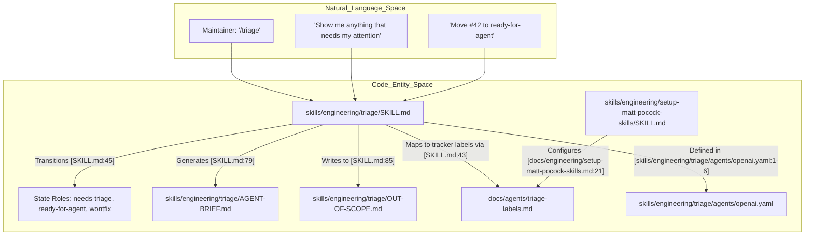
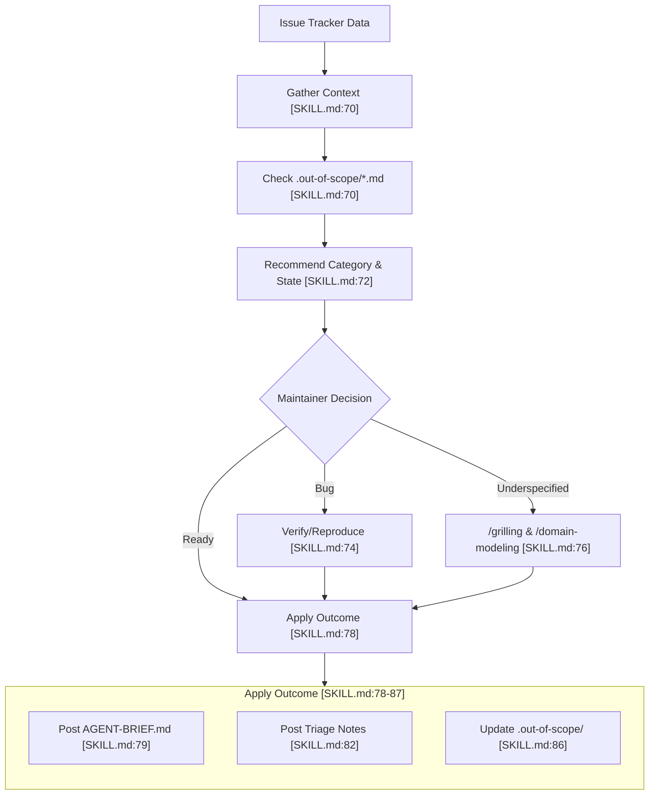

<!-- source: DeepWiki mcp.deepwiki.com · repo mattpocock/skills · page 6.3 Triage · fetched 2026-10-26 -->

# Triage

Relevant source files

The following files were used as context for generating this wiki page:

- [.changeset/github-tracker-external-pr-list.md](.changeset/github-tracker-external-pr-list.md)
- [docs/engineering/triage.md](docs/engineering/triage.md)
- [docs/engineering/wayfinder.md](docs/engineering/wayfinder.md)
- [skills/engineering/setup-matt-pocock-skills/domain.md](skills/engineering/setup-matt-pocock-skills/domain.md)
- [skills/engineering/setup-matt-pocock-skills/issue-tracker-github.md](skills/engineering/setup-matt-pocock-skills/issue-tracker-github.md)
- [skills/engineering/triage/AGENT-BRIEF.md](skills/engineering/triage/AGENT-BRIEF.md)
- [skills/engineering/triage/OUT-OF-SCOPE.md](skills/engineering/triage/OUT-OF-SCOPE.md)
- [skills/engineering/triage/SKILL.md](skills/engineering/triage/SKILL.md)
- [skills/engineering/wayfinder/SKILL.md](skills/engineering/wayfinder/SKILL.md)

The `triage` skill implements a state-machine approach to managing project issues and external pull requests. It is designed to move items from an initial unknown state into actionable buckets, specifically preparing them for autonomous agents or identifying them as out-of-scope for the project.

## Triage State Machine

The workflow transitions issues through a set of canonical "state roles" and "category roles". While the actual label strings in a repository may vary based on configuration (mapped via `/setup-matt-pocock-skills`), the logic relies on these internal definitions [skills/engineering/triage/SKILL.md:43-44]().

### Triage Roles

| Role Type | Name | Description |
| :--- | :--- | :--- |
| **Category** | `bug` | Something in the system is broken or malfunctioning [skills/engineering/triage/SKILL.md:28-28](). |
| **Category** | `enhancement` | A request for a new feature or improvement [skills/engineering/triage/SKILL.md:29-29](). |
| **State** | `needs-triage` | The default starting state; requires maintainer evaluation [skills/engineering/triage/SKILL.md:33-33](). |
| **State** | `needs-info` | Blocked waiting for the reporter to provide more details [skills/engineering/triage/SKILL.md:34-34](). |
| **State** | `ready-for-agent` | Fully specified and ready for an autonomous AI agent to implement [skills/engineering/triage/SKILL.md:35-35](). |
| **State** | `ready-for-human` | Requires human intervention (e.g., judgment calls, external access, design decisions, manual testing) [skills/engineering/triage/SKILL.md:36-36](). |
| **State** | `wontfix` | The issue will not be actioned [skills/engineering/triage/SKILL.md:37-37](). |

Every triaged issue must carry exactly one category role and one state role [skills/engineering/triage/SKILL.md:41-41](). For Pull Requests, `ready-for-agent` signifies that an agent should take the next step on the existing diff; `ready-for-human` means it's ready for a human to merge [skills/engineering/triage/SKILL.md:39-40]().

### State Transitions

An unlabeled issue typically enters at `needs-triage`. From there, it follows a directed path:
- `needs-triage` → `needs-info`, `ready-for-agent`, `ready-for-human`, or `wontfix` [skills/engineering/triage/SKILL.md:45-45]().
- `needs-info` returns to `needs-triage` once the reporter replies [skills/engineering/triage/SKILL.md:45-45]().
- The maintainer can override transitions at any time [skills/engineering/triage/SKILL.md:45-45]().

Sources: [skills/engineering/triage/SKILL.md:24-46](), [docs/engineering/triage.md:27-39]()

## The Three-Bucket Attention View

When a maintainer invokes `/triage` to see what needs attention, the system queries the issue tracker and organizes results into three priority buckets, sorted oldest first [skills/engineering/triage/SKILL.md:58-59]():

1.  **Unlabeled:** Issues that have never been triaged [skills/engineering/triage/SKILL.md:60-60]().
2.  **`needs-triage`:** Issues where evaluation is currently in progress [skills/engineering/triage/SKILL.md:61-61]().
3.  **`needs-info` (Active):** Issues where the reporter has replied since the last triage notes were posted [skills/engineering/triage/SKILL.md:62-62]().

The system includes external PRs in these buckets (marked with `[PR]`) while ignoring collaborator PRs [skills/engineering/triage/SKILL.md:64-64]().

Sources: [skills/engineering/triage/SKILL.md:48-67](), [docs/engineering/triage.md:59-64]()

## Triage Pipeline: Grill-then-Brief

Triaging a specific issue follows a structured pipeline to ensure high-quality specifications.

### 1. Context Gathering & Out-of-Scope Check
The agent reads the full issue or PR (body, comments, labels, author, dates; for a PR, the diff too) [skills/engineering/triage/SKILL.md:70-70](). It performs two codebase checks:
- **Redundancy:** Searching for existing implementations of the requested behavior by domain concept, reporting where it looked. If found, it's an already-implemented `wontfix` [skills/engineering/triage/SKILL.md:70-70]().
- **Prior Rejection:** Reading `.out-of-scope/*.md` and surfacing any that resembles this request [skills/engineering/triage/SKILL.md:70-71](), [skills/engineering/triage/OUT-OF-SCOPE.md:72-76]().

### 2. Recommendation
The agent tells the maintainer its category and state recommendation with reasoning, plus a brief codebase summary relevant to the request (including whether it's already implemented) [skills/engineering/triage/SKILL.md:72-72]().

### 3. Verification
Before any grilling, the agent checks that the claim holds up. For a bug, it reproduces it from the reporter's steps. For a PR, it confirms the diff does what it claims by checking it out and running relevant tests or commands [skills/engineering/triage/SKILL.md:74-75]().

### 4. Grilling
If the request needs fleshing out, the agent calls the `grilling` and `domain-modeling` skills to sharpen domain terms and update `GLOSSARY.md`/ADRs inline as decisions land [skills/engineering/triage/SKILL.md:76-77](). The `domain-modeling` skill creates `GLOSSARY.md` and ADRs lazily when terms or decisions are resolved [skills/engineering/setup-matt-pocock-skills/domain.md:10-12]().

### 5. Application of Outcome
Depending on the final state, the agent performs specific actions:
- **`ready-for-agent`**: Posts an agent brief comment formatted according to [AGENT-BRIEF.md](AGENT-BRIEF.md) [skills/engineering/triage/SKILL.md:79-79]().
- **`ready-for-human`**: Posts a brief with the same structure as an agent brief, but notes why it can't be delegated (judgment calls, external access, design decisions, manual testing) [skills/engineering/triage/SKILL.md:80-81]().
- **`needs-info`**: Posts triage notes using a specific template to establish "What we've established so far" vs. "What we still need from you" [skills/engineering/triage/SKILL.md:82-82](), [skills/engineering/triage/SKILL.md:92-108]().
- **`wontfix`**: Closes the issue.
    - If **already implemented**: points to where it lives; does not write to `.out-of-scope/` [skills/engineering/triage/SKILL.md:83-84]().
    - If **rejected (bug)**: gives a polite explanation, then closes [skills/engineering/triage/SKILL.md:85-85]().
    - If **rejected (enhancement)**: writes to `.out-of-scope/`, links to it from a comment, then closes [skills/engineering/triage/SKILL.md:86-86](), [skills/engineering/triage/OUT-OF-SCOPE.md:90-97]().
- **`needs-triage`**: Applies the role, with an optional comment if there's partial progress [skills/engineering/triage/SKILL.md:87-87]().

Sources: [skills/engineering/triage/SKILL.md:68-108](), [skills/engineering/triage/OUT-OF-SCOPE.md:70-97](), [docs/engineering/triage.md:51-58](), [skills/engineering/setup-matt-pocock-skills/domain.md:10-12]()

## Agent Briefs (AGENT-BRIEF.md)

An agent brief is the authoritative contract for an AFK (Away From Keyboard) agent, posted as a structured comment on a GitHub issue or PR when it moves to `ready-for-agent` [skills/engineering/triage/AGENT-BRIEF.md:3-3]().

### Design Principles
- **Durability:** Avoid file paths or line numbers that may go stale. Reference types, function signatures, and behavioral contracts instead [skills/engineering/triage/AGENT-BRIEF.md:9-18]().
- **Behavioral:** Describe *what* the system should do, not *how* to code it [skills/engineering/triage/AGENT-BRIEF.md:19-27]().
- **Complete Acceptance Criteria:** Provide concrete, testable checkboxes so the agent knows when it's done [skills/engineering/triage/AGENT-BRIEF.md:28-34]().
- **Explicit Scope Boundaries:** State what is out of scope to prevent gold-plating [skills/engineering/triage/AGENT-BRIEF.md:35-38]().

### Brief Structure
The brief follows a mandatory template [skills/engineering/triage/AGENT-BRIEF.md:41-68]():
- **Category:** `bug` / `enhancement`.
- **Summary:** One-line description of what needs to happen.
- **Current behavior:** Describes what happens now. For bugs, this is the broken behavior. For enhancements, this is the status quo the feature builds on.
- **Desired behavior:** Describes what should happen after the agent's work is complete.
- **Key interfaces:** Specific types, function signatures, or config shapes that the agent should look for or modify.
- **Acceptance criteria:** Specific, testable criteria.
- **Out of scope:** Things that should NOT be changed or addressed.

Sources: [skills/engineering/triage/AGENT-BRIEF.md:1-105](), [docs/engineering/triage.md:57-58]()

## The .out-of-scope/ Documentation System

To maintain institutional memory, rejected feature requests are documented in the `.out-of-scope/` directory [skills/engineering/triage/OUT-OF-SCOPE.md:3-7]().

### Implementation Details
- **File per Concept:** Files use short, descriptive kebab-case concept names (e.g., `dark-mode.md`), not issue numbers [skills/engineering/triage/OUT-OF-SCOPE.md:17-17](), [skills/engineering/triage/OUT-OF-SCOPE.md:57-58]().
- **Deduplication:** If a new issue matches an existing concept, the agent appends the new issue to the "Prior requests" list in the existing file [skills/engineering/triage/OUT-OF-SCOPE.md:93-94]().
- **Substantive Reasoning:** Documentation must explain *why* (e.g., project scope, technical constraints, strategic decisions) rather than just "we don't want this" [skills/engineering/triage/OUT-OF-SCOPE.md:60-68]().
- **Transition Logic:** Only **enhancements** (not bugs) that are rejected as `wontfix` are added to this system [skills/engineering/triage/OUT-OF-SCOPE.md:84-86](). Already-implemented features are pointed to directly and not recorded here, as recording them would "poison the dedup checks with false rejections" [skills/engineering/triage/OUT-OF-SCOPE.md:88-88]().

Sources: [skills/engineering/triage/OUT-OF-SCOPE.md:1-105](), [docs/engineering/triage.md:41-50]()

## System Architecture Diagrams

### Triage Skill Entity Mapping
This diagram maps natural language triage operations to code entities.

Sources: [skills/engineering/triage/SKILL.md:2-45](), [skills/engineering/triage/AGENT-BRIEF.md:41-68](), [skills/engineering/triage/OUT-OF-SCOPE.md:8-15](), [docs/engineering/setup-matt-pocock-skills.md:21](), [skills/engineering/triage/agents/openai.yaml:1-5]()

### Data Flow for Issue Processing
This diagram details the execution pathway from issue parsing to outcome application.

Sources: [skills/engineering/triage/SKILL.md:68-108](), [skills/engineering/triage/OUT-OF-SCOPE.md:70-97](), [skills/engineering/triage/AGENT-BRIEF.md:41-68]()

---

