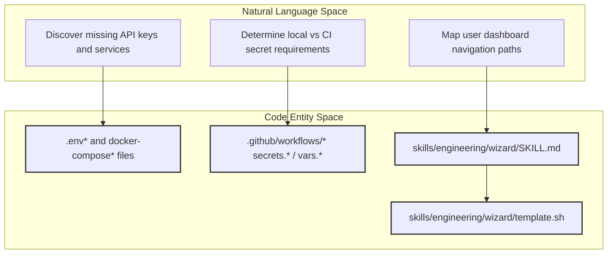
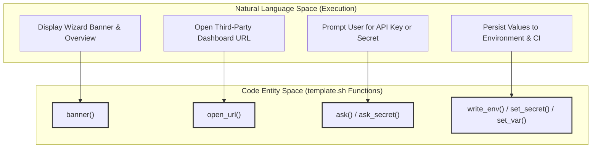
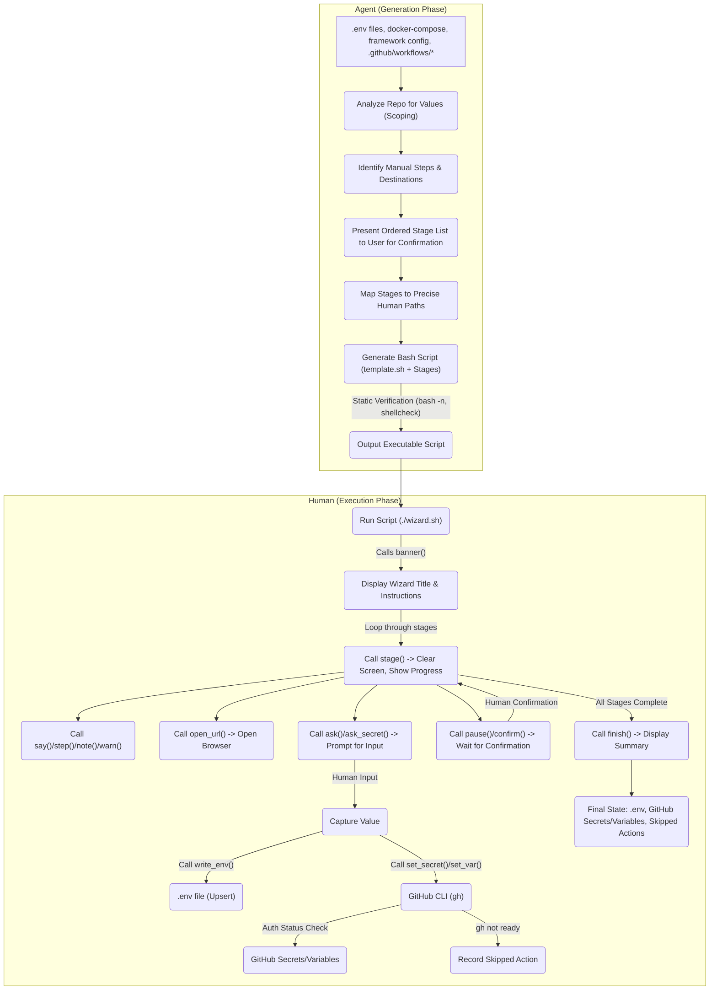

<!-- source: DeepWiki mcp.deepwiki.com · repo mattpocock/skills · page 6.4 Wizard: Scripting Human-Only Steps · fetched 2026-10-26 -->

# Wizard: Scripting Human-Only Steps

Relevant source files

The following files were used as context for generating this wiki page:

- [.changeset/wizard-template-fixes-2.md](.changeset/wizard-template-fixes-2.md)
- [.changeset/wizard-template-fixes.md](.changeset/wizard-template-fixes.md)
- [docs/engineering/wizard.md](docs/engineering/wizard.md)
- [skills/engineering/wizard/SKILL.md](skills/engineering/wizard/SKILL.md)
- [skills/engineering/wizard/agents/openai.yaml](skills/engineering/wizard/agents/openai.yaml)
- [skills/engineering/wizard/template.sh](skills/engineering/wizard/template.sh)

This page documents the `wizard` skill, which generates interactive bash scripts for manual procedures [docs/engineering/wizard.md:1-3]().

## Purpose and Scope

The `wizard` skill generates an interactive bash script that guides a human, step by step, through manual procedures that cannot be automated by an agent. This includes tasks like configuring third-party services, performing one-off migrations, or transitioning a project between states [docs/engineering/wizard.md:1-3](). The generated script acts as a program that drives the procedure and maintains state, with the human's role being to click, paste, and confirm actions [docs/engineering/wizard.md:5-6]().

The skill is designed to be invoked when a manual step, such as interacting with a third-party dashboard or handling credentials, blocks further automated progress [docs/engineering/wizard.md:9-9](). It prevents instructions from being lost in chat history by providing an executable, state-aware script [docs/engineering/wizard.md:9-9]().

Sources: [docs/engineering/wizard.md:1-6](), [docs/engineering/wizard.md:9-9]()

## When to Use the Wizard

The `wizard` skill is appropriate for situations where a human must perform actions that an automated agent cannot, such as:

*   **Initial Setup**: Configuring multiple third-party services for a new development environment, capturing API keys, and writing them to `.env` files and CI secrets [docs/engineering/wizard.md:13-14]().
*   **One-off Migrations**: Sequencing irreversible steps for a migration behind confirmation gates [docs/engineering/wizard.md:15-16]().
*   **Project Transitions**: Guiding a project through a one-time state change and reporting any uncompleted actions [docs/engineering/wizard.md:17-18]().
*   **Executable Documentation**: Replacing static README instructions with an executable script that is less prone to becoming outdated [docs/engineering/wizard.md:18-19]().

It is not intended for decision-making; for that, skills like `/grill-with-docs` and `/to-spec` are more suitable [docs/engineering/wizard.md:20-20]().

Sources: [docs/engineering/wizard.md:13-20]()

## Prerequisites

No specific prerequisites are needed to generate a wizard script. The generated script itself runs on `bash` and uses the `gh` CLI for GitHub secret and variable management. If `gh` is missing or unauthenticated, the relevant stages will be skipped with a warning, and the closing summary will instruct the user on manual steps [docs/engineering/wizard.md:23-24]().

Sources: [docs/engineering/wizard.md:23-24]()

## Stages and Scoping

A **stage** represents a single, focused task on one screen. The script clears the terminal between stages to ensure only the current step is visible [docs/engineering/wizard.md:28-28](). The author defines stages in dependency order and sets `TOTAL_STAGES` to drive the progress display [docs/engineering/wizard.md:28-29]().

Before script generation, the skill performs scoping by analyzing repository files such as `.env*`, `docker-compose*`, framework configurations, and `secrets.*`/`vars.*` references in `.github/workflows/` [docs/engineering/wizard.md:30-31](). This analysis identifies values the wizard needs to produce. The agent then presents an ordered stage list for user confirmation and maps each stage to a precise human-followable path (e.g., "Dashboard → Developers → API keys → Reveal test key → copy") [docs/engineering/wizard.md:30-31](). If the current UI is unknown, the agent will ask the user or consult documentation rather than inventing steps [docs/engineering/wizard.md:30-31]().

For each captured value, scoping determines its destination:

| Destination | When |
| :---------- | :--- |
| `.env` only | Local development needs it, CI does not [docs/engineering/wizard.md:35-35]() |
| GitHub secret | CI needs it, and it is sensitive [docs/engineering/wizard.md:36-36]() |
| GitHub variable | CI needs it, and it is public [docs/engineering/wizard.md:37-37]() |
| Both `.env` and a secret | Both local development and CI require it [docs/engineering/wizard.md:38-38]() |
| Nowhere | The stage is a pure action (e.g., flipping a switch, upgrading a plan) [docs/engineering/wizard.md:39-39]()

Sources: [docs/engineering/wizard.md:28-39]()

## Template and Library Functions

The `template.sh` file [skills/engineering/wizard/template.sh]() provides a consistent user experience across all generated wizard scripts. This template includes features like progress display, confirmation gates, cross-platform URL opening, hidden input for secrets, idempotent `.env` updates, `gh secret`/`gh variable` writes, and a closing summary [docs/engineering/wizard.md:43-44](). The section above the `STAGES` marker in `template.sh` is a fixed library and should not be hand-edited [skills/engineering/wizard/template.sh:6-8](). The agent's role is to scope the procedure and author the stages below this marker [docs/engineering/wizard.md:44-45]().

The agent verifies the generated script statically using `bash -n` and `shellcheck`, and traces that all values land in their intended destinations, with `set_secret` names matching CI references [docs/engineering/wizard.md:46-47](). The first execution of a wizard script serves as its test run [docs/engineering/wizard.md:47-47]().

### Key Library Functions

The `template.sh` provides several utility functions for authoring stages:

| Function | Description | Source |
| :------- | :---------- | :----- |
| `banner "Title"` | Displays an opening frame with the wizard's title and a general description of its purpose [skills/engineering/wizard/template.sh:39-47](). | [skills/engineering/wizard/template.sh:39-47]() |
| `stage "Name"` | Clears the screen, announces the current stage, and shows progress (e.g., "Stage 1/5") [skills/engineering/wizard/template.sh:51-56](). | [skills/engineering/wizard/template.sh:51-56]() |
| `say "..."` | Prints a plain instruction line [skills/engineering/wizard/template.sh:59-59](). | [skills/engineering/wizard/template.sh:59-59]() |
| `step "..."` | Prints a numbered-feeling action for the human to take in the browser [skills/engineering/wizard/template.sh:61-61](). | [skills/engineering/wizard/template.sh:61-61]() |
| `note "..."` | Prints a dimmed note [skills/engineering/wizard/template.sh:62-62](). | [skills/engineering/wizard/template.sh:62-62]() |
| `warn "..."` | Prints a warning message [skills/engineering/wizard/template.sh:63-63](). | [skills/engineering/wizard/template.sh:63-63]() |
| `open_url URL` | Opens the specified URL in the human's browser, with cross-platform support (including WSL) [skills/engineering/wizard/template.sh:66-75](). | [skills/engineering/wizard/template.sh:66-75]() |
| `pause "msg"` | Waits for the human to press Enter, confirming they have completed a manual step [skills/engineering/wizard/template.sh:78-81](). | [skills/engineering/wizard/template.sh:78-81]() |
| `confirm "question"` | Presents a `y/N` prompt, returning success on 'y' [skills/engineering/wizard/template.sh:84-89](). | [skills/engineering/wizard/template.sh:84-89]() |
| `ask KEY "Prompt"` | Prompts for a value, storing it in the shell variable `KEY`. If `KEY` already exists in `.env`, its value is offered as a default [skills/engineering/wizard/template.sh:109-119](). | [skills/engineering/wizard/template.sh:109-119]() |
| `ask_secret KEY "Prompt"` | Similar to `ask`, but input is hidden (e.g., for passwords or API keys) [skills/engineering/wizard/template.sh:122-135](). | [skills/engineering/wizard/template.sh:122-135]() |
| `write_env KEY VALUE` | Upserts `KEY=VALUE` into the `.env` file. It creates the file if it doesn't exist and replaces any existing line for `KEY`. This operation is idempotent [skills/engineering/wizard/template.sh:140-151](). | [skills/engineering/wizard/template.sh:140-151]() |
| `set_secret NAME VALUE` | Sets a GitHub Actions repository secret using the `gh` CLI. If `gh` is unavailable or unauthenticated, it falls back to a warning and records the skipped action [skills/engineering/wizard/template.sh:155-166](). | [skills/engineering/wizard/template.sh:155-166]() |
| `set_var NAME VALUE` | Sets a GitHub Actions repository variable (non-secret) using the `gh` CLI. Similar fallback behavior to `set_secret` [skills/engineering/wizard/template.sh:169-178](). | [skills/engineering/wizard/template.sh:169-178]() |

The `TOTAL_STAGES` variable, set by the author at the top of the stages section, drives the progress display [skills/engineering/wizard/template.sh:23-23]().

Sources: [docs/engineering/wizard.md:43-47](), [skills/engineering/wizard/template.sh:6-8](), [skills/engineering/wizard/template.sh:23-178]()

## Natural Language Space to Code Entity Space: Scoping & Generation

The following diagram bridges the natural language requirements gathered during the repository scoping phase with the concrete code structures and analysis targets utilized by the agent.

Diagram: Natural Language Space to Scoping Code Entities

Sources: [docs/engineering/wizard.md:30-31](), [skills/engineering/wizard/SKILL.md:18-20]()

## Natural Language Space to Code Entity Space: Execution & Runtime

This diagram maps the human execution steps (Natural Language Space) directly to the underlying bash functions defined in `template.sh` (Code Entity Space).

Diagram: Natural Language Space to Execution Code Entities

Sources: [skills/engineering/wizard/template.sh:39-178]()

## Wizard Generation and Execution Flow

The following diagram illustrates the process of generating and executing a wizard script, highlighting the interaction between the agent, the generated script, and the human user.

**Wizard Skill Data Flow**

Sources: [docs/engineering/wizard.md:30-39](), [skills/engineering/wizard/SKILL.md:16-44](), [skills/engineering/wizard/template.sh:11-178]()

## Ephemeral by Default

Wizard scripts are ephemeral by design. For one-off tasks like migrations or personal setups, the script can be saved to a scratch or `scripts/` path, run, and then deleted [docs/engineering/wizard.md:50-52](). If the setup path is repeatable and will be needed by others, it should be committed to the repository and linked from the `README` to ensure consistency and prevent re-asking the agent [docs/engineering/wizard.md:53-54]().

Sources: [docs/engineering/wizard.md:50-54]()

## Common Questions

*   **Do my API keys end up in the model's context?**
    No. The agent generates the script; it doesn't run it. The script captures keys with hidden terminal entry and writes them directly to `.env` or `gh secret`. The model is not connected to the CLI. However, if a key is pasted into the chat during the scoping phase, it will be in the model's context like any other text [docs/engineering/wizard.md:57-60]().

*   **Can I go back and fix a value I mistyped?**
    Not mid-run. The stages proceed forward. A mistake requires stopping the script (Ctrl-C) and re-running it. Re-running is designed to be cheap: any values already written to `.env` are offered as defaults, allowing the user to quickly advance through correct stages and retype only the incorrect one [docs/engineering/wizard.md:61-63](). There is a known issue where arrow keys in `ask` prompts insert control characters instead of moving the cursor, due to `read -r` being used instead of Readline [docs/engineering/wizard.md:64-65](). Backspace works, so users should delete back to the mistake [docs/engineering/wizard.md:65-66]().

*   **Does it know what I've already set up?**
    Partially. The wizard reads the repository's `.env` files, `docker-compose`, framework config, and CI `secrets.*` references to scope for genuinely missing values [docs/engineering/wizard.md:67-69](). It does not, however, check the state of third-party services. If a key exists in `.env`, it will be offered as a default; if you already created the Stripe account but never saved the key, the wizard still sends you to the dashboard for it [docs/engineering/wizard.md:69-70]().

*   **Where does it sit in the workflow, after grilling and the spec?**
    The `wizard` skill is standalone and not a fixed step in a chain like `/grill-with-docs → /to-spec → /wizard`. Its trigger is the need for a manual procedure, which can arise at any point in a project's lifecycle. It can also serve as a discovery tool, surfacing hidden prerequisites (e.g., API keys) before committing to work [docs/engineering/wizard.md:71-74]().

Sources: [docs/engineering/wizard.md:57-74]()

---

