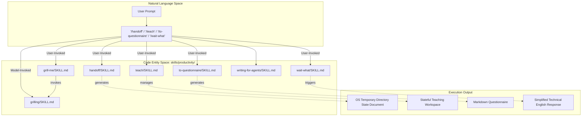

<!-- source: DeepWiki mcp.deepwiki.com · repo mattpocock/skills · page 7 Productivity Skills · fetched 2026-10-26 -->

# Productivity Skills

Relevant source files

The following files were used as context for generating this wiki page:

- [skills/productivity/README.md](skills/productivity/README.md)
- [skills/productivity/writing-for-agents/SKILL-MECHANICS.md](skills/productivity/writing-for-agents/SKILL-MECHANICS.md)
- [skills/productivity/writing-for-agents/agents/openai.yaml](skills/productivity/writing-for-agents/agents/openai.yaml)

The **Productivity** category consists of general-purpose workflow tools that are not specific to any particular programming language or codebase [skills/productivity/README.md:1-3](). These skills optimize the interaction between the user and the agent by compressing communication, managing session state, stress-testing ideas, and formalizing the creation of new capabilities.

## High-Level Workflow Overview

Productivity skills serve as the connective tissue of an agentic workflow. They divide broadly into **user-invoked** skills (reachable only when explicitly typed, with `disable-model-invocation: true` or `policy.allow_implicit_invocation: false`) and **model-invoked** skills (equipped with rich trigger descriptions so the model or other skills can reach them) [skills/productivity/README.md:5-17]().

### Communication and State Management
- **handoff**: Compacts the current conversation into a handoff document in the OS temp directory so another agent can continue the work [skills/productivity/README.md:10]().
- **wait-what**: Fired the moment a message doesn't land; the agent re-pitches it in plain English using `GLOSSARY.md` vocabulary [skills/productivity/README.md:13]().
- **teach**: Teaches the user a new skill or concept over multiple sessions, using the current directory as a stateful teaching workspace [skills/productivity/README.md:11]().
- **to-questionnaire**: Turns a decision you cannot answer alone into a structured async questionnaire [skills/productivity/README.md:12]().

### Planning and Skill Development
- **grill-me**: A user-invoked relentless interview process to resolve design trees [skills/productivity/README.md:9]().
- **grilling**: The model-invoked interview skill to stress-test plans and ideas [skills/productivity/README.md:19]().
- **writing-for-agents**: Reference documentation and mechanics for writing agent-consumed documents [skills/productivity/README.md:20](), [skills/productivity/writing-for-agents/SKILL-MECHANICS.md:1-3]().

### Mapping Productivity Skills to Code Entities

The following diagram illustrates how productivity skills are represented as discrete directories containing `SKILL.md` files and how they bridge natural language input to execution outputs.

**Productivity Skill Architecture**

Sources: [skills/productivity/README.md:1-20](), [skills/productivity/writing-for-agents/SKILL-MECHANICS.md:1-22]()

---

## 7.1 [Handoff](#7.1)

The `handoff` skill is a user-invoked tool used to transition work between agent sessions [skills/productivity/README.md:10](). It compacts the current conversation into a portable state document saved to the OS temporary directory so a fresh session or different harness can resume work.

It includes a suggested-skills section naming the exact skills the next agent should call, and explicitly avoids duplicating content already captured in other artifacts by referencing them by path instead. This differs from `/compact`, which is used strictly for in-session summarization.

For details, see [Handoff](#7.1).

Sources: [skills/productivity/README.md:1-20]()

---

## 7.2 [Teach](#7.2)

The `teach` skill provides a stateful teaching workspace for multi-session learning [skills/productivity/README.md:11](). It utilizes workspace files such as `MISSION.md`, `GLOSSARY.md`, `RESOURCES.md`, and learning records to guide the user through new concepts, adapting to their zone of proximal development across multiple sessions.

For details, see [Teach](#7.2).

Sources: [skills/productivity/README.md:1-20]()

---

## 7.3 [To-Questionnaire and Wait-What](#7.3)

These skills address communication breakdowns and async decision-making.

### To-Questionnaire
The `to-questionnaire` skill turns a decision you cannot answer alone into a structured Markdown questionnaire for async completion or meeting-based resolution [skills/productivity/README.md:12]().

### Wait-What
The `wait-what` skill is a recovery mechanism fired the moment a message doesn't land [skills/productivity/README.md:13](). The agent re-pitches the concept in plain English using `GLOSSARY.md` vocabulary and ASD-STE100 principles [skills/productivity/README.md:13]().

For details, see [To-Questionnaire and Wait-What](#7.3).

Sources: [skills/productivity/README.md:1-20](), [skills/productivity/writing-for-agents/SKILL-MECHANICS.md:1-22]()

---

