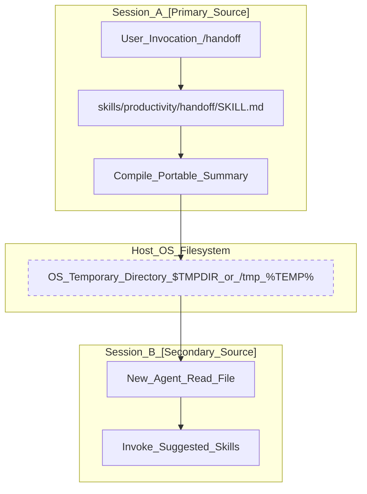
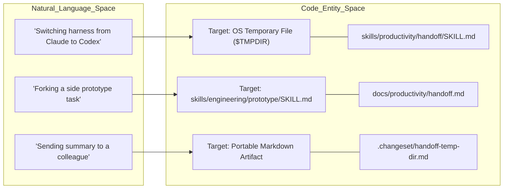
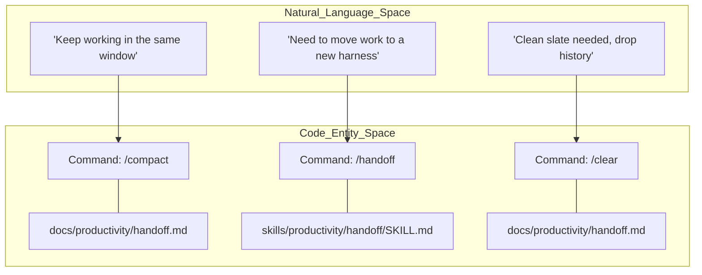

<!-- source: DeepWiki mcp.deepwiki.com · repo mattpocock/skills · page 7.1 Handoff · fetched 2026-10-26 -->

# Handoff

Relevant source files

The following files were used as context for generating this wiki page:

- [.changeset/handoff-temp-dir.md](.changeset/handoff-temp-dir.md)
- [docs/productivity/handoff.md](docs/productivity/handoff.md)
- [skills/engineering/code-review/SKILL.md](skills/engineering/code-review/SKILL.md)
- [skills/engineering/to-spec/SKILL.md](skills/engineering/to-spec/SKILL.md)
- [skills/in-progress/claude-handoff/SKILL.md](skills/in-progress/claude-handoff/SKILL.md)
- [skills/productivity/handoff/SKILL.md](skills/productivity/handoff/SKILL.md)

The `handoff` skill is a productivity tool designed to facilitate session continuity when switching between AI agent instances, models, or fresh conversation threads by generating a compact state document in the OS temporary directory [skills/productivity/handoff/SKILL.md:2-8](), [docs/productivity/handoff.md:3-5]().

## Purpose and Scope

The primary goal of the `handoff` skill is to bridge independent agent sessions where LLM context windows require a reset, but the logical thread of execution must be preserved without loss [skills/productivity/handoff/SKILL.md:3-8](). Unlike the built-in `/compact` command, `handoff` provides physical portability of state by serializing a targeted summary to disk [docs/productivity/handoff.md:3-5, 38-43]().

The skill is configured as user-invoked (`disable-model-invocation: true`) to prevent autonomous triggering, ensuring it is executed explicitly when state needs to travel across system boundaries [skills/productivity/handoff/SKILL.md:2-5](), [docs/productivity/handoff.md:9]().

Sources:
- [skills/productivity/handoff/SKILL.md:1-16]()
- [docs/productivity/handoff.md:1-42]()

## Implementation and Data Flow

When `/handoff` is invoked, the agent compiles a summary of the current session focus and writes it to the host operating system's temporary directory (`$TMPDIR`, else `/tmp`; `%TEMP%` on Windows) [.changeset/handoff-temp-dir.md:5](). This file acts as an intermediate artifact for a subsequent session or background runner [skills/productivity/handoff/SKILL.md:8](), [docs/productivity/handoff.md:45-48]().

Title: Session Handoff Lifecycle

Sources:
- [skills/productivity/handoff/SKILL.md:1-16]()
- [docs/productivity/handoff.md:8-9, 45-48]()
- [.changeset/handoff-temp-dir.md:1-5]()

## Document Structure and Artifact Referencing

The generated handoff file separates live conversational context from settled project artifacts to minimize duplication and prevent drift [skills/productivity/handoff/SKILL.md:12](), [docs/productivity/handoff.md:34-35]().

| Content Category | Action / Rule | Implementation Target |
| :--- | :--- | :--- |
| **Live Thread Context** | Summarize | Current focus and immediate next steps [skills/productivity/handoff/SKILL.md:8]() |
| **Suggested Skills** | Enumerate | Explicit list of skills for the next agent via Skill tool [skills/productivity/handoff/SKILL.md:10]() |
| **Specs, ADRs, Issues** | Reference by Path/URL | `docs/`, `.scratch/`, or issue tracker [skills/productivity/handoff/SKILL.md:12]() |
| **Sensitive Data** | Redact | API keys, passwords, PII [skills/productivity/handoff/SKILL.md:14]() |

Sources:
- [skills/productivity/handoff/SKILL.md:8-16]()
- [docs/productivity/handoff.md:32-35]()

## Comparison with Compact, Clear, and Forking

Each session transition mechanism preserves different aspects of workflow state. Understanding the boundaries prevents improper usage [docs/productivity/handoff.md:28, 38-43]().

- **/compact**: Compresses the current chat history within the active harness to preserve intent [docs/productivity/handoff.md:38-43]().
- **/clear**: Empties the context window entirely when historical context is disposable [docs/productivity/handoff.md:42]().
- **/handoff**: Generates a portable file on disk so context can survive harness switches, directory moves, or asynchronous handoffs [docs/productivity/handoff.md:3-5, 38-43]().

Sources:
- [docs/productivity/handoff.md:28, 38-43]()

## Mapping Natural Language to Code Entities

The `handoff` skill translates conversational intent into actionable file references and skill routing instructions for subsequent execution harnesses.

Title: Natural Language to Handoff Target Mapping

Sources:
- [skills/productivity/handoff/SKILL.md:1-16]()
- [docs/productivity/handoff.md:11-18]()
- [.changeset/handoff-temp-dir.md:1-5]()

Title: Session State Transition Routing

Sources:
- [skills/productivity/handoff/SKILL.md:1-16]()
- [docs/productivity/handoff.md:38-43]()

---

