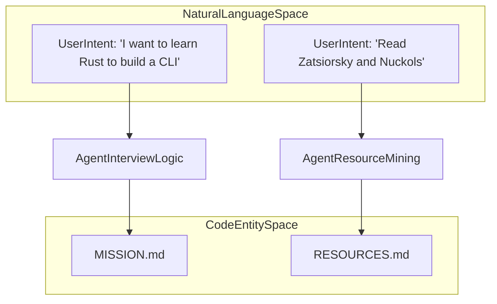
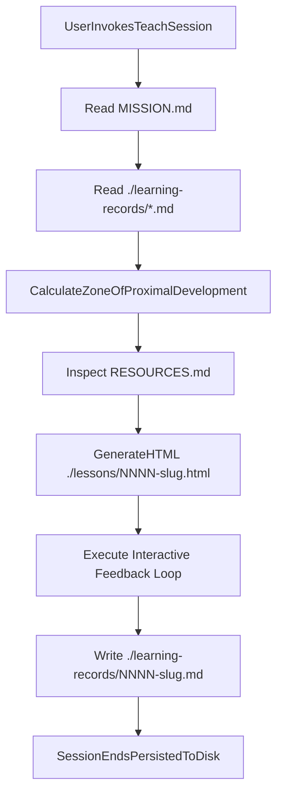
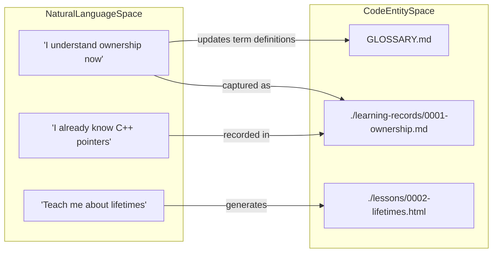

<!-- source: DeepWiki mcp.deepwiki.com · repo mattpocock/skills · page 7.2 Teach · fetched 2026-10-26 -->

# Teach

Relevant source files

The following files were used as context for generating this wiki page:

- [.changeset/teach-quiz-answer-position.md](.changeset/teach-quiz-answer-position.md)
- [.changeset/teach-workspace-root.md](.changeset/teach-workspace-root.md)
- [docs/engineering/diagnosing-bugs.md](docs/engineering/diagnosing-bugs.md)
- [docs/engineering/resolving-merge-conflicts.md](docs/engineering/resolving-merge-conflicts.md)
- [docs/engineering/setup-matt-pocock-skills.md](docs/engineering/setup-matt-pocock-skills.md)
- [docs/productivity/teach.md](docs/productivity/teach.md)
- [skills/productivity/teach/GLOSSARY-FORMAT.md](skills/productivity/teach/GLOSSARY-FORMAT.md)
- [skills/productivity/teach/LEARNING-RECORD-FORMAT.md](skills/productivity/teach/LEARNING-RECORD-FORMAT.md)
- [skills/productivity/teach/MISSION-FORMAT.md](skills/productivity/teach/MISSION-FORMAT.md)
- [skills/productivity/teach/RESOURCES-FORMAT.md](skills/productivity/teach/RESOURCES-FORMAT.md)
- [skills/productivity/teach/SKILL.md](skills/productivity/teach/SKILL.md)

The `teach` skill is a stateful capability designed to guide a user through learning a new skill or concept over multiple sessions within a dedicated workspace directory `[skills/productivity/teach/SKILL.md:8-12]`. Unlike standard skills that perform discrete, stateless tasks, `teach` treats the local file system as a persistent state machine, maintaining records of learning progress, goals, resources, and generated lessons `[docs/productivity/teach.md:3-6]`.

## The Teaching Workspace Model

The workspace relies on a specific file and directory structure to persist state across sessions, ensuring that learning is continuously grounded in the user's objectives and prior knowledge `[skills/productivity/teach/SKILL.md:12-20]`.

### Workspace File Structure

| File/Directory | Purpose | Format Specification |
| :--- | :--- | :--- |
| `MISSION.md` | Captures the concrete real-world goal and "Why" behind the learning. | `[skills/productivity/teach/MISSION-FORMAT.md:1-23]()` |
| `GLOSSARY.md` | Canonical language and compressed definitions understood by the user. | `[skills/productivity/teach/GLOSSARY-FORMAT.md:1-25]()` |
| `RESOURCES.md` | Curated, high-trust sources for Knowledge and Wisdom (communities). | `[skills/productivity/teach/RESOURCES-FORMAT.md:1-23]()` |
| `./learning-records/` | Sequential records (`0001-slug.md`) of non-obvious insights and prior knowledge. | `[skills/productivity/teach/LEARNING-RECORD-FORMAT.md:1-13]()` |
| `./lessons/` | Directory of self-contained HTML files representing units of teaching (`0001-<dash-case-name>.html`). | `[skills/productivity/teach/SKILL.md:48-50]()` |
| `./reference/` | Compressed learnings (cheat sheets, algorithms) in HTML format. | `[skills/productivity/teach/SKILL.md:15-15]()` |
| `./assets/` | Reusable components (CSS, quiz widgets) shared across lessons. | `[skills/productivity/teach/SKILL.md:19-19]()` |
| `NOTES.md` | Scratchpad for user preferences and agent working notes. | `[skills/productivity/teach/SKILL.md:20-20]()` |

Sources: `[skills/productivity/teach/SKILL.md:12-20]`, `[docs/productivity/teach.md:28-37]`

## Knowledge-Skills-Wisdom Philosophy & Fluency vs Storage Strength

The skill operates on a tripartite philosophy of deep learning:
1. **Knowledge**: Acquired from high-quality, high-trust resources tracked in `RESOURCES.md` `[skills/productivity/teach/SKILL.md:26-30]`. Difficulty is minimized during acquisition to protect working memory `[skills/productivity/teach/SKILL.md:97-98]`.
2. **Skills**: Acquired through interactive lessons devised by the agent `[skills/productivity/teach/SKILL.md:27-27]`. Here, desirable difficulty is deployed intentionally via retrieval practice, spacing, and interleaving `[skills/productivity/teach/SKILL.md:41-45]`.
3. **Wisdom**: Derived from community engagement and real-world practice `[skills/productivity/teach/SKILL.md:28-28]`.

The skill explicitly separates **fluency strength** (in-the-moment retrieval giving an illusory sense of mastery) from **storage strength** (long-term retention through retrieval practice and desirable difficulty) `[skills/productivity/teach/SKILL.md:34-41]`.

Sources: `[skills/productivity/teach/SKILL.md:22-46]`, `[docs/productivity/teach.md:40-46]`

## Natural Language Space to Code Entity Space: Initialization

This diagram bridges user intent regarding mission and resources to the underlying state files initialized by the agent.

Sources: `[skills/productivity/teach/SKILL.md:14-16]`, `[skills/productivity/teach/MISSION-FORMAT.md:8-12]`, `[skills/productivity/teach/RESOURCES-FORMAT.md:7-16]`

## Implementation and Data Flow: The Multi-Session Learning Loop

The `teach` skill utilizes the local directory as its persistent state machine across multiple sessions `[skills/productivity/teach/SKILL.md:8-10]`. At the start of each session, the agent reads existing artifacts to calculate the **Zone of Proximal Development (ZPD)** `[skills/productivity/teach/SKILL.md:81-90]`.

Sources: `[skills/productivity/teach/SKILL.md:8-18]`, `[skills/productivity/teach/SKILL.md:81-90]`

## Natural Language Space to Code Entity Space: Learning Records & Lessons

This diagram maps user comprehension, prior knowledge disclosures, and lesson generation steps onto concrete file outputs in the workspace.

Sources: `[skills/productivity/teach/SKILL.md:17-18]`, `[skills/productivity/teach/LEARNING-RECORD-FORMAT.md:29-37]`, `[skills/productivity/teach/GLOSSARY-FORMAT.md:29-35]`

## Format Specifications

### MISSION.md
`MISSION.md` establishes the "Why" and concrete real-world goals of the workspace `[skills/productivity/teach/MISSION-FORMAT.md:1-3]`.
* **Rules**: Exactly one mission per workspace; push back on vagueness; revise when reality shifts `[skills/productivity/teach/MISSION-FORMAT.md:27-30]`.
* **Structure**: `## Why`, `## Success looks like`, `## Constraints`, `## Out of scope` `[skills/productivity/teach/MISSION-FORMAT.md:10-22]`.

Sources: `[skills/productivity/teach/MISSION-FORMAT.md:1-31]`

### GLOSSARY.md
`GLOSSARY.md` stores compressed domain terminology `[skills/productivity/teach/GLOSSARY-FORMAT.md:1-3]`.
* **Rules**: Add terms only when the user understands them; be opinionated by listing aliases to avoid; keep definitions tight (1-2 sentences) `[skills/productivity/teach/GLOSSARY-FORMAT.md:29-31]`.

Sources: `[skills/productivity/teach/GLOSSARY-FORMAT.md:1-35]`

### LEARNING-RECORD-FORMAT.md
Learning records capture decision-grade insights and steer future sessions, functioning similarly to architectural decision records (ADRs) `[skills/productivity/teach/LEARNING-RECORD-FORMAT.md:5-6]`.
* **Numbering**: Sequentially named `0001-slug.md`, `0002-slug.md` inside `./learning-records/` `[skills/productivity/teach/LEARNING-RECORD-FORMAT.md:3]`.
* **Supersession**: Outdated understandings are marked `Status: superseded by LR-NNNN` rather than deleted `[skills/productivity/teach/LEARNING-RECORD-FORMAT.md:44-46]`.

Sources: `[skills/productivity/teach/LEARNING-RECORD-FORMAT.md:1-47]`

### RESOURCES.md
`RESOURCES.md` curates high-trust external knowledge and communities `[skills/productivity/teach/RESOURCES-FORMAT.md:1-3]`.
* **Rules**: High-trust only; annotate every entry with what it covers and when to use it; group into `## Knowledge` and `## Wisdom (Communities)` `[skills/productivity/teach/RESOURCES-FORMAT.md:27-29]`.

Sources: `[skills/productivity/teach/RESOURCES-FORMAT.md:1-33]`

---

