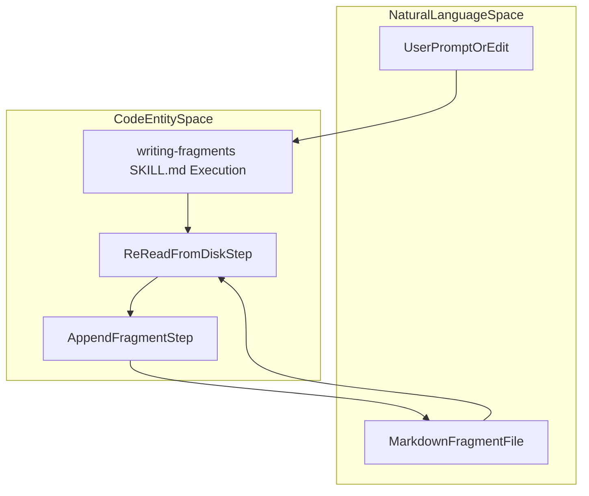
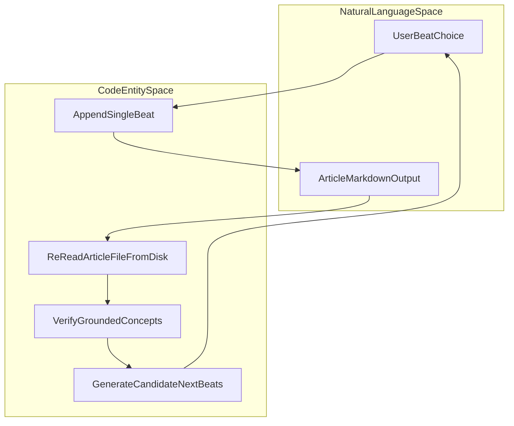

<!-- source: DeepWiki mcp.deepwiki.com · repo mattpocock/skills · page 8.1 In-Progress Writing Skills · fetched 2026-10-26 -->

# In-Progress Writing Skills

Relevant source files

The following files were used as context for generating this wiki page:

- [skills/in-progress/writing-beats/SKILL.md](skills/in-progress/writing-beats/SKILL.md)
- [skills/in-progress/writing-fragments/SKILL.md](skills/in-progress/writing-fragments/SKILL.md)
- [skills/in-progress/writing-shape/SKILL.md](skills/in-progress/writing-shape/SKILL.md)

This page details the experimental writing skills located in the `skills/in-progress/` bucket (`writing-fragments`, `writing-beats`, and `writing-shape`). These skills implement a structured "quarry" methodology for moving from raw, unstructured ideation (exploration) to a polished, constraint-checked article (exploitation). They enforce rigorous state synchronization via a read-before-write protocol to guarantee that manual user edits are never overwritten by agents.

Sources: [skills/in-progress/writing-fragments/SKILL.md:2-19](), [skills/in-progress/writing-beats/SKILL.md:2-21](), [skills/in-progress/writing-shape/SKILL.md:2-15]()

---

## The Writing Pipeline

The writing framework separates the generative, exploratory phase from the structural, exploitative phase. 

| Skill Name | Phase | Core Responsibility | Primary Output |
| :--- | :--- | :--- | :--- |
| `writing-fragments` | Explore | Relentless grilling to mine raw, unstructured "noticings". | Unordered markdown fragment file (`\n---\n` separated) |
| `writing-beats` | Exploit | Choose-your-own-adventure narrative assembly based on grounded concepts. | Sequential narrative beat-by-beat |
| `writing-shape` | Exploit | Paragraph-by-paragraph argument tuning and format argumentation. | Polished article prose |

Sources: [skills/in-progress/writing-fragments/SKILL.md:7-10](), [skills/in-progress/writing-beats/SKILL.md:7-13](), [skills/in-progress/writing-shape/SKILL.md:7-12]()

---

## Writing Fragments (`writing-fragments`)

The `writing-fragments` skill functions as an exploratory grilling session [skills/in-progress/writing-fragments/SKILL.md:7-10](). It models a "novelist's diary"—accumulating heterogeneous notes without imposing outlines, metadata, or table of contents [skills/in-progress/writing-fragments/SKILL.md:16-18](), [skills/in-progress/writing-fragments/SKILL.md:27-41]().

### Data Model & Fragment Specifications
A fragment is defined as any text snippet that is readable by the author, even if it lacks self-contained argumentation for a cold reader [skills/in-progress/writing-fragments/SKILL.md:23-25](). Valuable fragments include leading words (load-bearing coinages or metaphors), vignettes, half-thoughts, and quotes [skills/in-progress/writing-fragments/SKILL.md:27-39]().

Storage follows a flat format where fragments are appended sequentially and separated by horizontal rules (`\n---\n`) [skills/in-progress/writing-fragments/SKILL.md:52-69]().

### Read-Before-Write Synchronization Logic
To safely integrate user edits made between agent turns, the skill enforces strict synchronization behavior:
1. **Initial File Target**: The agent prompts for a save path once on the first write [skills/in-progress/writing-fragments/SKILL.md:13-13]().
2. **Disk Re-Read**: Before executing any append operation, the agent must read the current state of the markdown file from disk [skills/in-progress/writing-fragments/SKILL.md:73-75]().
3. **Append-Only Operation**: New fragments are appended to the tail of the document without altering prior fragments unless an explicit edit instruction is given [skills/in-progress/writing-fragments/SKILL.md:71-78]().

Sources: [skills/in-progress/writing-fragments/SKILL.md:7-19](), [skills/in-progress/writing-fragments/SKILL.md:23-41](), [skills/in-progress/writing-fragments/SKILL.md:52-78]()

---

## Writing Beats (`writing-beats`)

The `writing-beats` skill consumes a raw fragment file and executes a choose-your-own-adventure assembly process [skills/in-progress/writing-beats/SKILL.md:7-13](). It is restricted via frontmatter (`disable-model-invocation: true`) to prevent accidental model-triggered execution [skills/in-progress/writing-beats/SKILL.md:4-4]().

### Grounding Mechanics
Concepts must be formally **grounded** before a beat can lean on them [skills/in-progress/writing-beats/SKILL.md:25-27](). Grounding occurs in two ways:
- **Prerequisites**: Concepts established before the journey begins [skills/in-progress/writing-beats/SKILL.md:31-31]().
- **Introduced Concepts**: Concepts grounded by a preceding beat [skills/in-progress/writing-beats/SKILL.md:32-32]().

Candidate next beats are only offered if all requirements are met by the current grounded set [skills/in-progress/writing-beats/SKILL.md:36-37]().

Sources: [skills/in-progress/writing-beats/SKILL.md:7-21](), [skills/in-progress/writing-beats/SKILL.md:25-39](), [skills/in-progress/writing-beats/agents/openai.yaml:1-5]()

---

## Writing Shape (`writing-shape`)

The `writing-shape` skill executes an inverted grilling session to form an article paragraph-by-paragraph from a read-only input pile [skills/in-progress/writing-shape/SKILL.md:7-15](), [skills/in-progress/writing-shape/SKILL.md:41-43]().

### Format Arguments and Loop Mechanics
The skill requires the agent to explicitly debate formatting tradeoffs with the user out loud, determining whether a block should use prose, lists, callouts (`> [!TIP]`), tables, quotes, or code blocks [skills/in-progress/writing-shape/SKILL.md:59-68](). 

The core loop follows these execution steps:
1. **Pile Ingestion**: Reads the input file end-to-end to build context [skills/in-progress/writing-shape/SKILL.md:19-21]().
2. **Prerequisite Agreement**: Establishes initial reader grounding constraints [skills/in-progress/writing-shape/SKILL.md:22-22]().
3. **Opening Generation**: Drafts 2–3 candidate openings representing distinct angles [skills/in-progress/writing-shape/SKILL.md:23-23]().
4. **Iterative Growth**: Appends verified blocks immediately upon agreement while maintaining sync via disk re-reads [skills/in-progress/writing-shape/SKILL.md:24-26](), [skills/in-progress/writing-shape/SKILL.md:71-72]().

Sources: [skills/in-progress/writing-shape/SKILL.md:7-27](), [skills/in-progress/writing-shape/SKILL.md:41-68](), [skills/in-progress/writing-shape/SKILL.md:69-72]()

---

