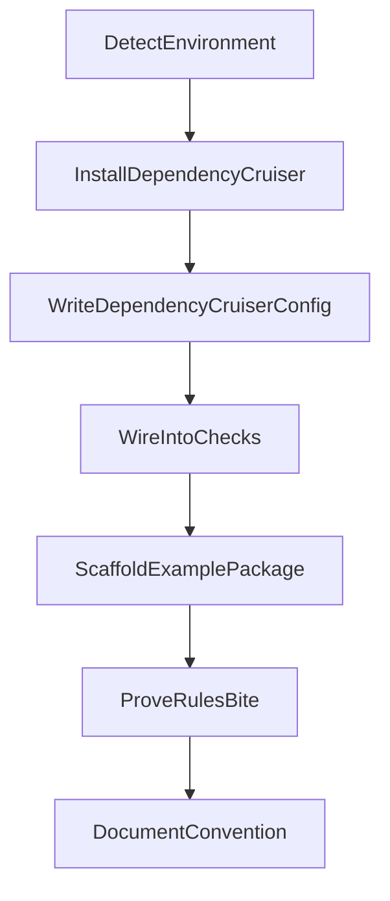

<!-- source: DeepWiki mcp.deepwiki.com · repo mattpocock/skills · page 8.3 Setup-TS-Deep-Modules · fetched 2026-10-26 -->

# Setup-TS-Deep-Modules

<details>
<summary>Relevant source files</summary>

The following files were used as context for generating this wiki page:

- [skills/in-progress/setup-ts-deep-modules/SKILL.md](skills/in-progress/setup-ts-deep-modules/SKILL.md)
- [skills/in-progress/setup-ts-deep-modules/dependency-cruiser.config.cjs](skills/in-progress/setup-ts-deep-modules/dependency-cruiser.config.cjs)

</details>


This page documents the `setup-ts-deep-modules` skill, which configures `dependency-cruiser` in a TypeScript repository to enforce "deep module" boundaries. This ensures that each package exposes a well-defined public interface through its root files, while keeping internal implementation details hidden within subfolders. The skill automates the installation of `dependency-cruiser`, sets up the necessary configuration, and verifies that the rules are correctly applied.

## Purpose and Scope

The `setup-ts-deep-modules` skill aims to promote a robust architectural pattern in TypeScript repositories by enforcing strict module boundaries. It ensures that consumers of a package interact only with its public entry points, preventing accidental coupling to internal implementation details. This improves maintainability, reduces cognitive load, and facilitates refactoring. The skill is user-invoked, meaning it requires explicit activation rather than being implicitly called by an agent [skills/in-progress/setup-ts-deep-modules/SKILL.md:4-4]().

Sources:
- [skills/in-progress/setup-ts-deep-modules/SKILL.md:4-4]()

## Deep Module Principles

A deep module is characterized by a large amount of behavior exposed through a small, well-defined interface [skills/in-progress/setup-ts-deep-modules/SKILL.md:9-9](). In the context of this skill, a package's public interface consists of its root files (entry points), while everything within its subfolders is considered private implementation [skills/in-progress/setup-ts-deep-modules/SKILL.md:9-9]().

The conventional structure enforced is:
```
src/packages/
  <name>/
    index.ts        ← an entry point (public). Import this from outside.
    client.ts       ← another entry point. Packages may expose SEVERAL.
    lib/            ← implementation: hidden from outside, free to import each other.
    tests/          ← co-located tests + fixtures (a subfolder, so private).
```
[skills/in-progress/setup-ts-deep-modules/SKILL.md:15-22]()

The key idea is that *any* file in a subfolder is private, making the configuration extensible without modification when new subfolders are introduced [skills/in-progress/setup-ts-deep-modules/SKILL.md:24-25]().

### Boundary Rules

The `dependency-cruiser` configuration enforces four primary rules, all set to `error` severity [skills/in-progress/setup-ts-deep-modules/SKILL.md:26-26]():

1.  **Entry-point boundary**: Code outside a package (e.g., application code or another package) may only import a package's root files (entry points), never anything within its subfolders [skills/in-progress/setup-ts-deep-modules/SKILL.md:28-28]().
    *   This is enforced by the `entrypoint-boundary-from-app` rule for external consumers [skills/in-progress/setup-ts-deep-modules/dependency-cruiser.config.cjs:29-36]() and `entrypoint-boundary-across-packages` for other packages [skills/in-progress/setup-ts-deep-modules/dependency-cruiser.config.cjs:37-48]().
2.  **Intra-package freedom**: Files within the same package can import each other freely, including internal subfolder files [skills/in-progress/setup-ts-deep-modules/SKILL.md:29-29]().
    *   This is handled by the `pathNot: ^${R}/$1/` clause in `entrypoint-boundary-across-packages` [skills/in-progress/setup-ts-deep-modules/dependency-cruiser.config.cjs:44-47]().
3.  **Tests through the entry points**: Test files (`<pkg>/tests/`) must import other packages only through their entry points. They can import their own test fixtures, but not other internal subfolder files of their own package [skills/in-progress/setup-ts-deep-modules/SKILL.md:30-30]().
    *   This is enforced by the `tests-through-entrypoints` rule [skills/in-progress/setup-ts-deep-modules/dependency-cruiser.config.cjs:50-59]().
4.  **No cycles**: No dependency cycles are allowed within the defined scope [skills/in-progress/setup-ts-deep-modules/SKILL.md:31-31]().
    *   This is enforced by the `no-circular` rule [skills/in-progress/setup-ts-deep-modules/dependency-cruiser.config.cjs:69-74]().

Additionally, the `tests-folder-is-private` rule ensures that nothing outside a package's own tests can import files from its `tests/` folder [skills/in-progress/setup-ts-deep-modules/dependency-cruiser.config.cjs:61-67]().

Sources:
- [skills/in-progress/setup-ts-deep-modules/SKILL.md:26-31]()
- [skills/in-progress/setup-ts-deep-modules/dependency-cruiser.config.cjs:29-74]()

### `PACKAGES_ROOT` and `PACKAGE_INTERNALS`

The core of the `dependency-cruiser` configuration relies on two key patterns defined in [skills/in-progress/setup-ts-deep-modules/dependency-cruiser.config.cjs:14-25]():

*   `PACKAGES_ROOT`: This constant defines the base directory where all packages reside (`const PACKAGES_ROOT = "src/packages";`) [skills/in-progress/setup-ts-deep-modules/dependency-cruiser.config.cjs:15-15]().
*   `PACKAGE_INTERNALS`: This derived regular expression matches any file path that is nested inside a subfolder of a package (`const PACKAGE_INTERNALS = ^${R}/[^/]+/[^/]+/;`). It explicitly excludes files directly at the package root, which are considered entry points [skills/in-progress/setup-ts-deep-modules/dependency-cruiser.config.cjs:20-24]().

These patterns are used in combination with `path` and `pathNot` properties in the `dependency-cruiser` rules to define allowed and forbidden import relationships. The `$1` back-references in the rules allow a package to import its own internals while preventing external access [skills/in-progress/setup-ts-deep-modules/SKILL.md:97-99]().

Sources:
- [skills/in-progress/setup-ts-deep-modules/SKILL.md:97-99]()
- [skills/in-progress/setup-ts-deep-modules/dependency-cruiser.config.cjs:14-25]()

### Diagram: Dependency-Cruiser Rule Application

```mermaid
graph TD
    subgraph "Repository"
        A["AppRootCode"]
        subgraph "PackagesRoot"
            P1["PackageA"]
            P2["PackageB"]
        end
    end

    subgraph "PackageAStructure"
        P1_EP["index.ts"]
        P1_LIB["lib/impl.ts"]
        P1_TESTS["tests/example.test.ts"]
    end

    subgraph "PackageBStructure"
        P2_EP["client.ts"]
    end

    A -- "Imports only entry points" --> P1_EP
    A -- "Forbidden: Imports internals" -.- X["entrypoint-boundary-from-app"]

    P1_EP -- "Imports freely" --> P1_LIB
    P1_LIB -- "Imports freely" --> P1_EP

    P1_EP -- "Imports only entry points" --> P2_EP
    P1_LIB -- "Forbidden: Imports internals" -.- Y["entrypoint-boundary-across-packages"]

    P1_TESTS -- "Imports own entry points" --> P1_EP
    P1_TESTS -- "Imports own test fixtures" --> P1_TESTS
    P1_TESTS -- "Forbidden: Imports own internals" -.- Z["tests-through-entrypoints"]

    P1_LIB -- "Forbidden: Imports tests" -.- W["tests-folder-is-private"]

    P1_LIB -- "Forbidden: Circular dependency" -.- C["no-circular"]
```
**Title**: "Deep Module Dependency Rules"

Sources:
- [skills/in-progress/setup-ts-deep-modules/SKILL.md:28-31]()
- [skills/in-progress/setup-ts-deep-modules/dependency-cruiser.config.cjs:29-74]()

## Installation Lifecycle

The `setup-ts-deep-modules` skill follows a structured lifecycle to integrate `dependency-cruiser` into a repository.

### 1. Detect the Environment

The first step involves identifying key aspects of the repository's environment [skills/in-progress/setup-ts-deep-modules/SKILL.md:39-43]():

*   **Package Manager**: Determined by the presence of lock files (`pnpm-lock.yaml`, `yarn.lock`, `bun.lockb`). If none are found, `npm` is assumed [skills/in-progress/setup-ts-deep-modules/SKILL.md:41-41]().
*   **Packages Root**: The skill attempts to locate the root directory for packages, preferring `src/packages` if `src/` exists, otherwise `packages`. The user is prompted for confirmation if an existing convention is detected [skills/in-progress/setup-ts-deep-modules/SKILL.md:42-42]().
*   **Existing Config**: Checks for an existing `dependency-cruiser` configuration file (e.g., `.dependency-cruiser.*`). If found, the new rules are merged into it rather than overwriting [skills/in-progress/setup-ts-deep-modules/SKILL.md:43-43]().

Sources:
- [skills/in-progress/setup-ts-deep-modules/SKILL.md:39-43]()

### 2. Install `dependency-cruiser`

`dependency-cruiser` is installed as a `devDependency` using the detected package manager [skills/in-progress/setup-ts-deep-modules/SKILL.md:47-49]().

Sources:
- [skills/in-progress/setup-ts-deep-modules/SKILL.md:47-49]()

### 3. Write the Configuration

The skill copies the template `dependency-cruiser.config.cjs` [skills/in-progress/setup-ts-deep-modules/SKILL.md:53-55]() to the repository root as `.dependency-cruiser.cjs`. The `PACKAGES_ROOT` variable within this file is set to the value determined in step 1 [skills/in-progress/setup-ts-deep-modules/SKILL.md:55-55](). The rules are designed to be path-depth based and extension-agnostic, requiring no further adaptation [skills/in-progress/setup-ts-deep-modules/SKILL.md:55-56]().

Sources:
- [skills/in-progress/setup-ts-deep-modules/SKILL.md:53-56]()
- [skills/in-progress/setup-ts-deep-modules/dependency-cruiser.config.cjs:14-15]()

### 4. Wire into Checks

A new `lint:boundaries` script is added to `package.json`, executing `depcruise <packages-root>` [skills/in-progress/setup-ts-deep-modules/SKILL.md:59-61](). This script is then integrated into the repository's existing umbrella check command (e.g., `check`, `ci`, `validate`) that typically runs type-checking. If no such umbrella script exists, the user is instructed to include `lint:boundaries` in their CI pipeline [skills/in-progress/setup-ts-deep-modules/SKILL.md:61-63](). The skill explicitly avoids modifying `tsconfig` or adding path aliases [skills/in-progress/setup-ts-deep-modules/SKILL.md:61-62]().

Sources:
- [skills/in-progress/setup-ts-deep-modules/SKILL.md:59-63]()

### 5. Scaffold Example Package

An example package is created under `<packages-root>/example/` to serve as a template and demonstration [skills/in-progress/setup-ts-deep-modules/SKILL.md:67-69](). This example includes:

*   `index.ts`: An entry point exporting a function that delegates to an internal file, demonstrating deep module behavior [skills/in-progress/setup-ts-deep-modules/SKILL.md:70-71]().
*   `lib/impl.ts`: An internal file in a subfolder, imported by `index.ts` but not directly accessible from outside [skills/in-progress/setup-ts-deep-modules/SKILL.md:72-72]().
*   `tests/example.test.ts`: A test file that imports only the package's entry point (`../index`) and asserts against the public function [skills/in-progress/setup-ts-deep-modules/SKILL.md:73-73]().

Sources:
- [skills/in-progress/setup-ts-deep-modules/SKILL.md:67-73]()

### 6. Prove the Rules Bite

This crucial step validates the `dependency-cruiser` configuration [skills/in-progress/setup-ts-deep-modules/SKILL.md:79-81]():

1.  The `lint:boundaries` command is run on the clean example package, which must pass [skills/in-progress/setup-ts-deep-modules/SKILL.md:83-83]().
2.  A temporary deep import (e.g., `import { thing } from "../lib/impl"`) is added to `tests/example.test.ts`. Running `lint:boundaries` again must *fail* with a `tests-through-entrypoints` violation [skills/in-progress/setup-ts-deep-modules/SKILL.md:84-84]().
3.  The deep import is reverted, and `lint:boundaries` is run one last time, which must pass again [skills/in-progress/setup-ts-deep-modules/SKILL.md:85-85]().

If step 2 does not result in a failure, the configuration is considered incorrect and must be fixed before completion [skills/in-progress/setup-ts-deep-modules/SKILL.md:86-87]().

Sources:
- [skills/in-progress/setup-ts-deep-modules/SKILL.md:79-87]()

### 7. Document the Convention

Finally, a `README.md` file is created within the packages root directory (e.g., `<packages-root>/README.md`) [skills/in-progress/setup-ts-deep-modules/SKILL.md:89-91](). This documentation covers:

*   The `src/packages/<name>/` layout, emphasizing entry points at the root and `lib/` for implementation, `tests/` for tests [skills/in-progress/setup-ts-deep-modules/SKILL.md:91-91]().
*   The rule to "import only through a package's entry points (its root files)" [skills/in-progress/setup-ts-deep-modules/SKILL.md:91-91]().
*   Instructions on how to run `lint:boundaries` [skills/in-progress/setup-ts-deep-modules/SKILL.md:91-91]().
*   Explicit discouragement of barrel files, advocating for multiple small entry points instead [skills/in-progress/setup-ts-deep-modules/SKILL.md:91-91]().

A context pointer is also added to the repository's agent instructions file (`CLAUDE.md` or `AGENTS.md`) to ensure agents can discover and adhere to these boundary rules [skills/in-progress/setup-ts-deep-modules/SKILL.md:93-94]().

Sources:
- [skills/in-progress/setup-ts-deep-modules/SKILL.md:89-94]()

### Diagram: Setup-TS-Deep-Modules Installation Lifecycle


**Title**: "Setup-TS-Deep-Modules Installation Lifecycle"

Sources:
- [skills/in-progress/setup-ts-deep-modules/SKILL.md:37-95]()

---

