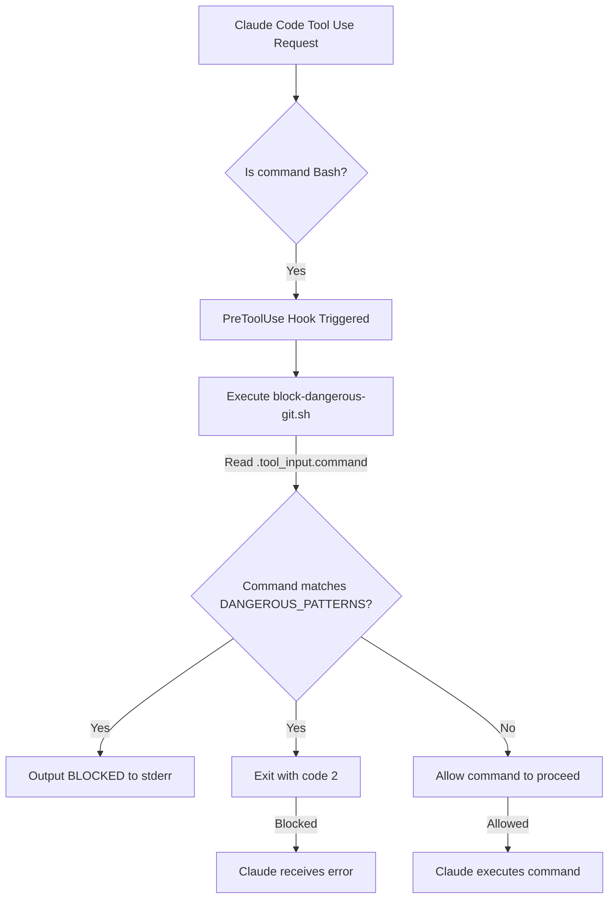
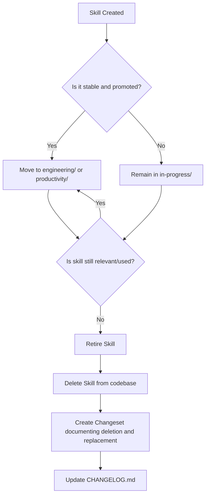

<!-- source: DeepWiki mcp.deepwiki.com · repo mattpocock/skills · page 8.4 Misc and Deprecated Buckets · fetched 2026-10-26 -->

# Misc and Deprecated Buckets

Relevant source files

The following files were used as context for generating this wiki page:

- [.out-of-scope/frozen-misc-skills.md](.out-of-scope/frozen-misc-skills.md)
- [skills/deprecated/README.md](skills/deprecated/README.md)
- [skills/misc/README.md](skills/misc/README.md)
- [skills/misc/git-guardrails-claude-code/SKILL.md](skills/misc/git-guardrails-claude-code/SKILL.md)
- [skills/misc/git-guardrails-claude-code/scripts/block-dangerous-git.sh](skills/misc/git-guardrails-claude-code/scripts/block-dangerous-git.sh)
- [skills/misc/setup-pre-commit/SKILL.md](skills/misc/setup-pre-commit/SKILL.md)

This page documents the utilities found in the `misc/` bucket and the policy surrounding the `deprecated/` bucket. The `misc/` bucket contains one-off tools that are not part of the main workflow but provide useful functionality, and are frozen against incoming bug reports or feature requests. The `deprecated/` bucket outlines the retirement policy where skills are deleted rather than archived.

## Misc Bucket Utilities

The `misc/` bucket contains a collection of tools that are generally not promoted in the main plugin manifest but are kept for specific, infrequent use cases [skills/misc/README.md:3-3](). As documented in `.out-of-scope/frozen-misc-skills.md`, these skills are **frozen**: bug reports, feature requests, and pull requests against them are closed, as they do not ship in the Claude Code plugin and are unmaintained day-to-day [.out-of-scope/frozen-misc-skills.md:3-3]().

Sources: [skills/misc/README.md:1-8](), [.out-of-scope/frozen-misc-skills.md:1-18]()

### `git-guardrails-claude-code`

This skill sets up a `PreToolUse` hook for Claude Code to prevent the execution of dangerous Git commands [skills/misc/git-guardrails-claude-code/SKILL.md:3-4](). It's designed to safeguard against accidental data loss or repository corruption during agent interactions.

#### Implementation Details

The `git-guardrails-claude-code` skill performs the following steps:
1.  **Scope Selection**: Asks the user whether to install the guardrails for the current project only (`.claude/settings.json`) or globally (`~/.claude/settings.json`) [skills/misc/git-guardrails-claude-code/SKILL.md:23-24]().
2.  **Script Copy**: Copies the `block-dangerous-git.sh` script to the appropriate `.claude/hooks/` directory and makes it executable [skills/misc/git-guardrails-claude-code/SKILL.md:28-35]().
3.  **Hook Configuration**: Adds a `PreToolUse` hook entry to the selected `settings.json` file. This hook executes the `block-dangerous-git.sh` script before any Bash command is run by Claude [skills/misc/git-guardrails-claude-code/SKILL.md:38-79]().
4.  **Customization**: Offers the user the option to customize the list of blocked patterns within the copied script [skills/misc/git-guardrails-claude-code/SKILL.md:83-85]().
5.  **Verification**: Provides a command to test the hook's functionality [skills/misc/git-guardrails-claude-code/SKILL.md:88-95]().

#### Blocked Commands

The `block-dangerous-git.sh` script intercepts and blocks the following Git commands and their variants [skills/misc/git-guardrails-claude-code/SKILL.md:10-17](), [skills/misc/git-guardrails-claude-code/scripts/block-dangerous-git.sh:6-16]():
*   `git push` (including `--force`)
*   `git reset --hard`
*   `git clean -f` / `git clean -fd`
*   `git branch -D`
*   `git checkout .` / `git restore .`

If a blocked command is detected, the script exits with code `2` and prints a "BLOCKED" message to `stderr` [skills/misc/git-guardrails-claude-code/SKILL.md:92-95](), [skills/misc/git-guardrails-claude-code/scripts/block-dangerous-git.sh:20-22]().

Title: "Git Guardrails Data Flow"

Sources: [skills/misc/git-guardrails-claude-code/SKILL.md:3-95](), [skills/misc/git-guardrails-claude-code/scripts/block-dangerous-git.sh:1-25]()

### `setup-pre-commit`

This skill automates the setup of pre-commit hooks using Husky, `lint-staged`, and Prettier, along with type checking and tests [skills/misc/setup-pre-commit/SKILL.md:3-4]().

#### Setup Process

The `setup-pre-commit` skill performs the following actions:
1.  **Package Manager Detection**: Identifies the package manager (`npm`, `pnpm`, `yarn`, `bun`) by checking lock files [skills/misc/setup-pre-commit/SKILL.md:18-20]().
2.  **Dependency Installation**: Installs `husky`, `lint-staged`, and `prettier` as `devDependencies` [skills/misc/setup-pre-commit/SKILL.md:25-27]().
3.  **Husky Initialization**: Runs `npx husky init` to create the `.husky/` directory and add the `prepare` script to `package.json` [skills/misc/setup-pre-commit/SKILL.md:30-35]().
4.  **Pre-commit Hook Creation**: Creates the `.husky/pre-commit` file with commands to run `lint-staged`, `typecheck`, and `test` scripts. It adapts to the detected package manager and omits `typecheck`/`test` if not found in `package.json` [skills/misc/setup-pre-commit/SKILL.md:38-47]().
5.  **`lint-staged` Configuration**: Creates a `.lintstagedrc` file to run `prettier --ignore-unknown --write` on all staged files [skills/misc/setup-pre-commit/SKILL.md:50-54]().
6.  **Prettier Configuration**: If no Prettier configuration exists, it creates a `.prettierrc` file with default settings [skills/misc/setup-pre-commit/SKILL.md:57-70]().
7.  **Verification**: Provides a checklist for verifying the setup and suggests running `npx lint-staged` as a test [skills/misc/setup-pre-commit/SKILL.md:73-79]().
8.  **Commit**: Stages all changes and commits them, which serves as a smoke test for the new hooks [skills/misc/setup-pre-commit/SKILL.md:82-85]().

Sources: [skills/misc/setup-pre-commit/SKILL.md:1-91]()

### `migrate-to-shoehorn`

This skill assists in migrating test files from `as` type assertions to `@total-typescript/shoehorn` [skills/misc/README.md:6-6](). This is a specialized refactoring utility for TypeScript projects.

Sources: [skills/misc/README.md:6-6]()

### `scaffold-exercises`

This skill is used to create directory structures for course exercises, including sections, problems, solutions, and explainers [skills/misc/README.md:7-7]().

Sources: [skills/misc/README.md:7-7]()

## Deprecated Bucket

The `deprecated/` bucket is intended for skills that are no longer in use [skills/deprecated/README.md:1-3]().

### Retirement Policy

Unlike other buckets, the `deprecated/` bucket is currently empty [skills/deprecated/README.md:3-3](). The policy for retiring skills is to **delete them rather than archive them** [skills/deprecated/README.md:3-3](). When a skill is retired, it is removed from the codebase, and the `changeset` that records its removal explicitly names any replacement skill or workflow [skills/deprecated/README.md:3-3](). This ensures that the repository remains lean and only contains actively maintained skills.

Title: "Skill Lifecycle and Retirement Policy"

Sources: [skills/deprecated/README.md:1-3]()

---

