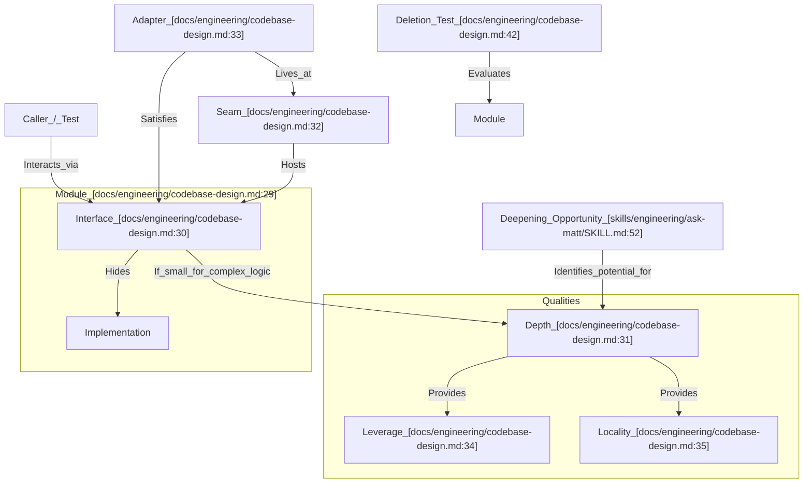
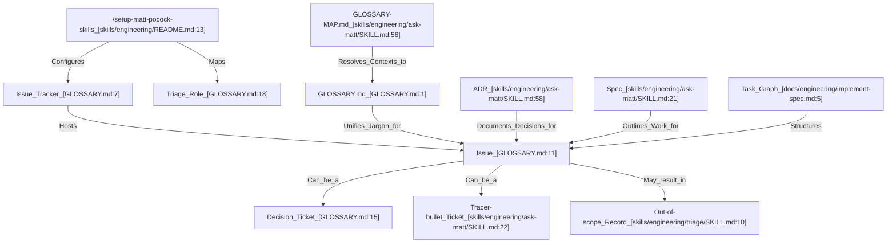

<!-- source: DeepWiki mcp.deepwiki.com · repo mattpocock/skills · page 9 Glossary · fetched 2026-10-26 -->

# Glossary

Relevant source files

The following files were used as context for generating this wiki page:

- [GLOSSARY.md](GLOSSARY.md)
- [README.md](README.md)
- [skills/engineering/README.md](skills/engineering/README.md)
- [skills/engineering/ask-matt/SKILL.md](skills/engineering/ask-matt/SKILL.md)

This glossary defines codebase-specific terminology, architectural patterns, and jargon used across the `skills` repository [README.md:92-94](). These terms form a **Ubiquitous Language** used by both human maintainers and AI agents to ensure alignment during development, triage, and execution [README.md:131-135]().

---

## Core Architectural Concepts

The following terms govern module shape, testability, and architectural refinement as defined in the `codebase-design`, `tdd`, and `improve-codebase-architecture` skills [README.md:111-164]().

| Term | Definition | Code Pointer |
| :--- | :--- | :--- |
| **Deep Module** | A module with a small interface hiding a large amount of powerful behavior (high leverage). | [docs/engineering/codebase-design.md:29-31]() |
| **Module** | Anything with an interface and an implementation (function, class, package, slice). | [docs/engineering/codebase-design.md:29-29]() |
| **Interface** | Everything a caller must know to use the module: types, invariants, error modes, ordering. | [docs/engineering/codebase-design.md:30-30]() |
| **Depth** | Leverage at the interface: a lot of behaviour behind a small interface. **Deep** = high leverage. | [docs/engineering/codebase-design.md:31-31]() |
| **Shallow** | An anti-pattern where a module's interface is nearly as complex as its implementation. | [docs/engineering/codebase-design.md:31-31]() |
| **Seam** | A place where you can alter behaviour without editing in that place; the location of an interface. | [docs/engineering/codebase-design.md:32-32]() |
| **Adapter** | A concrete thing that satisfies an interface at a seam (e.g., a Postgres repo or an in-memory fake). | [docs/engineering/codebase-design.md:33-33]() |
| **Leverage** | What callers get from depth: more capability per unit of interface they learn. | [docs/engineering/codebase-design.md:34-34]() |
| **Locality** | Concentration of change, bugs, and knowledge in one place rather than spreading across callers. | [docs/engineering/codebase-design.md:35-35]() |
| **Deepening Opportunity** | An area in the codebase identified by `/improve-codebase-architecture` where applying deep module principles would yield significant benefits. | [skills/engineering/ask-matt/SKILL.md:52-52]() |
| **Deletion Test** | A thought experiment: imagine deleting the module. If complexity vanishes, it was a pass-through. If it reappears across N callers, it was earning its keep. | [docs/engineering/codebase-design.md:42-42]() |

### Code Entity Space: Architectural Relationships

The diagram below bridges natural language definitions to the conceptual roles they play in the code, specifically as defined in the `codebase-design` and `tdd` skills [README.md:111-164]().

**Sources:** [docs/engineering/codebase-design.md:29-46](), [skills/engineering/ask-matt/SKILL.md:52-52]()

---

## Skills Framework & Execution

Terms regarding how skills are structured, distributed, and invoked within agents [README.md:25-97]().

*   **Skill**: A modular capability, typically Markdown-based with frontmatter, consumed by coding agents [README.md:1-1]().
*   **Flow**: A defined path through a sequence of skills (such as idea-to-ship) [skills/engineering/ask-matt/SKILL.md:11-11]().
*   **Bucket**: A directory folder under `skills/` categorizing capabilities (e.g., `engineering/`, `productivity/`, `in-progress/`, `misc/`, `deprecated/`) [CLAUDE.md:1-8]().
*   **Promoted / Non-promoted**: Promoted skills are stable and shipped as part of the core plugin distribution (`engineering/`, `productivity/`), whereas non-promoted skills reside in experimental or auxiliary buckets (`misc/`, `in-progress/`, `deprecated/`) [README.md:26-26]().
*   **User-invoked vs Model-invoked**: User-invoked skills can only be triggered by the human typing their exact name (`disable-model-invocation: true`), while model-invoked skills contain rich trigger phrasing allowing autonomous activation by the model [skills/engineering/ask-matt/SKILL.md:4-4](), [skills/engineering/README.md:5-23]().
*   **Smart Zone**: The context window (~150k tokens on state-of-the-art models) within which the model reasons sharply before degradation occurs [skills/engineering/ask-matt/SKILL.md:32-32]().
*   **Phase Boundary**: A logical stopping point (grilling, implementation, QA) where context should be evaluated (continue, clear, handoff, compact, subagent) [skills/engineering/ask-matt/SKILL.md:38-39]().
*   **Handoff**: A compact state document (portable markdown) used to bridge context windows or move work between isolated directories [skills/engineering/ask-matt/SKILL.md:18-20]().

---

## Grilling & Planning Primitives

Terms related to requirement gathering, specification refinement, and execution mapping [skills/engineering/ask-matt/SKILL.md:15-35]().

*   **Grilling**: A relentless interview loop that stress-tests an idea, plan, or decision before implementation begins [README.md:111-129]().
*   **Design Tree**: A model of a subject where high-level decisions branch into dependent sub-decisions during grilling [skills/productivity/grilling/SKILL.md:6-6]().
*   **Frontier**: The set of decisions whose prerequisites are all settled; the active set of questions to pose in a grilling session [skills/productivity/grilling/SKILL.md:8-8]().
*   **Round**: One full pass of asking the entire frontier at once in a numbered format during a grilling session [skills/productivity/grilling/SKILL.md:8-8]().
*   **Confirmation Gate**: The explicit user confirmation required at the end of a grilling session to lock in shared understanding before proceeding to downstream tasks [docs/productivity/grilling.md:60-62]().
*   **Decision Ticket**: A `wayfinder` unit holding a question whose resolution is a decision, rather than a code slice to execute [GLOSSARY.md:15-16]().
*   **Tracer-bullet ticket**: A ticket representing a vertical slice of implementation cutting through all system layers to provide early feedback [skills/engineering/ask-matt/SKILL.md:22-22]().
*   **Task Graph**: A representation of tickets with blocking edges, where the completion of one ticket unblocks subsequent work, orchestrating parallel execution [docs/engineering/implement-spec.md:5-5]().
*   **Integration Branch**: A single dedicated branch where all parallel work from implementer subagents is merged [docs/engineering/implement-spec.md:3-3]().
*   **Spec**: A detailed specification of work synthesized from a conversation and published to the issue tracker via `/to-spec` [skills/engineering/ask-matt/SKILL.md:21-21]().

---

## Documentation & Repository Lifecycle

Terms covering project documentation conventions, decision records, and release workflows [README.md:130-164]().

*   **GLOSSARY.md**: A project-specific glossary (formerly `CONTEXT.md`) that defines domain jargon and enforces vocabulary concision for agents [README.md:115-129](), [GLOSSARY.md:1-3](), [.changeset/rename-context-to-glossary.md:5-5]().
*   **GLOSSARY-MAP.md**: A file used in multi-context repositories to route and point to several bound `GLOSSARY.md` files [skills/engineering/ask-matt/SKILL.md:58-59](), [.changeset/rename-context-to-glossary.md:5-5]().
*   **ADR (Architectural Decision Record)**: A permanent record capturing hard-to-reverse or domain-specific architectural choices [README.md:131-132](), [skills/engineering/ask-matt/SKILL.md:58-59]().
*   **Out-of-scope record**: A documented rationale explaining why an inbound issue or request was marked won't-fix or out of scope [skills/engineering/triage/SKILL.md:10-10]().
*   **Changeset**: A metadata record tracking modifications to the skills repository for release management and versioning [.changeset/rename-context-to-glossary.md:1-1]().
*   **Graduation**: The promotion lifecycle process by which a skill transitions from an experimental or in-progress bucket into a stable promoted bucket (`engineering/` or `productivity/`) [docs/engineering/retro.md:1-1](), [docs/engineering/pr.md:1-1](), [docs/engineering/implement-spec.md:1-1]().

---

## Execution & Operational Jargon

Terms describing runtime utilities, risk assessment, and verification primitives [skills/engineering/README.md:21-34]().

*   **Prototype Variant**: A structurally distinct version of a UI or logic prototype, typically toggled via a `PrototypeSwitcher` bar [skills/planning/prototype/SKILL.md:10-10]().
*   **Wizard Stage**: A step in an interactive bash script generated by the `/wizard` skill, guiding humans through manual infrastructure or configuration procedures [skills/misc/wizard/SKILL.md:10-10]().
*   **Merge Danger / One-Way Door / Blast Radius**: Risk assessment vectors used in pull requests. A **one-way door** is an irreversible or destructive change, a **two-way door** is easily reversible, and **blast radius** measures the extent of potential impact if faults occur [docs/engineering/pr.md:23-24]().
*   **Primary vs Secondary Source**: Primary sources are authoritative originals (source code, committed tests, explicit user requirements) used to resolve contradictions; secondary sources are derived interpretations that carry lower priority [skills/implementation/resolving-merge-conflicts/SKILL.md:6-6]().

### Code Entity Space: Triage and Documentation Workflow

The diagram below maps operational records and artifacts to their underlying issue tracking and structural components [GLOSSARY.md:7-20]().

**Sources:** [GLOSSARY.md:7-20](), [skills/engineering/README.md:13-13](), [skills/engineering/ask-matt/SKILL.md:21-58](), [skills/engineering/triage/SKILL.md:10-10](), [docs/engineering/implement-spec.md:5-5]()