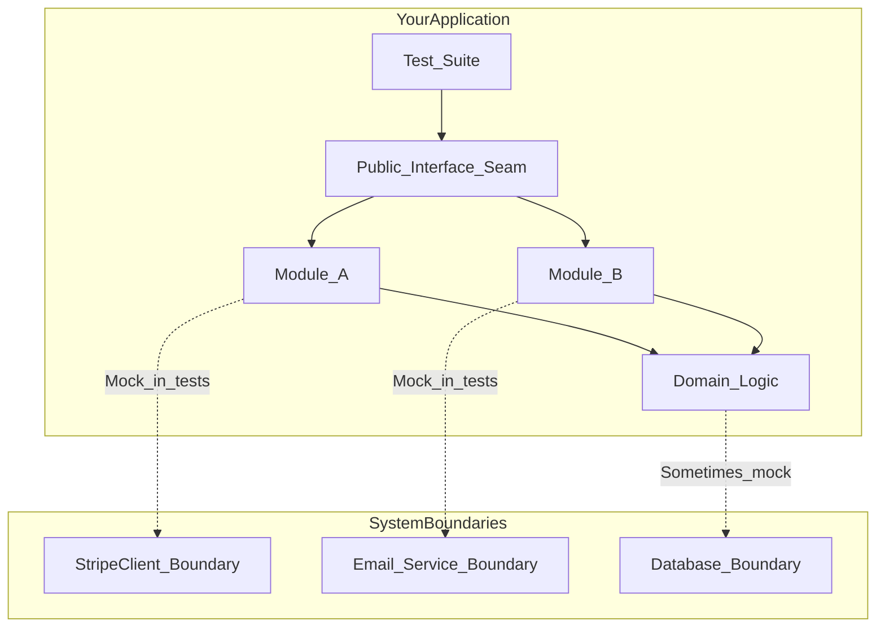
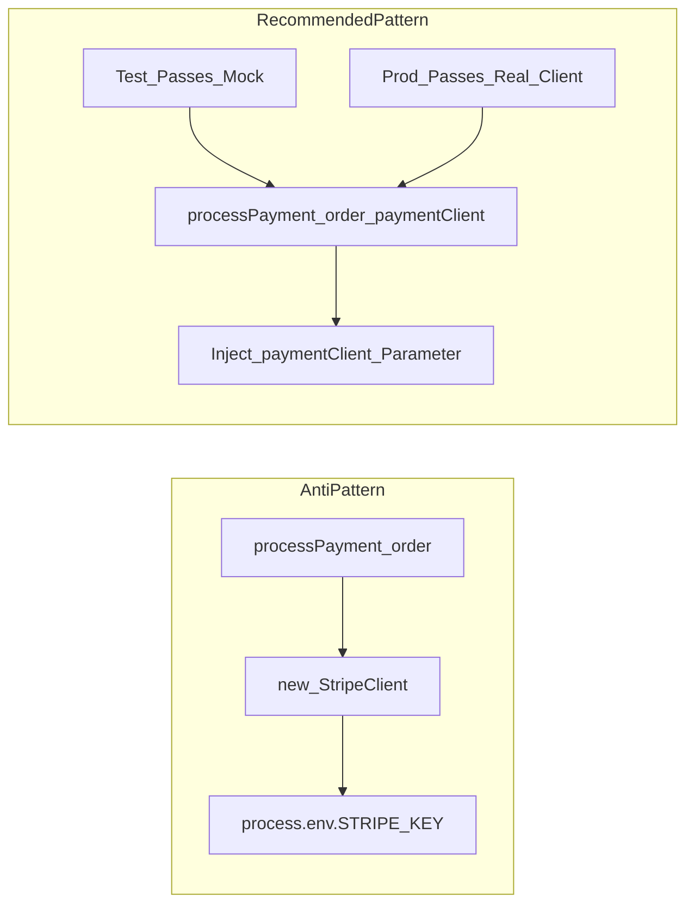
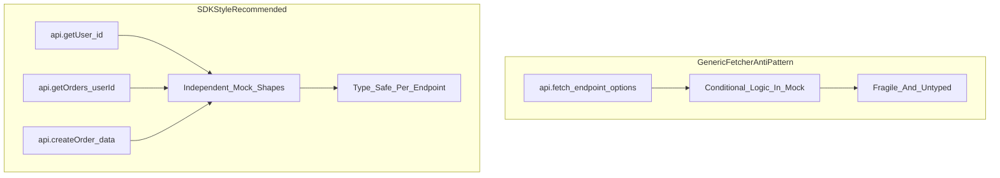

<!-- source: DeepWiki mcp.deepwiki.com · repo mattpocock/skills · extra page Mocking at System Boundaries · fetched 2026-10-26 -->

# Mocking at System Boundaries

<details>
<summary>Relevant source files</summary>

The following files were used as context for generating this wiki page:

- [skills/engineering/tdd/mocking.md](skills/engineering/tdd/mocking.md)

</details>


## Purpose and Scope

This document specifies best practices for mocking external dependencies in test-driven development workflows within the skills repository. The core operational principle is to mock strictly at **system boundaries**—such as external APIs, databases, time, randomness, and file systems—while testing all internal modules and collaborators through real implementations `[skills/engineering/tdd/mocking.md:3-9]()`.

This page details dependency injection patterns and SDK-style interface design that ensure boundary mocking remains clean, maintainable, and type-safe `[skills/engineering/tdd/mocking.md:16-59]()`. For overarching TDD practices and test writing guidelines, see the parent and sibling pages under **4.2 Test-Driven Development** `[skills/engineering/tdd/SKILL.md:1-38]()`.

Sources: `[skills/engineering/tdd/mocking.md:1-59]()`, `[skills/engineering/tdd/SKILL.md:1-38]()`

---

## The Boundary Principle

The fundamental rule of mocking in this architecture is to restrict mocks exclusively to system boundaries `[skills/engineering/tdd/mocking.md:3-4]()`. Testing internal code with real implementations ensures that your test suite exercises actual business logic rather than mocked assumptions that can drift from production realities.

### System Boundary Definition

A system boundary exists where internal application code interfaces with external, third-party infrastructure or services `[skills/engineering/tdd/mocking.md:3-9]()`:

| Boundary Type | Examples | Mocking Policy |
|--------------|----------|----------------|
| External APIs | Payment gateways (Stripe), email providers (SendGrid) | Always mock `[skills/engineering/tdd/mocking.md:5-5]()` |
| Databases | PostgreSQL, MongoDB, Redis | Prefer a real test DB; mock only when isolation demands it `[skills/engineering/tdd/mocking.md:6-6]()` |
| Time and Randomness | `Date.now()`, `Math.random()`, UUID generation | Always mock to ensure determinism `[skills/engineering/tdd/mocking.md:7-7]()` |
| File System | Disk I/O, directory operations | Use in-memory implementations or mock when interacting with the host OS `[skills/engineering/tdd/mocking.md:8-8]()` |

### Internal Collaborators (Do Not Mock)

Do not mock internal application modules, functions, or classes `[skills/engineering/tdd/mocking.md:10-14]`. Mocking internal collaborators tightly couples tests to implementation details, causing brittle test suites that fail during internal refactoring even when public behavior remains identical `[skills/engineering/tdd/SKILL.md:14-30]()`.

Sources: `[skills/engineering/tdd/mocking.md:1-15]()`, `[skills/engineering/tdd/SKILL.md:14-30]()`

---

## Architecture: Mock vs Real Implementation

The following diagram illustrates how the test suite interacts with real internal application components while placing mocks strictly at the outer system boundaries.


*Diagram: Testing Strategy - Real vs Mocked Components*

Sources: `[skills/engineering/tdd/mocking.md:1-15]()`, `[skills/engineering/tdd/SKILL.md:18-20]()`

---

## Dependency Injection Patterns

To make boundary mocking possible without relying on global monkey-patching, functions must accept external dependencies as explicit parameters rather than instantiating them internally `[skills/engineering/tdd/mocking.md:20-23]()`.

### Implementation Comparison

Consider the anti-pattern where a client is instantiated inside the function versus the recommended dependency injection approach:

```typescript
// [skills/engineering/tdd/mocking.md:31-34]
// Hard to mock - dependency created inside function
function processPayment(order) {
  const client = new StripeClient(process.env.STRIPE_KEY);
  return client.charge(order.total);
}
```

```typescript
// [skills/engineering/tdd/mocking.md:26-28]
// Easy to mock - dependency injected
function processPayment(order, paymentClient) {
  return paymentClient.charge(order.total);
}
```

By injecting `paymentClient`, unit tests can pass a lightweight mock object that fulfills the expected interface, while production code passes the concrete `StripeClient` instance `[skills/engineering/tdd/mocking.md:20-28]()`.


*Diagram: Dependency Injection Structure*

Sources: `[skills/engineering/tdd/mocking.md:16-35]()`

---

## SDK-Style Interface Design

At system boundaries, avoid generic fetcher functions that take raw endpoint strings and options objects. Instead, design **SDK-style interfaces** where each operation maps to a dedicated, strongly typed function `[skills/engineering/tdd/mocking.md:37-40]()`.

### Interface Pattern Comparison

```typescript
// [skills/engineering/tdd/mocking.md:43-47]
// GOOD: Each function is independently mockable
const api = {
  getUser: (id) => fetch(`/users/${id}`),
  getOrders: (userId) => fetch(`/users/${userId}/orders`),
  createOrder: (data) => fetch('/orders', { method: 'POST', body: data }),
};

// [skills/engineering/tdd/mocking.md:50-52]
// BAD: Mocking requires conditional logic inside the mock
const api = {
  fetch: (endpoint, options) => fetch(endpoint, options),
};
```

### Benefits of the SDK Approach
* **Predictable Responses:** Each mock method returns one specific, well-defined shape `[skills/engineering/tdd/mocking.md:56-56]()`.
* **No Conditional Logic:** Test setup requires zero conditional branching inside the mock implementation `[skills/engineering/tdd/mocking.md:57-57]()`.
* **Clear Intent:** It is immediately obvious which endpoints or operations a given test exercises `[skills/engineering/tdd/mocking.md:58-58]()`.
* **Type Safety:** Each endpoint function maintains individual request and response type safety `[skills/engineering/tdd/mocking.md:59-59]()`.


*Diagram: SDK-Style vs Generic Fetcher Interface Design*

Sources: `[skills/engineering/tdd/mocking.md:37-59]()`

---

## Seams and Codebase Design

The placement of mocks is directly determined by the codebase's **seams**. A seam is a location where you can alter behavior without editing code in that place `[skills/engineering/tdd/SKILL.md:18-20]`, `[docs/engineering/codebase-design.md:32-33]()`. 

The `codebase-design` skill defines module depth, interfaces, and seams to ensure that boundaries are explicit `[docs/engineering/codebase-design.md:29-33]()`. When designing modules:
* The interface serves as the primary test surface and the point of dependency injection.
* Mocks should only be applied at the outer boundaries (seams) of deep modules rather than internal sub-components.

Sources: `[skills/engineering/tdd/SKILL.md:18-26]()`, `[docs/engineering/codebase-design.md:3-44]()`

---

## Boundary Mocking Checklist

- [ ] Is the dependency a true system boundary (External API, Time, Randomness)? `[skills/engineering/tdd/mocking.md:3-9]()`
- [ ] Are internal collaborators and domain classes free of mocks? `[skills/engineering/tdd/mocking.md:10-15]()`
- [ ] Are external dependencies accepted as parameters via dependency injection? `[skills/engineering/tdd/mocking.md:20-28]()`
- [ ] Does the boundary use an SDK-style interface rather than a generic fetcher? `[skills/engineering/tdd/mocking.md:37-47]()`
- [ ] Is test setup free of conditional logic within mock definitions? `[skills/engineering/tdd/mocking.md:57-57]()`

Sources: `[skills/engineering/tdd/mocking.md:1-59]()`

---

