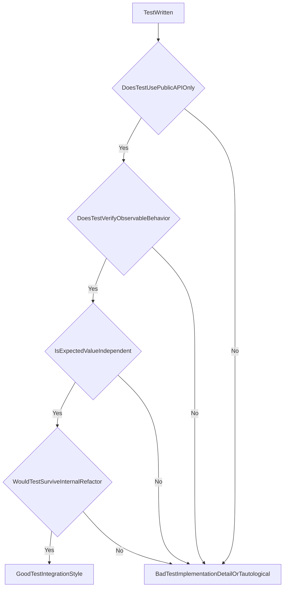
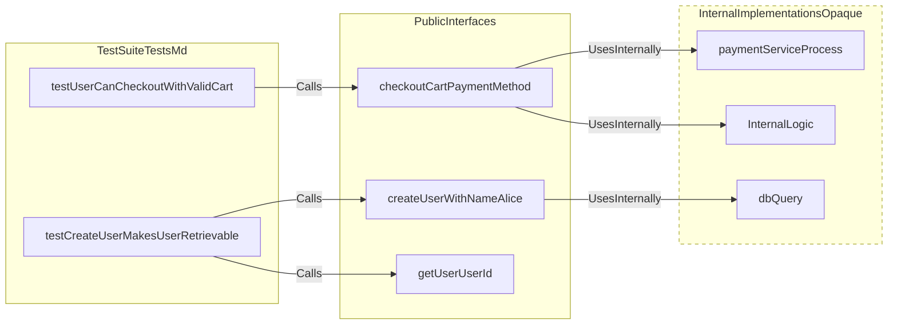
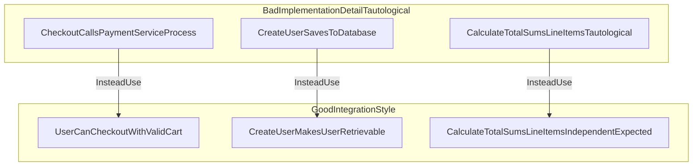

<!-- source: DeepWiki mcp.deepwiki.com · repo mattpocock/skills · extra page Writing Good Tests · fetched 2026-10-26 -->

# Writing Good Tests

<details>
<summary>Relevant source files</summary>

The following files were used as context for generating this wiki page:

- [skills/engineering/tdd/tests.md](skills/engineering/tdd/tests.md)

</details>


## Purpose and Scope

This document explains the principles for writing effective tests within the TDD workflow, focusing on the distinction between integration-style tests and implementation-detail tests. The core philosophy is that tests should verify **behavior through public interfaces**, not implementation details [skills/engineering/tdd/tests.md:5-5]().

This document covers test quality characteristics, common anti-patterns (including tautological tests), and practical examples. For mocking strategies at system boundaries, see [Mocking at System Boundaries](4.2.2). For the broader TDD workflow, see [Test-Driven Development](4.2).

Sources: [skills/engineering/tdd/tests.md:1-77]()

---

## Core Philosophy: Behavior vs Implementation

Tests should answer the question "**what** does the system do?" not "**how** does it do it?" [skills/engineering/tdd/tests.md:22-22](). A good test reads like a specification—e.g., "user can checkout with valid cart" tells you exactly what capability exists, and it survives refactors because it doesn't care about internal structure [skills/engineering/tdd/tests.md:21-21]().

### Decision Tree: Is This a Good Test?


Sources: [skills/engineering/tdd/tests.md:17-46]()

---

## Integration-Style Tests

Integration-style tests exercise **real code paths through public interfaces**, rather than mocking internal parts [skills/engineering/tdd/tests.md:5-5]().

### Characteristics

| Characteristic | Description | Code Example |
|---------------|-------------|---------|
| **Public API only** | Test uses only the exported interface [skills/engineering/tdd/tests.md:20-20]() | `checkout(cart, paymentMethod)` [skills/engineering/tdd/tests.md:12-12]() |
| **Observable behavior** | Verifies outputs callers care about [skills/engineering/tdd/tests.md:19-19]() | `expect(result.status).toBe("confirmed")` [skills/engineering/tdd/tests.md:13-13]() |
| **Refactor-resistant** | Code can change entirely; tests shouldn't [skills/engineering/tdd/tests.md:21-21]() | Moving logic between private helpers |
| **Describes WHAT, not HOW** | Focuses on the outcome, not the internal steps [skills/engineering/tdd/tests.md:22-22]() | `user can checkout with valid cart` [skills/engineering/tdd/tests.md:9-9]() |
| **One logical assertion** | Each test verifies a single logical outcome [skills/engineering/tdd/tests.md:23-23]() | `expect(result.status).toBe("confirmed")` [skills/engineering/tdd/tests.md:13-13]() |

Sources: [skills/engineering/tdd/tests.md:3-24]()

### Example: Good Integration Test
[skills/engineering/tdd/tests.md:9-14]()
```typescript
test("user can checkout with valid cart", async () => {
  const cart = createCart();
  cart.add(product);
  const result = await checkout(cart, paymentMethod);
  expect(result.status).toBe("confirmed");
});
```

### System Mapping: Public Interfaces
This diagram bridges natural language requirements to code entities defined in `tests.md`. It illustrates how good tests interact with public interfaces.


Sources: [skills/engineering/tdd/tests.md:9-14](), [skills/engineering/tdd/tests.md:29-36](), [skills/engineering/tdd/tests.md:48-60]()

---

## Anti-Patterns

### 1. Implementation-Detail Tests
These tests are coupled to the internal structure of the code and break when refactoring, even if the behavior hasn't changed [skills/engineering/tdd/tests.md:27-27]().

*   **Red Flag:** Mocking internal collaborators [skills/engineering/tdd/tests.md:40-40]().
*   **Red Flag:** Testing private methods [skills/engineering/tdd/tests.md:41-41]().
*   **Red Flag:** Asserting on call counts or order [skills/engineering/tdd/tests.md:42-42]().
*   **Red Flag:** Test breaks when refactoring without behavior change [skills/engineering/tdd/tests.md:43-43]().
*   **Red Flag:** Test name describes HOW not WHAT [skills/engineering/tdd/tests.md:44-44]().

**Example: Bad Implementation-Detail Test** [skills/engineering/tdd/tests.md:30-34]()
```typescript
test("checkout calls paymentService.process", async () => {
  const mockPayment = jest.mock(paymentService);
  await checkout(cart, payment);
  expect(mockPayment.process).toHaveBeenCalledWith(cart.total);
});
```

### 2. External Verification (Bypassing Interface)
Verifying behavior by directly inspecting internal state or external systems instead of using the public interface [skills/engineering/tdd/tests.md:45-45]().

*   **Red Flag:** Verifying through external means instead of interface [skills/engineering/tdd/tests.md:45-45]().

**Example: Bad External Verification** [skills/engineering/tdd/tests.md:49-53]()
```typescript
test("createUser saves to database", async () => {
  await createUser({ name: "Alice" });
  const row = await db.query("SELECT * FROM users WHERE name = ?", ["Alice"]);
  expect(row).toBeDefined();
});
```

**Example: Good Interface Verification** [skills/engineering/tdd/tests.md:56-60]()
```typescript
test("createUser makes user retrievable", async () => {
  const user = await createUser({ name: "Alice" });
  const retrieved = await getUser(user.id);
  expect(retrieved.name).toBe("Alice");
});
```

### 3. Tautological Tests
The expected value in the assertion is derived using the same logic as the implementation, making the test pass by construction and providing no independent verification [skills/engineering/tdd/tests.md:63-64]().

**Example: Bad Tautological Test** [skills/engineering/tdd/tests.md:66-70]()
```typescript
test("calculateTotal sums line items", () => {
  const items = [{ price: 10 }, { price: 5 }];
  const expected = items.reduce((sum, i) => sum + i.price, 0);
  expect(calculateTotal(items)).toBe(expected);
});
```

**Example: Good Independent Expected Value** [skills/engineering/tdd/tests.md:73-75]()
```typescript
test("calculateTotal sums line items", () => {
  expect(calculateTotal([{ price: 10 }, { price: 5 }])).toBe(15);
});
```

Sources: [skills/engineering/tdd/tests.md:25-77]()

---

## Code Comparison: Good vs. Bad

The following diagram maps patterns from `tests.md` to their quality classification.


Sources: [skills/engineering/tdd/tests.md:9-14](), [skills/engineering/tdd/tests.md:30-34](), [skills/engineering/tdd/tests.md:49-53](), [skills/engineering/tdd/tests.md:56-60](), [skills/engineering/tdd/tests.md:66-70](), [skills/engineering/tdd/tests.md:73-75]()

---

## Summary of Guidelines

| Principle | Guideline |
|-----------|-----------|
| **Black Box** | Treat the implementation as a black box; test the "What", not the "How" [skills/engineering/tdd/tests.md:22-22](). |
| **Public API Only** | Test through real interfaces, not mocks of internal parts [skills/engineering/tdd/tests.md:5-5](). |
| **Observable Behavior** | Test behavior users/callers care about [skills/engineering/tdd/tests.md:19-19](). |
| **Refactor-Resistant** | Tests should survive internal refactors without behavior change [skills/engineering/tdd/tests.md:21-21](). |
| **Independent Truth** | Expected values should be independent, known literals, not recomputed by the same logic [skills/engineering/tdd/tests.md:73-75](). |
| **One Logical Assertion** | Focus each test on a single logical assertion [skills/engineering/tdd/tests.md:23-23](). |

Sources: [skills/engineering/tdd/tests.md:1-77]()

---

