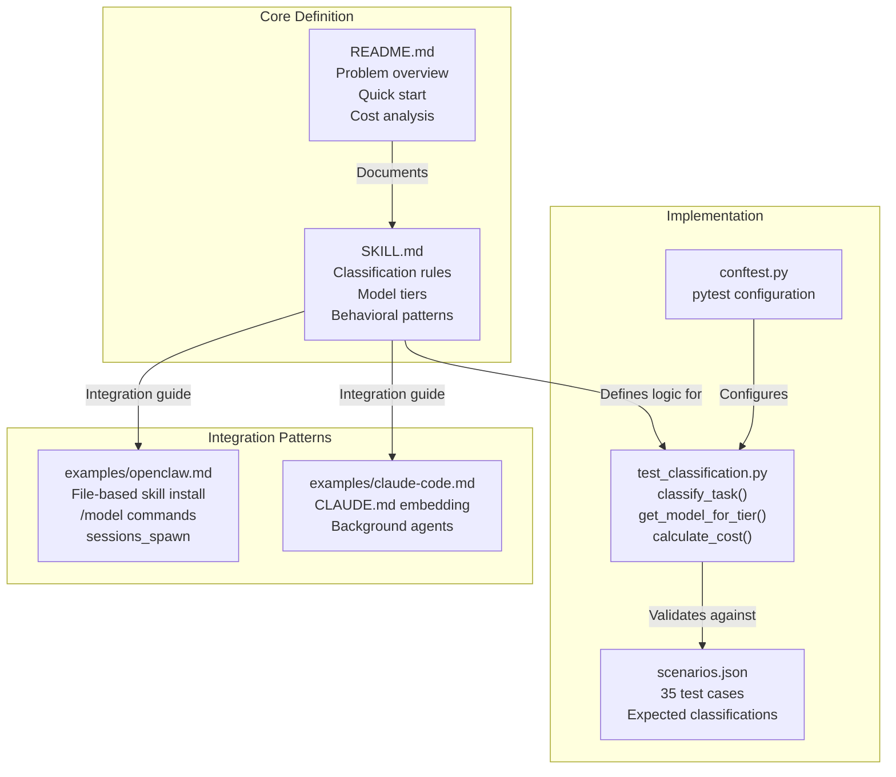
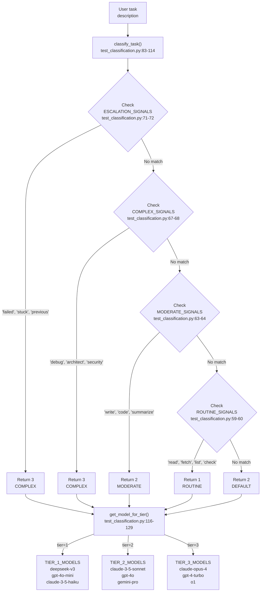
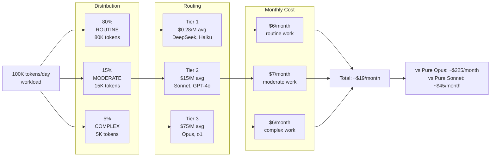

<!-- source: DeepWiki mcp.deepwiki.com · repo zscole/model-hierarchy-skill · page 1 Home · fetched 2026-10-26 -->

# Home

Relevant source files

The following files were used as context for generating this wiki page:

- [README.md](README.md)
- [SKILL.md](SKILL.md)

This wiki documents the **model-hierarchy-skill** system: a cost optimization framework for AI agent platforms that achieves approximately 10x cost reduction by intelligently routing tasks to appropriate language models based on complexity. The system classifies agent tasks into three categories (routine, moderate, complex) and routes them to corresponding model tiers (cheap, mid, premium), maintaining quality on complex work while dramatically reducing costs on routine operations.

This page provides a high-level introduction to the system architecture, core concepts, and repository structure. For detailed information about specific aspects:
- Problem definition and cost analysis: see [The Problem: Agent Cost Waste](#2.1) and [Cost Optimization Analysis](#2.3)
- Skill specification and classification rules: see [The Skill Definition](#3)
- Implementation details: see [Implementation Reference](#4)
- Platform-specific integration: see [Integration Guides](#5)

**Sources:** [README.md:1-89](), [SKILL.md:1-256]()

## System Overview

The model-hierarchy-skill addresses a fundamental inefficiency in AI agent systems: most agents execute all tasks on expensive premium models, despite 80% of agent work being routine operations (file I/O, status checks, formatting) that cheap models handle equally well. The system provides a classification framework and routing logic that agents can adopt to match task complexity with appropriate model capabilities.

The framework consists of three primary components:

| Component | Purpose | Key Artifact |
|-----------|---------|--------------|
| **Skill Definition** | Classification rules, model tiers, behavioral guidelines | `SKILL.md` |
| **Implementation** | Executable classification logic and cost calculations | `test_classification.py` |
| **Integration Examples** | Platform-specific adoption patterns | `examples/openclaw.md`, `examples/claude-code.md` |

The system achieves ~$19/month operational cost versus ~$225/month for pure premium model usage, assuming 100K tokens/day workload with 80/15/5 task distribution.

**Sources:** [README.md:3-19](), [SKILL.md:11-17]()

## Repository Structure

**Diagram: Repository File Structure**

The repository is organized into three layers:

1. **Core Definition Layer**: `SKILL.md` contains the authoritative specification of classification rules, model tier definitions, and agent behavioral patterns. `README.md` provides user-facing documentation.

2. **Implementation Layer**: `test_classification.py` contains both the reference implementation of the classification logic and comprehensive tests validating it. `scenarios.json` provides ground truth data for 35 test cases spanning routine, moderate, complex, and edge-case scenarios.

3. **Integration Layer**: Platform-specific examples demonstrate adoption patterns. `examples/openclaw.md` shows file-based skill installation for OpenClaw. `examples/claude-code.md` shows instruction embedding for Claude Code/Codex.

**Sources:** [README.md:72-84](), [SKILL.md:1-9]()

## Core Concepts

### Three-Tier Model Hierarchy

The system categorizes available language models into three tiers based on cost and capability:

| Tier | Cost Range | Model Examples | Usage Pattern |
|------|------------|----------------|---------------|
| **Tier 1 (Cheap)** | $0.14-0.50/M tokens | DeepSeek V3, GPT-4o-mini, Claude Haiku | 80% of tasks: file ops, status checks, formatting |
| **Tier 2 (Mid)** | $1-5/M tokens | Claude Sonnet, GPT-4o, Gemini Pro | 15% of tasks: code generation, summaries, analysis |
| **Tier 3 (Premium)** | $10-75/M tokens | Claude Opus, GPT-4.5, o1 | 5% of tasks: debugging, architecture, novel problems |

**Sources:** [SKILL.md:19-47]()

### Task Classification System

Tasks are classified into three complexity categories that map to model tiers:

- **ROUTINE** → Tier 1: Single-step operations with clear instructions and deterministic output (file read/write, status checks, simple lookups, formatting)
- **MODERATE** → Tier 2: Multi-step but well-defined operations requiring synthesis (code generation, summarization, data analysis, tool orchestration)
- **COMPLEX** → Tier 3: Novel problem-solving requiring deep reasoning (debugging, architecture decisions, security review, failed task escalation)

**Sources:** [SKILL.md:49-107]()

## Classification Architecture

**Diagram: Classification Logic Flow with Code Entity Mapping**

The classification system uses a cascading signal detection approach implemented in `classify_task()` [test_classification.py:83-114](). The function analyzes task descriptions against four signal pattern sets:

1. **ESCALATION_SIGNALS** [test_classification.py:71-72](): Highest priority, detects task retry/failure scenarios → forces Tier 3
2. **COMPLEX_SIGNALS** [test_classification.py:67-68](): Detects complex reasoning requirements → routes to Tier 3
3. **MODERATE_SIGNALS** [test_classification.py:63-64](): Detects synthesis/generation tasks → routes to Tier 2
4. **ROUTINE_SIGNALS** [test_classification.py:59-60](): Detects simple operations → routes to Tier 1

Ambiguous tasks default to Tier 2 as a safety mechanism. The `get_model_for_tier()` function [test_classification.py:116-129]() maps tier numbers to specific model identifiers from `TIER_1_MODELS`, `TIER_2_MODELS`, and `TIER_3_MODELS` [test_classification.py:46-57]().

**Sources:** [test_classification.py:46-129](), [SKILL.md:109-132]()

## Cost Optimization Model

The economic justification for the system relies on task distribution patterns typical in agent operations:

**Diagram: Cost Calculation Model**

The cost model assumes an 80/15/5 distribution based on typical agent workload patterns. Cost calculations are implemented in `calculate_cost()` and `calculate_monthly_cost()` functions [test_classification.py:131-152]() using pricing data from `MODEL_PRICING` [test_classification.py:20-44]().

**Calculation methodology:**
- Routine (80K tokens/day × 30 days × $0.28/M) ≈ $6/month
- Moderate (15K tokens/day × 30 days × $15/M) ≈ $7/month  
- Complex (5K tokens/day × 30 days × $75/M) ≈ $6/month
- **Total:** ~$19/month vs ~$225 for pure premium usage (10x reduction)

**Sources:** [README.md:52-61](), [SKILL.md:167-183](), [test_classification.py:20-152]()

## Integration Patterns

The skill supports three integration approaches:

### File-Based Discovery (OpenClaw)
Copy `SKILL.md` to `~/.openclaw/skills/model-hierarchy/SKILL.md`. The OpenClaw gateway loads the skill and enables `/model` commands for manual switching and `sessions_spawn` for automated sub-agent model selection. Configuration via `config.yml` sets default models. See [OpenClaw Integration](#5.1) for details.

### Instruction Embedding (Claude Code)
Extract classification rules from `SKILL.md` and embed into `CLAUDE.md` or project instructions. The agent reads these instructions at session start and applies them when spawning background agents. Natural language prompts guide model selection decisions. See [Claude Code Integration](#5.2) for details.

### Programmatic Implementation (Custom)
Implement a `get_model_for_task(task_description: str) -> str` function based on the signal detection patterns in [SKILL.md:220-232](). The reference implementation in [test_classification.py:83-129]() provides a starting point. See [Custom Integration](#5.3) for details.

**Sources:** [SKILL.md:186-232](), [examples/openclaw.md](), [examples/claude-code.md]()

## Validation Framework

The system includes comprehensive testing infrastructure:

- **Test scenarios**: `scenarios.json` contains 35 test cases across routine (10), moderate (10), complex (10), and edge case (5) categories, each with expected tier classification
- **Test implementation**: `test_classification.py` contains four test classes validating classification accuracy, cost calculations, model selection, and real-world scenario handling
- **Test execution**: Run via `pytest tests/ -v` or `python tests/test_classification.py`

The test suite validates that the `classify_task()` function correctly assigns tiers for diverse task descriptions and that cost projections match expected values. See [Testing & Validation](#6) for comprehensive coverage.

**Sources:** [README.md:62-70](), [test_classification.py:1-346](), [scenarios.json]()

## Getting Started

To adopt the model-hierarchy-skill:

1. **Understand the problem**: Review [The Problem: Agent Cost Waste](#2.1) to understand why routing matters
2. **Learn the classification system**: Read [Task Classification System](#3.1) and [Model Tier Architecture](#3.2) for tier definitions and routing rules
3. **Choose integration approach**: Select file-based ([OpenClaw Integration](#5.1)), instruction embedding ([Claude Code Integration](#5.2)), or programmatic ([Custom Integration](#5.3)) based on your platform
4. **Validate with tests**: Run the test suite to verify classification behavior matches expectations ([Running Tests](#6.3))
5. **Monitor and refine**: Track actual costs and adjust signal patterns as needed ([Extending the Skill](#7.3))

The skill is designed to be immediately usable via `SKILL.md` but also extensible for domain-specific customization.

**Sources:** [README.md:21-51](), [SKILL.md:249-256]()

---

