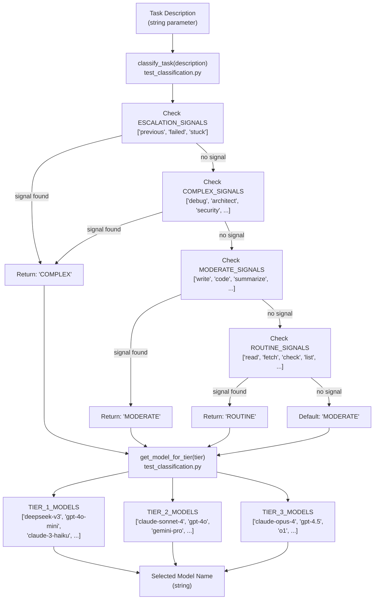
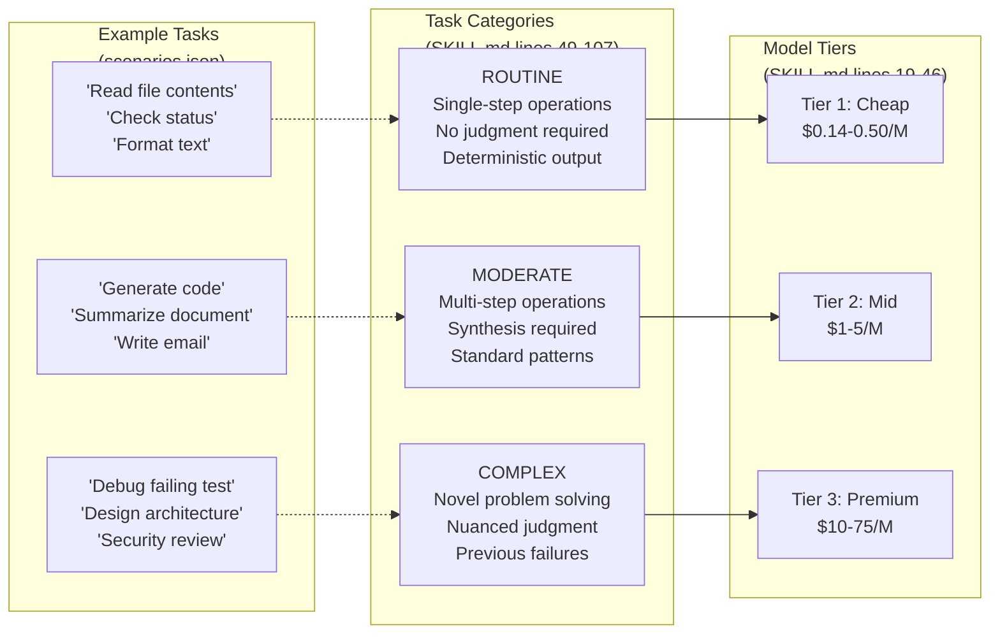
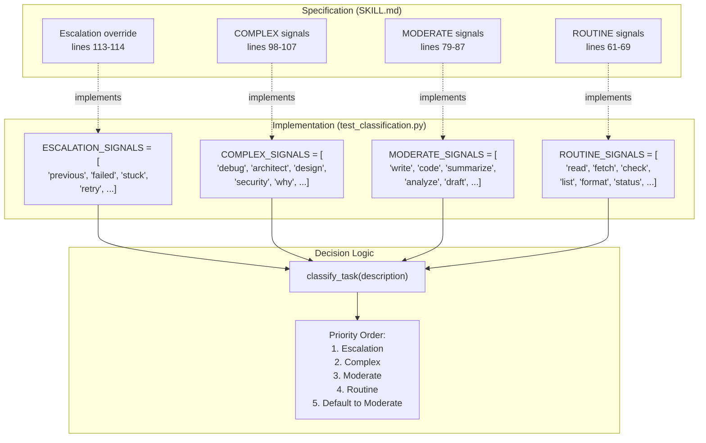
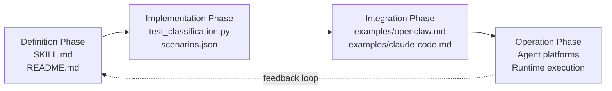

<!-- source: DeepWiki mcp.deepwiki.com · repo zscole/model-hierarchy-skill · page 2 Understanding the System · fetched 2026-10-26 -->

# Understanding the System

Relevant source files

The following files were used as context for generating this wiki page:

- [README.md](README.md)
- [SKILL.md](SKILL.md)

## Purpose and Scope

This page provides a comprehensive overview of the model-hierarchy-skill system architecture, explaining both the problem it solves and how the solution is structured. It bridges the conceptual framework with the actual implementation details.

For specific information about:
- The cost waste problem in detail, see [The Problem: Agent Cost Waste](#2.1)
- The routing solution mechanics, see [The Solution: Hierarchical Model Routing](#2.2)
- Mathematical cost analysis, see [Cost Optimization Analysis](#2.3)
- The skill specification format, see [The Skill Definition](#3)
- Code implementation details, see [Implementation Reference](#4)
- Platform-specific integration, see [Integration Guides](#5)

---

## System Overview

The model-hierarchy-skill is a cost optimization system that teaches AI agents to classify tasks by complexity and route them to appropriately-priced language models. The system achieves approximately 10x cost reduction by recognizing that 80% of agent tasks are routine operations that do not require expensive premium models.

The system consists of three primary layers:

| Layer | Components | Purpose |
|-------|-----------|---------|
| **Definition** | `SKILL.md`, `README.md` | Specifies classification rules, model tiers, and behavioral guidelines |
| **Implementation** | `test_classification.py`, `scenarios.json` | Executable classification logic and validation suite |
| **Integration** | `examples/openclaw.md`, `examples/claude-code.md` | Platform-specific adoption patterns |

**Sources:** [README.md:1-88](), [SKILL.md:1-256]()

---

## Core Architecture Components

The following diagram maps the system's conceptual components to their concrete file and code representations:

### Component-to-Code Mapping

```mermaid
graph TB
    subgraph "Definition Layer"
        SKILL_MD["SKILL.md"]
        README_MD["README.md"]
        
        SKILL_RULES["Classification Rules<br/>(lines 49-107)"]
        SKILL_TIERS["Model Tiers<br/>(lines 19-46)"]
        SKILL_ALGO["Decision Algorithm<br/>(lines 109-132)"]
        
        SKILL_MD --> SKILL_RULES
        SKILL_MD --> SKILL_TIERS
        SKILL_MD --> SKILL_ALGO
    end
    
    subgraph "Implementation Layer"
        TEST_FILE["test_classification.py"]
        SCENARIOS["scenarios.json"]
        
        CLASSIFY_FUNC["classify_task()"]
        MODEL_FUNC["get_model_for_tier()"]
        COST_FUNC["calculate_cost()"]
        
        SIGNAL_ROUTINE["ROUTINE_SIGNALS"]
        SIGNAL_MODERATE["MODERATE_SIGNALS"]
        SIGNAL_COMPLEX["COMPLEX_SIGNALS"]
        SIGNAL_ESCALATION["ESCALATION_SIGNALS"]
        
        TEST_FILE --> CLASSIFY_FUNC
        TEST_FILE --> MODEL_FUNC
        TEST_FILE --> COST_FUNC
        TEST_FILE --> SIGNAL_ROUTINE
        TEST_FILE --> SIGNAL_MODERATE
        TEST_FILE --> SIGNAL_COMPLEX
        TEST_FILE --> SIGNAL_ESCALATION
    end
    
    subgraph "Integration Layer"
        OC_EXAMPLE["examples/openclaw.md"]
        CC_EXAMPLE["examples/claude-code.md"]
        
        OC_INSTALL["~/.openclaw/skills/<br/>model-hierarchy/"]
        CC_CLAUDE_MD["CLAUDE.md<br/>project instructions"]
    end
    
    SKILL_RULES -.->|"implements"| CLASSIFY_FUNC
    SKILL_TIERS -.->|"implements"| MODEL_FUNC
    SKILL_ALGO -.->|"implements"| SIGNAL_ROUTINE
    SKILL_ALGO -.->|"implements"| SIGNAL_MODERATE
    SKILL_ALGO -.->|"implements"| SIGNAL_COMPLEX
    
    SKILL_MD -.->|"copied to"| OC_INSTALL
    SKILL_RULES -.->|"embedded in"| CC_CLAUDE_MD
    
    SCENARIOS -.->|"validates"| CLASSIFY_FUNC
```

**Sources:** [SKILL.md:1-256](), [README.md:72-84]()

---

## Task Classification and Routing Flow

This diagram shows how a task description flows through the classification system, mapping to specific code functions and data structures:

### Task Processing Pipeline

**Sources:** [test_classification.py]() (specific line references not available, but contains `classify_task()`, `get_model_for_tier()`, signal constant definitions)

---

## Three-Tier Model Hierarchy

The system organizes language models into three tiers based on cost and capability. Each tier is defined in both the specification and implementation:

| Tier | Cost Range | SKILL.md Definition | Implementation Constant | Example Models |
|------|-----------|---------------------|------------------------|----------------|
| **Tier 1: Cheap** | $0.10-0.50/M tokens | Lines 21-28 | `TIER_1_MODELS` | `deepseek-v3`, `gpt-4o-mini`, `claude-3-haiku` |
| **Tier 2: Mid** | $1-5/M tokens | Lines 30-36 | `TIER_2_MODELS` | `claude-sonnet-4`, `gpt-4o`, `gemini-pro` |
| **Tier 3: Premium** | $10-75/M tokens | Lines 38-45 | `TIER_3_MODELS` | `claude-opus-4`, `gpt-4.5`, `o1` |

### Tier-to-Task Mapping

**Sources:** [SKILL.md:19-107](), [README.md:13-17]()

---

## Signal-Based Classification System

The classification mechanism relies on keyword signal detection. The specification in `SKILL.md` defines the concept, while `test_classification.py` implements it as constant lists:

### Signal Detection Architecture

The `classify_task()` function checks signals in priority order: escalation signals override everything, followed by complex signals, moderate signals, and routine signals. If no signals match, the function defaults to `'MODERATE'` as a safe middle ground.

**Sources:** [SKILL.md:109-132](), [test_classification.py]()

---

## Implementation Validation

The system includes comprehensive validation through a test suite:

| Component | File | Purpose |
|-----------|------|---------|
| **Test scenarios** | `scenarios.json` | 35 test cases covering routine, moderate, complex, and edge cases |
| **Classification tests** | `test_classification.py` | Validates `classify_task()` accuracy against scenarios |
| **Cost calculation tests** | `test_classification.py` | Validates `calculate_cost()` and `calculate_monthly_cost()` functions |
| **Model selection tests** | `test_classification.py` | Validates `get_model_for_tier()` returns correct model names |

The test suite ensures the implementation matches the specification defined in `SKILL.md`. For details on running tests, see [Testing & Validation](#6).

**Sources:** [README.md:62-70]()

---

## Integration Patterns

The system supports three distinct integration patterns, each suited to different agent platform architectures:

### Integration Pattern Overview

```mermaid
graph TB
    subgraph "Pattern 1: File-Based Discovery"
        FB_SPEC["SKILL.md specification"]
        FB_INSTALL["Copy to:<br/>~/.openclaw/skills/<br/>model-hierarchy/SKILL.md"]
        FB_GATEWAY["OpenClaw Gateway<br/>discovers and loads skill"]
        FB_RUNTIME["Runtime commands:<br/>/model opus<br/>/model deepseek"]
    end
    
    subgraph "Pattern 2: Instruction Embedding"
        IE_SPEC["SKILL.md classification rules"]
        IE_EXTRACT["Extract natural language rules"]
        IE_CLAUDE["Add to CLAUDE.md<br/>project instructions"]
        IE_RUNTIME["Agent reads instructions<br/>on initialization"]
    end
    
    subgraph "Pattern 3: Programmatic"
        PG_CODE["test_classification.py<br/>implementation"]
        PG_FUNC["Implement get_model_for_task()<br/>in agent codebase"]
        PG_CALL["Call before API requests:<br/>model = get_model_for_task(task)"]
    end
    
    FB_SPEC --> FB_INSTALL --> FB_GATEWAY --> FB_RUNTIME
    IE_SPEC --> IE_EXTRACT --> IE_CLAUDE --> IE_RUNTIME
    PG_CODE --> PG_FUNC --> PG_CALL
```

For platform-specific implementation details, see:
- [OpenClaw Integration](#5.1) for file-based discovery pattern
- [Claude Code Integration](#5.2) for instruction embedding pattern
- [Custom Integration](#5.3) for programmatic implementation

**Sources:** [SKILL.md:186-232](), [README.md:22-50](), [examples/openclaw.md](), [examples/claude-code.md]()

---

## Cost Optimization Economics

The system achieves cost reduction through task distribution across tiers. The assumed distribution is:

| Distribution | Tasks per Tier | Tier Cost | Monthly Cost |
|--------------|---------------|-----------|--------------|
| 80% routine | 80K tokens/day → Tier 1 | $0.28/M average | ~$6/month |
| 15% moderate | 15K tokens/day → Tier 2 | $15/M average | ~$7/month |
| 5% complex | 5K tokens/day → Tier 3 | $75/M average | ~$6/month |
| **Total hierarchy** | **100K tokens/day** | **Mixed** | **~$19/month** |

Comparison to single-tier strategies:

| Strategy | Monthly Cost | vs Hierarchy |
|----------|--------------|--------------|
| Pure Tier 3 (Opus) | ~$225 | 10x more expensive |
| Pure Tier 2 (Sonnet) | ~$45 | 2.4x more expensive |
| Hierarchy (80/15/5) | ~$19 | Baseline |

The cost calculation is implemented in the `calculate_monthly_cost()` function, which accepts token counts per tier and pricing information.

For detailed cost analysis and mathematical justification, see [Cost Optimization Analysis](#2.3).

**Sources:** [SKILL.md:168-183](), [README.md:52-60]()

---

## System Lifecycle

The skill follows a definition → implementation → integration → operation lifecycle:

The specification in `SKILL.md` defines the rules and behaviors. The implementation in `test_classification.py` provides executable classification logic. Integration examples demonstrate adoption patterns. Operation occurs when agent platforms execute tasks using the skill's classification logic.

**Sources:** [README.md:1-88](), [SKILL.md:1-256]()

---

## Summary

The model-hierarchy-skill system consists of:

1. **A specification** ([SKILL.md]()) defining task classification rules, model tiers, and behavioral guidelines
2. **An implementation** ([test_classification.py]()) providing `classify_task()`, signal detection, and model selection
3. **Integration examples** ([examples/]()) showing file-based, instruction-based, and programmatic adoption
4. **A validation suite** ([scenarios.json]()) with 35 test cases ensuring classification accuracy

The system routes tasks to appropriate models based on complexity signals, achieving approximately 10x cost reduction by recognizing that 80% of agent tasks are routine operations suitable for cheap models.

For detailed information on specific aspects of the system, refer to the child pages under this section.

---

