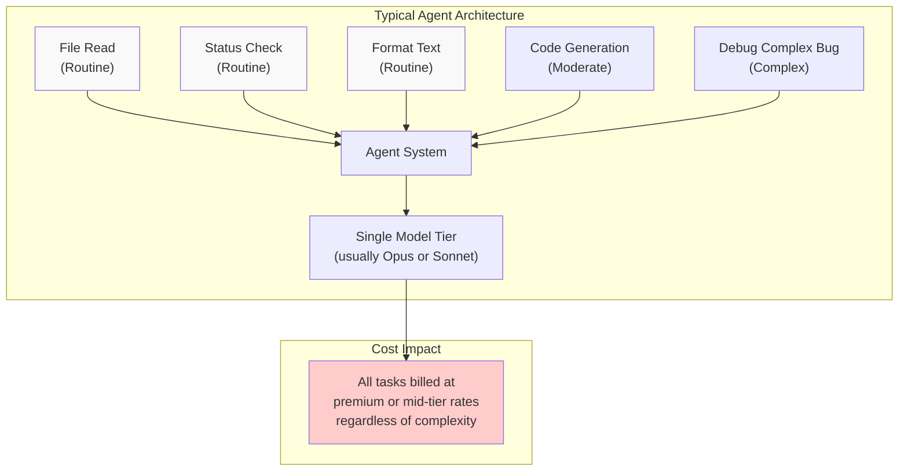
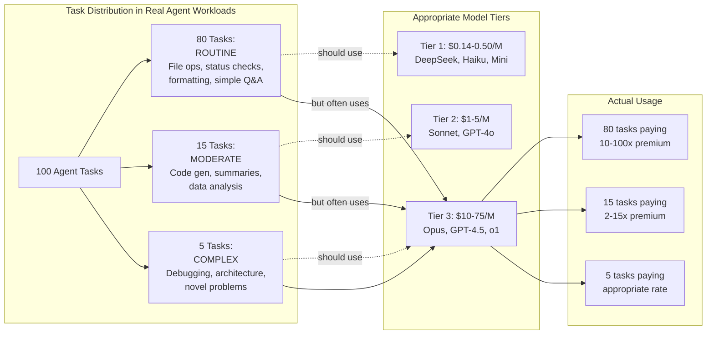
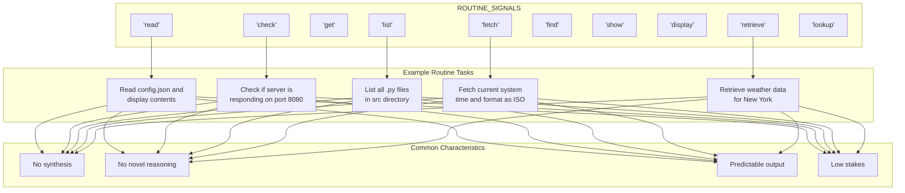
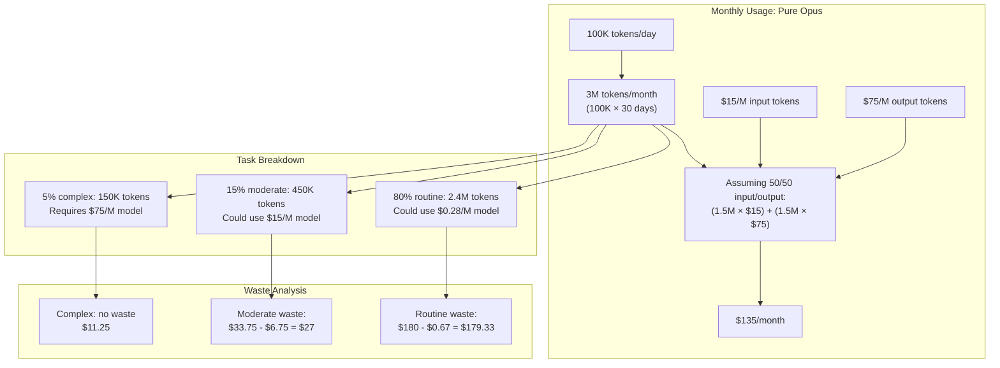
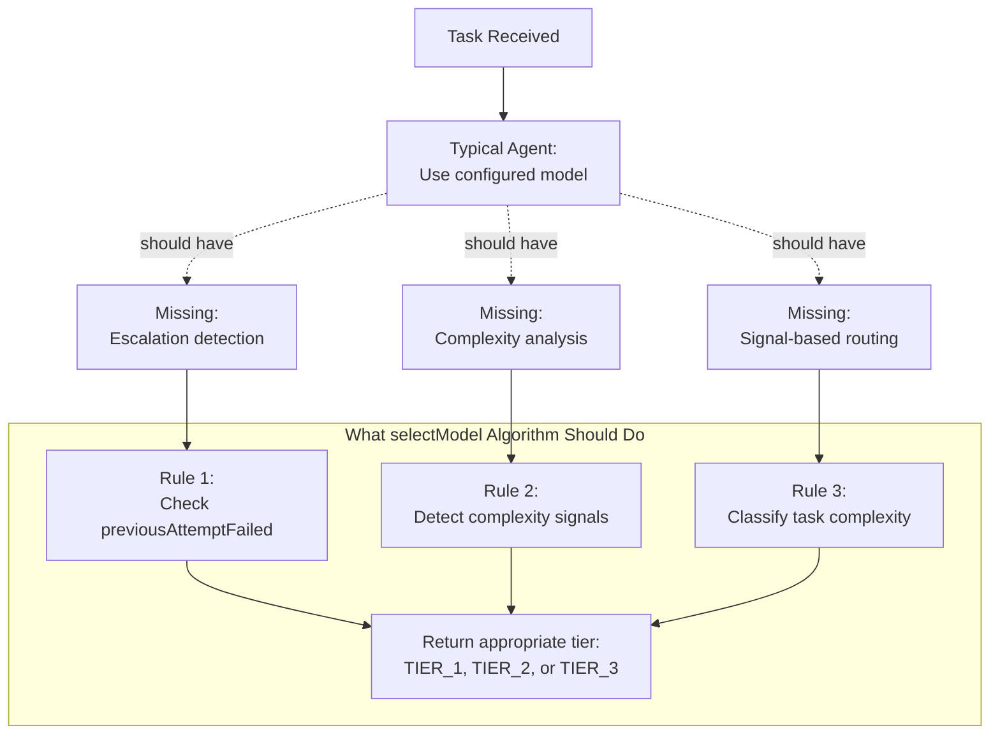
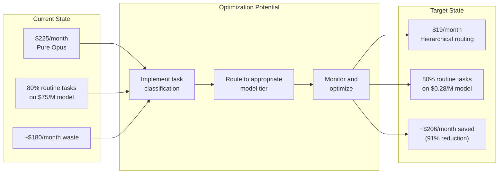

<!-- source: DeepWiki mcp.deepwiki.com · repo zscole/model-hierarchy-skill · page 2.1 The Problem: Agent Cost Waste · fetched 2026-10-26 -->

# The Problem: Agent Cost Waste

<details>
<summary>Relevant source files</summary>

The following files were used as context for generating this wiki page:

- [README.md](README.md)
- [SKILL.md](SKILL.md)

</details>


## Purpose and Scope

This document explains the fundamental problem that the model-hierarchy-skill system addresses: **the systemic waste of resources when AI agents execute routine tasks using expensive premium models**. It quantifies the cost impact, identifies the types of tasks that constitute "janitorial work," and examines why agents default to premium models despite most tasks being routine.

For the solution to this problem, see [The Solution: Hierarchical Model Routing](#2.2). For detailed cost calculations and savings projections, see [Cost Optimization Analysis](#2.3).

---

## The Core Problem Statement

Most AI agent systems execute all tasks using a single model tier, typically mid-tier or premium models. This approach creates significant cost waste because the distribution of task complexity in real-world agent operations is heavily skewed toward routine operations.

**The fundamental inefficiency**: Agents pay $15-75 per million tokens for tasks that $0.14-0.50 per million tokens can handle equivalently.



**Diagram: Uniform Model Usage Pattern**

Sources: [README.md:5-7](), [SKILL.md:16-17]()

---

## The 80/15/5 Task Distribution

Analysis of typical agent workloads reveals a consistent pattern: **80% of agent tasks are routine operations** that require no complex reasoning, nuanced judgment, or novel problem-solving.

| Task Category | Percentage | Complexity Level | Example Operations |
|---------------|-----------|------------------|-------------------|
| **Routine** | 80% | Single-step, deterministic | File I/O, status checks, formatting, lookups |
| **Moderate** | 15% | Multi-step, standard patterns | Code generation, summaries, analysis |
| **Complex** | 5% | Novel reasoning, high stakes | Debugging, architecture, security review |



**Diagram: Task Distribution and Cost Mismatch**

This distribution means that **the majority of operational costs are spent on tasks that derive no benefit from premium models**. A $0.14/M token model performs identically to a $75/M token model when reading a file or checking a status endpoint.

Sources: [README.md:7-17](), [SKILL.md:16-17](), [SKILL.md:178-182]()

---

## What Constitutes "Janitorial Work"

The term "janitorial work" describes the 80% of routine tasks that agents perform but that require no sophisticated reasoning capabilities. These tasks are characterized by:

### Characteristics of Routine Tasks

- **Single-step operations**: No multi-stage reasoning required
- **Clear, unambiguous instructions**: No interpretation needed
- **Deterministic output**: Expected result is well-defined
- **No judgment calls**: Execution follows direct procedural logic

### Examples from Code

The codebase defines routine operations through signal patterns detected in task descriptions. These signals are defined in [test_classification.py]():



**Diagram: ROUTINE_SIGNALS Pattern Detection**

The classification system in `test_classification.py` defines these signal patterns:

| Signal Category | Signals | Task Examples |
|----------------|---------|---------------|
| **ROUTINE_SIGNALS** | `read`, `fetch`, `get`, `list`, `check`, `find`, `show`, `display`, `retrieve`, `lookup` | File operations, status checks, simple lookups |
| **MODERATE_SIGNALS** | `write`, `create`, `update`, `modify`, `generate`, `code`, `summarize`, `analyze`, `transform` | Code generation, summaries, data transformation |
| **COMPLEX_SIGNALS** | `debug`, `fix`, `solve`, `architect`, `design`, `security`, `optimize`, `refactor` | Multi-step debugging, design decisions |
| **ESCALATION_SIGNALS** | `failed`, `stuck`, `error`, `previous attempt`, `tried`, `unsuccessful` | Tasks that need escalation after failure |

Sources: [SKILL.md:53-107](), [test_classification.py]() (signal definitions)

### Concrete Examples

From the skill definition in [SKILL.md:62-70]():

**Routine operations** (Tier 1 appropriate):
- File read/write operations
- Status checks and health monitoring
- Simple lookups (time, weather, definitions)
- Formatting and restructuring text
- List operations (filter, sort, transform)
- API calls with known parameters
- Heartbeat and cron tasks
- URL fetching and basic parsing

**Not routine** (Tier 2+ required):
- Code generation (standard patterns)
- Summarization and synthesis
- Draft writing (emails, docs, messages)
- Data analysis and transformation
- Multi-file operations

Sources: [SKILL.md:53-107]()

---

## Quantified Cost Impact

The cost waste from using premium models for routine tasks is substantial. Using 100K tokens per day as a baseline workload:

### Pure Premium Model Approach



**Diagram: Cost Waste with Pure Premium Model**

### Cost Comparison Table

| Strategy | Routine (80%) | Moderate (15%) | Complex (5%) | **Total** |
|----------|---------------|----------------|--------------|-----------|
| **Pure Opus** ($15-75/M) | $180 | $34 | $11 | **~$225** |
| **Pure Sonnet** ($3-15/M) | $36 | $7 | $2 | **~$45** |
| **Pure DeepSeek** ($0.14-0.28/M) | $0.67 | $0.13 | $0.04 | **~$0.84** |
| **Hierarchy** (80/15/5 split) | $6 (Tier 1) | $7 (Tier 2) | $6 (Tier 3) | **~$19** |

**Savings with hierarchy**: 
- vs Pure Opus: **~10.8x reduction** (~$206/month saved)
- vs Pure Sonnet: **~2.4x reduction** (~$26/month saved)

The key insight: **$206 of the $225 monthly Opus cost is spent on tasks that derive no benefit from Opus-level capabilities**.

Sources: [README.md:52-60](), [SKILL.md:168-183]()

---

## Why Agents Default to Expensive Models

Several factors contribute to the widespread pattern of using premium models for all tasks:

### 1. Simplicity Over Optimization

Agent frameworks typically default to a single model configuration. From integration examples:

```yaml
# config.yml - typical agent configuration
model: anthropic/claude-opus-4
```

**Problem**: Once set, this model handles all subsequent operations regardless of task complexity.

### 2. Lack of Task Classification

Most agent systems do not implement classification logic. The `selectModel` decision algorithm from [SKILL.md:110-132]() demonstrates what's typically missing:



**Diagram: Missing Classification Logic in Typical Agents**

### 3. Fear of Quality Degradation

Developers and users often assume that cheaper models will produce lower quality outputs. However, this assumption is false for routine tasks:

| Task Type | Tier 1 Quality | Tier 3 Quality | Quality Difference |
|-----------|----------------|----------------|-------------------|
| Read file contents | ✓ Identical | ✓ Identical | **None** |
| Check HTTP status | ✓ Identical | ✓ Identical | **None** |
| Format JSON | ✓ Identical | ✓ Identical | **None** |
| Simple lookups | ✓ Identical | ✓ Identical | **None** |
| Code generation | Acceptable | Better | Some (justified cost) |
| Novel debugging | Inadequate | Excellent | Significant (justified cost) |

**The reality**: Routine tasks are deterministic operations where model capability above a minimum threshold provides no benefit.

### 4. No Cost Visibility

Agent systems rarely expose per-task cost metrics, making the waste invisible to users and developers. The system operates as a black box where expensive operations are indistinguishable from cheap ones.

Sources: [SKILL.md:1-17](), [SKILL.md:110-132](), [SKILL.md:235-246]()

---

## The Opportunity

The combination of heavily skewed task distribution (80% routine) and massive price differentials (100x+ between cheapest and most expensive models) creates a significant optimization opportunity:



**Diagram: Cost Optimization Opportunity**

The model-hierarchy-skill system addresses this opportunity by implementing intelligent task classification and tiered model routing. For details on the solution architecture, see [The Solution: Hierarchical Model Routing](#2.2).

Sources: [README.md:1-19](), [SKILL.md:168-183]()

---

## Summary

The agent cost waste problem is characterized by:

1. **Skewed task distribution**: 80% of agent work is routine operations
2. **Uniform model usage**: Most systems use a single model tier for all tasks
3. **Massive price differentials**: 100x+ cost difference between cheapest and most expensive models
4. **No quality benefit**: Routine tasks produce identical results on cheap vs. premium models
5. **Invisible waste**: Users and developers lack visibility into per-task costs

**Result**: Systems routinely spend 10x more than necessary, with ~90% of costs going toward tasks that derive no benefit from premium model capabilities.

The problem is not that premium models are too expensive—it's that they're being used for tasks that don't require their capabilities. This is the core inefficiency that the model-hierarchy-skill system eliminates.

Sources: [README.md:5-19](), [SKILL.md:11-183]()

---

