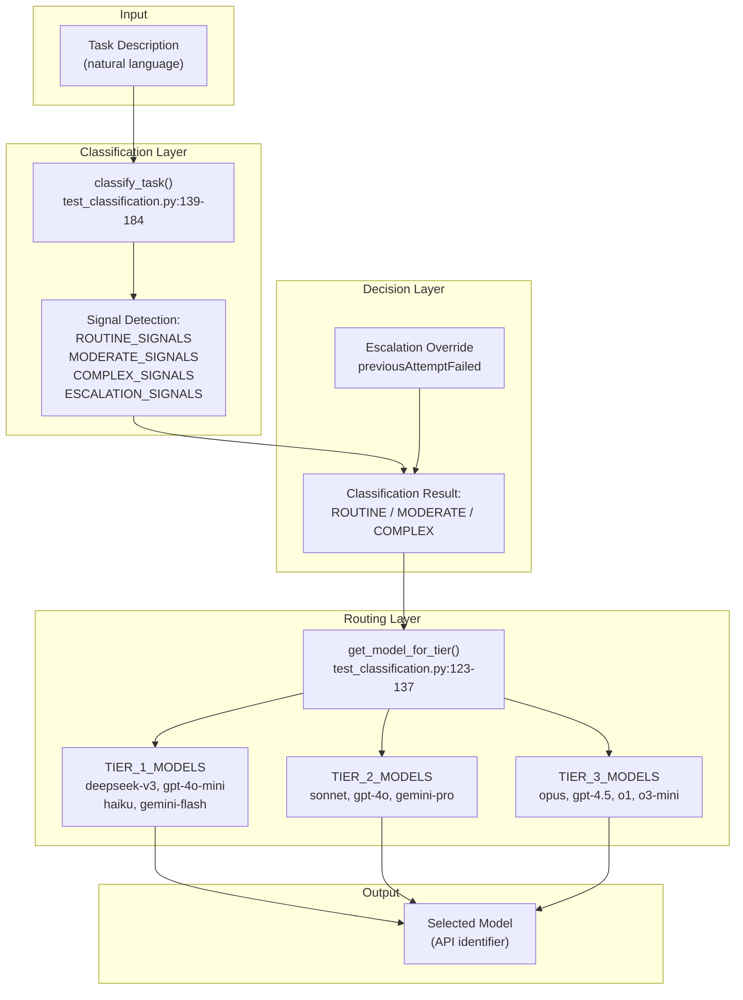
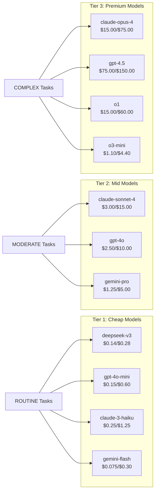
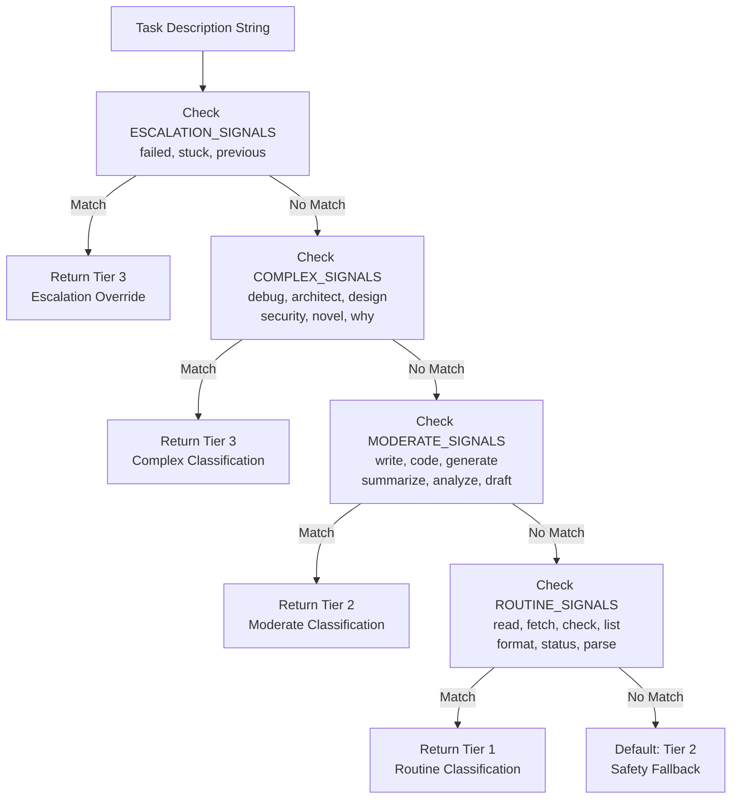
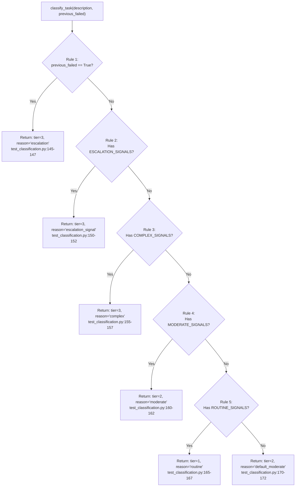
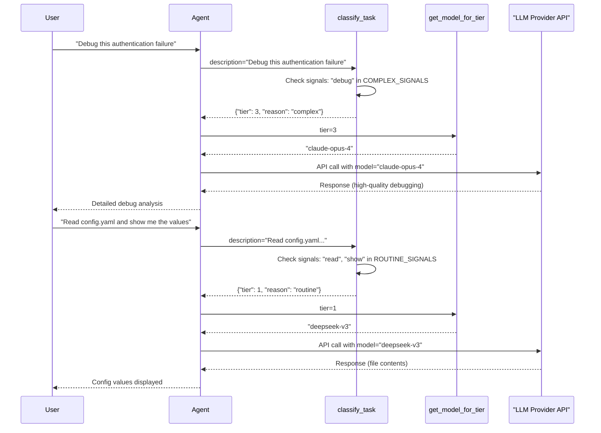

<!-- source: DeepWiki mcp.deepwiki.com · repo zscole/model-hierarchy-skill · page 2.2 The Solution: Hierarchical Model Routing · fetched 2026-10-26 -->

# The Solution: Hierarchical Model Routing

<details>
<summary>Relevant source files</summary>

The following files were used as context for generating this wiki page:

- [README.md](README.md)
- [SKILL.md](SKILL.md)

</details>


## Purpose and Scope

This page describes the core solution architecture of the model-hierarchy-skill system: how it routes tasks to appropriate models based on complexity to achieve cost optimization. The solution consists of three main components: a three-tier model classification system, a signal-based task analysis algorithm, and routing logic that matches tasks to the cheapest viable model tier.

For details on the problem being solved, see [The Problem: Agent Cost Waste](#2.1). For the mathematical justification of cost savings, see [Cost Optimization Analysis](#2.3). For the complete specification of classification rules, see [The Skill Definition](#3).

---

## Solution Overview

The hierarchical model routing system addresses agent cost waste through three core mechanisms:

1. **Model Tier Hierarchy** - A three-tier classification of LLM models by capability and cost
2. **Task Complexity Classification** - Signal-based analysis to categorize tasks as ROUTINE, MODERATE, or COMPLEX
3. **Intelligent Routing** - Decision algorithm that maps classified tasks to the cheapest sufficient model tier

The system operates on the principle that task complexity distribution is heavily skewed toward routine operations (estimated 80%), making aggressive routing to cheap models economically valuable while maintaining quality parity for those tasks.



**Sources:** [SKILL.md:1-256](), [test_classification.py:1-300](), [README.md:1-89]()

---

## Three-Tier Model Hierarchy

The system defines three distinct model tiers based on cost and capability profiles. Each tier contains multiple interchangeable models from different providers, allowing flexibility in deployment.

### Tier Definitions

| Tier | Cost Range | Usage Pattern | Code Reference |
|------|-----------|---------------|----------------|
| **Tier 1: Cheap** | $0.10-0.50/M tokens | 80% of tasks | `TIER_1_MODELS` [test_classification.py:30-35]() |
| **Tier 2: Mid** | $1-5/M tokens | 15% of tasks | `TIER_2_MODELS` [test_classification.py:36-40]() |
| **Tier 3: Premium** | $10-75/M tokens | 5% of tasks | `TIER_3_MODELS` [test_classification.py:41-46]() |

### Model Assignments by Tier



**Sources:** [SKILL.md:19-46](), [test_classification.py:30-46]()

### Default Model Selection

The `get_model_for_tier()` function returns the first model in each tier list as the default, but implementations can customize selection based on provider availability, regional pricing, or specific capability requirements.

```python
# Simplified logic from test_classification.py:123-137
def get_model_for_tier(tier: int) -> str:
    if tier == 1:
        return TIER_1_MODELS[0]  # "deepseek-v3"
    elif tier == 2:
        return TIER_2_MODELS[0]  # "claude-sonnet-4"
    else:
        return TIER_3_MODELS[0]  # "claude-opus-4"
```

**Sources:** [test_classification.py:123-137]()

---

## Task Classification System

The classification system analyzes task descriptions using signal-based pattern matching to determine complexity level. This approach is fast, deterministic, and does not require an additional LLM call.

### Classification Categories

| Category | Characteristics | Tier Assignment | Code Constant |
|----------|----------------|-----------------|---------------|
| **ROUTINE** | Single-step, deterministic, no judgment | Tier 1 | `ROUTINE_SIGNALS` [test_classification.py:49-60]() |
| **MODERATE** | Multi-step, standard patterns, synthesis | Tier 2 | `MODERATE_SIGNALS` [test_classification.py:61-73]() |
| **COMPLEX** | Novel problems, judgment calls, high stakes | Tier 3 | `COMPLEX_SIGNALS` [test_classification.py:74-86]() |

### Signal Pattern Detection

The system defines keyword lists that indicate task complexity. When a task description contains specific signals, it gets classified accordingly.



**Sources:** [test_classification.py:139-184](), [SKILL.md:109-132]()

### Signal Definitions

The complete signal lists are defined as constants in the implementation:

| Signal List | Purpose | Example Keywords |
|-------------|---------|------------------|
| `ROUTINE_SIGNALS` | Identify simple operations | `read`, `fetch`, `check`, `list`, `format`, `status`, `parse`, `get`, `show`, `display` |
| `MODERATE_SIGNALS` | Identify standard complexity | `write`, `code`, `generate`, `create`, `summarize`, `analyze`, `draft`, `review`, `search`, `compare` |
| `COMPLEX_SIGNALS` | Identify high complexity | `debug`, `architect`, `design`, `security`, `fix`, `investigate`, `troubleshoot`, `optimize`, `refactor` |
| `ESCALATION_SIGNALS` | Override to highest tier | `failed`, `stuck`, `previous`, `retry`, `escalate`, `harder` |

**Sources:** [test_classification.py:49-89]()

---

## Routing Decision Algorithm

The `classify_task()` function implements a priority-based decision tree that processes task descriptions through escalation checks, explicit signal matching, and default classification.



**Sources:** [test_classification.py:139-184](), [SKILL.md:109-132]()

### Decision Rules Priority

The algorithm applies rules in strict priority order:

1. **Escalation Override** - If `previous_failed=True` or escalation signals present, route to Tier 3 immediately
2. **Explicit Complex Signals** - Complexity indicators override routine/moderate signals
3. **Explicit Moderate Signals** - Standard complexity indicators
4. **Explicit Routine Signals** - Simple operation indicators
5. **Default to Moderate** - Safety fallback when no signals match

This priority ordering ensures that critical tasks (escalations, complex problems) are never under-provisioned even if they contain routine-signal keywords.

**Sources:** [test_classification.py:139-184]()

---

## Integration with Model Selection

After classification determines the tier, the `get_model_for_tier()` function translates tier numbers to concrete model identifiers that can be passed to LLM provider APIs.

### End-to-End Flow



**Sources:** [test_classification.py:123-137](), [test_classification.py:139-184]()

---

## Cost Calculation Functions

The system includes cost estimation functions to validate the economic benefit of hierarchical routing versus uniform model usage.

### Cost per Token Calculation

```python
# From test_classification.py:186-202
def calculate_cost(model: str, tokens: int, is_output: bool = False) -> float:
    """Calculate cost in dollars for given token usage"""
    # Retrieves pricing from MODEL_PRICING dict
    # Multiplies tokens by per-million rate
    # Returns cost in dollars
```

### Monthly Cost Projection

```python
# From test_classification.py:204-225
def calculate_monthly_cost(daily_tokens: int, distribution: dict) -> dict:
    """Project monthly costs given task distribution"""
    # Calculates cost for 30 days
    # Applies distribution percentages to tier usage
    # Returns breakdown by tier and total
```

The cost functions enable validation of the core value proposition: that 80/15/5 distribution across tiers yields ~$19/month compared to ~$225/month for pure premium usage.

**Sources:** [test_classification.py:186-225]()

---

## Skill Definition Mapping

The SKILL.md file provides the canonical specification of classification rules and behavioral guidelines, while test_classification.py implements these rules as executable code.

### Conceptual to Code Mapping

| SKILL.md Concept | Code Entity | File Location |
|------------------|-------------|---------------|
| "ROUTINE tasks" | `ROUTINE_SIGNALS` list | [test_classification.py:49-60]() |
| "MODERATE tasks" | `MODERATE_SIGNALS` list | [test_classification.py:61-73]() |
| "COMPLEX tasks" | `COMPLEX_SIGNALS` list | [test_classification.py:74-86]() |
| "Escalation override" | `ESCALATION_SIGNALS` list | [test_classification.py:87-89]() |
| "Tier 1: Cheap" | `TIER_1_MODELS` list | [test_classification.py:30-35]() |
| "Tier 2: Mid" | `TIER_2_MODELS` list | [test_classification.py:36-40]() |
| "Tier 3: Premium" | `TIER_3_MODELS` list | [test_classification.py:41-46]() |
| `selectModel()` algorithm | `classify_task()` function | [test_classification.py:139-184]() |
| Model tier lookup | `get_model_for_tier()` function | [test_classification.py:123-137]() |

**Sources:** [SKILL.md:1-256](), [test_classification.py:1-300]()

---

## Behavioral Integration Points

The solution supports multiple integration patterns for different agent platforms, each adapting the core classification logic to platform-specific capabilities.

### Integration Patterns

| Platform | Integration Method | Implementation Location |
|----------|-------------------|-------------------------|
| **OpenClaw** | File-based skill loading | [examples/openclaw.md]() |
| **Claude Code** | Instruction embedding | [examples/claude-code.md]() |
| **Custom Agents** | Function implementation | [SKILL.md:219-232]() |

All integration patterns implement the same core decision algorithm but adapt the interface to match platform conventions (file discovery, natural language instructions, or programmatic API).

**Sources:** [SKILL.md:186-232](), [examples/openclaw.md](), [examples/claude-code.md]()

---

## Summary

The hierarchical model routing solution achieves cost optimization through:

1. **Tier-Based Stratification** - Three model tiers separated by 10-50x cost differences
2. **Signal-Based Classification** - Fast, deterministic task analysis using keyword patterns  
3. **Priority-Ordered Routing** - Decision tree that ensures critical tasks get premium models
4. **Escalation Mechanism** - Automatic upgrade path for failed tasks
5. **Platform-Agnostic Design** - Core logic adaptable to multiple agent systems

The implementation balances simplicity (no ML classification required) with effectiveness (validated against 35 test scenarios). For detailed specification of classification rules, see [The Skill Definition](#3). For implementation details, see [Implementation Reference](#4).

**Sources:** [SKILL.md:1-256](), [test_classification.py:1-300](), [README.md:1-89]()

---

