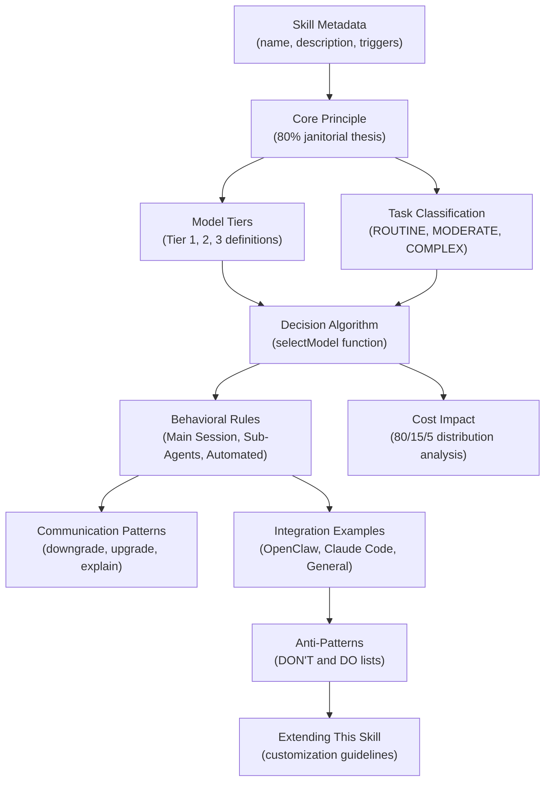
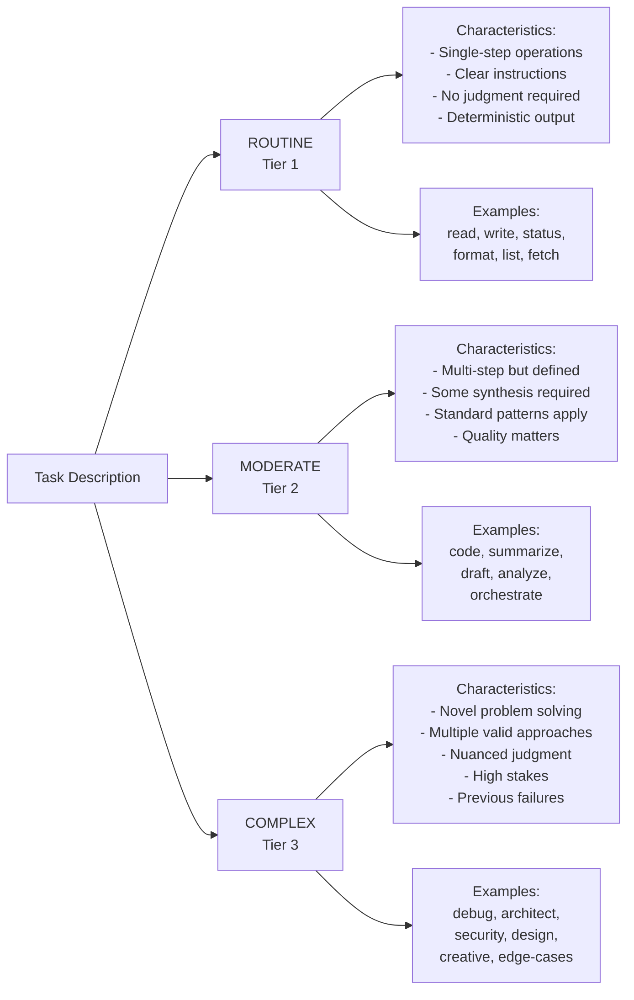
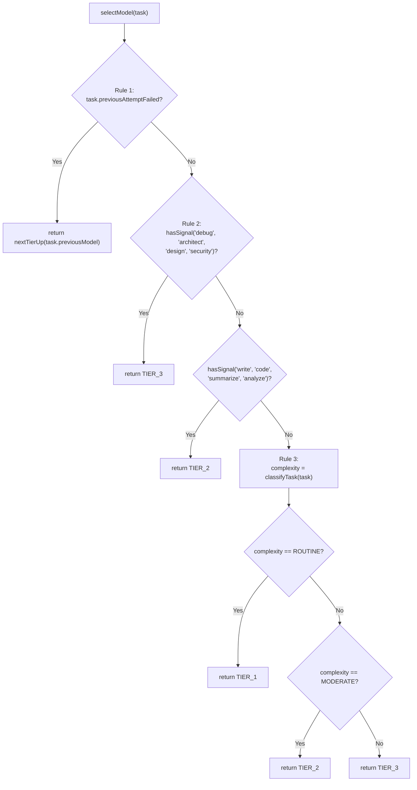
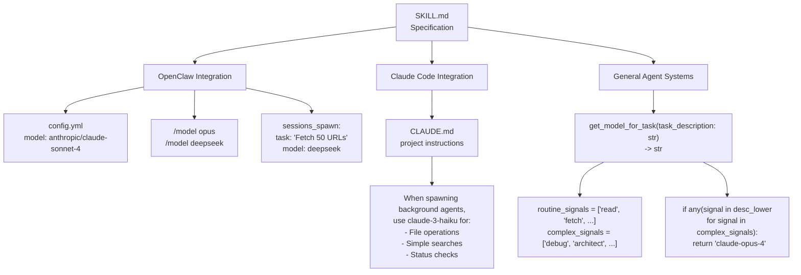

<!-- source: DeepWiki mcp.deepwiki.com · repo zscole/model-hierarchy-skill · page 3 The Skill Definition · fetched 2026-10-26 -->

# The Skill Definition

<details>
<summary>Relevant source files</summary>

The following files were used as context for generating this wiki page:

- [SKILL.md](SKILL.md)

</details>


## Purpose and Scope

This document provides comprehensive coverage of `SKILL.md`, the core specification file that defines the model hierarchy skill. This skill specification establishes the rules, tiers, and decision logic for routing agent tasks to cost-appropriate models.

The skill definition serves as the authoritative source for:
- Classification rules that categorize tasks as ROUTINE, MODERATE, or COMPLEX
- Model tier architecture defining three cost/capability levels
- The decision algorithm for model selection
- Behavioral rules for different agent contexts
- Communication patterns for model switching

For implementation details of the classification logic in Python, see [Implementation Reference](#4). For platform-specific integration instructions, see [Integration Guides](#5).

**Sources:** [SKILL.md:1-256]()

---

## Skill Metadata

The skill definition begins with YAML frontmatter that provides metadata for skill discovery and activation in agent platforms:

```yaml
---
name: model-hierarchy
description: >
  Cost-optimize AI agent operations by routing tasks to appropriate models based on complexity.
  Use this skill when: (1) deciding which model to use for a task, (2) spawning sub-agents,
  (3) considering cost efficiency, (4) the current model feels like overkill for the task.
  Triggers: "model routing", "cost optimization", "which model", "too expensive", "spawn agent".
---
```

| Metadata Field | Purpose | Value |
|----------------|---------|-------|
| `name` | Unique identifier for the skill | `model-hierarchy` |
| `description` | Multi-line explanation of skill purpose and usage conditions | Cost optimization through task routing |
| Triggers | Keywords that activate skill awareness | "model routing", "cost optimization", "which model", "too expensive", "spawn agent" |

The trigger phrases enable agent platforms to automatically surface this skill when relevant keywords appear in task descriptions or user queries. The description explicitly enumerates four usage scenarios: task-level model selection, sub-agent spawning, cost efficiency analysis, and overkill detection.

**Sources:** [SKILL.md:1-8]()

---

## Core Principle

The skill is built on a fundamental observation stated in [SKILL.md:17]():

> **80% of agent tasks are janitorial.** File reads, status checks, formatting, simple Q&A. These don't need expensive models. Reserve premium models for problems that actually require deep reasoning.

This principle drives the entire hierarchical routing system. The specification operationalizes this insight by:

1. Categorizing tasks into complexity levels
2. Mapping complexity levels to cost tiers
3. Providing explicit classification heuristics
4. Enabling escalation when tasks exceed model capabilities

**Sources:** [SKILL.md:15-17]()

---

## Specification Structure

The `SKILL.md` file is organized into distinct sections that together define a complete operational skill:

### High-Level Organization



**Sources:** [SKILL.md:1-256]()

---

## Model Tier Architecture Overview

The specification defines three model tiers with explicit pricing and capability characteristics:

| Tier | Cost Range | Model Examples | Primary Use Case |
|------|------------|----------------|------------------|
| **Tier 1: Cheap** | $0.10-0.50/M tokens | DeepSeek V3, GPT-4o-mini, Claude Haiku, Gemini Flash | Routine operations with deterministic outputs |
| **Tier 2: Mid** | $1-5/M tokens | Claude Sonnet, GPT-4o, Gemini Pro | Moderate complexity tasks requiring synthesis |
| **Tier 3: Premium** | $10-75/M tokens | Claude Opus, GPT-4.5, o1, o3-mini | Complex reasoning and novel problem solving |

Each tier is defined in tabular format in [SKILL.md:21-46]() with specific models, input/output pricing, and "Best For" descriptions. The specification notes that prices are "as of Feb 2026" and instructs users to check provider documentation for current rates.

### Tier Definitions in Detail

**Tier 1** ([SKILL.md:21-28]()): Four model options ranging from $0.075-0.30 per million input tokens. The tier emphasizes volume efficiency and fast response times. DeepSeek V3 is positioned as the general-purpose routine work model.

**Tier 2** ([SKILL.md:30-36]()): Three models spanning $1.25-3.00 per million input tokens. Claude Sonnet is designated for "balanced performance," GPT-4o for multimodal tasks, and Gemini Pro for long context scenarios.

**Tier 3** ([SKILL.md:38-46]()): Four premium models ranging from $1.10-75.00 per million input tokens. The tier includes both expensive frontier models (GPT-4.5 at $75 input) and budget reasoning models (o3-mini at $1.10 input).

For detailed tier architecture, see [Model Tier Architecture](#3.2).

**Sources:** [SKILL.md:19-48]()

---

## Task Classification Framework

The skill defines three complexity categories with explicit characteristics and examples:



### Category Definitions

**ROUTINE** ([SKILL.md:53-70]()): Tasks characterized by single-step operations, clear unambiguous instructions, no judgment required, and deterministic outputs. Eight example categories provided including file operations, status checks, simple lookups, formatting, list operations, API calls, heartbeat tasks, and URL fetching.

**MODERATE** ([SKILL.md:72-88]()): Tasks requiring multi-step execution but following well-defined patterns. Some synthesis required, standard patterns apply, quality matters but isn't critical. Eight example categories including code generation with standard patterns, summarization, draft writing, data analysis, multi-file operations, tool orchestration, code review (non-security), and search tasks.

**COMPLEX** ([SKILL.md:90-107]()): Tasks requiring novel problem solving, with multiple valid approaches, nuanced judgment calls, high stakes or irreversible outcomes, or previous attempt failures. Eight example categories including multi-step debugging, architecture decisions, security-sensitive review, escalation from failures, ambiguous requirements, long-context reasoning (>50K tokens), creative originality, and adversarial handling.

For comprehensive classification system documentation, see [Task Classification System](#3.1).

**Sources:** [SKILL.md:49-107]()

---

## Decision Algorithm Specification

The skill defines a three-rule decision function in pseudocode at [SKILL.md:110-132]():

### Algorithm Structure



### Rule Precedence

The algorithm implements three rules in strict precedence order:

1. **Escalation Override** ([SKILL.md:113-114]()): If a previous attempt failed, upgrade to the next tier regardless of task characteristics
2. **Explicit Complexity Signals** ([SKILL.md:116-121]()): Check for keyword signals indicating TIER_3 ("debug", "architect", "design", "security") or TIER_2 ("write", "code", "summarize", "analyze")
3. **Default Classification** ([SKILL.md:123-131]()): Invoke `classifyTask(task)` to determine ROUTINE, MODERATE, or COMPLEX

The escalation override ensures that stuck tasks receive more capable models without requiring explicit reclassification. The explicit signal detection provides fast-path routing for common task patterns. The default classification handles all other cases through structured analysis.

For detailed algorithm documentation, see [Decision Algorithm](#3.3).

**Sources:** [SKILL.md:109-132]()

---

## Behavioral Rules and Contexts

The specification defines context-specific behaviors for three agent scenarios:

### Behavioral Rule Matrix

| Context | Default Tier | Key Behaviors | Defined In |
|---------|--------------|---------------|------------|
| **Main Session** | Tier 2 | Suggest downgrade for routine work<br/>Request upgrade when stuck | [SKILL.md:136-141]() |
| **Sub-Agents** | Tier 1 | Default to cheapest unless clearly moderate+<br/>Batch similar tasks<br/>Report failures to parent | [SKILL.md:143-147]() |
| **Automated Tasks** | Varies | Heartbeats always Tier 1<br/>Reports Tier 1-2 based on complexity<br/>Alerts start Tier 2, escalate if needed | [SKILL.md:149-152]() |

### Main Session Rules

For interactive sessions, the specification recommends starting at Tier 2 for balanced capability. The agent should proactively suggest downgrades: "This is routine - I can handle this on a cheaper model or spawn a sub-agent." When encountering limitations, request upgrades: "This needs more reasoning power. Switching to [premium model]."

### Sub-Agent Rules

Sub-agents spawn at Tier 1 by default to minimize overhead costs. They should batch similar tasks to amortize the spawning cost and report failures back to the parent for potential escalation to higher tiers.

### Automated Task Rules

Automated tasks follow deterministic routing: heartbeats and monitoring always use Tier 1, scheduled reports use Tier 1-2 based on complexity analysis, and alert responses start at Tier 2 with escalation capability.

For complete behavioral rules, see [Behavioral Rules by Context](#3.4).

**Sources:** [SKILL.md:134-152]()

---

## Communication Patterns

The skill defines three communication templates for model switching scenarios at [SKILL.md:154-165]():

### Template Examples

**Downgrade Suggestion:**
> "This looks like routine file work. Want me to spawn a sub-agent on DeepSeek for this? Same result, fraction of the cost."

**Upgrade Request:**
> "I'm hitting the limits of what I can figure out here. This needs Opus-level reasoning. Switching up."

**Explaining Hierarchy:**
> "I'm running the heavy analysis on Sonnet while sub-agents fetch the data on DeepSeek. Keeps costs down without sacrificing quality where it matters."

These templates establish natural language patterns that agents should use when communicating model routing decisions to users. The templates emphasize transparency about cost-quality tradeoffs and justify routing decisions with task characteristics.

For complete communication pattern documentation, see [Communication Patterns](#3.5).

**Sources:** [SKILL.md:154-165]()

---

## Cost Impact Specification

The skill includes quantitative cost analysis showing projected savings from hierarchical routing. The specification assumes 100K tokens/day average usage and compares four strategies:

### Cost Comparison Table

From [SKILL.md:169-182]():

| Strategy | Monthly Cost | Distribution | Notes |
|----------|--------------|--------------|-------|
| Pure Opus | ~$225 | 100% Tier 3 | Maximum capability, maximum spend |
| Pure Sonnet | ~$45 | 100% Tier 2 | Good default for most work |
| Pure DeepSeek | ~$8 | 100% Tier 1 | Cheap but limited on hard problems |
| **Hierarchy (80/15/5)** | **~$19** | 80% T1, 15% T2, 5% T3 | Best of all worlds |

### The 80/15/5 Distribution

The hierarchical approach achieves ~$19/month through task distribution:
- 80% routine tasks on Tier 1: ~$6/month
- 15% moderate tasks on Tier 2: ~$7/month
- 5% complex tasks on Tier 3: ~$6/month

The specification explicitly states the value proposition: "10x cost reduction vs pure premium, with equivalent quality on complex tasks" ([SKILL.md:183]()).

For detailed cost optimization analysis, see [Cost Optimization Analysis](#2.3).

**Sources:** [SKILL.md:167-183]()

---

## Integration Examples

The specification provides three integration patterns demonstrating skill adoption across different agent architectures:



### Integration Pattern Details

**OpenClaw** ([SKILL.md:187-201]()): Uses file-based skill installation with YAML configuration. Default model set in `config.yml`, runtime switching via `/model` commands, and sub-agent spawning with model specification through `sessions_spawn` directive.

**Claude Code** ([SKILL.md:203-215]()): Uses instruction embedding in `CLAUDE.md` or project instructions. Rules specified in natural language for background agent spawning, with specific model recommendations for file operations, searches, and status checks.

**General Agent Systems** ([SKILL.md:217-232]()): Provides Python implementation example with `get_model_for_task` function. Uses signal lists (`routine_signals`, `complex_signals`) for pattern matching and returns model names as strings for direct API usage.

For platform-specific integration details, see [Integration Guides](#5).

**Sources:** [SKILL.md:185-232]()

---

## Anti-Patterns and Best Practices

The specification concludes with explicit guidance on what to avoid and what to embrace:

### Anti-Patterns (DON'T)

From [SKILL.md:236-240]():
- Run heartbeats on Opus
- Use premium models for file I/O
- Keep expensive model when task is clearly routine
- Spawn sub-agents on premium models by default

### Best Practices (DO)

From [SKILL.md:242-246]():
- Start mid-tier, adjust based on task
- Spawn helpers on cheapest viable model
- Escalate explicitly when stuck
- Track cost per task type to optimize further

The anti-patterns target common waste scenarios where expensive models perform no better than cheap alternatives. The best practices establish operational patterns for adaptive routing and continuous optimization through cost tracking.

**Sources:** [SKILL.md:234-246]()

---

## Extensibility Guidelines

The skill specification is designed for customization. The "Extending This Skill" section ([SKILL.md:248-256]()) provides four extension vectors:

| Extension Type | Description | Example |
|----------------|-------------|---------|
| Adjust tier definitions | Modify model assignments and pricing thresholds | Add provider-specific models or adjust for budget constraints |
| Add domain-specific signals | Extend classification with specialized keywords | Add "compliance" signal for TIER_3 in regulated industries |
| Track actual complexity | Monitor classification accuracy and outcomes | Log predicted vs actual tier requirements for model tuning |
| Set budget alerts | Implement cost monitoring and warnings | Alert when daily Tier 3 usage exceeds threshold |

These extension points enable organizations to adapt the skill to specific domains, cost constraints, and operational requirements while maintaining the core hierarchical routing principle.

**Sources:** [SKILL.md:248-256]()

---

## Summary

The `SKILL.md` file provides a complete, self-contained specification for hierarchical model routing. It bridges high-level principles (the 80% janitorial thesis) with concrete implementation guidance (classification rules, tier definitions, decision algorithms). The specification is platform-agnostic, supporting integration patterns ranging from file-based discovery to instruction embedding to programmatic implementation.

The skill achieves its cost optimization goals through four key mechanisms:
1. Explicit task complexity classification with clear characteristics and examples
2. Three-tier model architecture with 10-100x cost differentials between tiers
3. Signal-based routing with escalation override for stuck tasks
4. Context-specific behavioral rules optimizing for interactive, automated, and sub-agent scenarios

**Sources:** [SKILL.md:1-256]()

---

