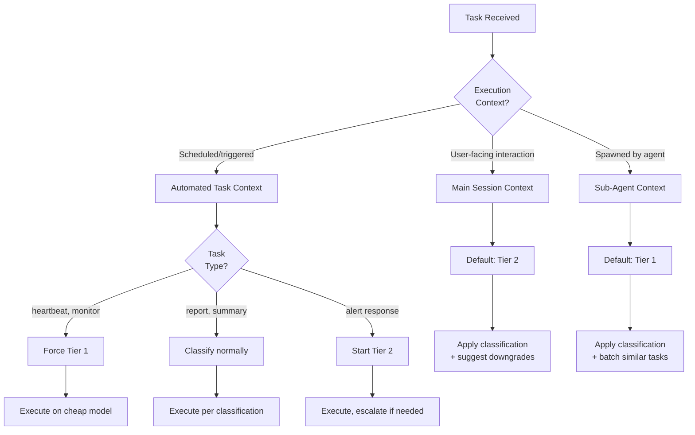
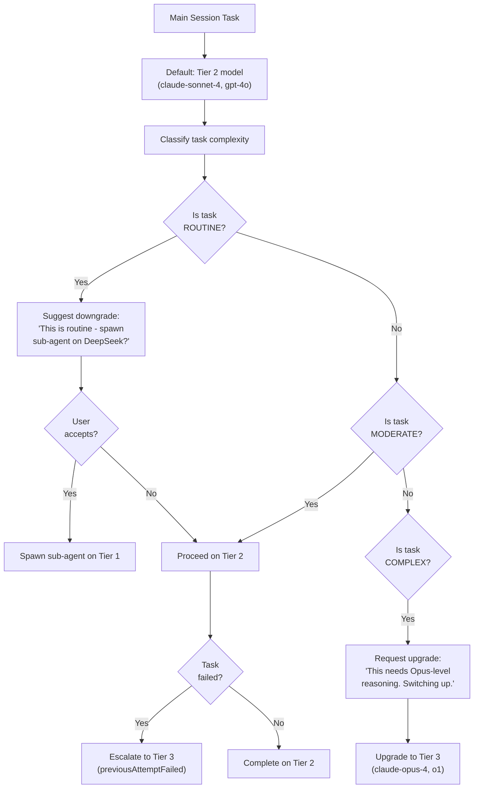
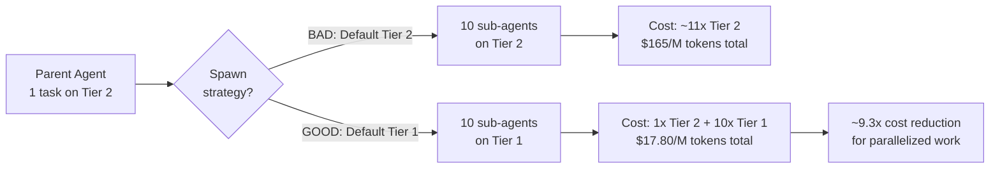
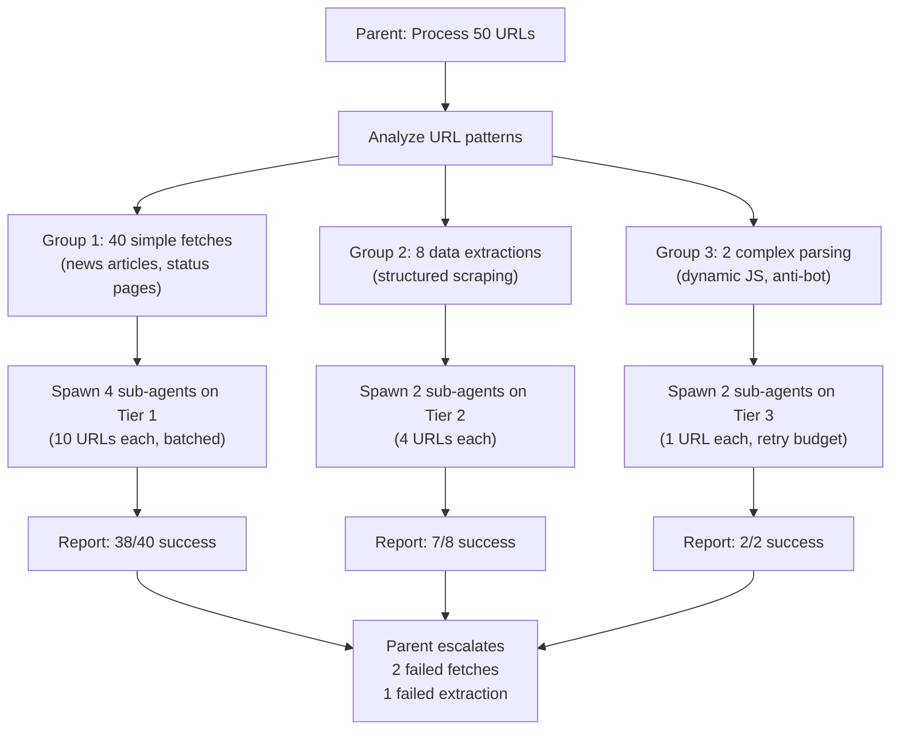
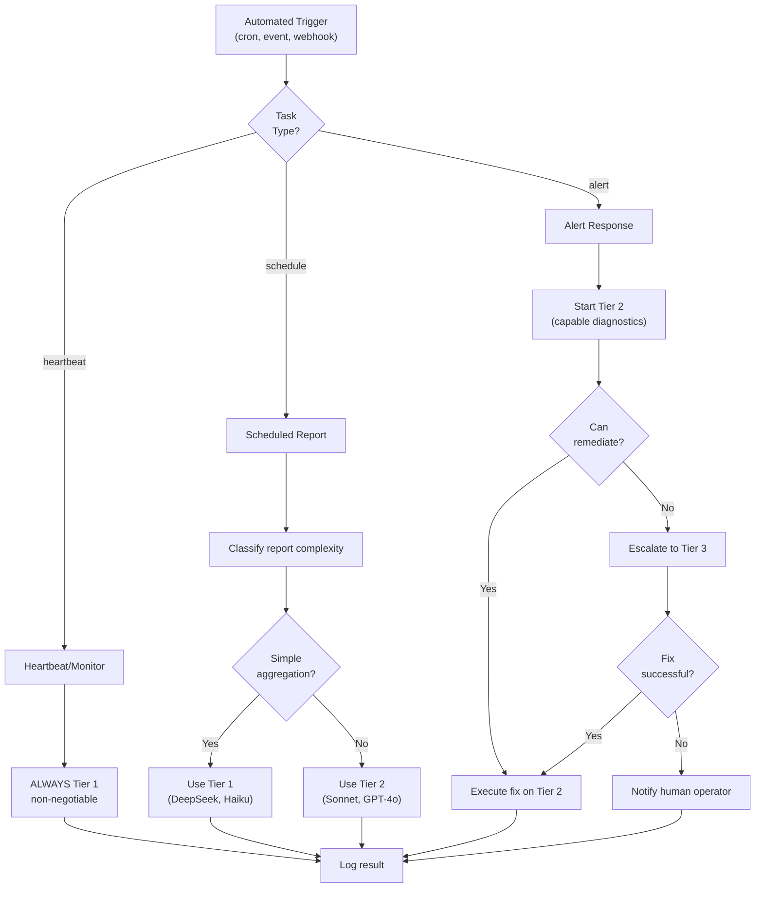

<!-- source: DeepWiki mcp.deepwiki.com · repo zscole/model-hierarchy-skill · page 3.4 Behavioral Rules by Context · fetched 2026-10-26 -->

# Behavioral Rules by Context

<details>
<summary>Relevant source files</summary>

The following files were used as context for generating this wiki page:

- [SKILL.md](SKILL.md)

</details>


## Purpose and Scope

This document defines the context-specific behavioral rules that determine model selection and operational patterns based on execution context. The model hierarchy skill applies different defaults and escalation behaviors depending on whether code is executing in a **Main Session** (interactive user-facing work), **Sub-Agent** (spawned background task), or **Automated Task** (scheduled/monitoring operation).

These behavioral rules complement the core classification algorithm ([Decision Algorithm](#3.3)) by adding context-aware defaults and communication patterns. For information about the general task classification system, see [Task Classification System](#3.1). For specific communication patterns when suggesting model changes, see [Communication Patterns](#3.5).

---

## The Three Execution Contexts

The skill distinguishes between three operational contexts, each with distinct cost-quality tradeoffs and user interaction patterns:

| Context | Primary Goal | User Visibility | Cost Sensitivity | Default Tier |
|---------|--------------|-----------------|------------------|--------------|
| **Main Session** | Interactive quality | High - direct user interaction | Medium - user expects capability | Tier 2 (Mid) |
| **Sub-Agent** | Batch efficiency | Low - background operation | High - multiplier effect | Tier 1 (Cheap) |
| **Automated Task** | Reliability & cost | None - unattended | Very High - recurring cost | Varies by task type |

### Context Decision Flow



**Sources:** [SKILL.md:134-153]()

---

## Main Session Behavioral Rules

Main sessions are interactive, user-facing contexts where the agent is directly engaged with a human operator. The primary concern is **responsiveness and capability** while remaining cost-conscious about obviously routine work.

### Rule Set

1. **Default to Tier 2 for interactive work** - Start with mid-tier models that provide good all-around performance without immediately jumping to premium pricing.

2. **Suggest downgrade when doing routine work** - Proactively notify the user when a task could be handled more cheaply: *"This is routine - I can handle this on a cheaper model or spawn a sub-agent."*

3. **Request upgrade when stuck** - Escalate to premium models when encountering difficulties: *"This needs more reasoning power. Switching to [premium model]."*

### Main Session Decision Tree



### Implementation Mapping

The main session rules are codified in the decision algorithm's default behavior and escalation handling:

- **Default Tier 2:** Not explicitly enforced in `classify_task` function, but recommended in integration patterns
- **Downgrade suggestions:** Implemented through communication patterns when `classify_task` returns `1` (routine) in an interactive context
- **Upgrade requests:** Triggered by `task.previousAttemptFailed` check ([SKILL.md:113-114]()) or explicit complexity signals ([SKILL.md:117-118]())

**Sources:** [SKILL.md:136-141]()

---

## Sub-Agent Behavioral Rules

Sub-agents are spawned background workers handling delegated tasks. The primary concern is **cost efficiency** since sub-agents can multiply costs through parallel or sequential execution of many tasks.

### Rule Set

1. **Default to Tier 1 unless task is clearly moderate+** - Start with the cheapest models that can complete the task, only escalating when classification explicitly indicates higher complexity.

2. **Batch similar tasks to amortize overhead** - When spawning multiple sub-agents or processing multiple items, group similar work to reduce per-task overhead and enable better cost optimization.

3. **Report failures back to parent for escalation** - Don't silently fail or auto-escalate; instead, communicate failures to the parent agent which can make informed escalation decisions.

### Sub-Agent Cost Multiplier Effect



### Batching Example

When a parent agent needs to process multiple similar items, sub-agents should group work by complexity:



### Integration Examples

**OpenClaw sub-agent spawning:**
```yaml
# Spawn sub-agent on cheap model
sessions_spawn:
  task: "Fetch and parse these 50 URLs"
  model: deepseek
```
([SKILL.md:198-201]())

**Claude Code background agent pattern:**
```
When spawning background agents, use claude-3-haiku for:
- File operations
- Simple searches  
- Status checks
```
([SKILL.md:207-210]())

**Sources:** [SKILL.md:143-147](), [SKILL.md:198-201](), [SKILL.md:207-210]()

---

## Automated Task Behavioral Rules

Automated tasks are scheduled, triggered, or recurring operations that run without direct user supervision. The primary concern is **predictable cost control** while maintaining reliability for critical monitoring functions.

### Rule Set by Task Type

#### Heartbeats and Monitoring → Always Tier 1

Health checks, status monitors, and heartbeat tasks must run on the cheapest available models. These tasks are:
- High frequency (every minute to every hour)
- Simple deterministic checks
- Cost-multiplicative due to frequency

**Examples:**
- Service health checks
- Disk space monitoring
- API endpoint availability
- Database connection tests
- Log file rotation checks

#### Scheduled Reports → Tier 1 or 2 Based on Complexity

Periodic summaries, digests, and analytics can vary in complexity:
- **Simple aggregations:** Tier 1 (daily counts, basic metrics)
- **Synthesis and analysis:** Tier 2 (weekly summaries with insights)

#### Alert Responses → Start Tier 2, Escalate if Needed

Incident response and alert handling begins with capable models but can escalate:
- **Initial triage:** Tier 2 for good diagnostic capability
- **Escalation:** Tier 3 if automated remediation fails
- **Fallback:** Human notification if Tier 3 fails

### Automated Task Flow



### Cost Impact of Automated Tasks

For a typical agent system running 24/7 with automated tasks:

| Task Type | Frequency | Tokens/Task | Daily Tasks | Tier | Monthly Cost |
|-----------|-----------|-------------|-------------|------|--------------|
| Heartbeats (5 services) | Every 5 min | 500 | 1,440 | Tier 1 | $0.30 |
| Daily summary | Once/day | 10K | 30 | Tier 1 | $0.08 |
| Weekly analysis | Once/week | 50K | 4 | Tier 2 | $0.90 |
| Alert responses | ~3/day avg | 5K | 90 | Tier 2 | $2.03 |
| **Total automated** | | | | | **$3.31** |

**Anti-pattern:** Running heartbeats on Tier 2 would cost **$10.80/month** instead of $0.30 - a **36x** increase for zero quality benefit.

**Sources:** [SKILL.md:149-153]()

---

## Context Comparison Matrix

The following table summarizes the key differences in behavioral rules across execution contexts:

| Dimension | Main Session | Sub-Agent | Automated Task |
|-----------|--------------|-----------|----------------|
| **Default tier** | Tier 2 (Mid) | Tier 1 (Cheap) | Varies by type |
| **Escalation trigger** | User-requested or stuck | Parent-directed only | Type-dependent |
| **Downgrade suggestion** | Proactive, conversational | N/A (already cheap) | N/A (pre-determined) |
| **Failure handling** | Request upgrade | Report to parent | Escalate or notify human |
| **Batching strategy** | N/A (interactive) | Group similar tasks | N/A (scheduled) |
| **Cost multiplier risk** | Low (1x) | High (Nx parallel) | Medium (frequency) |
| **Quality priority** | High (user-facing) | Sufficient (background) | Varies (critical vs routine) |
| **Communication** | Verbose, explanatory | Minimal, structured | Logging only |

---

## Context Selection in Code

While the `classify_task` function ([test_classification.py]()) does not explicitly receive a context parameter, the behavioral rules are implemented through:

### Integration-Level Context Handling

1. **OpenClaw Integration:** Context determined by command vs `sessions_spawn`:
   - Direct `/model` commands → Main Session context
   - `sessions_spawn` calls → Sub-Agent context
   - Scheduled jobs → Automated Task context

2. **Claude Code Integration:** Context implicit in instruction embedding:
   - Project instructions → Main Session context
   - Background agent spawning → Sub-Agent context

3. **Custom Integration:** Context parameter in wrapper functions:

```python
def get_model_for_task(task_description: str, 
                       context: str = "main") -> str:
    """
    context: "main", "sub_agent", or "automated"
    """
    routine_signals = ['read', 'fetch', 'check', 'list']
    complex_signals = ['debug', 'architect', 'design']
    
    # Context-based defaults
    if context == "sub_agent":
        default_tier = "deepseek-v3"  # Tier 1
    elif context == "automated":
        if "heartbeat" in task_description.lower():
            return "deepseek-v3"  # Force Tier 1
        default_tier = "deepseek-v3"
    else:  # main session
        default_tier = "claude-sonnet-4"  # Tier 2
    
    # Apply classification
    desc_lower = task_description.lower()
    if any(signal in desc_lower for signal in complex_signals):
        return "claude-opus-4"
    elif any(signal in desc_lower for signal in routine_signals):
        return "deepseek-v3"
    else:
        return default_tier
```

**Sources:** [SKILL.md:219-232](), [SKILL.md:189-201](), [SKILL.md:204-215]()

---

## Anti-Patterns by Context

### Main Session Anti-Patterns

**DON'T:**
- Keep expensive model when task is clearly routine ([SKILL.md:239]())
- Silently downgrade without suggesting to user
- Use premium models for file I/O in interactive sessions

**DO:**
- Suggest sub-agent spawning for batch work
- Explain model selection decisions to user
- Track which tasks trigger upgrades for future optimization

### Sub-Agent Anti-Patterns

**DON'T:**
- Spawn sub-agents on premium models by default ([SKILL.md:240]())
- Auto-escalate without reporting to parent
- Use Tier 2/3 for simple parallelizable work

**DO:**
- Spawn helpers on cheapest viable model ([SKILL.md:244]())
- Batch similar tasks to reduce overhead
- Report clear failure reasons for parent triage

### Automated Task Anti-Patterns

**DON'T:**
- Run heartbeats on Opus ([SKILL.md:237]())
- Use premium models for scheduled status checks
- Skip logging/monitoring of automated task costs

**DO:**
- Force Tier 1 for monitoring/heartbeats
- Set budget alerts to catch runaway premium usage ([SKILL.md:254]())
- Track cost per task type to optimize further ([SKILL.md:246]())

**Sources:** [SKILL.md:235-246]()

---

## Summary

The behavioral rules system adds context-awareness to the core classification algorithm by establishing different defaults, escalation patterns, and communication strategies for three execution contexts:

- **Main Session:** Tier 2 default with proactive downgrade suggestions and user-facing upgrade requests
- **Sub-Agent:** Tier 1 default with batching optimization and parent-delegated escalation
- **Automated Task:** Type-dependent defaults (heartbeats always Tier 1) with structured escalation paths

These context-specific rules ensure that the model hierarchy skill achieves cost optimization without sacrificing quality in user-facing work or reliability in critical monitoring tasks.

**Sources:** [SKILL.md:134-153](), [SKILL.md:235-246]()

---

