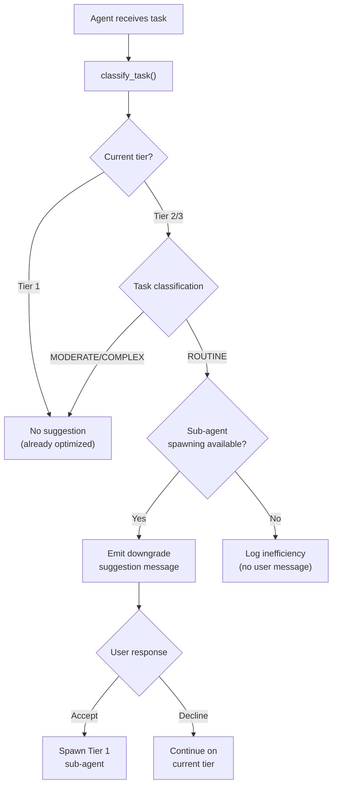
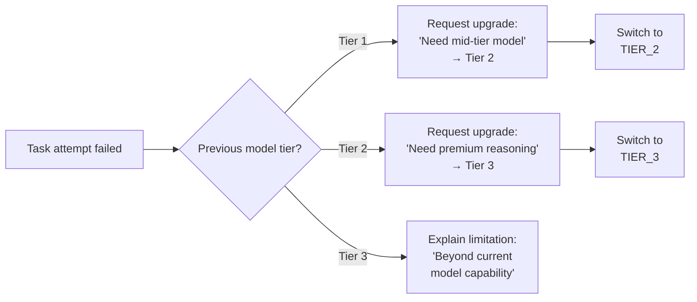
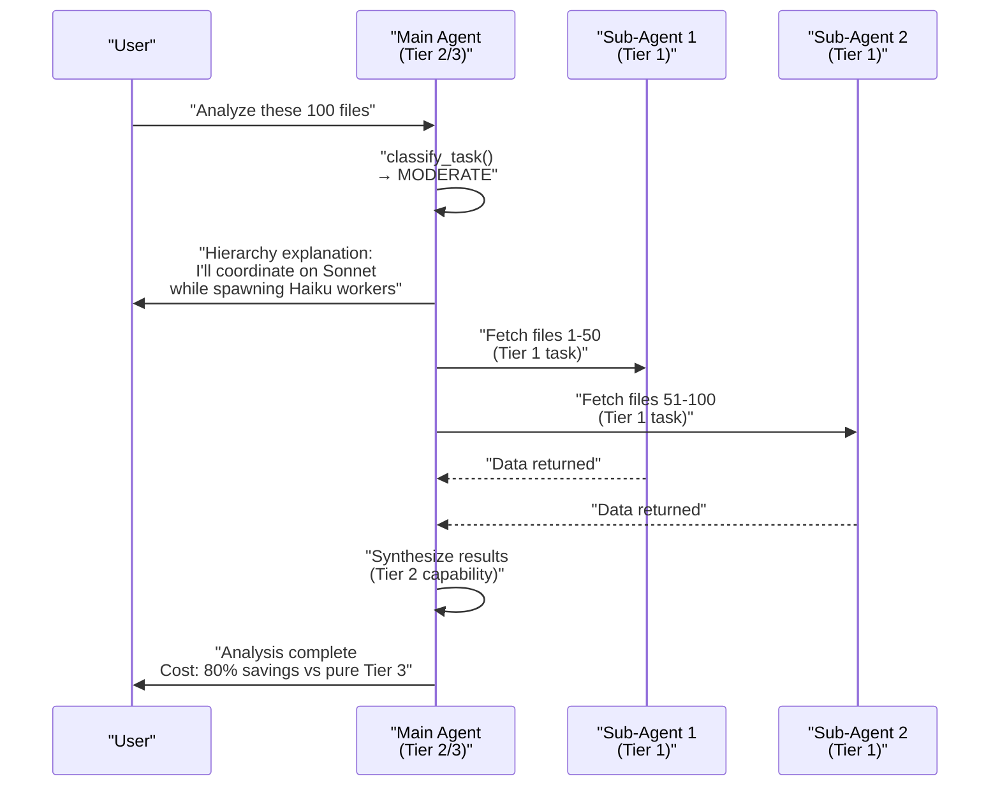
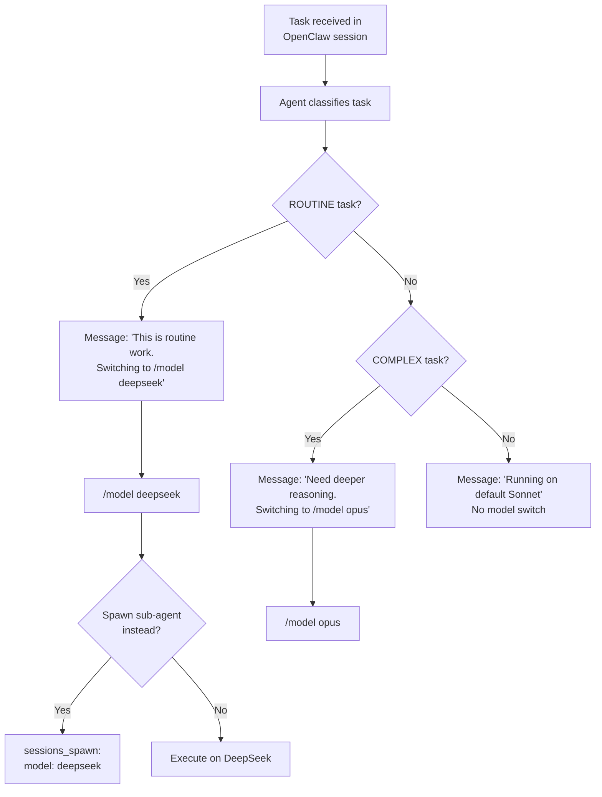
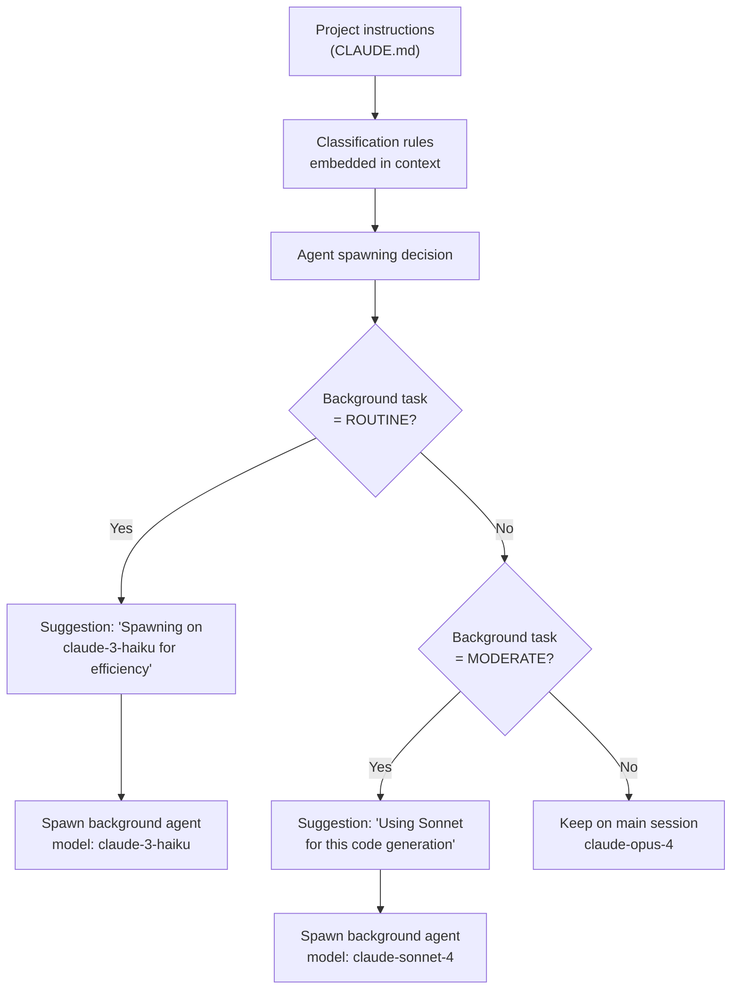
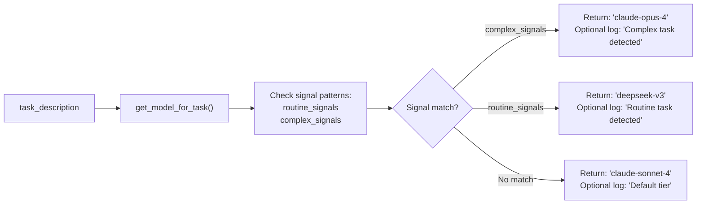
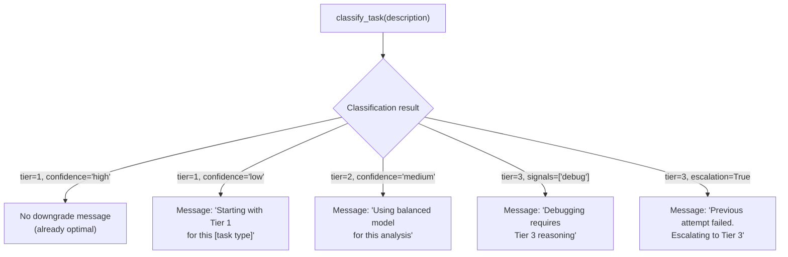

<!-- source: DeepWiki mcp.deepwiki.com · repo zscole/model-hierarchy-skill · page 3.5 Communication Patterns · fetched 2026-10-26 -->

# Communication Patterns

<details>
<summary>Relevant source files</summary>

The following files were used as context for generating this wiki page:

- [SKILL.md](SKILL.md)

</details>


## Purpose and Scope

This document describes how agents communicate model selection decisions to users and other agents within the model hierarchy system. Communication patterns define the natural language templates and protocols that agents use to suggest model downgrades, request upgrades, and explain hierarchical task execution.

These patterns enable transparent cost optimization by making model selection decisions visible and actionable. They bridge the gap between the automatic classification logic (see [Decision Algorithm](#3.3)) and user-facing interactions.

For behavioral rules that govern when to apply these patterns, see [Behavioral Rules by Context](#3.4). For the underlying classification system, see [Task Classification System](#3.1).

## Communication Pattern Types

The model hierarchy skill defines three primary communication patterns that agents use during task execution:

| Pattern Type | Purpose | Trigger Condition | Target Tier |
|--------------|---------|-------------------|-------------|
| **Downgrade Suggestion** | Propose moving to cheaper model for routine work | Task classified as ROUTINE while running on Tier 2/3 | Tier 1 |
| **Upgrade Request** | Request more powerful model when stuck | Task failing or requiring complex reasoning | Tier 3 |
| **Hierarchy Explanation** | Describe multi-tier execution strategy | Spawning sub-agents or parallel task execution | Mixed |

These patterns are defined in [SKILL.md:154-166]() as natural language templates that agents should follow when communicating model selection decisions.

**Sources:** [SKILL.md:154-166]()

## Downgrade Suggestion Pattern

### When to Use

Agents suggest downgrades when:
- Currently running on Tier 2 (mid) or Tier 3 (premium) models
- Task has been classified as ROUTINE
- Sub-agent spawning is available
- Cost efficiency matters (interactive sessions)

### Template Structure

```
"This looks like [task type]. Want me to spawn a sub-agent on [Tier 1 model] 
for this? Same result, fraction of the cost."
```

### Example Messages

**File operations:**
> "This looks like routine file work. Want me to spawn a sub-agent on DeepSeek for this? Same result, fraction of the cost."

**Status monitoring:**
> "These are simple status checks. I can delegate this to a Haiku sub-agent - we'll save ~95% on token costs."

**List operations:**
> "This is straightforward filtering. Let me spawn a mini agent to handle it - no need to burn premium tokens on list operations."

### Decision Flow



**Sources:** [SKILL.md:136-141](), [SKILL.md:158-159]()

## Upgrade Request Pattern

### When to Use

Agents request upgrades when:
- Task complexity exceeds current model capabilities
- Previous attempt failed on cheaper model (escalation)
- Explicit complexity signals detected ("debug", "architect", "security")
- User explicitly indicates current response is inadequate

### Template Structure

```
"I'm hitting the limits of what I can figure out here. This needs 
[Tier 3 model]-level reasoning. Switching up."
```

### Example Messages

**Debugging failure:**
> "I'm hitting the limits of what I can figure out here. This needs Opus-level reasoning. Switching up."

**Complex architecture:**
> "This design decision has too many interdependencies for my current model. Escalating to GPT-4.5 for comprehensive analysis."

**Security review:**
> "Security-sensitive code requires deeper analysis than I can provide. Requesting upgrade to Opus for thorough review."

### Escalation Logic Mapping

The upgrade request pattern directly implements the escalation override rule defined in [SKILL.md:112-114]():



**Sources:** [SKILL.md:112-114](), [SKILL.md:141](), [SKILL.md:161-162]()

## Hierarchy Explanation Pattern

### When to Use

Agents explain hierarchical execution when:
- Spawning multiple sub-agents on different tiers
- Orchestrating parallel tasks with tier optimization
- User asks about cost optimization strategy
- Demonstrating why specific tier allocation was chosen

### Template Structure

```
"I'm running the [complex task] on [Tier 2/3 model] while sub-agents 
[routine tasks] on [Tier 1 model]. Keeps costs down without sacrificing 
quality where it matters."
```

### Example Messages

**Parallel execution:**
> "I'm running the heavy analysis on Sonnet while sub-agents fetch the data on DeepSeek. Keeps costs down without sacrificing quality where it matters."

**Research task:**
> "I'll orchestrate this research with Sonnet coordinating and spawning Haiku workers to fetch individual sources. Quality synthesis, efficient data gathering."

**Multi-step workflow:**
> "Breaking this into phases: DeepSeek handles file I/O, I'll do the code generation on Sonnet, then escalate to Opus if we hit edge cases."

### Orchestration Communication Flow



**Sources:** [SKILL.md:164-165](), [SKILL.md:143-147]()

## Context-Specific Communication Rules

Different agent contexts require different communication approaches as defined in [SKILL.md:135-153]():

### Main Session Communication

Main session agents interact directly with users and should be more verbose about model selection:

| Scenario | Communication Pattern | Example |
|----------|----------------------|---------|
| Interactive routine work | **Explicit downgrade suggestion** | "This file operation is routine. Shall I spawn a DeepSeek sub-agent?" |
| Stuck on complex task | **Explicit upgrade request** | "I need more reasoning power for this. Switching to Opus." |
| Multi-tier orchestration | **Hierarchy explanation** | "Running analysis on Sonnet with Haiku workers for data fetching." |

Default model: Tier 2 (balanced for interactive use)

### Sub-Agent Communication

Sub-agents communicate more concisely and primarily report to their parent agent:

| Scenario | Communication Pattern | Example |
|----------|----------------------|---------|
| Task success | **Silent completion** | Return result without model discussion |
| Task failure | **Failure report to parent** | "Task failed on Tier 1. Recommend escalation." |
| Unexpected complexity | **Escalation request** | "Complexity exceeds Tier 1. Request parent intervention." |

Default model: Tier 1 (optimize for cost)

### Automated Task Communication

Automated tasks (cron, heartbeats) communicate only on exceptions:

| Scenario | Communication Pattern | Example |
|----------|----------------------|---------|
| Normal execution | **Silent** | No communication needed |
| Alert/anomaly | **Start Tier 2 with explanation** | "Alert detected. Running investigation on Sonnet." |
| Alert resolution failure | **Upgrade with escalation** | "Alert requires manual review. Escalating to Opus for analysis." |

**Sources:** [SKILL.md:135-153]()

## Platform-Specific Adaptations

### OpenClaw Integration

OpenClaw uses explicit `/model` commands alongside natural language communication:



Communication includes both explanation and action:
- Natural language rationale: "This is routine file work"
- Explicit command: `/model deepseek` or `sessions_spawn: {model: deepseek}`

**Sources:** [SKILL.md:187-201]()

### Claude Code Integration

Claude Code relies on natural language instructions in project configuration:



Communication is embedded in the natural language flow since Claude Code doesn't support explicit model-switching commands. The agent explains choices within its response:

> "I'll spawn a background agent on Haiku to fetch those files while I continue with the main analysis here."

**Sources:** [SKILL.md:203-215]()

### Generic Agent Systems

Generic implementations use programmatic function calls with optional logging:



Communication is optional and system-dependent. Implementations may:
- Log model selection decisions silently
- Emit structured events for monitoring
- Include explanation in API response metadata

**Sources:** [SKILL.md:217-232]()

## Communication Anti-Patterns

The following communication patterns should be avoided:

| Anti-Pattern | Why It Fails | Correct Pattern |
|--------------|--------------|-----------------|
| Silent model switches without explanation | Users don't understand cost optimization | Always explain rationale |
| Over-explaining for sub-agents | Adds token overhead to routine tasks | Sub-agents communicate only on failure |
| Requesting user approval for every tier switch | Interrupts workflow unnecessarily | Suggest downgrades, auto-execute upgrades on failure |
| Using tier names instead of model names | Confusing to users unfamiliar with hierarchy | Use specific model names: "DeepSeek", "Opus" |
| Apologizing for using cheaper models | Undermines confidence in tier system | Frame as optimization: "efficient" not "cheap" |

**Sources:** [SKILL.md:235-246]()

## Message Template Reference

### Quick Reference Table

| Situation | Template | Variables | Example Model |
|-----------|----------|-----------|---------------|
| **Downgrade - File I/O** | "This looks like routine [task type]. Want me to spawn a sub-agent on [model]?" | task_type, model | DeepSeek V3 |
| **Downgrade - List ops** | "This is straightforward [operation]. Let me spawn a [model] agent." | operation, model | GPT-4o-mini |
| **Upgrade - Debugging** | "I'm hitting limits. This needs [model]-level reasoning." | model | Opus |
| **Upgrade - Escalation** | "Previous attempt failed. Escalating to [model]." | model | GPT-4.5 |
| **Hierarchy - Analysis** | "Running [complex] on [model1] while sub-agents [simple] on [model2]." | complex, model1, simple, model2 | Sonnet, Haiku |
| **Hierarchy - Research** | "I'll coordinate on [model1] and spawn [model2] workers to [task]." | model1, model2, task | Sonnet, Haiku |

### Code-to-Message Mapping

The communication patterns map to classification results from `classify_task()`:



**Sources:** [SKILL.md:154-166]()

---

**Complete Sources for this document:**
- [SKILL.md:112-114]() - Decision algorithm escalation rules
- [SKILL.md:135-153]() - Behavioral rules for main sessions, sub-agents, and automated tasks
- [SKILL.md:154-166]() - Communication pattern templates and examples
- [SKILL.md:187-232]() - Platform-specific integration examples

---

