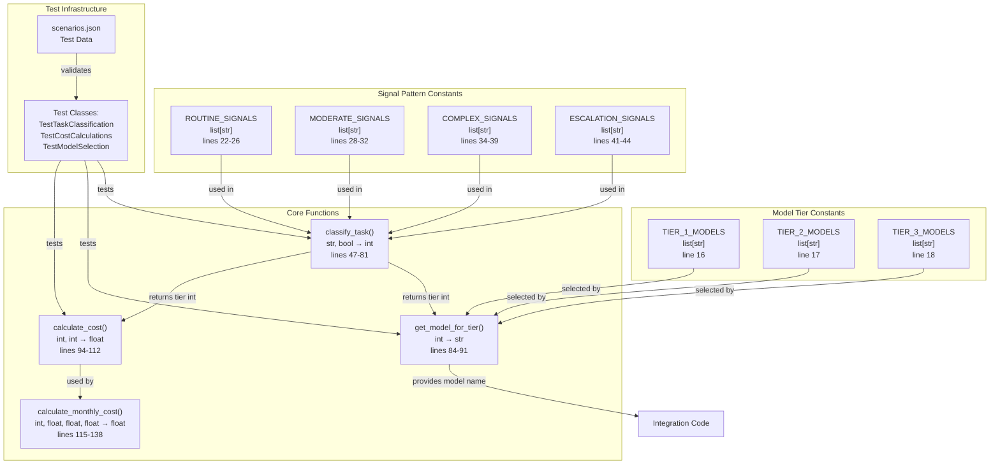
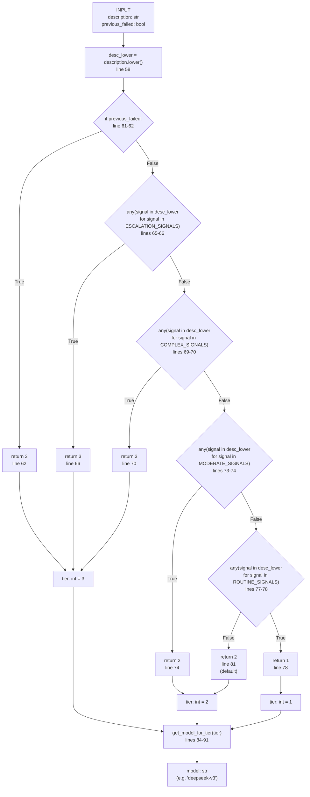
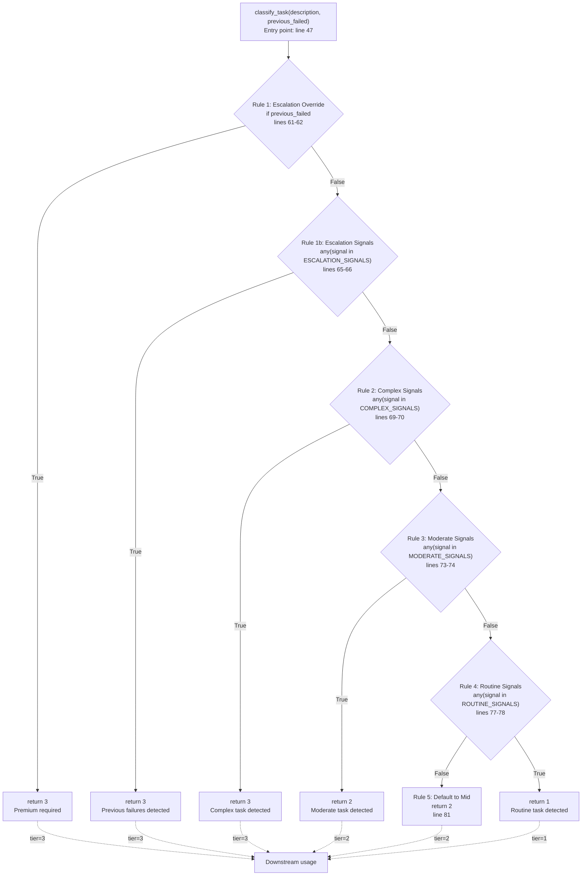
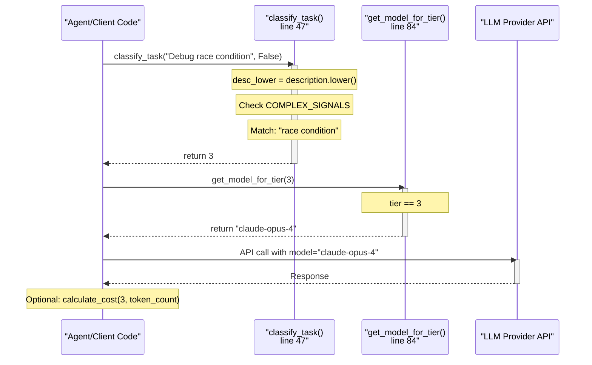

<!-- source: DeepWiki mcp.deepwiki.com · repo zscole/model-hierarchy-skill · page 4 Implementation Reference · fetched 2026-10-26 -->

# Implementation Reference

<details>
<summary>Relevant source files</summary>

The following files were used as context for generating this wiki page:

- [tests/test_classification.py](tests/test_classification.py)

</details>


This page provides a technical reference for the Python implementation of the model hierarchy classification system. It documents the core functions, data structures, and algorithms that power task classification and model selection.

For guidance on how to integrate this implementation into specific platforms, see [Integration Guides](#5). For understanding the conceptual classification rules, see [The Skill Definition](#3).

## Purpose and Scope

The implementation reference covers the executable Python code located in [tests/test_classification.py](). This file contains:

- **Classification Logic**: The `classify_task` function that maps task descriptions to model tiers
- **Signal Detection**: Pattern lists (ROUTINE_SIGNALS, MODERATE_SIGNALS, etc.) used for classification
- **Model Selection**: Model tier definitions and the `get_model_for_tier` function
- **Cost Estimation**: Functions for calculating per-task and monthly operational costs

The implementation serves both as production-ready classification code and as the reference implementation validated by the test suite.

**Sources:** [tests/test_classification.py:1-311]()

## System Component Architecture

The following diagram shows the relationship between all major components in the implementation, using their actual code entity names:

**Diagram: Implementation Component Relationships**



**Sources:** [tests/test_classification.py:16-138]()

## Module Organization

The implementation is organized as a single module at [tests/test_classification.py]() with the following structure:

| Section | Lines | Content |
|---------|-------|---------|
| Model Tier Definitions | 16-18 | `TIER_1_MODELS`, `TIER_2_MODELS`, `TIER_3_MODELS` constant lists |
| Signal Pattern Definitions | 22-44 | `ROUTINE_SIGNALS`, `MODERATE_SIGNALS`, `COMPLEX_SIGNALS`, `ESCALATION_SIGNALS` |
| Core Classification | 47-81 | `classify_task()` function with tier selection logic |
| Model Selection | 84-91 | `get_model_for_tier()` function mapping tiers to models |
| Cost Calculation | 94-138 | `calculate_cost()` and `calculate_monthly_cost()` functions |
| Test Infrastructure | 142-311 | Test fixtures, test classes, and pytest configuration |

The module follows a pattern where the implementation code precedes the test code, making it easy to extract just the classification functions for integration into other systems.

**Sources:** [tests/test_classification.py:1-311]()

## Data Flow Through Classification

The following diagram illustrates the complete data flow from task description input through classification to model selection, using actual variable names and function parameters from the implementation:

**Diagram: Classification Data Flow with Code Entities**



**Sources:** [tests/test_classification.py:47-91]()

## Model Tier Definitions

The implementation defines three model tiers as Python lists, each containing specific model identifiers:

| Constant Name | Tier | Models | Line Reference |
|---------------|------|--------|----------------|
| `TIER_1_MODELS` | 1 (Cheap) | `["deepseek-v3", "gpt-4o-mini", "claude-3-haiku", "gemini-flash"]` | [tests/test_classification.py:16]() |
| `TIER_2_MODELS` | 2 (Mid) | `["claude-sonnet-4", "gpt-4o", "gemini-pro"]` | [tests/test_classification.py:17]() |
| `TIER_3_MODELS` | 3 (Premium) | `["claude-opus-4", "gpt-4.5", "o1", "o3-mini"]` | [tests/test_classification.py:18]() |

These constants are used by the `get_model_for_tier()` function to select appropriate models for each tier. The lists support multiple models per tier to allow for platform-specific availability or preference.

**Sources:** [tests/test_classification.py:16-18]()

## Signal Pattern Tables

The classification system uses four signal pattern lists to detect task characteristics:

### ROUTINE_SIGNALS

Low-complexity operations suitable for tier 1 models:

| Signals | Description |
|---------|-------------|
| `"read"`, `"fetch"`, `"check"`, `"list"`, `"format"` | Basic data retrieval and formatting |
| `"status"`, `"get"`, `"filter"`, `"sort"`, `"convert"` | Simple transformations and queries |
| `"parse"`, `"health"`, `"ping"`, `"time"`, `"date"` | Status checks and parsing |
| `"lookup"`, `"find file"`, `"show"`, `"display"` | File system and display operations |

**Source:** [tests/test_classification.py:22-26]()

### MODERATE_SIGNALS

Medium-complexity operations suitable for tier 2 models:

| Signals | Description |
|---------|-------------|
| `"write"`, `"code"`, `"summarize"`, `"draft"` | Content creation tasks |
| `"analyze"`, `"create"`, `"generate"`, `"review"` | Analysis and generation |
| `"refactor"`, `"transform"`, `"search"`, `"research"` | Code modification and research |
| `"explain"`, `"describe"`, `"compare"` | Explanation tasks |

**Source:** [tests/test_classification.py:28-32]()

### COMPLEX_SIGNALS

High-complexity operations requiring tier 3 models:

| Signals | Description |
|---------|-------------|
| `"debug"`, `"architect"`, `"design"`, `"security"` | System design and debugging |
| `"why does"`, `"why is"`, `"tradeoff"`, `"evaluate"` | Deep reasoning and evaluation |
| `"doesn't work"`, `"failed"`, `"tried"` | Problem diagnosis |
| `"race condition"`, `"vulnerability"`, `"migrate"` | Complex technical issues |
| `"behaves differently"`, `"under load"`, `"production"` | Production debugging |

**Source:** [tests/test_classification.py:34-39]()

### ESCALATION_SIGNALS

Signals indicating previous failures, forcing tier 3:

| Signals | Description |
|---------|-------------|
| `"previous"`, `"couldn't"`, `"failed"` | Past failure indicators |
| `"try again"`, `"still not working"` | Retry requests |
| `"none of these work"`, `"stuck"` | Persistent problems |

**Source:** [tests/test_classification.py:41-44]()

## Classification Algorithm Flow

The `classify_task` function implements a priority-based classification algorithm with five rules executed in sequence:

**Diagram: classify_task Decision Tree with Line Numbers**



**Key Algorithm Characteristics:**

1. **Short-circuiting**: Returns immediately when a match is found
2. **Priority ordering**: Higher priority signals (escalation, complex) checked first
3. **Case-insensitive**: Converts `description` to lowercase via `desc_lower` (line 58)
4. **Safe default**: Returns tier 2 when uncertain (line 81)
5. **Type signature**: `(str, bool) -> int` - returns tier number 1, 2, or 3

**Sources:** [tests/test_classification.py:47-81]()

## Cost Calculation Implementation

The module provides two cost calculation functions that estimate operational expenses:

### calculate_cost Function

```python
def calculate_cost(tier: int, tokens: int = 1000) -> float
```

**Purpose**: Calculates approximate cost for a single task based on tier and token count.

**Parameters:**
- `tier` (int): Model tier (1, 2, or 3)
- `tokens` (int): Number of tokens, default 1000

**Returns:** Cost in USD (float)

**Pricing Constants** (per 1M output tokens):
- Tier 1: $0.28 (DeepSeek V3)
- Tier 2: $15.00 (Claude Sonnet)
- Tier 3: $75.00 (Claude Opus)

**Formula:** `(tokens / 1,000,000) * costs[tier]`

**Source:** [tests/test_classification.py:94-112]()

### calculate_monthly_cost Function

```python
def calculate_monthly_cost(
    daily_tokens: int,
    routine_pct: float = 0.80,
    moderate_pct: float = 0.15,
    complex_pct: float = 0.05
) -> float
```

**Purpose**: Calculates projected monthly cost with hierarchical routing based on task distribution.

**Parameters:**
- `daily_tokens` (int): Average daily token usage
- `routine_pct` (float): Percentage of routine tasks (default 0.80)
- `moderate_pct` (float): Percentage of moderate tasks (default 0.15)
- `complex_pct` (float): Percentage of complex tasks (default 0.05)

**Returns:** Monthly cost in USD (float)

**Calculation Logic:**
1. Calculates daily cost for each tier: `calculate_cost(tier, daily_tokens * percentage)`
2. Sums all tier costs
3. Multiplies by 30 days

**Source:** [tests/test_classification.py:115-138]()

### Cost Calculation Example

For 100,000 tokens/day with default distribution:

| Tier | Percentage | Daily Tokens | Cost/Day | Cost/Month (30 days) |
|------|-----------|--------------|----------|---------------------|
| Tier 1 | 80% | 80,000 | $0.022 | $0.67 |
| Tier 2 | 15% | 15,000 | $0.225 | $6.75 |
| Tier 3 | 5% | 5,000 | $0.375 | $11.25 |
| **Total** | **100%** | **100,000** | **$0.622** | **~$18.67** |

Compare to pure premium: `(100,000 / 1,000,000) * $75 * 30 = $225/month`

**Savings ratio:** ~12x cost reduction

**Sources:** [tests/test_classification.py:94-138]()

## Function Integration Example

The following diagram shows how the core functions are typically used together in an integration:

**Diagram: Function Call Chain for Task Processing**



**Typical Integration Pattern:**

1. **Receive task**: Client receives task description from user or system
2. **Classify**: Call `classify_task(description, previous_failed)` → returns tier (1, 2, or 3)
3. **Select model**: Call `get_model_for_tier(tier)` → returns model identifier string
4. **Execute**: Make API call to LLM provider with selected model
5. **Track cost** (optional): Call `calculate_cost(tier, tokens)` for cost tracking

**Sources:** [tests/test_classification.py:47-112]()

## Testing and Validation

The implementation includes comprehensive test coverage through pytest test classes:

| Test Class | Purpose | Lines |
|------------|---------|-------|
| `TestTaskClassification` | Tests tier classification accuracy against scenarios | 152-201 |
| `TestCostCalculations` | Validates cost calculation formulas and savings | 203-228 |
| `TestModelSelection` | Verifies correct model selection per tier | 230-247 |
| `TestSignalDetection` | Tests signal pattern matching | 249-266 |
| `TestRealWorldScenarios` | Real-world task classification examples | 268-307 |

For detailed information on running and interpreting tests, see [Testing & Validation](#6).

**Sources:** [tests/test_classification.py:152-307]()

## Extension Points

The implementation is designed for easy customization:

### Adding Custom Signals

To add domain-specific signals, extend the pattern lists at the module level:

```python
# Add to ROUTINE_SIGNALS for your domain
ROUTINE_SIGNALS.extend(["validate", "verify", "confirm"])

# Or define custom signal lists
DOMAIN_SPECIFIC_SIGNALS = ["deploy", "rollback", "scale"]
```

**Reference:** [tests/test_classification.py:22-44]()

### Customizing Model Tiers

Modify the tier model lists to use different model providers:

```python
TIER_1_MODELS = ["your-cheap-model", "alternative-cheap"]
TIER_2_MODELS = ["your-mid-model"]
TIER_3_MODELS = ["your-premium-model"]
```

**Reference:** [tests/test_classification.py:16-18]()

### Adjusting Cost Calculations

Update the `costs` dictionary in `calculate_cost` to reflect current pricing:

```python
costs = {
    1: 0.25,    # Updated pricing
    2: 12.00,
    3: 60.00
}
```

**Reference:** [tests/test_classification.py:107-111]()

For detailed extension guidance, see [Extending the Skill](#7.3).

## Implementation Notes

### Design Decisions

1. **Single file structure**: All implementation code in one module for easy extraction and integration
2. **Immutable constants**: Signal patterns and model tiers defined as module-level constants
3. **Simple data types**: Uses basic Python types (str, int, float, bool) with no external dependencies
4. **No state**: All functions are pure - no global state or side effects
5. **Testability**: Implementation co-located with tests for documentation-through-tests pattern

### Performance Characteristics

- **Time complexity**: O(n*m) where n = signal list length, m = description length
- **Space complexity**: O(1) - no dynamic allocations during classification
- **Typical latency**: <1ms for classification on modern hardware
- **Thread safety**: All functions are thread-safe (no shared mutable state)

### Type Safety

The module uses Python 3 type hints for all function signatures:

- `classify_task(description: str, previous_failed: bool = False) -> int`
- `get_model_for_tier(tier: int) -> str`
- `calculate_cost(tier: int, tokens: int = 1000) -> float`
- `calculate_monthly_cost(daily_tokens: int, routine_pct: float = 0.80, ...) -> float`

Type hints are also used for the `Literal` type import (line 11), though not extensively utilized in the current implementation.

**Sources:** [tests/test_classification.py:1-138]()

---

For detailed documentation of each function, see the subsections:
- [classify_task Function](#4.1)
- [Signal Detection System](#4.2)
- [Model Selection Logic](#4.3)
- [Cost Calculation Functions](#4.4)

---

