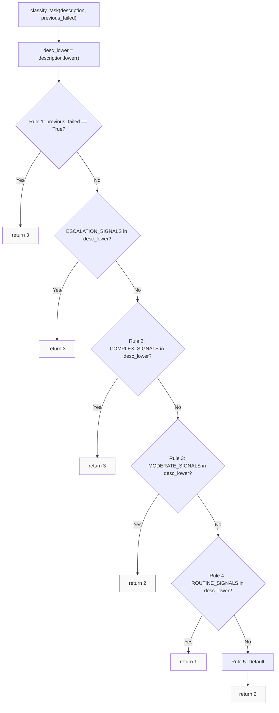
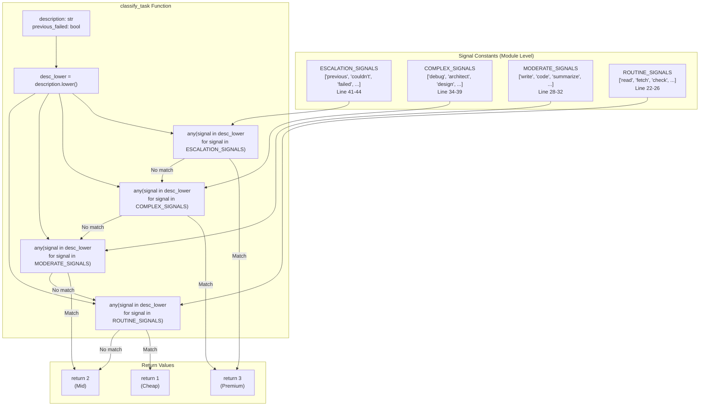
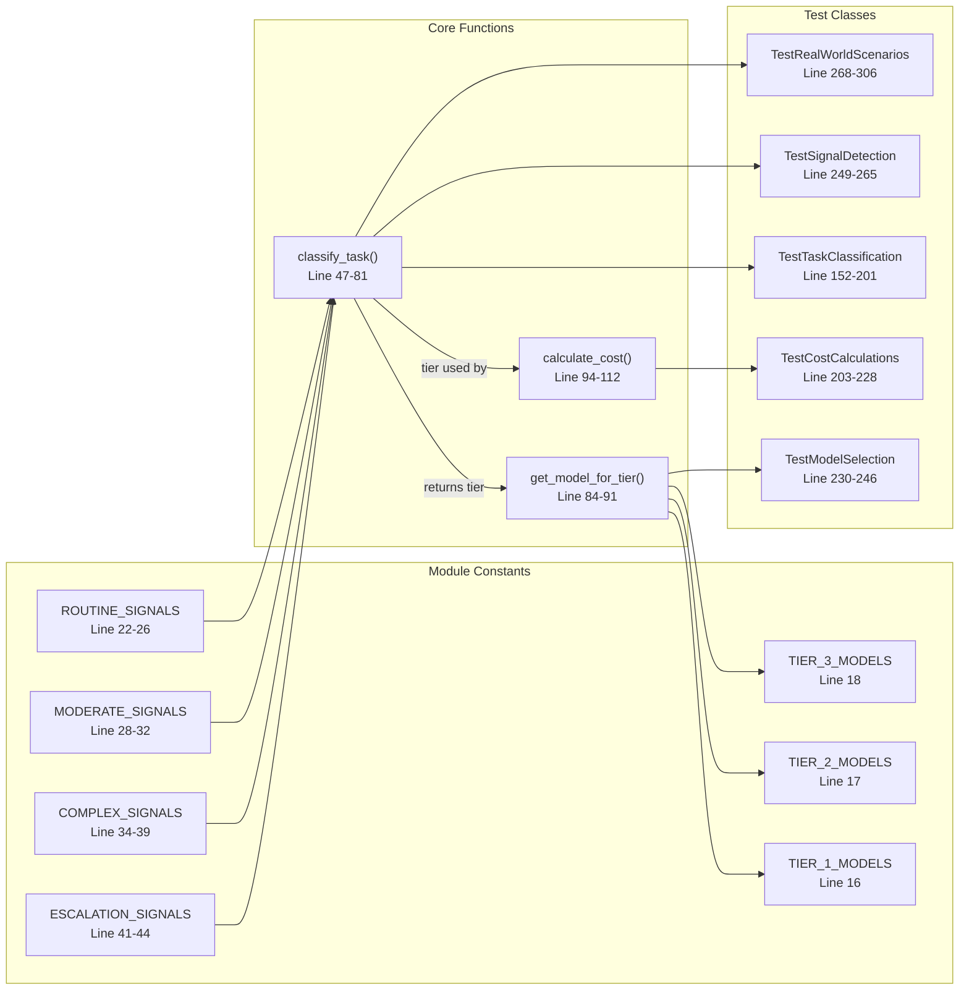

<!-- source: DeepWiki mcp.deepwiki.com · repo zscole/model-hierarchy-skill · page 4.1 classify_task Function · fetched 2026-10-26 -->

# classify_task Function

<details>
<summary>Relevant source files</summary>

The following files were used as context for generating this wiki page:

- [SKILL.md](SKILL.md)
- [tests/test_classification.py](tests/test_classification.py)

</details>


## Purpose and Scope

This page documents the `classify_task` function, which is the core implementation of the task classification system. The function analyzes task descriptions and routes them to appropriate model tiers (1=cheap, 2=mid, 3=premium) based on complexity signals and escalation rules.

For the conceptual decision algorithm and behavioral rules, see [Decision Algorithm](#3.3). For signal pattern definitions, see [Signal Detection System](#4.2). For model selection after classification, see [Model Selection Logic](#4.3).

Sources: [tests/test_classification.py:47-81](), [SKILL.md:110-132]()

---

## Function Signature

```python
def classify_task(description: str, previous_failed: bool = False) -> int
```

The function is defined at [tests/test_classification.py:47]() and serves as the entry point for all task classification decisions.

| Component | Type | Description |
|-----------|------|-------------|
| Function Name | `classify_task` | Pure function with no side effects |
| Module | `tests/test_classification.py` | Located in test module but serves as reference implementation |
| Return Type | `int` | Model tier: 1 (cheap), 2 (mid), or 3 (premium) |

Sources: [tests/test_classification.py:47-48]()

---

## Parameters

### `description: str`

The task description to classify. This parameter accepts natural language descriptions of agent tasks.

**Characteristics:**
- Required parameter (no default value)
- Case-insensitive matching (converted to lowercase internally at [tests/test_classification.py:58]())
- May contain multiple sentences or clauses
- Searched for signal keywords using substring matching

**Examples:**
```python
classify_task("Read the config file")                    # → 1
classify_task("Write a Python function to parse JSON")   # → 2
classify_task("Debug this race condition in production") # → 3
```

### `previous_failed: bool = False`

Escalation flag indicating whether a previous attempt at the same task failed.

**Characteristics:**
- Optional parameter (defaults to `False`)
- When `True`, immediately returns tier 3 regardless of description (see [tests/test_classification.py:61-62]())
- Implements the "escalation override" rule from the decision algorithm
- Reflects the principle that if a cheaper model failed, a premium model should be used

**Example:**
```python
# Even routine tasks escalate when previous attempt failed
classify_task("Read the config file", previous_failed=True)  # → 3
```

Sources: [tests/test_classification.py:47-57](), [SKILL.md:113-114]()

---

## Return Value

The function returns an integer representing the model tier:

| Return Value | Tier Name | Cost Range | Example Models |
|--------------|-----------|------------|----------------|
| `1` | Cheap / Tier 1 | $0.10-0.50/M tokens | `deepseek-v3`, `gpt-4o-mini`, `claude-3-haiku` |
| `2` | Mid / Tier 2 | $1-5/M tokens | `claude-sonnet-4`, `gpt-4o`, `gemini-pro` |
| `3` | Premium / Tier 3 | $10-75/M tokens | `claude-opus-4`, `gpt-4.5`, `o1` |

The returned tier value is typically passed to `get_model_for_tier()` to obtain an actual model name. See [Model Selection Logic](#4.3) for details.

Sources: [tests/test_classification.py:47-81](), [SKILL.md:19-46]()

---

## Internal Logic Flow

The function implements a 5-rule decision tree with priority ordering. Rules are evaluated sequentially, with higher-priority rules short-circuiting evaluation.

### Classification Decision Tree



Sources: [tests/test_classification.py:58-81]()

---

## Rule-Based Classification Algorithm

### Rule 1: Escalation Override (Lines 60-66)

**Priority:** Highest  
**Implementation:** [tests/test_classification.py:60-66]()

```python
# Rule 1: Escalation override
if previous_failed:
    return 3

# Check for escalation signals in description
if any(signal in desc_lower for signal in ESCALATION_SIGNALS):
    return 3
```

This rule has two paths:
1. **Explicit escalation**: If `previous_failed=True`, return tier 3 immediately
2. **Implicit escalation**: If description contains any signal from `ESCALATION_SIGNALS`, return tier 3

**ESCALATION_SIGNALS:** `["previous", "couldn't", "failed", "try again", "still not working", "none of these work", "stuck"]` ([tests/test_classification.py:41-44]())

**Rationale:** Failed attempts indicate the task is harder than initially classified. Premium models should be used to avoid repeated failures.

### Rule 2: Complex Signal Detection (Lines 68-70)

**Priority:** High  
**Implementation:** [tests/test_classification.py:68-70]()

```python
# Rule 2: Check for complex signals first (highest priority)
if any(signal in desc_lower for signal in COMPLEX_SIGNALS):
    return 3
```

**COMPLEX_SIGNALS:** `["debug", "architect", "design", "security", "why does", "why is", "tradeoff", "evaluate", "doesn't work", "failed", "tried", "race condition", "vulnerability", "migrate", "behaves differently", "under load", "production"]` ([tests/test_classification.py:34-39]())

**Rationale:** These signals indicate novel problem-solving, nuanced judgment, or high-stakes operations requiring premium reasoning capabilities.

### Rule 3: Moderate Signal Detection (Lines 72-74)

**Priority:** Medium  
**Implementation:** [tests/test_classification.py:72-74]()

```python
# Rule 3: Check for moderate signals
if any(signal in desc_lower for signal in MODERATE_SIGNALS):
    return 2
```

**MODERATE_SIGNALS:** `["write", "code", "summarize", "draft", "analyze", "create", "generate", "review", "refactor", "transform", "search", "research", "explain", "describe", "compare"]` ([tests/test_classification.py:28-32]())

**Rationale:** Multi-step operations requiring synthesis or standard pattern application, but not requiring premium reasoning.

### Rule 4: Routine Signal Detection (Lines 76-78)

**Priority:** Low  
**Implementation:** [tests/test_classification.py:76-78]()

```python
# Rule 4: Check for routine signals
if any(signal in desc_lower for signal in ROUTINE_SIGNALS):
    return 1
```

**ROUTINE_SIGNALS:** `["read", "fetch", "check", "list", "format", "status", "get", "filter", "sort", "convert", "parse", "health", "ping", "time", "date", "lookup", "find file", "show", "display"]` ([tests/test_classification.py:22-26]())

**Rationale:** Single-step, deterministic operations that don't benefit from expensive models.

### Rule 5: Default to Mid-Tier (Lines 80-81)

**Priority:** Fallback  
**Implementation:** [tests/test_classification.py:80-81]()

```python
# Rule 5: Default to mid-tier if uncertain
return 2
```

**Rationale:** When no signals match, default to tier 2 as a safe middle ground. This prevents under-provisioning for ambiguous tasks while avoiding unnecessary premium costs.

Sources: [tests/test_classification.py:60-81](), [SKILL.md:110-132]()

---

## Signal Detection Integration

The function integrates with four signal constant arrays defined at the module level.

### Signal Detection Architecture



### Signal Matching Algorithm

The signal detection uses Python's `any()` function with list comprehension for efficient substring matching:

```python
any(signal in desc_lower for signal in SIGNAL_LIST)
```

This pattern appears at:
- [tests/test_classification.py:65]() for escalation signals
- [tests/test_classification.py:69]() for complex signals
- [tests/test_classification.py:73]() for moderate signals
- [tests/test_classification.py:77]() for routine signals

**Matching Behavior:**
- Substring matching (not word boundary matching)
- Case-insensitive (description converted to lowercase)
- Short-circuits on first match (due to `any()`)
- Order matters: signals are checked in priority order

Sources: [tests/test_classification.py:22-44](), [tests/test_classification.py:65-78]()

---

## Function Context and Dependencies

### Module-Level Dependencies



### Related Functions

The `classify_task` function is typically used in conjunction with:

1. **`get_model_for_tier(tier: int) -> str`** ([tests/test_classification.py:84-91]())
   - Converts tier number to actual model name
   - Returns: `"deepseek-v3"`, `"claude-sonnet-4"`, or `"claude-opus-4"`

2. **`calculate_cost(tier: int, tokens: int) -> float`** ([tests/test_classification.py:94-112]())
   - Estimates cost for a given tier and token count
   - Used for cost analysis and optimization

3. **`calculate_monthly_cost(...) -> float`** ([tests/test_classification.py:115-138]())
   - Projects monthly costs based on task distribution
   - Validates the 80/15/5 distribution assumption

Sources: [tests/test_classification.py:1-150]()

---

## Usage Examples

### Basic Classification

```python
# Routine task → Tier 1
tier = classify_task("Read the configuration file")
assert tier == 1

# Moderate task → Tier 2
tier = classify_task("Write a Python function to validate emails")
assert tier == 2

# Complex task → Tier 3
tier = classify_task("Debug this race condition in the database layer")
assert tier == 3
```

### With Escalation

```python
# Initial attempt with routine signal
tier = classify_task("Parse the JSON response")
assert tier == 1  # Would use cheap model

# After failure, escalate
tier = classify_task("Parse the JSON response", previous_failed=True)
assert tier == 3  # Now uses premium model
```

### Compound Tasks

```python
# Multiple signals - highest priority wins
tier = classify_task("Read the config and debug why it's not loading")
assert tier == 3  # "debug" signal triggers tier 3

# Ambiguous task - defaults to mid-tier
tier = classify_task("Handle the user request appropriately")
assert tier == 2  # No matching signals, uses default
```

### Integration with Model Selection

```python
# Complete flow: classify → select model → execute
description = "Analyze the performance metrics and generate a report"
tier = classify_task(description)  # Returns 2 (moderate)
model = get_model_for_tier(tier)   # Returns "claude-sonnet-4"

# Now route task to the selected model
# (actual routing depends on integration platform)
```

Sources: [tests/test_classification.py:155-306](), [SKILL.md:220-232]()

---

## Test Coverage

The function is validated by 35 test scenarios across multiple test classes:

| Test Class | Scenarios | Purpose |
|------------|-----------|---------|
| `TestTaskClassification` | 10 routine, 10 moderate, 10 complex | Validates basic tier assignment |
| `TestSignalDetection` | Parametrized tests | Validates signal matching logic |
| `TestRealWorldScenarios` | 5 edge cases | Validates realistic agent workflows |

**Key Test Cases:**
- [tests/test_classification.py:155-171](): Tests routine/moderate/complex classification
- [tests/test_classification.py:173-177](): Tests escalation override
- [tests/test_classification.py:179-188](): Tests escalation signals in description
- [tests/test_classification.py:190-195](): Tests compound tasks use highest tier
- [tests/test_classification.py:197-200](): Tests default to mid-tier
- [tests/test_classification.py:252-265](): Parametrized signal detection tests
- [tests/test_classification.py:271-306](): Real-world scenarios (heartbeats, code review, security)

**Test Data Source:** [tests/scenarios.json]() contains structured test scenarios loaded at [tests/test_classification.py:142-149]()

Sources: [tests/test_classification.py:152-310](), [conftest.py]()

---

## Performance Characteristics

### Time Complexity

The function has O(n × m) time complexity where:
- n = length of task description
- m = total number of signals across all categories

In practice:
- Signal lists contain 15-25 keywords each
- Task descriptions are typically < 500 characters
- Performance is negligible (microseconds per call)

### Memory Characteristics

- **No heap allocation**: All signal lists are module-level constants
- **Minimal stack usage**: Simple conditional logic with early returns
- **No state**: Pure function with no side effects

### Bottlenecks

The function is not a performance bottleneck. For high-throughput scenarios, consider:
1. Pre-compiling signal lists into regex patterns
2. Caching classification results for identical descriptions
3. Using word boundary matching instead of substring matching for precision

Sources: [tests/test_classification.py:47-81]()

---

## Design Rationale

### Why Sequential Rule Evaluation?

The priority-ordered rule structure ([tests/test_classification.py:60-81]()) ensures:
1. **Safety first**: Escalation signals always trigger tier 3
2. **Complexity before simplicity**: Complex signals override moderate/routine
3. **Conservative defaults**: Unknown tasks default to tier 2, not tier 1

### Why Substring Matching?

Substring matching (vs. word boundary matching) provides:
- **Simplicity**: No regex compilation overhead
- **Flexibility**: Catches variations ("debugging", "debugger", "debug")
- **Robustness**: Works with compound words and punctuation

**Trade-off**: May have false positives (e.g., "read" matches "thread"), but defaults and priority ordering mitigate this.

### Why Default to Tier 2?

Defaulting ambiguous tasks to tier 2 ([tests/test_classification.py:80-81]()) balances:
- **Safety**: Avoids under-provisioning for unclear tasks
- **Cost**: Avoids unnecessary premium model usage
- **Quality**: Mid-tier models handle most ambiguous cases well

Sources: [tests/test_classification.py:47-81](), [SKILL.md:110-132]()

---

