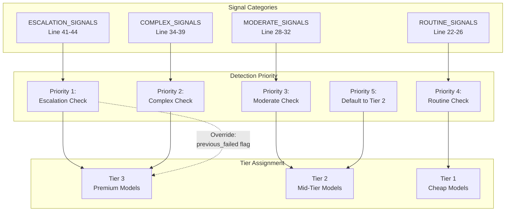
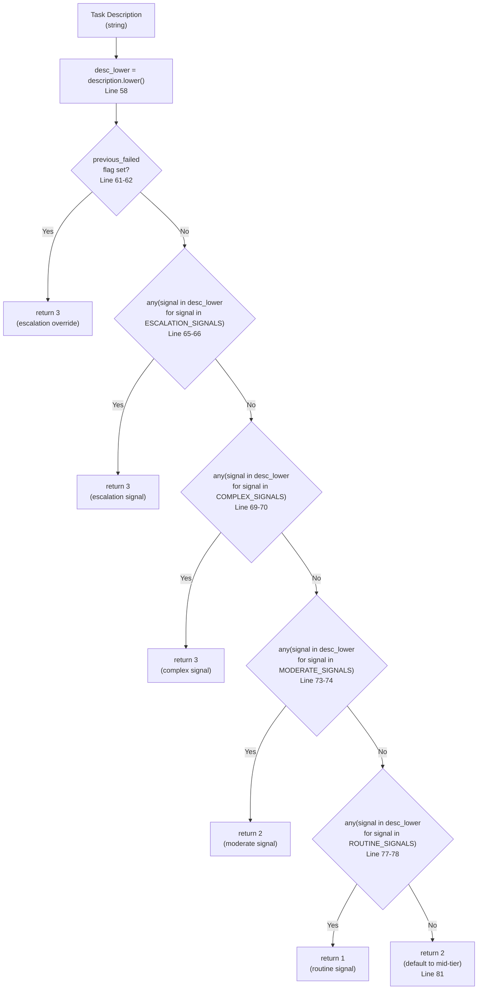
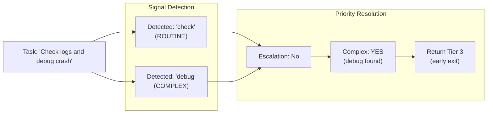

<!-- source: DeepWiki mcp.deepwiki.com · repo zscole/model-hierarchy-skill · page 4.2 Signal Detection System · fetched 2026-10-26 -->

# Signal Detection System

<details>
<summary>Relevant source files</summary>

The following files were used as context for generating this wiki page:

- [tests/scenarios.json](tests/scenarios.json)
- [tests/test_classification.py](tests/test_classification.py)

</details>


**Purpose**: This document describes the signal detection mechanism used to classify task descriptions into model tiers. Signal detection is the core pattern-matching engine that analyzes natural language task descriptions and identifies complexity indicators. For the overall classification algorithm that uses these signals, see [4.1 classify_task Function](#4.1). For the tier definitions that signals map to, see [3.2 Model Tier Architecture](#3.2).

**Scope**: This page covers the four signal categories (`ROUTINE_SIGNALS`, `MODERATE_SIGNALS`, `COMPLEX_SIGNALS`, `ESCALATION_SIGNALS`), their keyword patterns, detection logic, and priority rules.

---

## Overview

The signal detection system uses keyword-based pattern matching to classify tasks. Each signal category corresponds to a model tier or special behavior. The system performs case-insensitive substring matching against predefined signal lists to determine task complexity.

**Sources**: [tests/test_classification.py:22-44]()

---

## Signal Categories and Tier Mapping



**Signal Priority Rules**:
1. **Escalation signals** have highest priority and always route to Tier 3
2. **Complex signals** are checked second and route to Tier 3
3. **Moderate signals** are checked third and route to Tier 2
4. **Routine signals** are checked fourth and route to Tier 1
5. **Unknown tasks** default to Tier 2 as a safety fallback

**Sources**: [tests/test_classification.py:47-82]()

---

## ROUTINE_SIGNALS

Routine signals indicate simple, deterministic operations that require minimal reasoning. These tasks are typically file operations, status checks, formatting, and data retrieval.

### Signal Keywords

| Signal | Purpose | Example Task |
|--------|---------|--------------|
| `read` | File/data reading | "Read the contents of config.json" |
| `fetch` | URL/API fetching | "Fetch the homepage of example.com" |
| `check` | Status verification | "Check if the server is running" |
| `list` | Directory/item listing | "List all files in the src directory" |
| `format` | Text formatting | "Format this JSON and fix the indentation" |
| `status` | Status queries | "Get the current git status" |
| `get` | Data retrieval | "Get the database connection string" |
| `filter` | Data filtering | "Filter this list to only items over 100" |
| `sort` | Data sorting | "Sort these entries alphabetically" |
| `convert` | Simple conversion | "Convert this date to ISO format" |
| `parse` | Parsing operations | "Parse this XML response" |
| `health` | Health checks | "Run the health check" |
| `ping` | Network pinging | "Ping the API endpoint" |
| `time` | Time queries | "What time is it in Tokyo?" |
| `date` | Date operations | "Get today's date" |
| `lookup` | Simple lookups | "Lookup this error code" |
| `find file` | File finding | "Find files matching *.log" |
| `show` | Display operations | "Show the current configuration" |
| `display` | Display operations | "Display the results" |

**Full Definition**: [tests/test_classification.py:22-26]()

**Sources**: [tests/test_classification.py:22-26](), [tests/scenarios.json:2-52]()

---

## MODERATE_SIGNALS

Moderate signals indicate tasks requiring synthesis, generation, or analysis but not deep reasoning or debugging. These tasks typically involve code generation, documentation, summarization, and standard reviews.

### Signal Keywords

| Signal | Purpose | Example Task |
|--------|---------|--------------|
| `write` | Content/code writing | "Write a Python function to parse CSV files" |
| `code` | Code generation | "Code a REST API endpoint" |
| `summarize` | Content summarization | "Summarize this 10-page document" |
| `draft` | Drafting documents | "Draft an email to the team about the launch" |
| `analyze` | Data analysis | "Analyze the sales data and find trends" |
| `create` | Content creation | "Create a README for this project" |
| `generate` | Generation tasks | "Generate unit tests for this module" |
| `review` | Standard reviews | "Review this pull request" |
| `refactor` | Code refactoring | "Refactor this function to be more readable" |
| `transform` | Data transformation | "Transform this JSON into a markdown table" |
| `search` | Search operations | "Search for recent articles about AI agents" |
| `research` | Research tasks | "Research best practices for caching" |
| `explain` | Explanations | "Explain how this algorithm works" |
| `describe` | Descriptions | "Describe the system architecture" |
| `compare` | Comparisons | "Compare these two approaches" |

**Full Definition**: [tests/test_classification.py:28-32]()

**Important Note**: The `code` keyword in moderate signals means that even simple code tasks (like "format this code") are routed to Tier 2. This is an intentional tradeoff documented in [tests/scenarios.json:170-172]() to ensure code generation tasks receive adequate model capability.

**Sources**: [tests/test_classification.py:28-32](), [tests/scenarios.json:54-104]()

---

## COMPLEX_SIGNALS

Complex signals indicate tasks requiring deep reasoning, debugging, architectural decisions, security analysis, or root cause investigation. These tasks benefit significantly from premium model capabilities.

### Signal Keywords

| Signal | Purpose | Example Task |
|--------|---------|--------------|
| `debug` | Debugging issues | "Debug why this test is flaky and sometimes fails" |
| `architect` | Architecture design | "Architect a migration strategy from monolith to microservices" |
| `design` | System design | "Design the architecture for a distributed cache system" |
| `security` | Security analysis | "Review this smart contract for security vulnerabilities" |
| `why does` | Root cause analysis | "Why does this work in dev but fail in production?" |
| `why is` | Root cause analysis | "Why is the system behaving differently under load?" |
| `tradeoff` | Tradeoff evaluation | "Evaluate the tradeoffs between these three approaches" |
| `evaluate` | Deep evaluation | "Evaluate the performance implications" |
| `doesn't work` | Failure investigation | "This doesn't work and I don't know why" |
| `failed` | Failure analysis | "The deployment failed with this error" |
| `tried` | Multi-attempt problems | "I tried three different approaches and none work" |
| `race condition` | Concurrency issues | "This code has a race condition somewhere. Find it." |
| `vulnerability` | Security issues | "Find vulnerabilities in this authentication system" |
| `migrate` | Migration planning | "Migrate the database schema without downtime" |
| `behaves differently` | Behavioral issues | "System behaves differently under load" |
| `under load` | Performance issues | "Analyze behavior under load" |
| `production` | Production debugging | "Debug this production issue" |

**Full Definition**: [tests/test_classification.py:34-39]()

**Sources**: [tests/test_classification.py:34-39](), [tests/scenarios.json:106-156]()

---

## ESCALATION_SIGNALS

Escalation signals indicate that previous attempts to solve a task have failed. These signals always force routing to Tier 3 (premium models), regardless of other signals present in the task description.

### Signal Keywords

| Signal | Purpose | Example Task |
|--------|---------|--------------|
| `previous` | Previous model failed | "The previous model couldn't figure this out" |
| `couldn't` | Capability failure | "I couldn't solve this with the current approach" |
| `failed` | Task failure | "This failed when I tried it" |
| `try again` | Retry request | "Try again with a better approach" |
| `still not working` | Persistent failure | "Still not working after multiple attempts" |
| `none of these work` | Multiple failures | "I tried three approaches and none of these work" |
| `stuck` | Stuck condition | "I'm stuck on this problem" |

**Full Definition**: [tests/test_classification.py:41-44]()

**Escalation Priority**: Escalation signals are checked first in the classification logic ([tests/test_classification.py:64-66]()), even before complex signals, ensuring that failed tasks always receive premium model attention.

**Sources**: [tests/test_classification.py:41-44](), [tests/scenarios.json:180-183]()

---

## Detection Algorithm



**Detection Method**: The system uses Python's substring matching with the `in` operator to check if any signal keyword appears anywhere in the lowercased task description. This is case-insensitive and position-independent.

**Sources**: [tests/test_classification.py:47-82]()

---

## Signal Detection Examples

### Example 1: Simple Routine Task

```
Task: "Read the contents of config.json"
Lowercase: "read the contents of config.json"
Detected Signals: ["read"]
Category: ROUTINE_SIGNALS
Result: Tier 1
```

**Sources**: [tests/scenarios.json:4-7]()

### Example 2: Compound Task (Highest Priority Wins)

```
Task: "Read this file and summarize it"
Lowercase: "read this file and summarize it"
Detected Signals: ["read", "summarize"]
Categories: ROUTINE_SIGNALS (read), MODERATE_SIGNALS (summarize)
Result: Tier 2 (moderate signal has higher priority)
```

**Sources**: [tests/scenarios.json:160-163]()

### Example 3: Complex Debugging Task

```
Task: "Debug why this test is flaky and sometimes fails"
Lowercase: "debug why this test is flaky and sometimes fails"
Detected Signals: ["debug"]
Category: COMPLEX_SIGNALS
Result: Tier 3
```

**Sources**: [tests/scenarios.json:108-111]()

### Example 4: Escalation Override

```
Task: "Format this JSON"
Lowercase: "format this json"
Detected Signals: ["format"]
Category: ROUTINE_SIGNALS (would be Tier 1)
Override: previous_failed=True flag is set
Result: Tier 3 (escalation overrides all other signals)
```

**Sources**: [tests/test_classification.py:173-177]()

---

## Signal Priority in Compound Tasks

When multiple signals from different categories appear in a single task description, the system uses the **highest priority signal** to determine the tier. This is implemented through sequential checking with early returns.



**Priority Order** (highest to lowest):
1. Escalation signals → Tier 3
2. Complex signals → Tier 3
3. Moderate signals → Tier 2
4. Routine signals → Tier 1
5. No signals → Tier 2 (default)

**Implementation**: The `classify_task` function checks categories in priority order and returns immediately upon finding a match ([tests/test_classification.py:60-81]()), ensuring higher-priority signals always dominate.

**Sources**: [tests/test_classification.py:60-81](), [tests/scenarios.json:158-183]()

---

## Test Coverage

The signal detection system has comprehensive test coverage validating each category and edge case.

### Test Classes and Methods

| Test Class | Methods | Purpose |
|------------|---------|---------|
| `TestTaskClassification` | `test_routine_tasks`<br/>`test_moderate_tasks`<br/>`test_complex_tasks` | Validates all 35 scenarios from scenarios.json |
| `TestSignalDetection` | `test_routine_signals_detected`<br/>`test_complex_signals_detected` | Validates individual signal keywords |
| `TestRealWorldScenarios` | `test_heartbeat_is_routine`<br/>`test_security_review_is_complex`<br/>`test_architecture_is_complex` | Validates realistic agent tasks |

**Test Data**: The test suite uses [tests/scenarios.json]() containing 35 categorized test cases:
- 10 routine tasks ([scenarios.json:2-52]())
- 10 moderate tasks ([scenarios.json:54-104]())
- 10 complex tasks ([scenarios.json:106-156]())
- 5 edge cases ([scenarios.json:158-183]())

**Sources**: [tests/test_classification.py:152-307](), [tests/scenarios.json:1-185]()

---

## Signal Pattern Tuning

The signal lists are designed to balance precision and recall. Some keywords like `code` are intentionally placed in `MODERATE_SIGNALS` rather than `ROUTINE_SIGNALS` to ensure code generation tasks receive adequate model capability, even for simple code tasks.

### Known Tradeoffs

| Tradeoff | Example | Rationale |
|----------|---------|-----------|
| `code` in MODERATE | "Format this code" → Tier 2 | Ensures code tasks get sufficient model capability |
| `explain` in MODERATE | "Explain this function" → Tier 2 | Simple explanations benefit from mid-tier synthesis |
| `failed` in COMPLEX | "The build failed" → Tier 3 | Failure investigation often requires deep reasoning |

These tradeoffs are documented in the edge cases section of [tests/scenarios.json:158-183]().

**Sources**: [tests/scenarios.json:170-177](), [tests/test_classification.py:291-296]()

---

## Implementation in classify_task

The signal detection system is consumed by the `classify_task` function, which performs the actual matching logic:

```python
# From tests/test_classification.py:58-66
desc_lower = description.lower()

# Escalation check (highest priority)
if previous_failed:
    return 3
if any(signal in desc_lower for signal in ESCALATION_SIGNALS):
    return 3

# Complex check
if any(signal in desc_lower for signal in COMPLEX_SIGNALS):
    return 3

# ... continues with moderate, routine, default
```

The `any()` function with generator expression provides efficient short-circuit evaluation, stopping as soon as a matching signal is found.

**Sources**: [tests/test_classification.py:47-82]()

---

## Extension Points

To customize signal detection for domain-specific use cases:

1. **Add domain-specific signals**: Extend signal lists with domain keywords (e.g., `["sql", "query"]` for database tasks)
2. **Adjust signal categories**: Move signals between categories to tune classification behavior
3. **Add signal weights**: Replace binary detection with weighted scoring for nuanced classification
4. **Context-aware signals**: Implement signal detection that considers surrounding words (e.g., "debug logging" vs "debug production")

For guidance on extending the skill, see [7.3 Extending the Skill](#7.3).

**Sources**: [tests/test_classification.py:22-44]()

---

