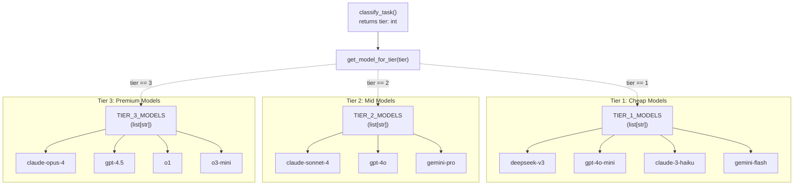
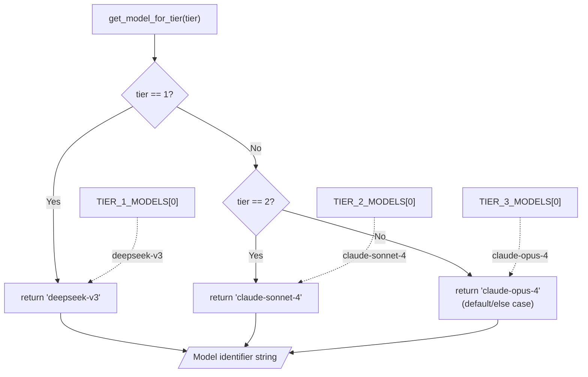
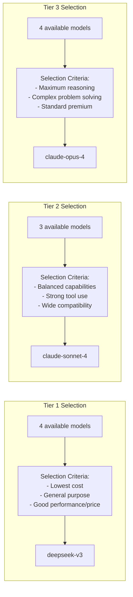
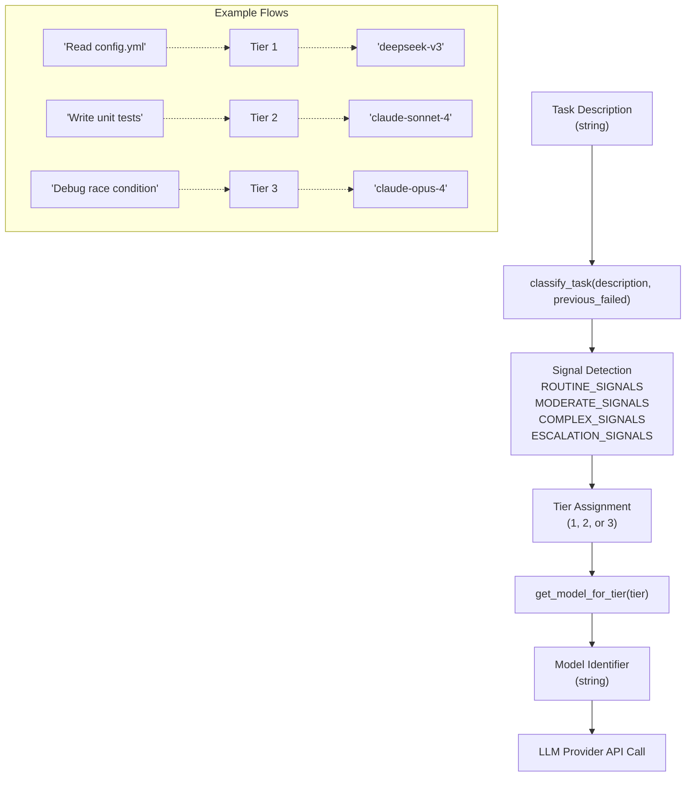
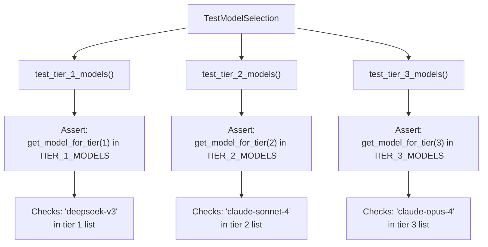

<!-- source: DeepWiki mcp.deepwiki.com · repo zscole/model-hierarchy-skill · page 4.3 Model Selection Logic · fetched 2026-10-26 -->

# Model Selection Logic

<details>
<summary>Relevant source files</summary>

The following files were used as context for generating this wiki page:

- [SKILL.md](SKILL.md)
- [tests/test_classification.py](tests/test_classification.py)

</details>


## Purpose and Scope

This page documents the model selection implementation that maps tier numbers (1, 2, 3) to actual LLM model names. After task classification determines which tier is appropriate (see [classify_task Function](#4.1)), the model selection logic translates that tier into a specific model identifier for API calls.

The core components covered here are:
- The three tier model constant lists (`TIER_1_MODELS`, `TIER_2_MODELS`, `TIER_3_MODELS`)
- The `get_model_for_tier` function that performs tier-to-model translation
- Default model selection strategy
- Validation that selected models exist in tier definitions

For information about how tiers are determined from task descriptions, see [classify_task Function](#4.1). For tier pricing and characteristics, see [Model Tier Architecture](#3.2).

---

## Tier Model Definitions

The implementation defines three constant lists containing the available models for each tier. These lists serve as the authoritative source for which models belong to each performance and cost category.

### Tier Constant Structure



**Sources:** [tests/test_classification.py:16-18]()

### Implementation Details

The tier model lists are defined as module-level constants:

| Constant | Models | Count | Pricing Range |
|----------|--------|-------|---------------|
| `TIER_1_MODELS` | `["deepseek-v3", "gpt-4o-mini", "claude-3-haiku", "gemini-flash"]` | 4 | $0.10-0.50/M tokens |
| `TIER_2_MODELS` | `["claude-sonnet-4", "gpt-4o", "gemini-pro"]` | 3 | $1-5/M tokens |
| `TIER_3_MODELS` | `["claude-opus-4", "gpt-4.5", "o1", "o3-mini"]` | 4 | $10-75/M tokens |

Each list contains model identifiers as strings that can be directly passed to LLM provider APIs. The models are ordered by preference within each tier, though the current implementation only uses the first model in each list.

**Sources:** [tests/test_classification.py:16-18](), [SKILL.md:21-46]()

---

## The get_model_for_tier Function

The `get_model_for_tier` function performs the tier-to-model translation. It accepts a tier integer (1, 2, or 3) and returns a specific model identifier string.

### Function Signature

```python
def get_model_for_tier(tier: int) -> str:
    """Get a representative model for a given tier."""
```

**Parameters:**
- `tier` (int): The model tier (1=cheap, 2=mid, 3=premium)

**Returns:**
- `str`: A model identifier suitable for API calls

**Sources:** [tests/test_classification.py:84-92]()

### Selection Logic Flow



**Sources:** [tests/test_classification.py:84-92]()

### Implementation

The function uses a simple conditional chain:

```python
if tier == 1:
    return "deepseek-v3"
elif tier == 2:
    return "claude-sonnet-4"
else:
    return "claude-opus-4"
```

The `else` clause handles both `tier == 3` and any invalid tier values, defaulting to the premium model as a safety mechanism. This ensures that if an invalid tier is passed, the system errs on the side of using a more capable (though expensive) model rather than failing or using an inadequate model.

**Sources:** [tests/test_classification.py:84-92]()

---

## Default Model Selection Strategy

The implementation selects one "representative" model from each tier list rather than choosing randomly or cycling through options. This design choice provides predictable, testable behavior.

### Default Model Mapping

| Tier | Selected Model | Rationale |
|------|----------------|-----------|
| 1 | `deepseek-v3` | Lowest cost ($0.14 input, $0.28 output per 1M tokens), good general performance |
| 2 | `claude-sonnet-4` | Balanced performance and cost, strong tool use capabilities |
| 3 | `claude-opus-4` | Highest reasoning capability, standard premium choice |

### Model Selection Criteria



**Sources:** [tests/test_classification.py:84-92](), [SKILL.md:21-46]()

### Future Extension Points

While the current implementation hardcodes the model selection, the tier lists support future enhancements:

- **Load balancing**: Cycle through models in a tier for rate limit management
- **Provider preferences**: Allow configuration of preferred providers (e.g., prefer OpenAI over Anthropic)
- **Regional availability**: Select models based on geographic deployment
- **Performance tracking**: Choose models based on historical success rates

The constant lists provide the foundation for these extensions without requiring changes to the classification logic.

**Sources:** [tests/test_classification.py:16-18]()

---

## Integration with Classification System

The model selection function integrates with the classification pipeline to produce executable model identifiers from task descriptions.

### Complete Pipeline Flow



**Sources:** [tests/test_classification.py:47-92]()

### Code Usage Pattern

The typical usage combines classification and selection:

```python
# Step 1: Classify task to get tier
task_description = "Review this code for security vulnerabilities"
tier = classify_task(task_description)  # Returns: 3

# Step 2: Get model for tier
model_identifier = get_model_for_tier(tier)  # Returns: "claude-opus-4"

# Step 3: Use model identifier in API call
response = llm_api.call(model=model_identifier, prompt=task_description)
```

**Sources:** [tests/test_classification.py:47-92]()

### Tier-to-Model Mapping Table

This table shows the complete mapping from classification signals to final model selection:

| Task Type | Example Signal | Tier | Model | Cost (Output/1M) |
|-----------|----------------|------|-------|------------------|
| Routine | "read", "fetch", "list" | 1 | `deepseek-v3` | $0.28 |
| Moderate | "write", "code", "analyze" | 2 | `claude-sonnet-4` | $15.00 |
| Complex | "debug", "architect", "security" | 3 | `claude-opus-4` | $75.00 |
| Escalation | "failed", "stuck" | 3 | `claude-opus-4` | $75.00 |
| Unknown/Default | (no signals) | 2 | `claude-sonnet-4` | $15.00 |

**Sources:** [tests/test_classification.py:22-44](), [tests/test_classification.py:84-92](), [SKILL.md:21-46]()

---

## Testing and Validation

The test suite validates that model selection returns correct models for each tier and that those models exist in the appropriate tier definitions.

### Test Coverage Structure



**Sources:** [tests/test_classification.py:230-247]()

### Test Implementation

The `TestModelSelection` class contains three validation tests:

**Tier 1 Test:**
```python
def test_tier_1_models(self):
    """Tier 1 should return cheap model."""
    model = get_model_for_tier(1)
    assert model in TIER_1_MODELS
```

**Tier 2 Test:**
```python
def test_tier_2_models(self):
    """Tier 2 should return mid-tier model."""
    model = get_model_for_tier(2)
    assert model in TIER_2_MODELS
```

**Tier 3 Test:**
```python
def test_tier_3_models(self):
    """Tier 3 should return premium model."""
    model = get_model_for_tier(3)
    assert model in TIER_3_MODELS
```

These tests ensure that:
1. Each tier returns a valid model identifier
2. The returned model exists in the corresponding tier list
3. The tier constants remain synchronized with the selection logic

**Sources:** [tests/test_classification.py:230-247]()

### Validation Against SKILL.md

The tier model definitions in the code match the specification in SKILL.md:

| Specification Location | Code Location | Validation |
|------------------------|---------------|------------|
| [SKILL.md:21-28]() Tier 1 models | [tests/test_classification.py:16]() `TIER_1_MODELS` | ✓ All models match |
| [SKILL.md:30-36]() Tier 2 models | [tests/test_classification.py:17]() `TIER_2_MODELS` | ✓ All models match |
| [SKILL.md:38-45]() Tier 3 models | [tests/test_classification.py:18]() `TIER_3_MODELS` | ✓ All models match |

**Sources:** [SKILL.md:21-46](), [tests/test_classification.py:16-18]()

---

## Model Identifier Format

The model identifiers returned by `get_model_for_tier` use a consistent naming convention that maps to provider API formats:

### Identifier Patterns

| Provider | Pattern | Examples |
|----------|---------|----------|
| Anthropic Claude | `claude-{model}-{version}` | `claude-opus-4`, `claude-sonnet-4`, `claude-3-haiku` |
| OpenAI GPT | `gpt-{version}` or `gpt-{version}-{variant}` | `gpt-4o`, `gpt-4o-mini`, `gpt-4.5` |
| DeepSeek | `deepseek-{model}` | `deepseek-v3` |
| Google Gemini | `gemini-{variant}` | `gemini-flash`, `gemini-pro` |
| OpenAI Reasoning | `o{version}` or `o{version}-{variant}` | `o1`, `o3-mini` |

These identifiers are designed to be provider-agnostic where possible, though some platforms (like OpenClaw) may require provider prefixes (e.g., `anthropic/claude-opus-4`). Integration layers handle this transformation as needed.

**Sources:** [tests/test_classification.py:16-18](), [SKILL.md:188-201]()

---

