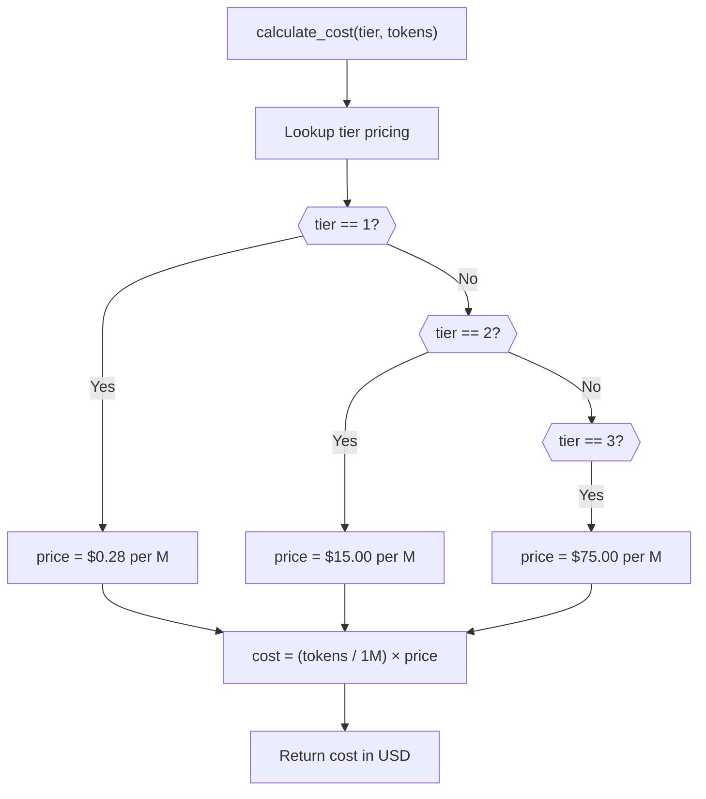
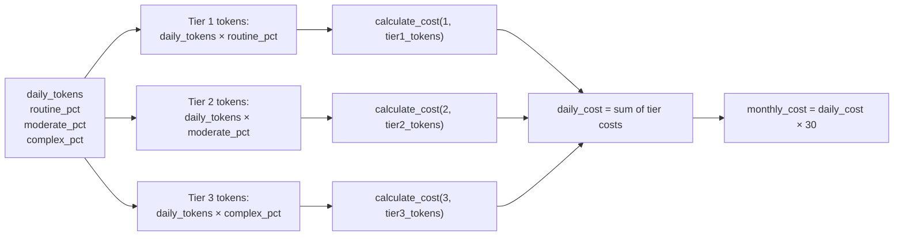
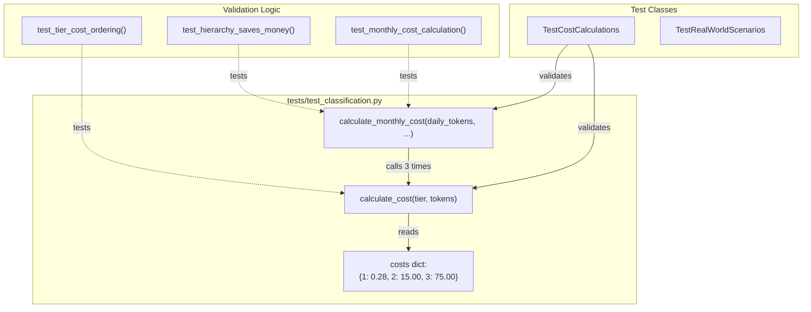
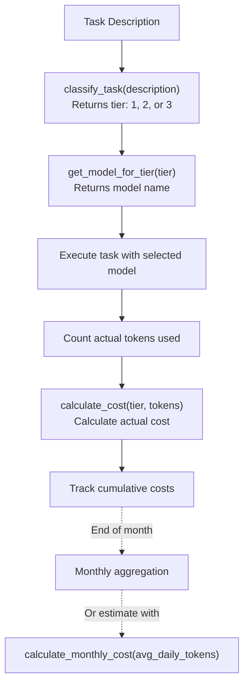

<!-- source: DeepWiki mcp.deepwiki.com · repo zscole/model-hierarchy-skill · page 4.4 Cost Calculation Functions · fetched 2026-10-26 -->

# Cost Calculation Functions

<details>
<summary>Relevant source files</summary>

The following files were used as context for generating this wiki page:

- [README.md](README.md)
- [tests/test_classification.py](tests/test_classification.py)

</details>


## Purpose and Scope

This document covers the cost calculation functions used to estimate operational expenses for the model hierarchy system. These functions enable validation of cost savings claims and provide a framework for projecting monthly costs based on token usage and task distribution.

For information about how tasks are classified into tiers, see [Task Classification System](#3.1). For details on the model tier definitions that these functions reference, see [Model Tier Architecture](#3.2).

---

## Overview

The cost calculation system consists of two primary functions that work together to estimate operational costs:

| Function | Purpose | Scope |
|----------|---------|-------|
| `calculate_cost` | Calculate cost for a single tier and token count | Per-task or per-batch calculation |
| `calculate_monthly_cost` | Calculate total monthly cost with task distribution | Aggregate cost projection |

Both functions use hardcoded pricing data representing average output token costs for representative models in each tier. The system uses output token pricing because it is typically higher than input pricing and provides a conservative cost estimate.

**Sources:** [tests/test_classification.py:94-138]()

---

## Function: calculate_cost

### Signature and Parameters

```python
def calculate_cost(tier: int, tokens: int = 1000) -> float
```

| Parameter | Type | Description |
|-----------|------|-------------|
| `tier` | `int` | Model tier (1=cheap, 2=mid, 3=premium) |
| `tokens` | `int` | Number of tokens (default: 1000) |
| **Returns** | `float` | Cost in USD |

### Pricing Model

The function uses fixed per-million-token rates for each tier:

| Tier | Representative Model | Cost per 1M Tokens | Use Case |
|------|---------------------|-------------------|----------|
| 1 | DeepSeek V3 | $0.28 | Routine tasks (80% of workload) |
| 2 | Claude Sonnet 4 | $15.00 | Moderate tasks (15% of workload) |
| 3 | Claude Opus 4 | $75.00 | Complex tasks (5% of workload) |

### Calculation Formula

```
cost = (tokens / 1,000,000) × tier_price
```

The function performs a simple linear calculation by dividing the token count by one million and multiplying by the tier's price per million tokens.

### Implementation Details

The pricing data is stored in a dictionary mapping tier numbers to costs. The calculation applies the appropriate rate based on the tier parameter:

[tests/test_classification.py:106-112]()

**Sources:** [tests/test_classification.py:94-112]()

---

## Function: calculate_monthly_cost

### Signature and Parameters

```python
def calculate_monthly_cost(
    daily_tokens: int,
    routine_pct: float = 0.80,
    moderate_pct: float = 0.15,
    complex_pct: float = 0.05
) -> float
```

| Parameter | Type | Default | Description |
|-----------|------|---------|-------------|
| `daily_tokens` | `int` | (required) | Average tokens processed per day |
| `routine_pct` | `float` | 0.80 | Percentage of routine tasks (tier 1) |
| `moderate_pct` | `float` | 0.15 | Percentage of moderate tasks (tier 2) |
| `complex_pct` | `float` | 0.05 | Percentage of complex tasks (tier 3) |
| **Returns** | `float` | | Monthly cost in USD |

### Calculation Strategy

The function calculates monthly costs by:
1. Distributing daily tokens across tiers based on task distribution percentages
2. Calculating per-tier daily costs using `calculate_cost`
3. Summing tier costs to get total daily cost
4. Multiplying by 30 to extrapolate monthly cost

### Mathematical Formula

```
daily_cost = calculate_cost(1, daily_tokens × routine_pct) +
             calculate_cost(2, daily_tokens × moderate_pct) +
             calculate_cost(3, daily_tokens × complex_pct)

monthly_cost = daily_cost × 30
```

### Default Distribution Rationale

The default 80/15/5 distribution is based on empirical observations that most agent tasks are routine operations. This distribution aligns with the "80% janitorial work" problem statement documented in [The Problem: Agent Cost Waste](#2.1).

**Sources:** [tests/test_classification.py:115-138]()

---

## Cost Calculation Flow

### Per-Task Cost Calculation



**Sources:** [tests/test_classification.py:94-112]()

---

### Monthly Cost Projection



**Sources:** [tests/test_classification.py:115-138]()

---

## Code Entity Mapping

### Function Relationships



**Sources:** [tests/test_classification.py:94-138](), [tests/test_classification.py:203-228]()

---

## Usage in Test Suite

### Validation of Cost Ordering

The test suite validates that higher tiers cost more for the same token count:

[tests/test_classification.py:206-210]()

This ensures the pricing model maintains logical consistency where premium models are more expensive than cheaper alternatives.

### Validation of Cost Savings

The hierarchical routing cost is compared against pure premium usage to validate the 10x savings claim:

[tests/test_classification.py:212-221]()

The test asserts that hierarchical routing costs less than 1/5 of pure premium usage, confirming the cost optimization benefit.

### Validation of Cost Estimates

The monthly cost calculation is tested to ensure it produces reasonable estimates:

[tests/test_classification.py:223-227]()

For 100K tokens per day, the expected monthly cost is approximately $19, with the test allowing variance between $10 and $30 to account for pricing fluctuations.

**Sources:** [tests/test_classification.py:203-228]()

---

## Cost Comparison Examples

### Scenario: 100K Tokens Per Day

Using the default 80/15/5 distribution:

| Component | Calculation | Result |
|-----------|-------------|--------|
| **Tier 1 (80K tokens/day)** | (80,000 / 1M) × $0.28 × 30 | $0.67/month |
| **Tier 2 (15K tokens/day)** | (15,000 / 1M) × $15.00 × 30 | $6.75/month |
| **Tier 3 (5K tokens/day)** | (5,000 / 1M) × $75.00 × 30 | $11.25/month |
| **Total Hierarchical** | Sum of above | **~$19/month** |
| **Pure Opus (100K/day)** | (100,000 / 1M) × $75.00 × 30 | **$225/month** |
| **Pure Sonnet (100K/day)** | (100,000 / 1M) × $15.00 × 30 | **$45/month** |

### Cost Savings Calculation

```
Savings vs Pure Opus = ($225 - $19) / $225 = 91.6% reduction
Savings vs Pure Sonnet = ($45 - $19) / $45 = 57.8% reduction
```

The hierarchical approach achieves approximately 10x cost reduction versus pure premium usage and 2.4x reduction versus pure mid-tier usage.

**Sources:** [README.md:52-60](), [tests/test_classification.py:115-138]()

---

## Integration with Classification System

### Cost Calculation in Context



**Sources:** [tests/test_classification.py:47-138]()

---

## Extending Cost Calculations

### Adding New Tiers

To add a new tier or modify pricing, update the `costs` dictionary in `calculate_cost`:

[tests/test_classification.py:106-111]()

### Adjusting Task Distribution

To model different workload distributions, pass custom percentages to `calculate_monthly_cost`:

```python
# More complex workload (60% routine, 25% moderate, 15% complex)
monthly_cost = calculate_monthly_cost(
    daily_tokens=100_000,
    routine_pct=0.60,
    moderate_pct=0.25,
    complex_pct=0.15
)
```

### Input vs Output Token Pricing

The current implementation uses output token pricing. To model input tokens, modify the `costs` dictionary with input-specific rates. Note that most models have lower input pricing, which would further improve cost savings.

**Sources:** [tests/test_classification.py:94-138]()

---

## Related Functions

| Function | Purpose | Documentation |
|----------|---------|---------------|
| `classify_task` | Determine tier for a task | [classify_task Function](#4.1) |
| `get_model_for_tier` | Select model for a tier | [Model Selection Logic](#4.3) |
| `TIER_X_MODELS` | Model definitions by tier | [Model Tier Architecture](#3.2) |

**Sources:** [tests/test_classification.py:1-311]()

---

