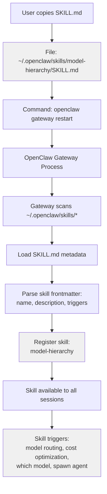
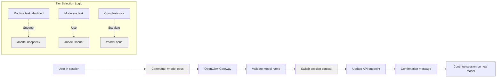
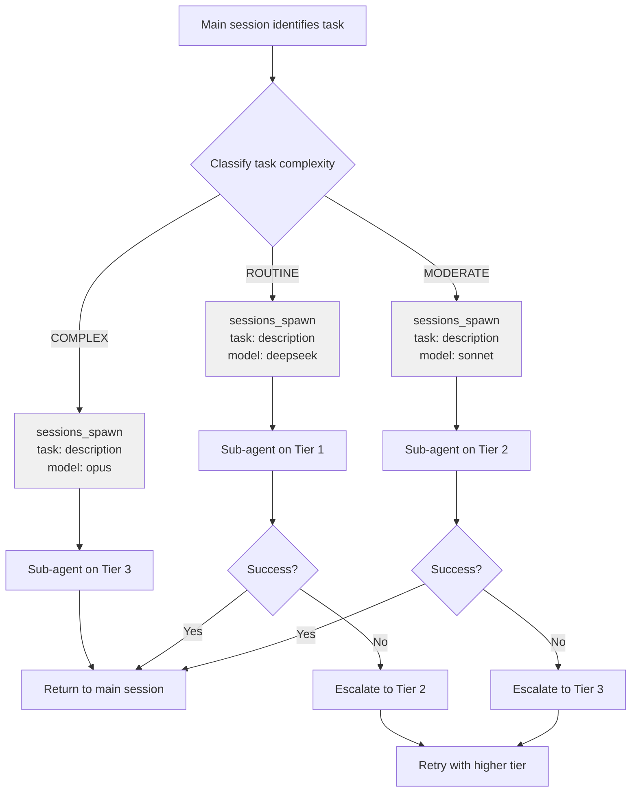
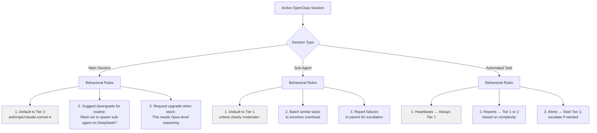
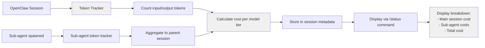

<!-- source: DeepWiki mcp.deepwiki.com · repo zscole/model-hierarchy-skill · page 5.1 OpenClaw Integration · fetched 2026-10-26 -->

# OpenClaw Integration

<details>
<summary>Relevant source files</summary>

The following files were used as context for generating this wiki page:

- [README.md](README.md)
- [SKILL.md](SKILL.md)
- [examples/openclaw.md](examples/openclaw.md)

</details>


## Purpose and Scope

This document provides a complete technical guide for integrating the model hierarchy skill into OpenClaw, a gateway-based agent platform. It covers file-based skill installation, configuration via `config.yml`, runtime model switching commands, sub-agent spawning patterns, and cost monitoring.

For integration with Claude Code/Codex, see [Claude Code Integration](#5.2). For integrating with other agent systems, see [Custom Integration](#5.3). For the underlying classification rules, see [The Skill Definition](#3).

---

## Installation Process

OpenClaw uses a file-based skill discovery system where skills are loaded from the `~/.openclaw/skills/` directory. The model hierarchy skill must be copied to this location and the gateway must be restarted to pick up the new skill.

### Installation Steps

| Step | Command | Purpose |
|------|---------|---------|
| 1 | `cp SKILL.md ~/.openclaw/skills/model-hierarchy/SKILL.md` | Copy skill definition to OpenClaw skills directory |
| 2 | `openclaw gateway restart` | Reload gateway to discover and load the skill |

The directory structure created:

```
~/.openclaw/
└── skills/
    └── model-hierarchy/
        └── SKILL.md
```

### Skill Discovery Flow



Sources: [README.md:23-31](), [examples/openclaw.md:1-10](), [SKILL.md:1-8]()

---

## Configuration

OpenClaw configuration is managed through a `config.yml` file that defines default model selection and other gateway settings.

### Default Model Configuration

The recommended default is a mid-tier model (Tier 2) as it provides balanced performance for interactive sessions while allowing downgrades for routine work and upgrades for complex tasks.

**config.yml:**

```yaml
model: anthropic/claude-sonnet-4
```

### Model Tier Recommendations by Context

| Context | Recommended Default | Rationale |
|---------|-------------------|-----------|
| Main interactive session | `anthropic/claude-sonnet-4` | Balanced for user interaction, can suggest downgrades |
| Sub-agents (default) | `deepseek-v3` | Most work is routine, escalate if needed |
| Heartbeat/monitoring | `deepseek-v3` | Always routine operations |
| Scheduled reports | `deepseek-v3` or `anthropic/claude-sonnet-4` | Depends on report complexity |

Sources: [examples/openclaw.md:12-18](), [SKILL.md:20-46](), [SKILL.md:189-201]()

---

## Runtime Model Switching

OpenClaw provides the `/model` command for switching models within an active session. This is the primary mechanism for manual tier adjustments during interactive work.

### /model Command Syntax

```
/model <model_name>
```

### Common Model Commands

| Command | Target Model | Use Case |
|---------|-------------|----------|
| `/model opus` | claude-opus-4 (Tier 3) | Upgrade for complex debugging, architecture decisions |
| `/model sonnet` | claude-sonnet-4 (Tier 2) | Return to balanced default |
| `/model deepseek` | deepseek-v3 (Tier 1) | Downgrade for routine file operations |
| `/model haiku` | claude-haiku (Tier 1) | Fast tool use, quick responses |

### Model Switching Flow



### Expected Agent Communication Patterns

When the model hierarchy skill is active, the agent should proactively suggest model changes:

**Downgrade suggestion example:**
> "This looks like routine file work. Want me to spawn a sub-agent on DeepSeek for this? Same result, fraction of the cost."

**Upgrade request example:**
> "I'm hitting the limits of what I can figure out here. This needs Opus-level reasoning. Switching up."

Sources: [examples/openclaw.md:20-30](), [SKILL.md:154-165](), [SKILL.md:189-195]()

---

## Sub-Agent Spawning

The `sessions_spawn` function allows the main session to delegate work to child agents running on different models. This is the primary mechanism for achieving cost optimization through parallelization.

### sessions_spawn Function

**Signature:**

```python
sessions_spawn(
    task: str,
    model: str = None,  # Defaults to config.yml setting
    ...
)
```

### Sub-Agent Model Selection Strategy



### Example: Bulk URL Fetching

**Scenario:** Fetch and parse 50 URLs (routine work, high volume)

```python
sessions_spawn(
    task="Fetch and parse these 50 URLs: [url_list]",
    model="deepseek"  # Tier 1 - cheap model for routine work
)
```

**Cost comparison:**

| Model | Cost per 100K tokens | Total for 50 URLs (~200K tokens) |
|-------|---------------------|----------------------------------|
| claude-opus-4 | $15-75/M | ~$3.00-15.00 |
| claude-sonnet-4 | $3-15/M | ~$0.60-3.00 |
| deepseek-v3 | $0.14-0.28/M | ~$0.03-0.06 |

### Batching Pattern

Spawn a single sub-agent for related tasks rather than spawning multiple sub-agents:

**Good:**
```python
sessions_spawn(
    task="Process all items in /data/ directory: read, validate, format",
    model="deepseek"
)
```

**Bad (unnecessary overhead):**
```python
for file in files:
    sessions_spawn(task=f"Process {file}", model="deepseek")
```

Sources: [examples/openclaw.md:32-41](), [SKILL.md:197-201](), [SKILL.md:142-147]()

---

## Heartbeat and Monitoring Configuration

Heartbeat tasks (periodic status checks) should always run on Tier 1 models as they are deterministic, routine operations.

### Heartbeat Configuration

**In agent configuration file:**

```yaml
heartbeat:
  model: deepseek-v3
  interval: 30m
```

### Automated Task Model Assignment

| Task Type | Model Tier | Configuration Example |
|-----------|-----------|----------------------|
| Heartbeats/monitoring | Always Tier 1 | `model: deepseek-v3` |
| Scheduled reports (simple) | Tier 1 | `model: deepseek-v3` |
| Scheduled reports (complex) | Tier 2 | `model: anthropic/claude-sonnet-4` |
| Alert responses | Start Tier 2, escalate if needed | `model: anthropic/claude-sonnet-4` |

Sources: [examples/openclaw.md:43-52](), [SKILL.md:148-152]()

---

## Expected Agent Behavior

After skill installation, the OpenClaw agent should exhibit the following behaviors based on the skill rules defined in [SKILL.md:134-152]().

### Behavioral Rules Summary



### Interaction Examples

**1. Agent suggests downgrade (routine work detected):**

```
User: Read the contents of config.json and list all the keys
Agent: This looks like routine file work. Want me to spawn a sub-agent on DeepSeek 
       for this? Same result, fraction of the cost.
User: Yes
Agent: [spawns sub-agent with model="deepseek"]
```

**2. Agent requests upgrade (complexity detected):**

```
Agent: I've tried debugging this issue but I'm hitting the limits of what I can 
       figure out. This needs Opus-level reasoning. Switching to /model opus.
```

**3. Agent explains hierarchy (multi-tier execution):**

```
Agent: I'm running the heavy analysis on Sonnet while sub-agents fetch the data 
       on DeepSeek. Keeps costs down without sacrificing quality where it matters.
```

Sources: [examples/openclaw.md:54-61](), [SKILL.md:134-165]()

---

## Cost Tracking

OpenClaw provides the `/status` command to monitor token usage and costs for the current session.

### Status Command

```
/status
```

**Example output:**

```
Session Status:
  Model: anthropic/claude-sonnet-4
  Tokens (input): 45,230
  Tokens (output): 12,890
  Estimated cost: $0.33
  
  Sub-agents spawned: 3
    - Sub-1 (deepseek-v3): $0.002
    - Sub-2 (deepseek-v3): $0.001
    - Sub-3 (claude-sonnet-4): $0.08
  
  Total session cost: $0.41
```

### Cost Tracking Architecture



### Monthly Cost Projection

Assuming 100K tokens/day usage with the skill active:

| Strategy | Distribution | Monthly Cost |
|----------|-------------|--------------|
| Pure Opus (without skill) | 100% Tier 3 | ~$225 |
| Pure Sonnet (without skill) | 100% Tier 2 | ~$45 |
| **Hierarchy (with skill)** | 80% Tier 1, 15% Tier 2, 5% Tier 3 | **~$19** |

**Cost breakdown with skill:**
- Tier 1 (80K tokens/day): ~$6/month
- Tier 2 (15K tokens/day): ~$7/month
- Tier 3 (5K tokens/day): ~$6/month

Sources: [examples/openclaw.md:62-64](), [SKILL.md:167-183]()

---

## Integration Verification

To verify the skill is properly installed and functioning:

### Verification Checklist

| Step | Action | Expected Result |
|------|--------|-----------------|
| 1 | Start new session | Agent should use default model from config.yml |
| 2 | Give routine task (e.g., "read file.txt") | Agent suggests spawning sub-agent on cheap model |
| 3 | Use `/model deepseek` | Model switches, confirmation message appears |
| 4 | Use `/model opus` | Model switches to premium tier |
| 5 | Spawn sub-agent with explicit model | Sub-agent runs on specified model |
| 6 | Use `/status` | Cost breakdown displays with model tiers |

### Troubleshooting

**Skill not loading:**
- Verify file path: `~/.openclaw/skills/model-hierarchy/SKILL.md`
- Verify gateway restarted: `openclaw gateway restart`
- Check gateway logs for skill discovery errors

**Agent not suggesting model changes:**
- Verify skill triggers are met (e.g., task includes "routing", "cost", "which model")
- Check that SKILL.md frontmatter is properly formatted (YAML with `---` delimiters)

**Sub-agents not spawning on correct models:**
- Verify `model` parameter is passed to `sessions_spawn`
- Check that model names match OpenClaw's provider format (e.g., `anthropic/claude-sonnet-4`)

Sources: [examples/openclaw.md:54-64](), [SKILL.md:1-8]()

---

