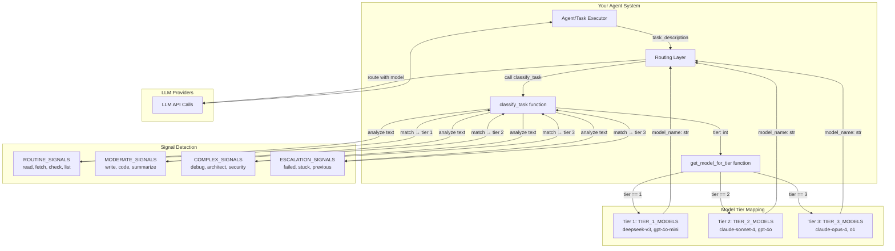
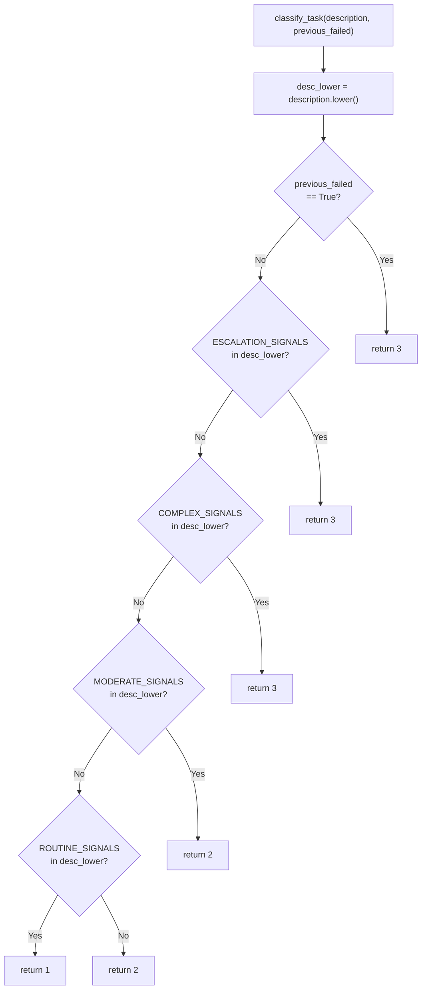
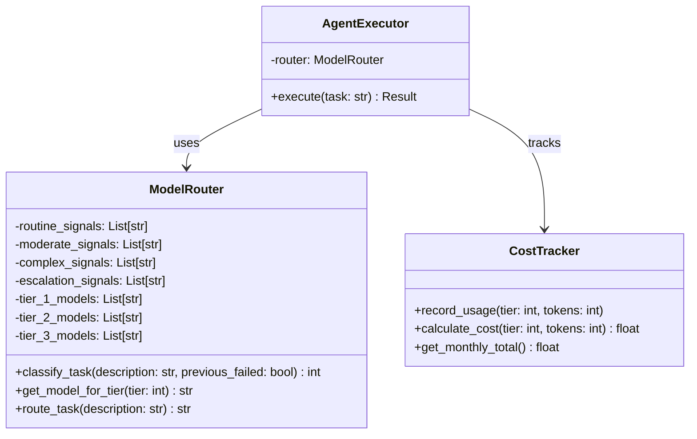
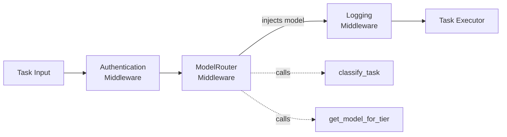
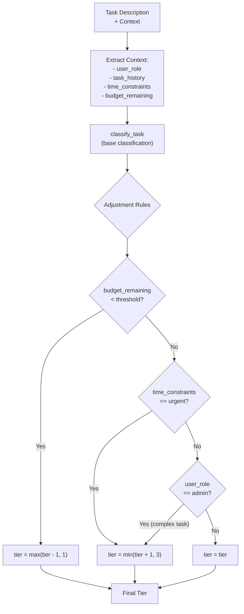
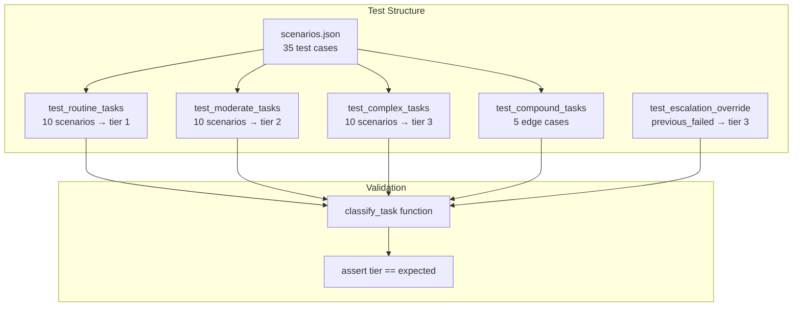
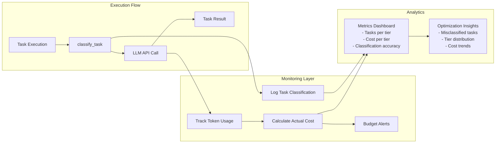

<!-- source: DeepWiki mcp.deepwiki.com · repo zscole/model-hierarchy-skill · page 5.3 Custom Integration · fetched 2026-10-26 -->

# Custom Integration

<details>
<summary>Relevant source files</summary>

The following files were used as context for generating this wiki page:

- [README.md](README.md)
- [SKILL.md](SKILL.md)
- [tests/test_classification.py](tests/test_classification.py)

</details>


This page provides guidelines for integrating the model-hierarchy-skill into custom agent systems, AI platforms, or automation frameworks that are not OpenClaw or Claude Code.

For platform-specific instructions, see [OpenClaw Integration](#5.1) or [Claude Code Integration](#5.2). For the core classification rules and behavioral specifications, see [The Skill Definition](#3).

**Scope:** This document covers programmatic integration patterns, implementation of the classification logic, signal pattern customization, and validation strategies for custom agent platforms.

---

## Overview: Integration Architecture

Custom integration involves implementing the task classification logic in your agent's routing layer. The system analyzes task descriptions using signal patterns and returns the appropriate model tier.



**Sources:** [tests/test_classification.py:47-82](), [SKILL.md:108-132]()

---

## Core Classification Function

The heart of the integration is the `classify_task` function, which analyzes task descriptions and returns a tier number (1, 2, or 3).

### Function Signature

```python
def classify_task(description: str, previous_failed: bool = False) -> int
```

**Parameters:**
| Parameter | Type | Description |
|-----------|------|-------------|
| `description` | `str` | The task description to classify |
| `previous_failed` | `bool` | Whether a previous attempt failed (forces tier 3) |

**Returns:** `int` - Model tier (1=cheap, 2=mid, 3=premium)

**Sources:** [tests/test_classification.py:47-82]()

### Classification Algorithm



**Sources:** [tests/test_classification.py:47-82](), [SKILL.md:108-132]()

### Signal Pattern Constants

The classification uses four sets of signal patterns defined as list constants:

| Constant | Purpose | Example Signals | Default Tier |
|----------|---------|-----------------|--------------|
| `ROUTINE_SIGNALS` | Single-step, deterministic operations | `"read"`, `"fetch"`, `"check"`, `"list"`, `"format"`, `"status"` | 1 |
| `MODERATE_SIGNALS` | Multi-step, synthesis required | `"write"`, `"code"`, `"summarize"`, `"analyze"`, `"create"` | 2 |
| `COMPLEX_SIGNALS` | Novel problem-solving, judgment calls | `"debug"`, `"architect"`, `"security"`, `"why does"`, `"tradeoff"` | 3 |
| `ESCALATION_SIGNALS` | Previous failures, explicit escalation | `"previous"`, `"failed"`, `"stuck"`, `"try again"`, `"couldn't"` | 3 |

**Sources:** [tests/test_classification.py:22-44]()

---

## Model Tier Definitions

After classification, map tiers to actual model identifiers using tier constants and the `get_model_for_tier` function.

### Tier Model Lists

```python
TIER_1_MODELS = ["deepseek-v3", "gpt-4o-mini", "claude-3-haiku", "gemini-flash"]
TIER_2_MODELS = ["claude-sonnet-4", "gpt-4o", "gemini-pro"]
TIER_3_MODELS = ["claude-opus-4", "gpt-4.5", "o1", "o3-mini"]
```

**Sources:** [tests/test_classification.py:16-18]()

### Model Selection Function

```python
def get_model_for_tier(tier: int) -> str
```

Returns a representative model name for the tier. The reference implementation returns:
- Tier 1: `"deepseek-v3"`
- Tier 2: `"claude-sonnet-4"`
- Tier 3: `"claude-opus-4"`

**Sources:** [tests/test_classification.py:84-91]()

---

## Implementation Patterns

### Pattern 1: Function-Based Integration

Direct implementation in your routing logic:

```python
# Minimal integration
from your_agent import route_to_llm

def execute_task(task_description: str):
    tier = classify_task(task_description)
    model = get_model_for_tier(tier)
    return route_to_llm(model, task_description)
```

**Use when:** You have a simple routing layer or want minimal abstraction.

**Sources:** [SKILL.md:217-232](), [tests/test_classification.py:47-91]()

### Pattern 2: Class-Based Integration

Encapsulate classification logic in a class:



**Use when:** You need to customize signal patterns per agent instance or want to track routing metrics.

**Sources:** [tests/test_classification.py:1-311]()

### Pattern 3: Middleware Pattern

Intercept task execution with classification middleware:



**Use when:** You have a middleware-based architecture (e.g., Express-style, ASGI middleware).

**Sources:** [SKILL.md:108-166]()

---

## Adapting to Your System

### Customizing Signal Patterns

Extend or modify signal lists to match your domain:

```python
# Add domain-specific signals
ROUTINE_SIGNALS = [
    # Standard signals
    "read", "fetch", "check", "list",
    # Custom domain signals
    "validate schema", "run migration", "backup database"
]

COMPLEX_SIGNALS = [
    # Standard signals
    "debug", "architect", "security",
    # Custom domain signals
    "optimize performance", "scale system", "handle edge case"
]
```

**Example domains:**
| Domain | Custom Routine Signals | Custom Complex Signals |
|--------|------------------------|------------------------|
| DevOps | `"deploy"`, `"rollback"`, `"health"` | `"diagnose outage"`, `"capacity plan"` |
| Data Engineering | `"extract"`, `"transform"`, `"validate"` | `"optimize pipeline"`, `"data quality"` |
| Security | `"scan"`, `"log"`, `"rotate keys"` | `"incident response"`, `"threat model"` |

**Sources:** [tests/test_classification.py:22-44](), [SKILL.md:249-256]()

### Adjusting Tier Definitions

Modify tier-to-model mappings for your provider or budget:

```python
# Example: Using different providers
TIER_1_MODELS = ["anthropic/haiku", "groq/llama-3.1-8b"]
TIER_2_MODELS = ["anthropic/sonnet", "openai/gpt-4o"]
TIER_3_MODELS = ["anthropic/opus", "openai/o1"]

# Example: Budget-conscious mapping
def get_model_for_tier(tier: int) -> str:
    if tier == 1:
        return "groq/llama-3.1-8b"  # Free tier
    elif tier == 2:
        return "anthropic/haiku"     # Cheaper mid-tier
    else:
        return "anthropic/sonnet"    # Premium = mid-tier
```

**Sources:** [tests/test_classification.py:16-18](), [tests/test_classification.py:84-91](), [SKILL.md:249-256]()

### Adding Context-Aware Classification

Enhance classification with additional context:



**Sources:** [SKILL.md:108-132](), [tests/test_classification.py:47-82]()

---

## Cost Calculation Functions

Track and project costs using the provided calculation functions.

### Per-Task Cost

```python
def calculate_cost(tier: int, tokens: int = 1000) -> float
```

Calculates approximate cost for a single task using output token pricing:

| Tier | Cost per 1M Tokens | Cost for 1K Tokens |
|------|-------------------|-------------------|
| 1 | $0.28 | $0.00028 |
| 2 | $15.00 | $0.015 |
| 3 | $75.00 | $0.075 |

**Sources:** [tests/test_classification.py:94-112]()

### Monthly Cost Projection

```python
def calculate_monthly_cost(
    daily_tokens: int,
    routine_pct: float = 0.80,
    moderate_pct: float = 0.15,
    complex_pct: float = 0.05
) -> float
```

Projects monthly costs based on task distribution. Default 80/15/5 split yields ~$19/month for 100K tokens/day.

**Comparison:**

| Strategy | Tokens/Day | Monthly Cost | Calculation |
|----------|-----------|--------------|-------------|
| Pure Tier 3 | 100,000 | $225 | `calculate_cost(3, 100000) * 30` |
| Pure Tier 2 | 100,000 | $45 | `calculate_cost(2, 100000) * 30` |
| Hierarchical (80/15/5) | 100,000 | $19 | `calculate_monthly_cost(100000)` |

**Sources:** [tests/test_classification.py:115-138](), [SKILL.md:169-183]()

---

## Testing Your Integration

### Unit Testing Classification

Validate that your signal patterns correctly route tasks:



**Minimal test implementation:**

```python
def test_classification_accuracy():
    # Routine tasks
    assert classify_task("Read the config file") == 1
    assert classify_task("Check server status") == 1
    
    # Moderate tasks
    assert classify_task("Write code to parse JSON") == 2
    assert classify_task("Summarize this document") == 2
    
    # Complex tasks
    assert classify_task("Debug this race condition") == 3
    assert classify_task("Design system architecture") == 3
    
    # Escalation
    assert classify_task("Read file", previous_failed=True) == 3
```

**Sources:** [tests/test_classification.py:152-201](), [tests/scenarios.json]()

### Integration Testing

Test the complete flow from task input to model execution:

| Test Case | Input | Expected Behavior |
|-----------|-------|-------------------|
| Routine task execution | `"Fetch user data"` | Calls API with tier 1 model |
| Escalation after failure | First attempt fails | Second attempt uses tier 3 |
| Cost tracking | Run 100 tasks | Records token usage per tier |
| Model availability | Tier 1 model unavailable | Falls back to next available tier |

**Sources:** [tests/test_classification.py:268-306]()

---

## Monitoring and Cost Tracking

Implement monitoring to validate classification accuracy and track actual costs.



**Key metrics to track:**

| Metric | Purpose | Calculation |
|--------|---------|-------------|
| Tasks per tier | Verify 80/15/5 distribution | Count tasks by tier |
| Average tokens per tier | Validate task sizing assumptions | Sum tokens / task count |
| Misclassification rate | Identify signal pattern gaps | Manual review sample |
| Cost per task type | Find optimization opportunities | Group by task category |
| Daily cost trend | Budget management | Rolling 7-day average |

**Sources:** [tests/test_classification.py:203-228](), [SKILL.md:169-183]()

---

## Complete Implementation Example

Minimal working integration for a custom agent system:

```python
# model_router.py
from typing import Literal

# Signal patterns (customize for your domain)
ROUTINE_SIGNALS = ["read", "fetch", "check", "list", "format", "status"]
MODERATE_SIGNALS = ["write", "code", "summarize", "analyze", "create"]
COMPLEX_SIGNALS = ["debug", "architect", "security", "why does", "tradeoff"]
ESCALATION_SIGNALS = ["previous", "failed", "stuck", "try again"]

# Model tier definitions
TIER_1_MODELS = ["deepseek-v3", "gpt-4o-mini"]
TIER_2_MODELS = ["claude-sonnet-4", "gpt-4o"]
TIER_3_MODELS = ["claude-opus-4", "o1"]

def classify_task(description: str, previous_failed: bool = False) -> int:
    """Classify task into tier (1, 2, or 3)."""
    desc_lower = description.lower()
    
    if previous_failed:
        return 3
    
    if any(signal in desc_lower for signal in ESCALATION_SIGNALS):
        return 3
    
    if any(signal in desc_lower for signal in COMPLEX_SIGNALS):
        return 3
    
    if any(signal in desc_lower for signal in MODERATE_SIGNALS):
        return 2
    
    if any(signal in desc_lower for signal in ROUTINE_SIGNALS):
        return 1
    
    return 2  # Default to mid-tier

def get_model_for_tier(tier: int) -> str:
    """Get model identifier for tier."""
    if tier == 1:
        return TIER_1_MODELS[0]
    elif tier == 2:
        return TIER_2_MODELS[0]
    else:
        return TIER_3_MODELS[0]

# Integration with your agent
def execute_agent_task(task_description: str, retry: bool = False):
    """Execute task with appropriate model."""
    tier = classify_task(task_description, previous_failed=retry)
    model = get_model_for_tier(tier)
    
    # Your LLM API call here
    result = your_llm_api.call(model=model, prompt=task_description)
    
    return result, tier, model
```

**Usage:**

```python
# Execute routine task on cheap model
result, tier, model = execute_agent_task("Read the config file")
# tier=1, model="deepseek-v3"

# Execute complex task on premium model
result, tier, model = execute_agent_task("Debug this race condition")
# tier=3, model="claude-opus-4"

# Escalate after failure
result, tier, model = execute_agent_task("Read the config", retry=True)
# tier=3, model="claude-opus-4"
```

**Sources:** [tests/test_classification.py:1-138](), [SKILL.md:217-232]()

---

