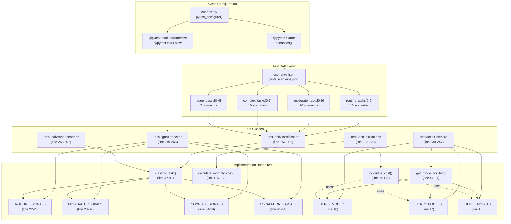
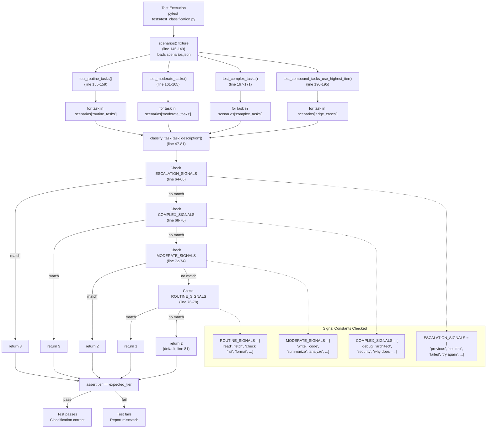
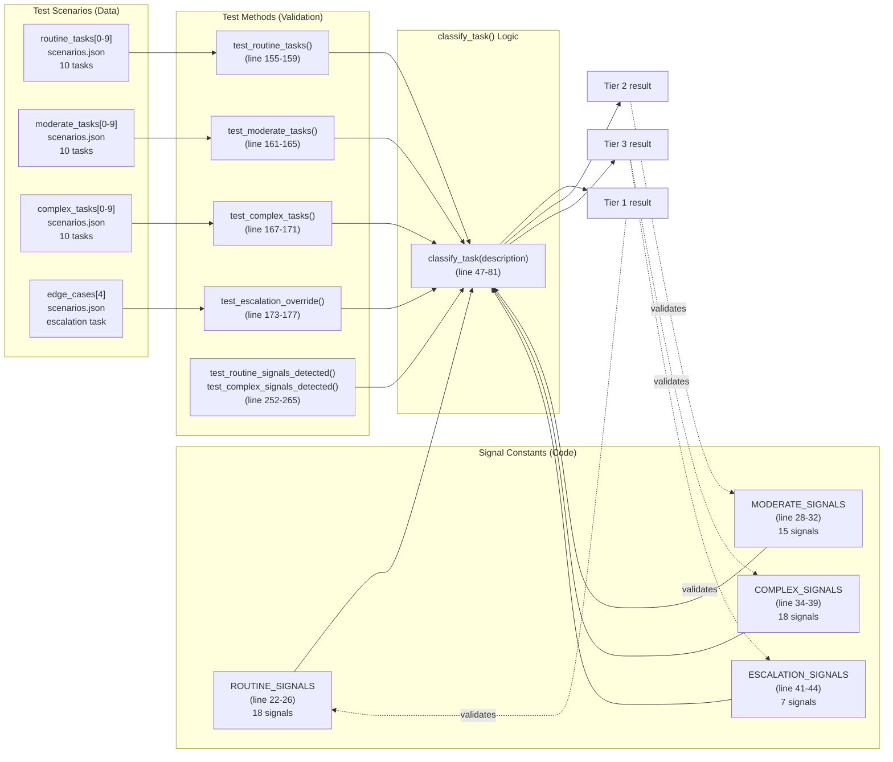

<!-- source: DeepWiki mcp.deepwiki.com · repo zscole/model-hierarchy-skill · page 6 Testing & Validation · fetched 2026-10-26 -->

# Testing & Validation

<details>
<summary>Relevant source files</summary>

The following files were used as context for generating this wiki page:

- [tests/conftest.py](tests/conftest.py)
- [tests/scenarios.json](tests/scenarios.json)
- [tests/test_classification.py](tests/test_classification.py)

</details>


## Purpose and Scope

This document provides a comprehensive overview of the test suite that validates the model hierarchy classification system. The test suite ensures that the `classify_task()` function correctly routes tasks to appropriate model tiers and that cost calculations accurately reflect expected savings.

The testing system consists of three primary components:
1. **Test scenarios** - 35 ground-truth test cases in [tests/scenarios.json:1-186]()
2. **Test implementation** - Classification logic and test classes in [tests/test_classification.py:1-311]()
3. **Test configuration** - pytest setup in [tests/conftest.py:1-11]()

For information about the classification rules being tested, see [The Skill Definition](#3). For integration testing strategies, see [Integration Guides](#5).

**Sources:** [tests/test_classification.py:1-311](), [tests/scenarios.json:1-186](), [tests/conftest.py:1-11]()

---

## Testing Strategy

The test suite employs a **validation-through-scenarios** approach where expected behaviors are defined as JSON test cases and validated against the classification implementation. This design ensures that the classification heuristics match the documented skill behavior and achieve the advertised cost optimization.

### Core Validation Goals

| Validation Target | Purpose | Test Coverage |
|------------------|---------|---------------|
| **Classification Accuracy** | Verify tasks route to correct tiers | 35 scenarios across 4 categories |
| **Cost Calculations** | Validate 10x cost savings claim | Monthly cost projections with distribution analysis |
| **Signal Detection** | Ensure keywords trigger correct tiers | Parametrized tests for all signal sets |
| **Escalation Logic** | Verify override behavior for failures | Previous failure flag and escalation signals |
| **Model Selection** | Validate model tier mappings | Tier-to-model resolution tests |

The test suite is co-located with the implementation it validates - both the `classify_task()` function and its test classes exist in [tests/test_classification.py:1-311](). This pattern enables documentation-through-tests where the implementation serves as executable specification.

**Sources:** [tests/test_classification.py:1-311]()

---

## Test Architecture Overview

**Test Architecture: Code Entity Mapping**



This diagram maps the natural language concepts (test scenarios) to concrete code entities (functions, constants, test classes). Each node references its location in the codebase for easy navigation.

**Sources:** [tests/test_classification.py:1-311](), [tests/scenarios.json:1-186](), [tests/conftest.py:1-11]()

---

## Test Scenario Structure

The [tests/scenarios.json:1-186]() file serves as the ground truth dataset for classification behavior. Each scenario includes a task description, expected tier assignment, and detected signals.

### Scenario Categories

| Category | Count | Expected Tier | Example Signals | File Location |
|----------|-------|---------------|-----------------|---------------|
| **routine_tasks** | 10 | Tier 1 | `"read"`, `"check"`, `"list"`, `"fetch"` | [tests/scenarios.json:2-53]() |
| **moderate_tasks** | 10 | Tier 2 | `"write"`, `"code"`, `"summarize"`, `"analyze"` | [tests/scenarios.json:54-105]() |
| **complex_tasks** | 10 | Tier 3 | `"debug"`, `"architect"`, `"security"`, `"why"` | [tests/scenarios.json:106-157]() |
| **edge_cases** | 5 | Mixed | Compound tasks, escalations, ambiguous signals | [tests/scenarios.json:158-184]() |

### Scenario Schema

Each test scenario follows this structure:

```json
{
  "description": "Task description string",
  "expected_tier": 1,  // 1, 2, or 3
  "signals": ["signal1", "signal2"],  // Detected keywords
  "note": "Optional explanation"  // For edge cases
}
```

### Example Scenarios by Tier

**Tier 1 (Routine) Examples:**
- `"Read the contents of config.json"` → [tests/scenarios.json:4-7]()
- `"List all files in the src directory"` → [tests/scenarios.json:24-27]()
- `"Get the current git status"` → [tests/scenarios.json:49-52]()

**Tier 2 (Moderate) Examples:**
- `"Write a Python function to parse CSV files"` → [tests/scenarios.json:56-59]()
- `"Summarize this 10-page document"` → [tests/scenarios.json:61-64]()
- `"Generate unit tests for this module"` → [tests/scenarios.json:86-89]()

**Tier 3 (Complex) Examples:**
- `"Debug why this test is flaky and sometimes fails"` → [tests/scenarios.json:108-111]()
- `"Design the architecture for a distributed cache system"` → [tests/scenarios.json:113-116]()
- `"Review this smart contract for security vulnerabilities"` → [tests/scenarios.json:118-121]()

**Edge Cases:**
- `"Read this file and summarize it"` → Tier 2 (summarize dominates) [tests/scenarios.json:160-163]()
- `"The previous model couldn't solve this. Try again."` → Tier 3 (escalation) [tests/scenarios.json:180-183]()

**Sources:** [tests/scenarios.json:1-186]()

---

## Classification Validation Flow

**Classification Test Flow: Natural Language to Code Execution**



This flow shows how test descriptions from `scenarios.json` flow through the `classify_task()` function and its signal detection logic, with assertions validating the tier assignments.

**Sources:** [tests/test_classification.py:47-81](), [tests/test_classification.py:145-201](), [tests/scenarios.json:1-186]()

---

## Test Class Organization

The test suite is organized into five test classes, each focusing on a specific aspect of the classification system.

### TestTaskClassification

**Location:** [tests/test_classification.py:152-201]()

**Purpose:** Validates that the `classify_task()` function correctly assigns tasks to tiers based on their descriptions.

**Key Test Methods:**

| Method | Purpose | Validates |
|--------|---------|-----------|
| `test_routine_tasks()` | All routine scenarios → Tier 1 | [line 155-159]() |
| `test_moderate_tasks()` | All moderate scenarios → Tier 2 | [line 161-165]() |
| `test_complex_tasks()` | All complex scenarios → Tier 3 | [line 167-171]() |
| `test_escalation_override()` | `previous_failed=True` → Tier 3 | [line 173-177]() |
| `test_escalation_signals_in_description()` | Escalation keywords → Tier 3 | [line 179-188]() |
| `test_compound_tasks_use_highest_tier()` | Edge cases use highest signal | [line 190-195]() |
| `test_unknown_defaults_to_mid()` | Ambiguous tasks → Tier 2 | [line 197-200]() |

### TestCostCalculations

**Location:** [tests/test_classification.py:203-228]()

**Purpose:** Validates cost calculation functions and the 10x savings claim.

**Key Test Methods:**

| Method | Purpose | Formula |
|--------|---------|---------|
| `test_tier_cost_ordering()` | Tier 1 < Tier 2 < Tier 3 | [line 206-210]() |
| `test_hierarchy_saves_money()` | Hierarchical < 1/5 × Pure Premium | [line 212-221]() |
| `test_monthly_cost_calculation()` | 100K tokens/day ≈ $19/month | [line 223-227]() |

**Cost Calculation Functions:**
- `calculate_cost(tier, tokens)` - Cost for single tier [line 94-112]()
- `calculate_monthly_cost(daily_tokens, routine_pct, moderate_pct, complex_pct)` - Monthly projection [line 115-138]()

### TestModelSelection

**Location:** [tests/test_classification.py:230-247]()

**Purpose:** Validates that `get_model_for_tier()` returns models from the correct tier.

**Key Test Methods:**
- `test_tier_1_models()` - Returns model from `TIER_1_MODELS` [line 233-236]()
- `test_tier_2_models()` - Returns model from `TIER_2_MODELS` [line 238-241]()
- `test_tier_3_models()` - Returns model from `TIER_3_MODELS` [line 243-246]()

**Model Tier Constants:**
- `TIER_1_MODELS` - `["deepseek-v3", "gpt-4o-mini", "claude-3-haiku", "gemini-flash"]` [line 16]()
- `TIER_2_MODELS` - `["claude-sonnet-4", "gpt-4o", "gemini-pro"]` [line 17]()
- `TIER_3_MODELS` - `["claude-opus-4", "gpt-4.5", "o1", "o3-mini"]` [line 18]()

### TestSignalDetection

**Location:** [tests/test_classification.py:249-266]()

**Purpose:** Validates signal pattern detection using parametrized tests.

**Key Test Methods:**
- `test_routine_signals_detected()` - Parametrized across first 5 routine signals [line 252-258]()
- `test_complex_signals_detected()` - Parametrized across first 5 complex signals [line 260-265]()

Uses `@pytest.mark.parametrize` decorator to generate multiple test cases from signal lists.

### TestRealWorldScenarios

**Location:** [tests/test_classification.py:268-307]()

**Purpose:** Validates classification behavior for realistic agent task descriptions.

**Key Test Methods:**

| Method | Scenario Type | Expected Tier | Example |
|--------|--------------|---------------|---------|
| `test_heartbeat_is_routine()` | Health checks | Tier 1 | `"Run the heartbeat check"` |
| `test_code_review_is_moderate()` | Standard review | Tier 2 | `"Review this pull request for style issues"` |
| `test_security_review_is_complex()` | Security review | Tier 3 | `"Review this code for security vulnerabilities"` |
| `test_simple_code_is_moderate()` | Code formatting | Tier 2 | `"Format this Python code"` |
| `test_architecture_is_complex()` | Architecture design | Tier 3 | `"Design the system architecture"` |

**Sources:** [tests/test_classification.py:152-307]()

---

## Signal Detection Validation

**Signal Detection Test Matrix**



This matrix shows how signal constants are validated against test scenarios through the classification logic. Each signal set has corresponding test scenarios that ensure correct tier assignment.

**Sources:** [tests/test_classification.py:22-44](), [tests/test_classification.py:152-266](), [tests/scenarios.json:1-186]()

---

## Cost Validation

The test suite validates the economic justification for the model hierarchy system by calculating projected costs and comparing them to single-tier approaches.

### Cost Calculation Functions

**`calculate_cost(tier, tokens)`** [line 94-112]()
```
Approximate output costs per 1M tokens:
- Tier 1: $0.28 (DeepSeek V3)
- Tier 2: $15.00 (Claude Sonnet)
- Tier 3: $75.00 (Claude Opus)

Returns: (tokens / 1,000,000) × cost_per_M
```

**`calculate_monthly_cost(daily_tokens, routine_pct, moderate_pct, complex_pct)`** [line 115-138]()
```
Default distribution: 80% routine, 15% moderate, 5% complex
Monthly cost = (
    calculate_cost(1, daily_tokens × routine_pct) +
    calculate_cost(2, daily_tokens × moderate_pct) +
    calculate_cost(3, daily_tokens × complex_pct)
) × 30 days
```

### Cost Assertions

| Test | Assertion | Purpose | Location |
|------|-----------|---------|----------|
| `test_tier_cost_ordering()` | Tier 1 < Tier 2 < Tier 3 | Validate pricing hierarchy | [line 206-210]() |
| `test_hierarchy_saves_money()` | Hierarchical < Pure Premium / 5 | Validate ≥5x savings | [line 212-221]() |
| `test_monthly_cost_calculation()` | $10 < Monthly < $30 | Validate $19/month claim | [line 223-227]() |

### Cost Comparison Example

For 100K tokens/day workload:

| Approach | Calculation | Monthly Cost |
|----------|------------|--------------|
| **Pure Premium (Opus)** | `calculate_cost(3, 100000) × 30` | ~$225/month |
| **Pure Mid (Sonnet)** | `calculate_cost(2, 100000) × 30` | ~$45/month |
| **Hierarchical** | `calculate_monthly_cost(100000)` | ~$19/month |

The test `test_hierarchy_saves_money()` validates that hierarchical routing achieves at least 5x cost reduction compared to pure premium usage [line 212-221]().

**Sources:** [tests/test_classification.py:94-138](), [tests/test_classification.py:203-228]()

---

## Test Configuration

### pytest Configuration

**File:** [tests/conftest.py:1-11]()

The `pytest_configure()` function defines custom test markers:

```python
def pytest_configure(config):
    config.addinivalue_line(
        "markers", "slow: marks tests as slow (deselect with '-m \"not slow\"')"
    )
```

This allows tests to be marked as `@pytest.mark.slow` for optional exclusion during development.

### Test Fixtures

**`scenarios()` fixture** [line 145-149]()

Loads test scenarios from JSON file:
```python
@pytest.fixture
def scenarios():
    with open(SCENARIOS_PATH) as f:
        return json.load(f)
```

This fixture is used by test classes to access ground-truth test cases.

### Test Execution Commands

| Command | Purpose | Use Case |
|---------|---------|----------|
| `pytest tests/test_classification.py` | Run all tests | Full validation |
| `pytest tests/test_classification.py -v` | Verbose output | Detailed test results |
| `pytest tests/test_classification.py -k "routine"` | Run tests matching pattern | Targeted testing |
| `pytest tests/test_classification.py -m "not slow"` | Skip slow tests | Fast development feedback |
| `pytest tests/test_classification.py::TestTaskClassification` | Run specific class | Class-level testing |
| `pytest tests/test_classification.py::TestTaskClassification::test_routine_tasks` | Run specific test | Method-level testing |

**Sources:** [tests/conftest.py:1-11](), [tests/test_classification.py:145-149]()

---

## Test Coverage Summary

### Coverage by Component

| Component | Test Class | Test Count | Coverage |
|-----------|-----------|------------|----------|
| `classify_task()` | `TestTaskClassification` | 7 methods | Signal detection, escalation, defaults |
| Cost functions | `TestCostCalculations` | 3 methods | Pricing hierarchy, savings validation |
| `get_model_for_tier()` | `TestModelSelection` | 3 methods | All three tiers |
| Signal constants | `TestSignalDetection` | 10 parametrized | Routine and complex signals |
| Real scenarios | `TestRealWorldScenarios` | 5 methods | Practical use cases |

### Coverage by Scenario Type

| Scenario Type | Count | File Location | Validates |
|--------------|-------|---------------|-----------|
| Routine tasks | 10 | [tests/scenarios.json:2-53]() | Tier 1 classification |
| Moderate tasks | 10 | [tests/scenarios.json:54-105]() | Tier 2 classification |
| Complex tasks | 10 | [tests/scenarios.json:106-157]() | Tier 3 classification |
| Edge cases | 5 | [tests/scenarios.json:158-184]() | Compound tasks, escalations |
| **Total** | **35** | | **Full classification matrix** |

### Critical Validation Points

1. **Signal Priority**: Complex signals override moderate, which override routine [line 64-78]()
2. **Escalation Override**: `previous_failed=True` forces Tier 3 regardless of signals [line 61-66]()
3. **Default Behavior**: Unknown tasks default to Tier 2 (safe middle ground) [line 80-81]()
4. **Cost Savings**: Hierarchical routing achieves >5x cost reduction [line 212-221]()
5. **Model Mapping**: Each tier correctly maps to appropriate model sets [line 84-91]()

**Sources:** [tests/test_classification.py:1-311](), [tests/scenarios.json:1-186]()

---

## Running the Test Suite

For detailed information about executing tests, interpreting results, and using test markers, see [Running Tests](#6.3).

For understanding individual test scenarios and their expected behaviors, see [Test Scenarios](#6.1).

For details about test class organization and test method structure, see [Test Suite Structure](#6.2).

**Sources:** [tests/test_classification.py:1-311](), [tests/scenarios.json:1-186](), [tests/conftest.py:1-11]()

---

