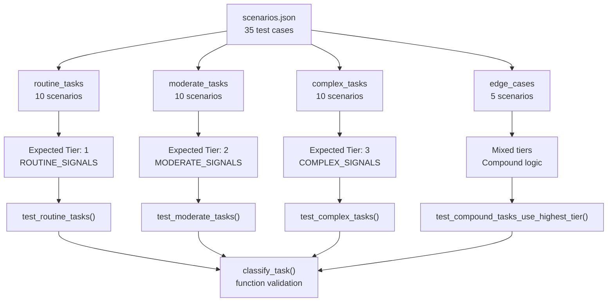
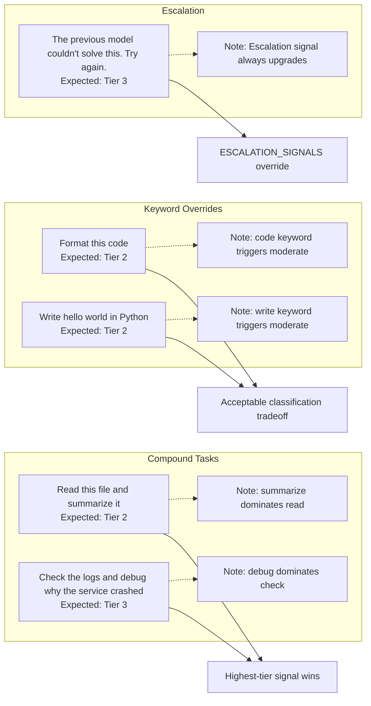
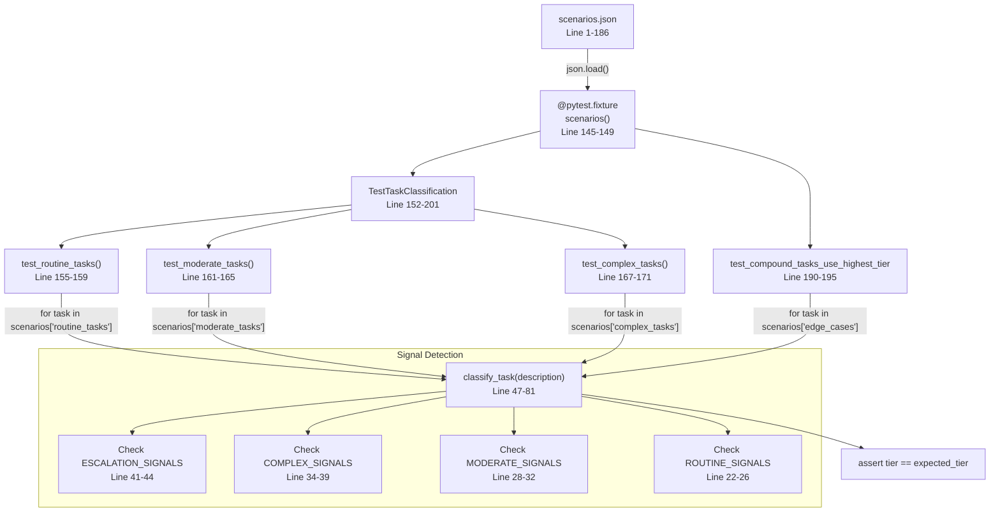
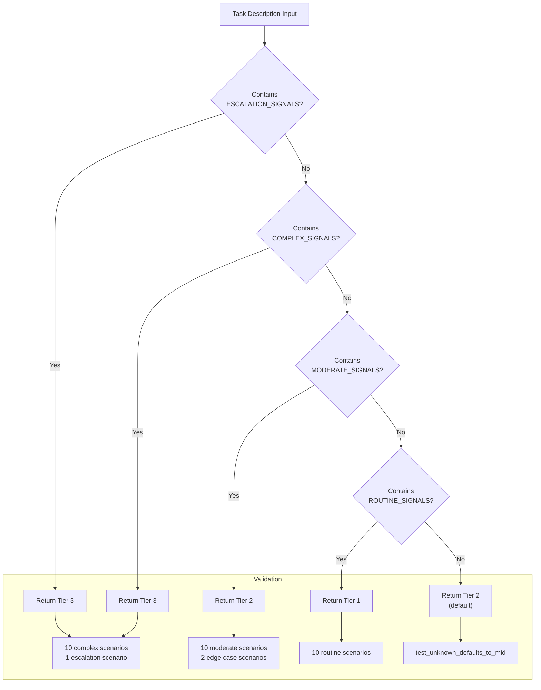

<!-- source: DeepWiki mcp.deepwiki.com · repo zscole/model-hierarchy-skill · page 6.1 Test Scenarios · fetched 2026-10-26 -->

# Test Scenarios

<details>
<summary>Relevant source files</summary>

The following files were used as context for generating this wiki page:

- [tests/scenarios.json](tests/scenarios.json)
- [tests/test_classification.py](tests/test_classification.py)

</details>


This page documents the test scenario dataset defined in [tests/scenarios.json](). The file contains 35 carefully curated test cases that validate the task classification system's ability to correctly route tasks to appropriate model tiers. Each scenario represents a realistic agent task with an expected tier assignment, enabling systematic verification of the classification heuristics defined in [SKILL.md]().

For information about how these scenarios are used in test classes, see [Test Suite Structure](#6.2). For instructions on executing the tests, see [Running Tests](#6.3).

**Sources**: [tests/scenarios.json:1-186]()

---

## Scenario File Structure

The `scenarios.json` file organizes test cases into four top-level categories, each targeting a specific aspect of the classification system:

```json
{
  "routine_tasks": [...],    // 10 scenarios expecting Tier 1
  "moderate_tasks": [...],   // 10 scenarios expecting Tier 2
  "complex_tasks": [...],    // 10 scenarios expecting Tier 3
  "edge_cases": [...]        // 5 scenarios testing boundary conditions
}
```

Each category contains an array of scenario objects. The test suite in [test_classification.py]() loads this file using a pytest fixture and validates that the `classify_task` function produces the expected tier for each scenario.

**Sources**: [tests/scenarios.json:1-186](), [tests/test_classification.py:142-149]()

---

## Scenario Data Model

### Scenario Object Schema

Each scenario object follows a consistent structure:

| Field | Type | Required | Description |
|-------|------|----------|-------------|
| `description` | string | Yes | The task description text that will be passed to `classify_task()` |
| `expected_tier` | integer | Yes | The expected classification result (1, 2, or 3) |
| `signals` | array[string] | Yes | The signal keywords that should trigger the classification |
| `note` | string | No | Explanation for edge cases or unusual classification logic |

**Example Scenario:**
```json
{
  "description": "Read the contents of config.json",
  "expected_tier": 1,
  "signals": ["read", "file"]
}
```

The `signals` field documents which keywords from the signal detection system (defined in [test_classification.py:22-44]()) should trigger the classification. This creates explicit traceability between scenario outcomes and classification rules.

**Sources**: [tests/scenarios.json:3-7](), [tests/scenarios.json:160-163]()

---

## Scenario Category Breakdown

The following diagram illustrates how the 35 scenarios are distributed across categories and tiers:

**Scenario Distribution and Validation Flow**



**Sources**: [tests/scenarios.json:2-184](), [tests/test_classification.py:155-195]()

---

## Category 1: Routine Tasks (Tier 1)

Routine tasks validate that simple, deterministic operations are correctly classified to Tier 1 (cheap models). These represent approximately 80% of real-world agent workload.

### Representative Scenarios

| Description | Signals | Validation Target |
|-------------|---------|-------------------|
| "Read the contents of config.json" | `["read", "file"]` | File operations |
| "Check if the server is running" | `["check", "status"]` | Status queries |
| "What time is it in Tokyo?" | `["simple_qa"]` | Simple Q&A |
| "Format this JSON and fix the indentation" | `["format"]` | Formatting tasks |
| "List all files in the src directory" | `["list", "file"]` | Directory listing |
| "Fetch the homepage of example.com" | `["fetch", "url"]` | URL fetching |
| "Filter this list to only items over 100" | `["filter", "list"]` | Data filtering |
| "Get the current git status" | `["status", "git"]` | Version control status |

These scenarios validate the `ROUTINE_SIGNALS` pattern matching in [test_classification.py:22-26](). The classification logic should detect keywords like `"read"`, `"check"`, `"list"`, `"format"`, and `"fetch"`, triggering Tier 1 assignment.

**Sources**: [tests/scenarios.json:2-53]()

---

## Category 2: Moderate Tasks (Tier 2)

Moderate tasks validate classification of work requiring reasoning and generation capabilities but not premium model intelligence. These represent approximately 15% of agent workload.

### Representative Scenarios

| Description | Signals | Validation Target |
|-------------|---------|-------------------|
| "Write a Python function to parse CSV files" | `["write", "code"]` | Code generation |
| "Summarize this 10-page document" | `["summarize"]` | Document summarization |
| "Draft an email to the team about the launch" | `["draft", "write"]` | Content drafting |
| "Analyze the sales data and find trends" | `["analyze", "data"]` | Data analysis |
| "Refactor this function to be more readable" | `["refactor", "code"]` | Code refactoring |
| "Generate unit tests for this module" | `["generate", "test", "code"]` | Test generation |
| "Transform this JSON into a markdown table" | `["transform", "data"]` | Data transformation |

These scenarios validate the `MODERATE_SIGNALS` pattern matching in [test_classification.py:28-32](). Keywords like `"write"`, `"code"`, `"summarize"`, `"analyze"`, and `"generate"` should trigger Tier 2 assignment.

**Sources**: [tests/scenarios.json:54-105]()

---

## Category 3: Complex Tasks (Tier 3)

Complex tasks validate that cognitively demanding work requiring deep reasoning, debugging, or architectural thinking is routed to premium models. These represent approximately 5% of agent workload.

### Representative Scenarios

| Description | Signals | Validation Target |
|-------------|---------|-------------------|
| "Debug why this test is flaky and sometimes fails" | `["debug"]` | Debugging |
| "Design the architecture for a distributed cache system" | `["design", "architect"]` | Architecture design |
| "Review this smart contract for security vulnerabilities" | `["security", "review"]` | Security review |
| "I tried three different approaches and none work. Why?" | `["failed_attempts"]` | Escalation scenario |
| "This code has a race condition somewhere. Find it." | `["debug", "concurrency"]` | Concurrency debugging |
| "Why does this work in dev but fail in production?" | `["debug", "why"]` | Environment debugging |
| "Evaluate the tradeoffs between these three approaches" | `["evaluate", "tradeoffs"]` | Tradeoff analysis |

These scenarios validate the `COMPLEX_SIGNALS` pattern matching in [test_classification.py:34-39](). Keywords like `"debug"`, `"architect"`, `"security"`, `"why does"`, and `"tradeoff"` should trigger Tier 3 assignment.

**Sources**: [tests/scenarios.json:106-157]()

---

## Category 4: Edge Cases

Edge cases test boundary conditions where multiple signals compete or classification is non-obvious. These scenarios ensure the classification system handles compound tasks and escalation logic correctly.

### Edge Case Analysis

**Scenario Structure with Notes:**



**Detailed Edge Cases:**

| Description | Expected Tier | Note |
|-------------|---------------|------|
| "Read this file and summarize it" | 2 | Compound task - `summarize` dominates over `read` |
| "Check the logs and debug why the service crashed" | 3 | Compound task - `debug` dominates over `check` |
| "Format this code" | 2 | `code` keyword triggers moderate - acceptable tradeoff |
| "Write hello world in Python" | 2 | `write` keyword triggers moderate - correct for most code tasks |
| "The previous model couldn't solve this. Try again." | 3 | Escalation signal - always upgrade to premium |

These scenarios validate the prioritization logic in [test_classification.py:60-81](): escalation signals override all other signals, complex signals take precedence over moderate and routine signals, and when no signals match, the system defaults to Tier 2.

**Sources**: [tests/scenarios.json:158-184](), [tests/test_classification.py:173-200]()

---

## Scenario Loading and Validation Flow

The following diagram shows how scenarios flow from the JSON file through the test infrastructure to validate the classification function:

**Test Scenario Execution Pipeline**



### Loading Mechanism

The scenarios are loaded via a pytest fixture defined in [test_classification.py:145-149]():

```python
@pytest.fixture
def scenarios():
    """Load test scenarios from JSON file."""
    with open(SCENARIOS_PATH) as f:
        return json.load(f)
```

Where `SCENARIOS_PATH` is computed as `Path(__file__).parent / "scenarios.json"` in [test_classification.py:142](). This fixture is dependency-injected into test methods that require scenario data.

### Validation Execution

Each test method iterates through its respective scenario category:

- `test_routine_tasks()` validates all 10 routine scenarios expect Tier 1 ([test_classification.py:155-159]())
- `test_moderate_tasks()` validates all 10 moderate scenarios expect Tier 2 ([test_classification.py:161-165]())
- `test_complex_tasks()` validates all 10 complex scenarios expect Tier 3 ([test_classification.py:167-171]())
- `test_compound_tasks_use_highest_tier()` validates all 5 edge cases expect their documented tier ([test_classification.py:190-195]())

**Sources**: [tests/test_classification.py:142-149](), [tests/test_classification.py:152-195]()

---

## Signal Coverage Matrix

The scenarios provide comprehensive coverage of the signal detection patterns. The following table maps signal categories to scenario counts:

| Signal Category | Signal Count | Scenario Coverage | Example Signals |
|----------------|--------------|-------------------|-----------------|
| `ROUTINE_SIGNALS` | 18 signals | 10 scenarios | `"read"`, `"fetch"`, `"check"`, `"list"`, `"format"` |
| `MODERATE_SIGNALS` | 15 signals | 10 scenarios | `"write"`, `"code"`, `"summarize"`, `"analyze"`, `"generate"` |
| `COMPLEX_SIGNALS` | 18 signals | 10 scenarios | `"debug"`, `"architect"`, `"security"`, `"why does"`, `"tradeoff"` |
| `ESCALATION_SIGNALS` | 7 signals | 1 scenario + test | `"previous"`, `"couldn't"`, `"failed"`, `"stuck"` |

**Signal Detection Hierarchy:**



This hierarchy ensures that escalation always takes precedence, followed by complexity indicators, then moderate work signals, and finally routine task indicators. The default to Tier 2 provides a safety net for ambiguous tasks.

**Sources**: [tests/test_classification.py:22-44](), [tests/test_classification.py:47-81](), [tests/scenarios.json:1-186]()

---

## Scenario Usage Examples

### Example 1: Routine Task Validation

A routine task scenario validates that simple operations are routed to cheap models:

```json
{
  "description": "List all files in the src directory",
  "expected_tier": 1,
  "signals": ["list", "file"]
}
```

The test validates this by calling `classify_task("List all files in the src directory")` and asserting the result equals `1`. The function detects the `"list"` signal from `ROUTINE_SIGNALS` and returns Tier 1.

### Example 2: Complex Task Validation

A complex task scenario ensures debugging work gets premium models:

```json
{
  "description": "Debug why this test is flaky and sometimes fails",
  "expected_tier": 3,
  "signals": ["debug"]
}
```

The test validates this by calling `classify_task("Debug why this test is flaky and sometimes fails")` and asserting the result equals `3`. The function detects the `"debug"` signal from `COMPLEX_SIGNALS` and returns Tier 3.

### Example 3: Edge Case Validation

An edge case scenario tests compound task logic:

```json
{
  "description": "Read this file and summarize it",
  "expected_tier": 2,
  "note": "Compound task - summarize dominates over read"
}
```

The test validates that even though `"read"` is a routine signal, the presence of `"summarize"` (a moderate signal) correctly classifies the task as Tier 2, demonstrating that higher-tier signals take precedence.

**Sources**: [tests/scenarios.json:24-27](), [tests/scenarios.json:107-111](), [tests/scenarios.json:160-163]()

---

## Extending the Scenario Dataset

To add new test scenarios:

1. **Identify the scenario category**: Determine if it's routine, moderate, complex, or an edge case
2. **Define the description**: Write a realistic task description an agent might receive
3. **Determine expected tier**: Based on the classification rules in [SKILL.md]()
4. **Document signals**: List the keywords that should trigger classification
5. **Add optional note**: For edge cases, explain the classification rationale
6. **Run tests**: Execute `pytest tests/test_classification.py` to validate

The scenario format allows the test suite to evolve alongside the classification logic, maintaining comprehensive validation coverage as new signals or tiers are added.

**Sources**: [tests/scenarios.json:1-186](), [tests/test_classification.py:1-311]()

---

