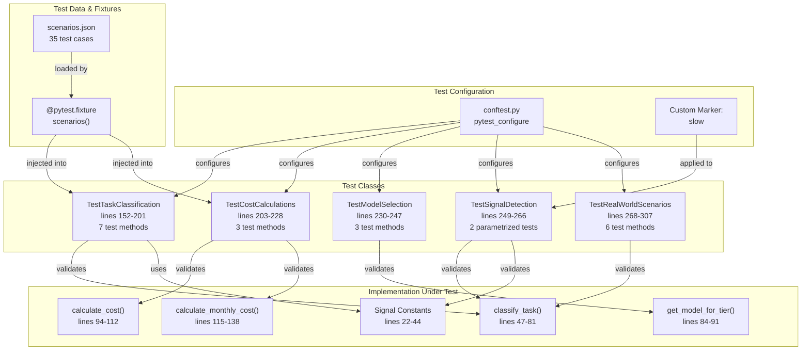
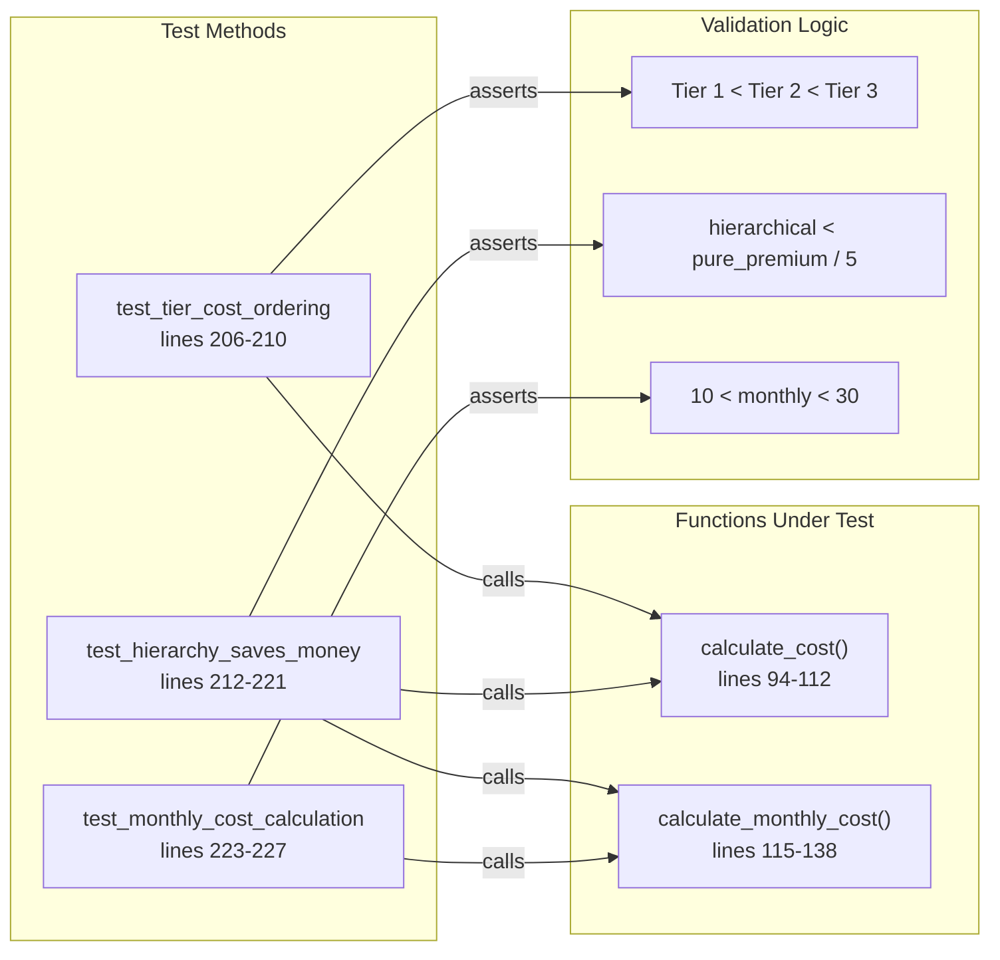
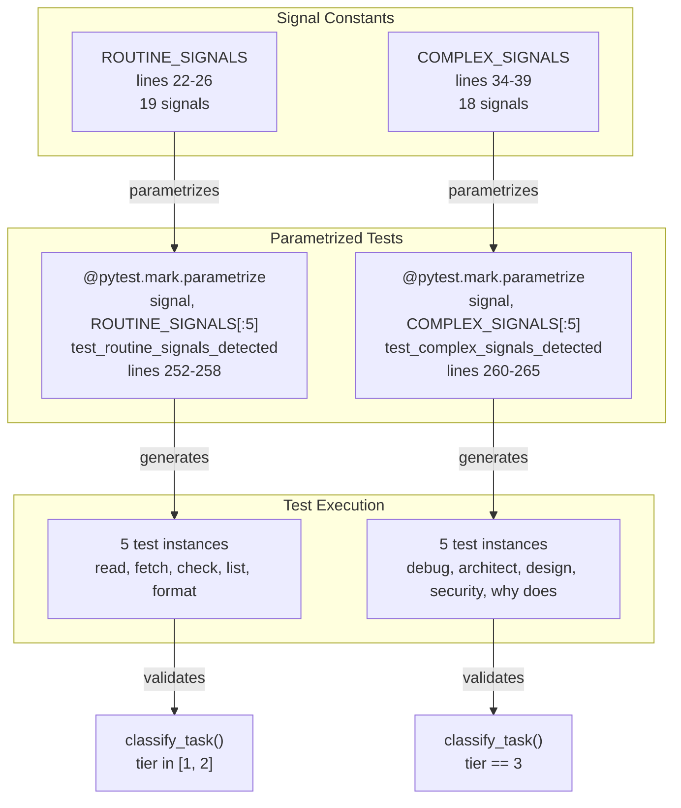
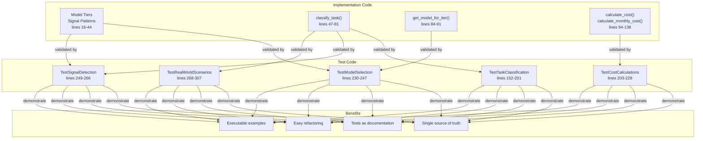

<!-- source: DeepWiki mcp.deepwiki.com · repo zscole/model-hierarchy-skill · page 6.2 Test Suite Structure · fetched 2026-10-26 -->

# Test Suite Structure

<details>
<summary>Relevant source files</summary>

The following files were used as context for generating this wiki page:

- [tests/conftest.py](tests/conftest.py)
- [tests/test_classification.py](tests/test_classification.py)

</details>


This page documents the organization and structure of the test suite in `tests/test_classification.py` and `tests/conftest.py`. It describes the five test classes that validate different aspects of the model hierarchy system: task classification logic, cost calculations, model selection, signal detection, and real-world scenarios. For information about the test data used by these test classes, see [Test Scenarios](#6.1). For instructions on executing the test suite, see [Running Tests](#6.3).

---

## Test File Organization

The test suite is contained in two files:

| File | Purpose | Lines of Code |
|------|---------|---------------|
| `tests/conftest.py` | Pytest configuration and custom markers | 11 |
| `tests/test_classification.py` | Implementation code, test classes, and fixtures | 311 |

The `test_classification.py` file follows a combined pattern where implementation code and test code coexist in the same file. This creates a documentation-through-tests architecture where the tests serve as both validation and usage examples.

**File Structure:**
- Lines 1-139: Implementation code (model definitions, signal patterns, classification functions, cost functions)
- Lines 141-149: Test fixtures
- Lines 152-307: Five test classes with 20+ test methods

**Sources:** [tests/test_classification.py:1-311]()

---

## Test Class Architecture



**Sources:** [tests/test_classification.py:1-311](), [tests/conftest.py:1-11]()

---

## TestTaskClassification Class

The `TestTaskClassification` class validates the core classification logic in the `classify_task` function. It contains 7 test methods organized by classification outcome.

| Test Method | Purpose | Lines | Validation Target |
|-------------|---------|-------|-------------------|
| `test_routine_tasks` | Validates tier 1 classification | 155-159 | Routine task signals → tier 1 |
| `test_moderate_tasks` | Validates tier 2 classification | 161-165 | Moderate task signals → tier 2 |
| `test_complex_tasks` | Validates tier 3 classification | 167-171 | Complex task signals → tier 3 |
| `test_escalation_override` | Validates previous_failed parameter | 173-177 | previous_failed=True → tier 3 |
| `test_escalation_signals_in_description` | Validates escalation signal detection | 179-188 | ESCALATION_SIGNALS → tier 3 |
| `test_compound_tasks_use_highest_tier` | Validates multi-signal tasks | 190-195 | Multiple signals → highest tier |
| `test_unknown_defaults_to_mid` | Validates default behavior | 197-200 | No signals → tier 2 |

**Fixture Usage:** The `test_routine_tasks`, `test_moderate_tasks`, `test_complex_tasks`, and `test_compound_tasks_use_highest_tier` methods inject the `scenarios` fixture, which loads test data from `scenarios.json` [tests/test_classification.py:146-149]().

**Signal Priority Testing:** The class validates that the classification algorithm respects signal priority: escalation > complex > moderate > routine > default [tests/test_classification.py:59-81]().

**Sources:** [tests/test_classification.py:152-201]()

---

## TestCostCalculations Class

The `TestCostCalculations` class validates cost estimation functions. It contains 3 test methods that verify cost ordering, savings calculations, and monthly projections.



**Key Assertions:**

1. **Cost Ordering** [tests/test_classification.py:206-210](): Verifies `calculate_cost(1, tokens) < calculate_cost(2, tokens) < calculate_cost(3, tokens)` for any token count.

2. **Savings Verification** [tests/test_classification.py:212-221](): Compares pure premium cost (`calculate_cost(3, daily_tokens) * 30`) against hierarchical routing (`calculate_monthly_cost(daily_tokens)`). Asserts that hierarchical is at least 5x cheaper.

3. **Monthly Cost Target** [tests/test_classification.py:223-227](): For 100K tokens/day, validates that monthly cost falls between $10-$30, targeting the documented ~$19 estimate.

**Sources:** [tests/test_classification.py:203-228]()

---

## TestModelSelection Class

The `TestModelSelection` class validates the `get_model_for_tier` function, ensuring each tier returns a model from its designated tier list.

| Test Method | Tier | Expected Models | Lines |
|-------------|------|-----------------|-------|
| `test_tier_1_models` | 1 | `TIER_1_MODELS` (deepseek-v3, gpt-4o-mini, claude-3-haiku, gemini-flash) | 233-236 |
| `test_tier_2_models` | 2 | `TIER_2_MODELS` (claude-sonnet-4, gpt-4o, gemini-pro) | 238-241 |
| `test_tier_3_models` | 3 | `TIER_3_MODELS` (claude-opus-4, gpt-4.5, o1, o3-mini) | 243-246 |

The tests validate against the model tier constants defined in [tests/test_classification.py:16-18]():

```python
TIER_1_MODELS = ["deepseek-v3", "gpt-4o-mini", "claude-3-haiku", "gemini-flash"]
TIER_2_MODELS = ["claude-sonnet-4", "gpt-4o", "gemini-pro"]
TIER_3_MODELS = ["claude-opus-4", "gpt-4.5", "o1", "o3-mini"]
```

**Implementation Detail:** The `get_model_for_tier` function currently returns a single representative model per tier (deepseek-v3, claude-sonnet-4, claude-opus-4) rather than selecting from the full list [tests/test_classification.py:84-91]().

**Sources:** [tests/test_classification.py:230-247](), [tests/test_classification.py:16-18](), [tests/test_classification.py:84-91]()

---

## TestSignalDetection Class

The `TestSignalDetection` class uses pytest's parametrization feature to test signal detection patterns across multiple signal types.



**Parametrization Strategy:**

1. **Routine Signals** [tests/test_classification.py:252-258](): Tests the first 5 routine signals ("read", "fetch", "check", "list", "format"). Each signal is embedded in a template sentence: `"Please {signal} the data"`. The test allows tier 1 or 2 because some routine signals may be overridden by other words in compound tasks.

2. **Complex Signals** [tests/test_classification.py:260-265](): Tests the first 5 complex signals ("debug", "architect", "design", "security", "why does"). Template: `"Need to {signal} this system"`. Strictly asserts tier 3.

This parametrization approach generates 10 distinct test cases from 2 test methods, validating signal detection patterns without repetitive code.

**Sources:** [tests/test_classification.py:249-266](), [tests/test_classification.py:22-39]()

---

## TestRealWorldScenarios Class

The `TestRealWorldScenarios` class tests realistic agent task scenarios that might occur in production. Unlike the other test classes that use JSON fixtures or parametrization, this class embeds task descriptions directly in test code.

| Test Method | Scenario Type | Expected Tier | Example Task | Lines |
|-------------|---------------|---------------|--------------|-------|
| `test_heartbeat_is_routine` | Health checks | 1 | "Run the heartbeat check" | 271-279 |
| `test_code_review_is_moderate` | Code review | 2 | "Review this pull request for style issues" | 281-284 |
| `test_security_review_is_complex` | Security review | 3 | "Review this code for security vulnerabilities" | 286-289 |
| `test_simple_code_is_moderate` | Code formatting | 2 | "Format this Python code" | 291-296 |
| `test_architecture_is_complex` | Architecture decisions | 3 | "Design the system architecture" | 298-306 |

**Design Patterns Validated:**

1. **Context-Specific Classification** [tests/test_classification.py:281-289](): Tests demonstrate that the same activity (code review) can map to different tiers based on context. Standard review → tier 2, security review → tier 3.

2. **Signal Override Behavior** [tests/test_classification.py:291-296](): The test acknowledges that "code" triggers moderate classification even for simple formatting tasks, documenting this as an "acceptable tradeoff for catching code generation tasks" (inline comment).

3. **Multi-Example Validation** [tests/test_classification.py:271-279](), [tests/test_classification.py:298-306](): Some tests validate multiple related task descriptions in a list, ensuring consistent classification across similar phrasings.

**Sources:** [tests/test_classification.py:268-307]()

---

## Pytest Configuration and Fixtures

### conftest.py Configuration

The `conftest.py` file defines custom pytest markers using the `pytest_configure` hook [tests/conftest.py:6-10]():

```python
def pytest_configure(config):
    """Configure pytest with custom markers."""
    config.addinivalue_line(
        "markers", "slow: marks tests as slow (deselect with '-m \"not slow\"')"
    )
```

This registers the `slow` marker, which can be applied to time-intensive tests. Currently, no tests in the suite use this marker, but it enables future performance-sensitive test isolation.

### scenarios Fixture

The `scenarios` fixture loads test data from `scenarios.json` [tests/test_classification.py:145-149]():

```python
@pytest.fixture
def scenarios():
    """Load test scenarios from JSON file."""
    with open(SCENARIOS_PATH) as f:
        return json.load(f)
```

Where `SCENARIOS_PATH` is defined as [tests/test_classification.py:142]():

```python
SCENARIOS_PATH = Path(__file__).parent / "scenarios.json"
```

**Fixture Consumers:**
- `TestTaskClassification.test_routine_tasks`
- `TestTaskClassification.test_moderate_tasks`
- `TestTaskClassification.test_complex_tasks`
- `TestTaskClassification.test_compound_tasks_use_highest_tier`
- `TestCostCalculations` (implicitly, through cost distribution assumptions)

**Sources:** [tests/conftest.py:1-11](), [tests/test_classification.py:142-149]()

---

## Implementation-Under-Test Location

The test file contains both the implementation being tested and the tests themselves. This co-location pattern serves multiple purposes:



**Rationale:** This pattern is common in skill-based systems where the implementation is intended as a reference that users will adapt. By keeping implementation and tests together, users can:

1. Understand the implementation through comprehensive test examples
2. Validate their adaptations against the same test suite
3. See expected inputs and outputs without consulting separate documentation

**Integration Points:** For actual integrations (OpenClaw, Claude Code), the implementation code would be extracted and adapted. See [OpenClaw Integration](#5.1) and [Claude Code Integration](#5.2) for platform-specific implementations.

**Sources:** [tests/test_classification.py:1-311]()

---

## Test Execution Entry Point

The test file includes a command-line execution entry point [tests/test_classification.py:309-310]():

```python
if __name__ == "__main__":
    pytest.main([__file__, "-v"])
```

This allows running the test file directly with `python tests/test_classification.py` instead of requiring `pytest` command invocation. The `-v` flag enables verbose output, showing each test method name and result.

**Sources:** [tests/test_classification.py:309-310]()

---

