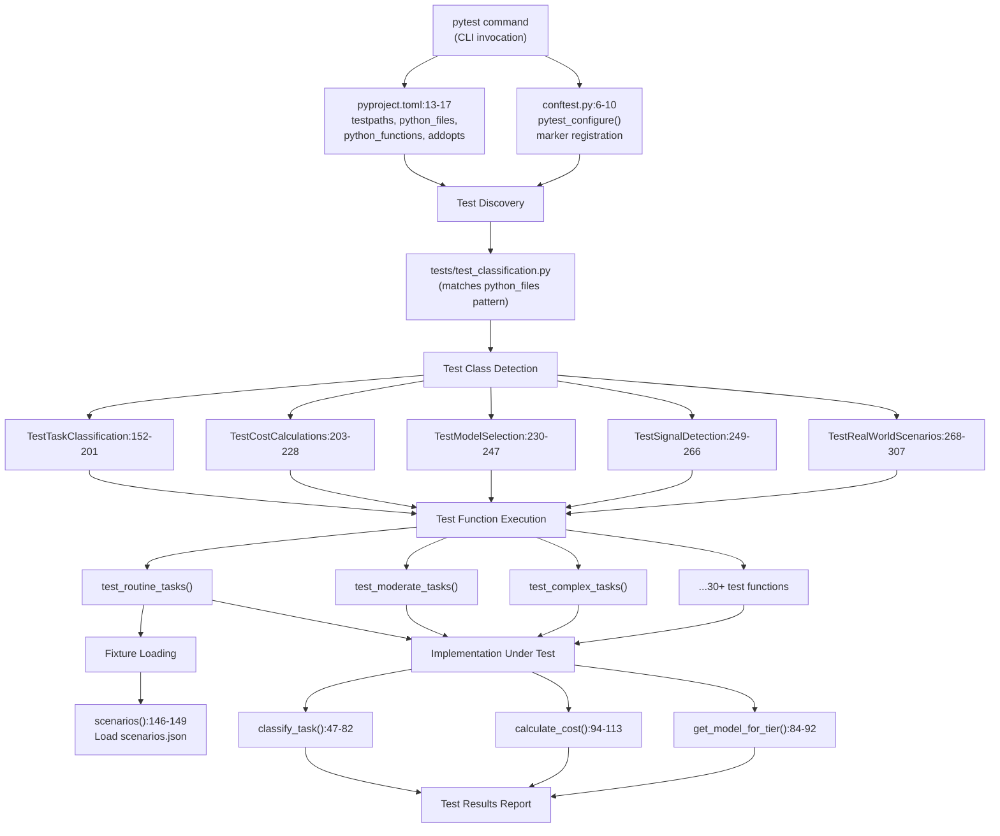
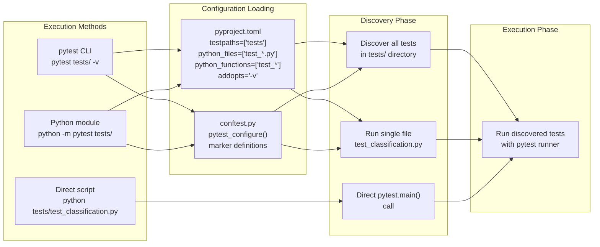

<!-- source: DeepWiki mcp.deepwiki.com · repo zscole/model-hierarchy-skill · page 6.3 Running Tests · fetched 2026-10-26 -->

# Running Tests

<details>
<summary>Relevant source files</summary>

The following files were used as context for generating this wiki page:

- [README.md](README.md)
- [pyproject.toml](pyproject.toml)
- [tests/conftest.py](tests/conftest.py)
- [tests/test_classification.py](tests/test_classification.py)

</details>


This page explains how to execute the test suite for the model-hierarchy-skill, including pytest commands, test markers, output interpretation, and common testing workflows. For information about what test scenarios are available, see [Test Scenarios](#6.1). For details on the structure and organization of test classes, see [Test Suite Structure](#6.2).

## Overview

The test suite validates the classification logic, cost calculations, and model selection behavior defined in [test_classification.py:1-311](). Tests are executed using pytest, configured through [pyproject.toml:13-17]() and [conftest.py:1-10]().

---

## Basic Test Execution

### Running All Tests

Execute the complete test suite with verbose output:

```bash
pytest tests/ -v
```

Alternative syntax using Python module notation:

```bash
python -m pytest tests/ -v
```

The `-v` flag enables verbose output, showing each test name and result. This flag is also configured as a default in [pyproject.toml:17]().

**Sources:** [README.md:64-70](), [pyproject.toml:13-17]()

---

### Running Specific Test Files

Execute only the classification tests:

```bash
pytest tests/test_classification.py -v
```

Or run the file directly as a Python script:

```bash
python tests/test_classification.py
```

The direct execution works because of [test_classification.py:309-310](), which calls `pytest.main()` when run as `__main__`.

**Sources:** [test_classification.py:309-310](), [README.md:69]()

---

## Test Selection Strategies

### Running Specific Test Classes

Execute all tests in a single test class:

```bash
pytest tests/test_classification.py::TestTaskClassification -v
```

Available test classes:
- `TestTaskClassification` - Core classification logic tests
- `TestCostCalculations` - Cost computation validation
- `TestModelSelection` - Model tier assignment tests
- `TestSignalDetection` - Signal pattern detection tests
- `TestRealWorldScenarios` - Realistic agent task tests

**Sources:** [test_classification.py:152-307]()

---

### Running Individual Test Functions

Execute a single test method:

```bash
pytest tests/test_classification.py::TestTaskClassification::test_routine_tasks -v
```

Pattern for function names: All test functions follow the `test_*` naming convention as configured in [pyproject.toml:16]().

**Sources:** [pyproject.toml:15-16]()

---

### Test Markers and Filtering

The test suite defines custom markers in [conftest.py:6-10](). Currently, the `slow` marker is configured for tests that take significant time:

```bash
# Run only slow tests
pytest tests/ -m slow -v

# Exclude slow tests
pytest tests/ -m "not slow" -v
```

The marker configuration in `conftest.py` allows pytest to recognize these markers without warnings:

```python
config.addinivalue_line(
    "markers", "slow: marks tests as slow (deselect with '-m \"not slow\"')"
)
```

**Sources:** [conftest.py:6-10]()

---

## Test Execution Flow

The following diagram shows how pytest discovers and executes tests, mapping natural language concepts to actual code entities:



**Sources:** [pyproject.toml:13-17](), [conftest.py:6-10](), [test_classification.py:1-311]()

---

## Interpreting Test Output

### Successful Test Run

A passing test produces output like:

```
tests/test_classification.py::TestTaskClassification::test_routine_tasks PASSED [ 10%]
tests/test_classification.py::TestTaskClassification::test_moderate_tasks PASSED [ 20%]
tests/test_classification.py::TestTaskClassification::test_complex_tasks PASSED [ 30%]
...
================================ 35 passed in 0.12s ================================
```

**Output Components:**
- **Test path**: Full pytest node ID (file::class::method)
- **Result**: `PASSED`, `FAILED`, `SKIPPED`, or `ERROR`
- **Progress**: Percentage completion `[ 10%]`
- **Summary**: Total counts and execution time

**Sources:** [pyproject.toml:17]()

---

### Failed Test Output

When a test fails, pytest displays an assertion error with context:

```
FAILED tests/test_classification.py::TestTaskClassification::test_routine_tasks
________________________________ FAILURES _________________________________
___________________ TestTaskClassification.test_routine_tasks ___________________
...
AssertionError: Expected tier 1 for: Read the configuration file
assert 2 == 1
```

The assertion messages are defined in test code using format strings:
```python
assert tier == 1, f"Expected tier 1 for: {task['description']}"
```

**Sources:** [test_classification.py:159](), [test_classification.py:165](), [test_classification.py:171]()

---

## Test Execution Modes

The following diagram illustrates different ways to invoke the test suite:



**Sources:** [pyproject.toml:13-17](), [conftest.py:6-10](), [test_classification.py:309-310]()

---

## Common Testing Workflows

### Development Workflow

When modifying classification logic:

```bash
# 1. Run tests continuously during development
pytest tests/test_classification.py::TestTaskClassification -v

# 2. After fixing issues, run all classification tests
pytest tests/test_classification.py -v

# 3. Before committing, run the full suite
pytest tests/ -v
```

**Sources:** [test_classification.py:152-201]()

---

### Parametrized Test Execution

Some tests use `@pytest.mark.parametrize` to run multiple scenarios with different inputs:

```bash
# Run all parametrized signal detection tests
pytest tests/test_classification.py::TestSignalDetection -v
```

Example parametrized test from [test_classification.py:252-258]():
```python
@pytest.mark.parametrize("signal", ROUTINE_SIGNALS[:5])
def test_routine_signals_detected(self, signal):
    desc = f"Please {signal} the data"
    tier = classify_task(desc)
    assert tier in [1, 2]
```

Each parameter value creates a separate test case, visible in the output as:
```
test_routine_signals_detected[read] PASSED
test_routine_signals_detected[fetch] PASSED
test_routine_signals_detected[check] PASSED
```

**Sources:** [test_classification.py:252-265]()

---

## Fixture Usage

### Scenarios Fixture

The `scenarios` fixture loads test data from [scenarios.json](). Tests that use this fixture automatically receive the loaded JSON data:

```bash
# All tests using scenarios fixture
pytest tests/test_classification.py::TestTaskClassification::test_routine_tasks -v
```

Fixture definition in [test_classification.py:145-149]():
```python
@pytest.fixture
def scenarios():
    """Load test scenarios from JSON file."""
    with open(SCENARIOS_PATH) as f:
        return json.load(f)
```

Tests access the fixture by declaring it as a parameter in [test_classification.py:155](), [test_classification.py:161](), [test_classification.py:167](), [test_classification.py:190]().

**Sources:** [test_classification.py:145-149](), [test_classification.py:155-171]()

---

## Test Organization by Purpose

The following table maps test purposes to their execution commands:

| Test Purpose | Command | Test Classes |
|-------------|---------|--------------|
| Classification accuracy | `pytest tests/test_classification.py::TestTaskClassification -v` | `TestTaskClassification` |
| Cost calculations | `pytest tests/test_classification.py::TestCostCalculations -v` | `TestCostCalculations` |
| Model selection | `pytest tests/test_classification.py::TestModelSelection -v` | `TestModelSelection` |
| Signal detection | `pytest tests/test_classification.py::TestSignalDetection -v` | `TestSignalDetection` |
| Real-world scenarios | `pytest tests/test_classification.py::TestRealWorldScenarios -v` | `TestRealWorldScenarios` |

**Sources:** [test_classification.py:152-307]()

---

## Configuration Reference

### pyproject.toml Configuration

The pytest configuration in [pyproject.toml:13-17]():

| Setting | Value | Purpose |
|---------|-------|---------|
| `testpaths` | `["tests"]` | Directories to search for tests |
| `python_files` | `["test_*.py"]` | File naming pattern for test files |
| `python_functions` | `["test_*"]` | Function naming pattern for test functions |
| `addopts` | `"-v"` | Default command-line options (verbose) |

**Sources:** [pyproject.toml:13-17]()

---

### conftest.py Configuration

The pytest configuration hook in [conftest.py:6-10]() registers custom markers:

```python
def pytest_configure(config):
    """Configure pytest with custom markers."""
    config.addinivalue_line(
        "markers", "slow: marks tests as slow (deselect with '-m \"not slow\"')"
    )
```

**Sources:** [conftest.py:6-10]()

---

## Advanced Usage

### Stopping on First Failure

Exit immediately when a test fails:

```bash
pytest tests/ -x -v
```

The `-x` flag stops execution at the first failure, useful for quick feedback during debugging.

---

### Showing Print Output

Display print statements during test execution:

```bash
pytest tests/ -v -s
```

The `-s` flag disables output capturing, showing all print statements from tests and the code under test.

---

### Running Tests with Coverage

While not configured in the current setup, coverage can be added:

```bash
pytest tests/ --cov=tests --cov-report=term-missing
```

This requires installing `pytest-cov` in addition to the dependencies specified in [pyproject.toml:11]().

**Sources:** [pyproject.toml:10-11]()

---

## Test Execution Environment

### Python Version Requirement

The project requires Python 3.9 or higher as specified in [pyproject.toml:8]():

```toml
requires-python = ">=3.9"
```

Verify your Python version before running tests:

```bash
python --version
```

**Sources:** [pyproject.toml:8]()

---

### Test Dependencies

Install test dependencies before running the suite:

```bash
pip install -e ".[test]"
```

This installs the optional test dependencies defined in [pyproject.toml:11]():
```toml
[project.optional-dependencies]
test = ["pytest>=7.0.0"]
```

**Sources:** [pyproject.toml:10-11]()

---

## Summary

The test suite is executed primarily through pytest with configuration driven by [pyproject.toml:13-17]() and [conftest.py:6-10](). Key execution patterns include:

- **Full suite**: `pytest tests/ -v`
- **Single class**: `pytest tests/test_classification.py::TestTaskClassification -v`
- **Marker filtering**: `pytest tests/ -m "not slow" -v`
- **Direct execution**: `python tests/test_classification.py`

Test output provides clear feedback on classification accuracy, cost calculations, and model selection behavior. The 35+ test cases validate the implementation against expected behavior defined in `scenarios.json` and hard-coded test assertions.

**Sources:** [README.md:64-70](), [pyproject.toml:13-17](), [conftest.py:1-10](), [test_classification.py:1-311]()

---

