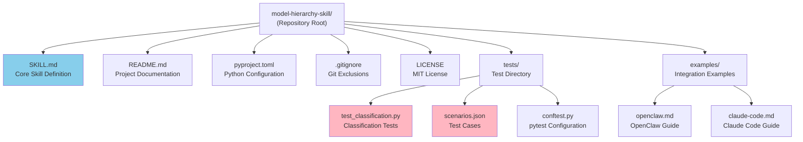
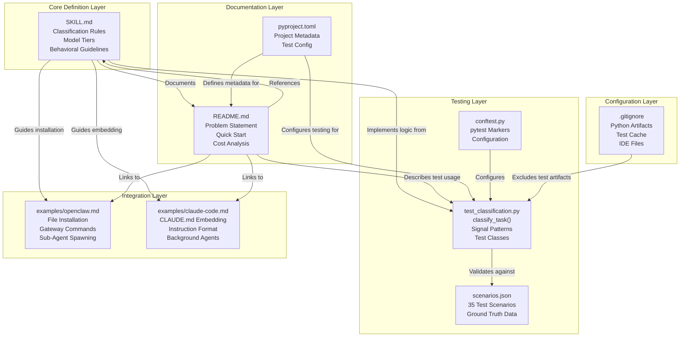
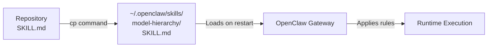
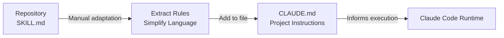
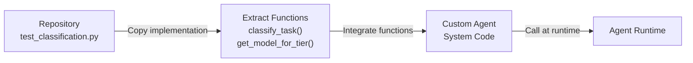

<!-- source: DeepWiki mcp.deepwiki.com · repo zscole/model-hierarchy-skill · page 7.2 Repository Structure · fetched 2026-10-26 -->

# Repository Structure

Relevant source files

The following files were used as context for generating this wiki page:

- [.gitignore](.gitignore)
- [README.md](README.md)
- [pyproject.toml](pyproject.toml)

This page provides a comprehensive overview of the repository layout for the model-hierarchy-skill project. It describes the purpose of each file and directory, and how they relate to each other in the overall system architecture.

For information about setting up the development environment, see [Project Setup](#7.1). For details about extending the system, see [Extending the Skill](#7.3).

---

## Overview

The repository follows a simple, flat structure designed for ease of distribution and integration. The core skill definition exists as a standalone file (`SKILL.md`) that can be copied directly into agent platforms, while supporting files provide documentation, testing, and integration examples.

### Repository Layout

**Sources:** [README.md:72-84]()

---

## Root-Level Files

The repository root contains the core definition files and project configuration.

### SKILL.md

The primary deliverable of this repository. This file contains the complete skill specification including:
- Task classification rules
- Model tier definitions
- Decision algorithms
- Behavioral guidelines
- Communication patterns

This is the file that gets installed into agent platforms like OpenClaw or embedded into project instructions for Claude Code.

**Purpose:** Standalone skill definition that can be distributed independently  
**Target Audience:** Agent platforms and AI systems  
**Referenced By:** All integration guides in [Integration Guides](#5)

### README.md

The main project documentation that serves as the entry point for users. Contains:
- Problem statement explaining the 80/20 cost waste issue [README.md:5-7]()
- Solution overview with the three-tier model hierarchy [README.md:9-18]()
- Quick start instructions for OpenClaw and Claude Code [README.md:21-46]()
- Cost analysis showing ~10x savings [README.md:52-60]()
- Repository file structure [README.md:72-84]()
- Testing instructions [README.md:63-70]()

**Purpose:** User-facing documentation and integration guide  
**Target Audience:** Developers integrating the skill  
**Cross-References:** Links to `SKILL.md` and integration examples

### pyproject.toml

Python project configuration file following PEP 517/518 standards. Defines:
- Project metadata (name, version, description) [pyproject.toml:1-8]()
- Optional test dependencies (`pytest>=7.0.0`) [pyproject.toml:10-11]()
- pytest configuration (test paths, file patterns, options) [pyproject.toml:13-17]()
- Build system requirements [pyproject.toml:19-21]()

**Purpose:** Python packaging and test configuration  
**Target Audience:** Developers running tests or building distributions  
**Build System:** Uses setuptools as the build backend [pyproject.toml:20-21]()

### .gitignore

Standard Python gitignore file that excludes:
- Python artifacts (`__pycache__/`, `*.pyc`, `*.egg-info/`) [.gitignore:2-21]()
- Virtual environments (`venv/`, `.venv/`) [.gitignore:23-27]()
- Testing artifacts (`.pytest_cache/`, `.coverage`) [.gitignore:29-34]()
- IDE files (`.idea/`, `.vscode/`) [.gitignore:36-41]()
- OS artifacts (`.DS_Store`, `Thumbs.db`) [.gitignore:43-45]()

**Purpose:** Keep repository clean of generated files  
**Target Audience:** Git version control system

**Sources:** [README.md:1-89](), [pyproject.toml:1-21](), [.gitignore:1-46]()

---

## Directory Structure

### tests/

Contains all testing infrastructure for validating the classification logic and cost calculations.

#### test_classification.py

The primary test implementation file that includes:
- The `classify_task()` function being tested (implementation)
- Signal pattern definitions (ROUTINE_SIGNALS, MODERATE_SIGNALS, COMPLEX_SIGNALS, ESCALATION_SIGNALS)
- Model tier mappings (TIER_1_MODELS, TIER_2_MODELS, TIER_3_MODELS)
- Cost calculation functions (`calculate_cost()`, `calculate_monthly_cost()`)
- Test classes validating classification accuracy

This file serves a dual role: it contains both the reference implementation of the classification logic and the tests that validate it.

**Purpose:** Reference implementation and test suite  
**Test Framework:** pytest  
**See Also:** [classify_task Function](#4.1), [Test Suite Structure](#6.2)

#### scenarios.json

A JSON file containing 35 test scenarios organized into categories:
- Routine tasks (10 scenarios) - expected Tier 1
- Moderate tasks (10 scenarios) - expected Tier 2
- Complex tasks (10 scenarios) - expected Tier 3
- Edge cases (5 scenarios) - mixed tier expectations

Each scenario includes a `description` field and an `expected_tier` field for validation.

**Purpose:** Ground truth dataset for classification testing  
**Format:** JSON array of test case objects  
**See Also:** [Test Scenarios](#6.1)

#### conftest.py

pytest configuration file that defines:
- Custom test markers (e.g., `slow` marker for expensive tests) [pyproject.toml:13-17]()
- Shared fixtures (if any)
- pytest session configuration

**Purpose:** pytest test infrastructure configuration  
**Framework:** pytest

**Sources:** [README.md:63-70](), [README.md:78-80](), [pyproject.toml:13-17]()

### examples/

Contains platform-specific integration guides showing how to install and use the skill in different agent systems.

#### openclaw.md

Integration guide for OpenClaw platform covering:
- File-based installation to `~/.openclaw/skills/model-hierarchy/` [README.md:26-27]()
- Gateway restart procedure [README.md:29-30]()
- `/model` command usage for manual model switching
- Sub-agent spawning with appropriate model tiers
- `config.yml` configuration

**Purpose:** OpenClaw-specific integration instructions  
**Integration Pattern:** File-based skill discovery  
**See Also:** [OpenClaw Integration](#5.1)

#### claude-code.md

Integration guide for Claude Code/Codex platform covering:
- Embedding skill rules in `CLAUDE.md` project instructions [README.md:35-46]()
- Natural language classification guidelines
- Background agent spawning with model suggestions
- Instruction format adaptation

**Purpose:** Claude Code-specific integration instructions  
**Integration Pattern:** Instruction embedding  
**See Also:** [Claude Code Integration](#5.2)

**Sources:** [README.md:21-50](), [README.md:82-83]()

---

## File Relationships and Dependencies

The following diagram shows how files relate to each other in terms of dependencies, references, and usage patterns.

### Dependency Graph

**Sources:** [README.md:1-89](), [pyproject.toml:1-21]()

---

## File Size and Complexity

| File | Purpose | Complexity | Distribution |
|------|---------|-----------|--------------|
| `SKILL.md` | Core skill definition | High | Copied to platforms |
| `README.md` | User documentation | Low | Reference only |
| `test_classification.py` | Implementation + tests | Medium | Development only |
| `scenarios.json` | Test data | Low | Development only |
| `conftest.py` | Test config | Low | Development only |
| `examples/openclaw.md` | Integration guide | Low | Reference only |
| `examples/claude-code.md` | Integration guide | Low | Reference only |
| `pyproject.toml` | Project config | Low | Development only |
| `.gitignore` | Git exclusions | Low | Development only |

**Sources:** [README.md:72-84]()

---

## Installation and Distribution Patterns

The repository supports multiple distribution patterns depending on the target platform:

### Pattern 1: File-Based Distribution (OpenClaw)

**Usage:** `cp SKILL.md ~/.openclaw/skills/model-hierarchy/SKILL.md` [README.md:26-27]()

### Pattern 2: Instruction Embedding (Claude Code)

**Usage:** Add classification rules to `CLAUDE.md` [README.md:35-46]()

### Pattern 3: Programmatic Integration (Custom)

**Usage:** Implement `get_model_for_task()` function in custom agent system

**Sources:** [README.md:21-50]()

---

## Build and Test Artifacts (Excluded)

The following directories and files are generated during development but excluded from version control via `.gitignore`:

| Artifact Type | Pattern | Purpose |
|---------------|---------|---------|
| Python cache | `__pycache__/`, `*.pyc` | Compiled bytecode |
| Virtual env | `venv/`, `.venv/` | Isolated Python environment |
| Test cache | `.pytest_cache/` | pytest execution cache |
| Coverage | `.coverage`, `htmlcov/` | Test coverage reports |
| Build artifacts | `dist/`, `build/`, `*.egg-info/` | Package distribution |
| IDE files | `.idea/`, `.vscode/` | Editor configuration |

These are automatically generated and should not be committed to the repository.

**Sources:** [.gitignore:1-46]()

---

## Repository Access Patterns

### For End Users (Agent Integration)

**Primary Files:**
- `SKILL.md` - The skill to install
- `README.md` - Quick start guide
- `examples/openclaw.md` or `examples/claude-code.md` - Platform-specific guide

**Typical Flow:** Read `README.md` → Choose platform → Follow example guide → Install `SKILL.md`

### For Developers (Testing and Extension)

**Primary Files:**
- `test_classification.py` - Implementation reference
- `scenarios.json` - Test cases
- `pyproject.toml` - Development configuration

**Typical Flow:** Clone repo → Install test dependencies → Run `pytest tests/` → Modify implementation → Re-test

### For Contributors (Documentation)

**Primary Files:**
- `SKILL.md` - Core specification to update
- `README.md` - User docs to improve
- `examples/` - Integration guides to expand

**Typical Flow:** Identify improvement → Update relevant file → Test changes → Submit PR

**Sources:** [README.md:63-70](), [pyproject.toml:10-11]()

---

