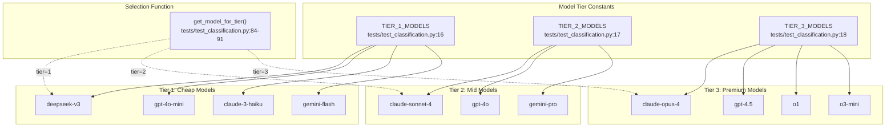
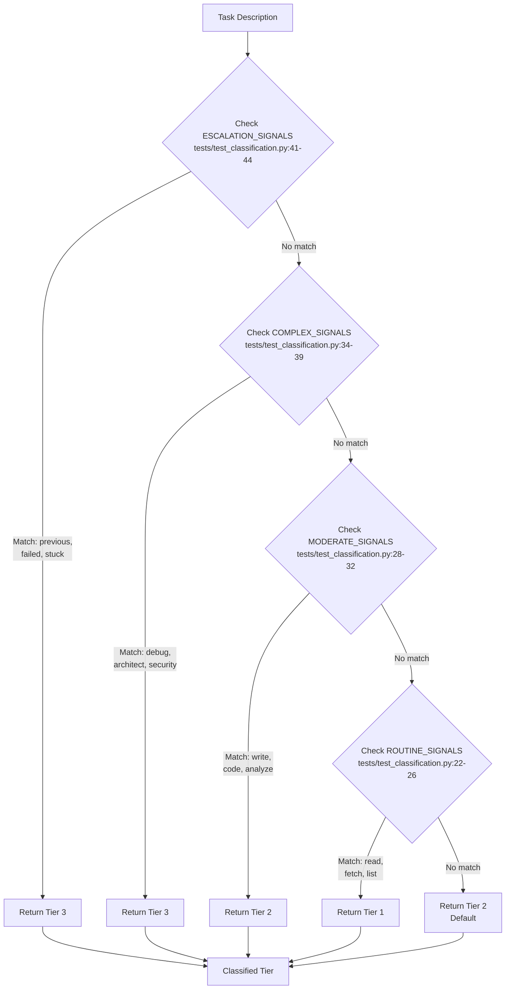
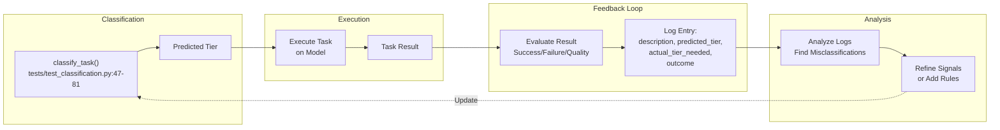
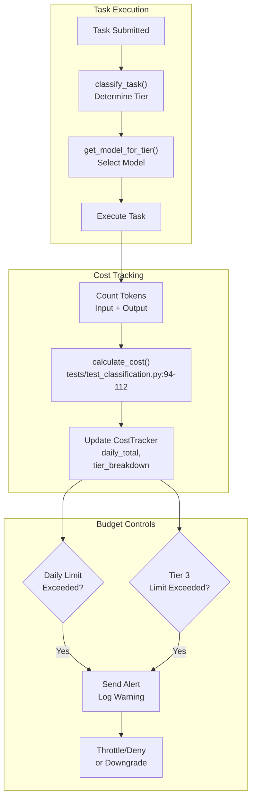

<!-- source: DeepWiki mcp.deepwiki.com · repo zscole/model-hierarchy-skill · page 7.3 Extending the Skill · fetched 2026-10-26 -->

# Extending the Skill

<details>
<summary>Relevant source files</summary>

The following files were used as context for generating this wiki page:

- [SKILL.md](SKILL.md)
- [tests/test_classification.py](tests/test_classification.py)

</details>


This document explains how to customize and extend the model-hierarchy-skill for your specific use case. Topics covered include adjusting tier definitions, adding domain-specific classification signals, tracking complexity for continuous improvement, and implementing budget controls.

For general integration patterns with agent platforms, see [Custom Integration](#5.3). For the core classification algorithm being extended, see [classify_task Function](#4.1) and [Signal Detection System](#4.2).

---

## Overview of Extension Points

The skill exposes four primary extension points for customization:

| Extension Point | Implementation Location | Use Case |
|----------------|------------------------|----------|
| **Tier Definitions** | `TIER_1_MODELS`, `TIER_2_MODELS`, `TIER_3_MODELS` | Add new models, change tier assignments, adjust to provider changes |
| **Signal Patterns** | `ROUTINE_SIGNALS`, `MODERATE_SIGNALS`, `COMPLEX_SIGNALS`, `ESCALATION_SIGNALS` | Add domain-specific keywords, industry terminology, custom triggers |
| **Classification Logic** | `classify_task()` function | Implement custom heuristics, add context-aware routing, incorporate runtime data |
| **Cost Tracking** | `calculate_cost()`, `calculate_monthly_cost()` | Update pricing, add budget alerts, track actual spending patterns |

All extension points are implemented in [tests/test_classification.py](tests/test_classification.py) and documented in [SKILL.md](SKILL.md). The system is designed for modification without breaking existing integrations.

**Sources:** [tests/test_classification.py:1-311](), [SKILL.md:248-256]()

---

## Adjusting Tier Definitions

### Modifying Model Assignments

The three-tier hierarchy is defined by model constant lists that can be modified to reflect your provider access, budget constraints, or new model releases.



**Diagram: Model Tier Constants and Selection**

**Example: Adding a New Model**

To add a new model to a tier, append it to the appropriate list:

```python
# Original definition at tests/test_classification.py:16
TIER_1_MODELS = ["deepseek-v3", "gpt-4o-mini", "claude-3-haiku", "gemini-flash"]

# Extended with new model
TIER_1_MODELS = [
    "deepseek-v3", "gpt-4o-mini", "claude-3-haiku", "gemini-flash",
    "mistral-small"  # New addition
]
```

**Example: Promoting a Model Between Tiers**

If a model's capabilities improve or pricing changes:

```python
# Move o3-mini from Tier 3 to Tier 2
TIER_2_MODELS = ["claude-sonnet-4", "gpt-4o", "gemini-pro", "o3-mini"]
TIER_3_MODELS = ["claude-opus-4", "gpt-4.5", "o1"]  # Removed o3-mini
```

The `get_model_for_tier()` function [tests/test_classification.py:84-91]() returns the first model from each tier list as the default representative. To change the default selection:

```python
def get_model_for_tier(tier: int) -> str:
    """Get a representative model for a given tier."""
    if tier == 1:
        return "mistral-small"  # Changed from deepseek-v3
    elif tier == 2:
        return "gemini-pro"     # Changed from claude-sonnet-4
    else:
        return "o1"             # Changed from claude-opus-4
```

**Sources:** [tests/test_classification.py:16-18](), [tests/test_classification.py:84-91](), [SKILL.md:19-46]()

### Updating Cost Calculations

When tier definitions change, update the cost calculation functions to reflect current pricing:

| Function | Location | Purpose |
|----------|----------|---------|
| `calculate_cost()` | [tests/test_classification.py:94-112]() | Per-task cost estimation |
| `calculate_monthly_cost()` | [tests/test_classification.py:115-138]() | Aggregate monthly projections |

**Example: Updating Pricing**

```python
# Original pricing at tests/test_classification.py:107-111
costs = {
    1: 0.28,    # DeepSeek V3
    2: 15.00,   # Claude Sonnet
    3: 75.00    # Claude Opus
}

# Updated for new models or pricing changes
costs = {
    1: 0.20,    # Mistral Small (cheaper)
    2: 12.00,   # Updated Gemini Pro pricing
    3: 60.00    # o1 pricing (cheaper than Opus)
}
```

The monthly cost calculation [tests/test_classification.py:115-138]() uses these per-token costs with task distribution assumptions (80% routine, 15% moderate, 5% complex). Adjust these percentages based on your actual workload:

```python
monthly = calculate_monthly_cost(
    daily_tokens=100_000,
    routine_pct=0.85,   # Increased routine work
    moderate_pct=0.12,  # Decreased moderate
    complex_pct=0.03    # Decreased complex
)
```

**Sources:** [tests/test_classification.py:94-138](), [SKILL.md:169-183]()

---

## Adding Domain-Specific Signals

### Understanding Signal Priority

The classification system uses four signal lists with hierarchical priority:



**Diagram: Signal Priority and Classification Flow**

The priority order is: `ESCALATION` > `COMPLEX` > `MODERATE` > `ROUTINE` > `DEFAULT (tier 2)`. This ensures that critical signals always override routine indicators.

**Sources:** [tests/test_classification.py:47-81](), [tests/test_classification.py:22-44]()

### Extending Signal Lists

Each signal list is defined as a Python list of lowercase strings that are matched against the task description.

**Example: Adding Medical Domain Signals**

```python
# Original routine signals at tests/test_classification.py:22-26
ROUTINE_SIGNALS = [
    "read", "fetch", "check", "list", "format", "status", "get",
    "filter", "sort", "convert", "parse", "health", "ping", "time",
    "date", "lookup", "find file", "show", "display"
]

# Extended with medical terminology
ROUTINE_SIGNALS = [
    "read", "fetch", "check", "list", "format", "status", "get",
    "filter", "sort", "convert", "parse", "health", "ping", "time",
    "date", "lookup", "find file", "show", "display",
    # Medical domain additions
    "vitals", "patient record", "lab result", "appointment", "prescription lookup"
]
```

**Example: Adding DevOps Complex Signals**

```python
# Original complex signals at tests/test_classification.py:34-39
COMPLEX_SIGNALS = [
    "debug", "architect", "design", "security", "why does",
    "why is", "tradeoff", "evaluate", "doesn't work", "failed",
    "tried", "race condition", "vulnerability", "migrate",
    "behaves differently", "under load", "production"
]

# Extended with DevOps terminology
COMPLEX_SIGNALS = [
    "debug", "architect", "design", "security", "why does",
    "why is", "tradeoff", "evaluate", "doesn't work", "failed",
    "tried", "race condition", "vulnerability", "migrate",
    "behaves differently", "under load", "production",
    # DevOps additions
    "cluster failover", "zero downtime", "circuit breaker",
    "distributed trace", "kubernetes crash", "service mesh"
]
```

**Signal Conflict Resolution**

When a task description matches multiple signal types, the highest priority wins. Example:

```python
# Task: "Debug the read operation that failed"
# Matches: "read" (ROUTINE), "debug" (COMPLEX), "failed" (ESCALATION)
# Result: Tier 3 (ESCALATION has highest priority)

tier = classify_task("Debug the read operation that failed")
assert tier == 3
```

**Sources:** [tests/test_classification.py:22-44](), [tests/test_classification.py:47-81]()

### Testing New Signals

Add test cases to validate new signals in [tests/scenarios.json]() or directly in test classes:

```python
# Add to TestSignalDetection class (tests/test_classification.py:249-265)
def test_custom_domain_signals(self):
    """Custom domain signals should trigger correct tiers."""
    # Medical routine
    assert classify_task("Check patient vitals") == 1
    
    # DevOps complex
    assert classify_task("Debug the kubernetes cluster failover") == 3
    
    # Financial moderate
    assert classify_task("Generate quarterly financial report") == 2
```

**Sources:** [tests/test_classification.py:249-265](), [tests/scenarios.json]()

---

## Tracking and Improving Classification

### Implementing Classification Feedback

To improve classification accuracy over time, implement a logging system that tracks predicted versus actual tiers:



**Diagram: Classification Feedback and Improvement Loop**

**Example: Logging Implementation**

```python
import json
from datetime import datetime
from pathlib import Path

class ClassificationLogger:
    """Track classification predictions and outcomes."""
    
    def __init__(self, log_path: Path):
        self.log_path = log_path
    
    def log_classification(
        self,
        description: str,
        predicted_tier: int,
        actual_tier_needed: int | None = None,
        success: bool | None = None,
        execution_time_ms: float | None = None
    ):
        """Log a classification event."""
        entry = {
            "timestamp": datetime.utcnow().isoformat(),
            "description": description,
            "predicted_tier": predicted_tier,
            "actual_tier_needed": actual_tier_needed,
            "success": success,
            "execution_time_ms": execution_time_ms,
            "correct_prediction": (
                predicted_tier == actual_tier_needed 
                if actual_tier_needed else None
            )
        }
        
        with open(self.log_path, "a") as f:
            f.write(json.dumps(entry) + "\n")
```

**Example: Using the Logger**

```python
logger = ClassificationLogger(Path("classification_log.jsonl"))

# Classify and execute
description = "Read the config file and extract API keys"
predicted_tier = classify_task(description)
logger.log_classification(description, predicted_tier)

# If task fails with tier 1, log actual tier needed
if task_failed:
    logger.log_classification(
        description,
        predicted_tier=1,
        actual_tier_needed=2,  # Should have used tier 2
        success=False
    )
```

**Sources:** [tests/test_classification.py:47-81]()

### Analyzing Classification Patterns

Build analysis tools to identify systematic misclassifications:

```python
def analyze_classification_accuracy(log_path: Path) -> dict:
    """Analyze classification log for accuracy metrics."""
    entries = []
    with open(log_path) as f:
        entries = [json.loads(line) for line in f]
    
    # Filter entries with outcomes
    with_outcomes = [
        e for e in entries 
        if e.get("correct_prediction") is not None
    ]
    
    if not with_outcomes:
        return {"error": "No outcome data"}
    
    correct = sum(1 for e in with_outcomes if e["correct_prediction"])
    total = len(with_outcomes)
    
    # Find common misclassifications
    misclassified = [
        e for e in with_outcomes 
        if not e["correct_prediction"]
    ]
    
    # Extract signal patterns from misclassified tasks
    underestimated = [
        e for e in misclassified 
        if e["predicted_tier"] < e["actual_tier_needed"]
    ]
    
    return {
        "accuracy": correct / total,
        "total_samples": total,
        "correct": correct,
        "incorrect": len(misclassified),
        "underestimated_count": len(underestimated),
        "sample_misclassifications": misclassified[:5]
    }
```

**Sources:** [tests/test_classification.py:47-81]()

---

## Implementing Budget Controls

### Adding Cost Tracking

Extend the cost calculation functions to track actual spending:



**Diagram: Cost Tracking and Budget Control Flow**

**Example: Cost Tracker Implementation**

```python
from datetime import datetime, timedelta
from typing import Dict

class CostTracker:
    """Track daily and monthly costs with budget limits."""
    
    def __init__(self, daily_limit: float = 10.0, tier3_limit: float = 3.0):
        self.daily_limit = daily_limit
        self.tier3_limit = tier3_limit
        self.costs: Dict[str, float] = {}  # date -> total cost
        self.tier_costs: Dict[str, Dict[int, float]] = {}  # date -> tier -> cost
        
    def record_cost(self, tier: int, tokens: int) -> bool:
        """
        Record a task cost. Returns False if budget exceeded.
        
        Uses calculate_cost() from tests/test_classification.py:94-112
        """
        today = datetime.utcnow().date().isoformat()
        cost = calculate_cost(tier, tokens)
        
        # Initialize today's tracking
        if today not in self.costs:
            self.costs[today] = 0.0
            self.tier_costs[today] = {1: 0.0, 2: 0.0, 3: 0.0}
        
        # Check limits before recording
        new_daily_total = self.costs[today] + cost
        new_tier3_total = self.tier_costs[today][3] + (cost if tier == 3 else 0)
        
        if new_daily_total > self.daily_limit:
            return False  # Daily limit exceeded
        
        if tier == 3 and new_tier3_total > self.tier3_limit:
            return False  # Tier 3 limit exceeded
        
        # Record cost
        self.costs[today] += cost
        self.tier_costs[today][tier] += cost
        return True
    
    def get_monthly_total(self) -> float:
        """Calculate total cost for current month."""
        today = datetime.utcnow()
        month_start = today.replace(day=1).date().isoformat()
        
        return sum(
            cost for date, cost in self.costs.items()
            if date >= month_start
        )
    
    def get_tier_breakdown(self, days: int = 7) -> Dict[int, float]:
        """Get tier cost breakdown for recent days."""
        cutoff = (datetime.utcnow() - timedelta(days=days)).date().isoformat()
        
        breakdown = {1: 0.0, 2: 0.0, 3: 0.0}
        for date, tier_dict in self.tier_costs.items():
            if date >= cutoff:
                for tier, cost in tier_dict.items():
                    breakdown[tier] += cost
        
        return breakdown
```

**Example: Using the Cost Tracker**

```python
tracker = CostTracker(daily_limit=10.0, tier3_limit=3.0)

# Before executing task
description = "Debug the authentication flow"
tier = classify_task(description)
estimated_tokens = 5000

# Check budget
if not tracker.record_cost(tier, estimated_tokens):
    # Budget exceeded - downgrade or defer
    if tier == 3:
        print("Tier 3 budget exceeded, downgrading to tier 2")
        tier = 2
        tracker.record_cost(tier, estimated_tokens)
    else:
        print("Daily budget exceeded, deferring task")
        # Queue for next day or alert user

# Get spending report
monthly = tracker.get_monthly_total()
breakdown = tracker.get_tier_breakdown()
print(f"Monthly total: ${monthly:.2f}")
print(f"Last 7 days breakdown: {breakdown}")
```

**Sources:** [tests/test_classification.py:94-112](), [tests/test_classification.py:115-138]()

### Budget Alert Integration

Integrate budget tracking with your agent platform's notification system:

```python
class BudgetAlertSystem:
    """Alert system for cost anomalies."""
    
    def __init__(self, tracker: CostTracker):
        self.tracker = tracker
    
    def check_alerts(self) -> list[str]:
        """Check for budget alert conditions."""
        alerts = []
        
        # Daily limit approaching
        today = datetime.utcnow().date().isoformat()
        if today in self.tracker.costs:
            daily = self.tracker.costs[today]
            if daily > self.tracker.daily_limit * 0.8:
                alerts.append(
                    f"Daily budget at {daily/self.tracker.daily_limit*100:.0f}%"
                )
        
        # Tier 3 overuse
        breakdown = self.tracker.get_tier_breakdown(days=1)
        tier3_pct = breakdown[3] / sum(breakdown.values()) * 100
        if tier3_pct > 10:  # Expected 5%
            alerts.append(
                f"Tier 3 usage at {tier3_pct:.0f}% (expected 5%)"
            )
        
        # Monthly projection
        monthly = self.tracker.get_monthly_total()
        days_in_month = 30
        days_elapsed = datetime.utcnow().day
        projected = monthly * (days_in_month / days_elapsed)
        if projected > 50:  # Expected ~$19
            alerts.append(
                f"Monthly projection: ${projected:.2f} (expected ~$19)"
            )
        
        return alerts
```

**Sources:** [tests/test_classification.py:115-138](), [SKILL.md:169-183]()

---

## Additional Extension Patterns

### Custom Classification Context

Add context-aware classification that considers more than just the task description:

```python
def classify_task_with_context(
    description: str,
    previous_failed: bool = False,
    user_tier_preference: int | None = None,
    time_sensitivity: str = "normal",  # "urgent", "normal", "background"
    available_budget: float | None = None
) -> int:
    """
    Enhanced classification with additional context.
    
    Extends classify_task() from tests/test_classification.py:47-81
    """
    # Start with base classification
    tier = classify_task(description, previous_failed)
    
    # Apply user preference override (if within reason)
    if user_tier_preference and abs(user_tier_preference - tier) <= 1:
        tier = user_tier_preference
    
    # Time-sensitive tasks get upgrade
    if time_sensitivity == "urgent" and tier < 3:
        tier += 1
    
    # Background tasks get downgrade
    if time_sensitivity == "background" and tier > 1:
        tier -= 1
    
    # Budget constraints force downgrade
    if available_budget is not None:
        max_tier = 1 if available_budget < 1.0 else (2 if available_budget < 5.0 else 3)
        tier = min(tier, max_tier)
    
    return tier
```

**Sources:** [tests/test_classification.py:47-81]()

### Multi-Provider Model Selection

Extend `get_model_for_tier()` to select models based on provider availability or preferences:

```python
def get_model_for_tier(
    tier: int,
    preferred_provider: str | None = None,
    available_providers: list[str] | None = None
) -> str:
    """
    Enhanced model selection with provider preferences.
    
    Extends get_model_for_tier() from tests/test_classification.py:84-91
    """
    provider_models = {
        "anthropic": {
            1: "claude-3-haiku",
            2: "claude-sonnet-4",
            3: "claude-opus-4"
        },
        "openai": {
            1: "gpt-4o-mini",
            2: "gpt-4o",
            3: "o1"
        },
        "google": {
            1: "gemini-flash",
            2: "gemini-pro",
            3: "gemini-ultra"
        },
        "deepseek": {
            1: "deepseek-v3",
            2: "deepseek-v3",
            3: "deepseek-v3"  # Only tier 1, fall back to others
        }
    }
    
    # Try preferred provider first
    if preferred_provider and preferred_provider in provider_models:
        return provider_models[preferred_provider][tier]
    
    # Filter by available providers
    if available_providers:
        for provider in available_providers:
            if provider in provider_models:
                return provider_models[provider][tier]
    
    # Fall back to default from original function
    if tier == 1:
        return "deepseek-v3"
    elif tier == 2:
        return "claude-sonnet-4"
    else:
        return "claude-opus-4"
```

**Sources:** [tests/test_classification.py:84-91](), [tests/test_classification.py:16-18]()

---

## Summary

The model-hierarchy-skill provides four primary extension points:

1. **Tier Definitions**: Modify `TIER_1_MODELS`, `TIER_2_MODELS`, `TIER_3_MODELS` and update cost calculations
2. **Signal Patterns**: Extend `ROUTINE_SIGNALS`, `MODERATE_SIGNALS`, `COMPLEX_SIGNALS`, `ESCALATION_SIGNALS` with domain-specific keywords
3. **Classification Logic**: Enhance `classify_task()` with context-awareness, feedback loops, and custom heuristics
4. **Cost Controls**: Implement `CostTracker` and `BudgetAlertSystem` for spending management

All extensions maintain backward compatibility with existing integrations documented in [OpenClaw Integration](#5.1), [Claude Code Integration](#5.2), and [Custom Integration](#5.3).

**Sources:** [tests/test_classification.py:1-311](), [SKILL.md:1-256]()

---

