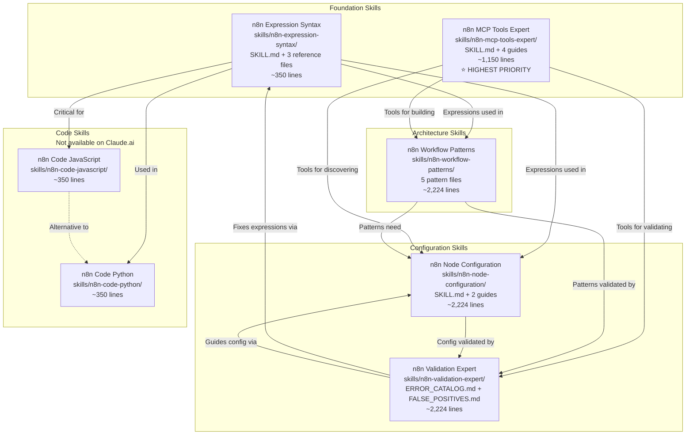
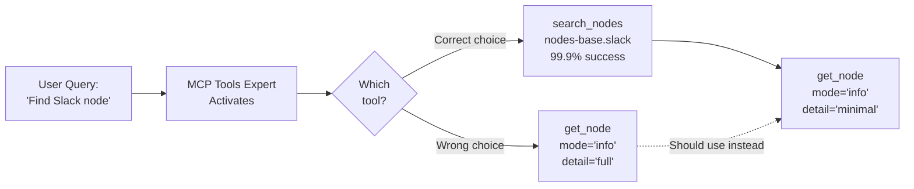
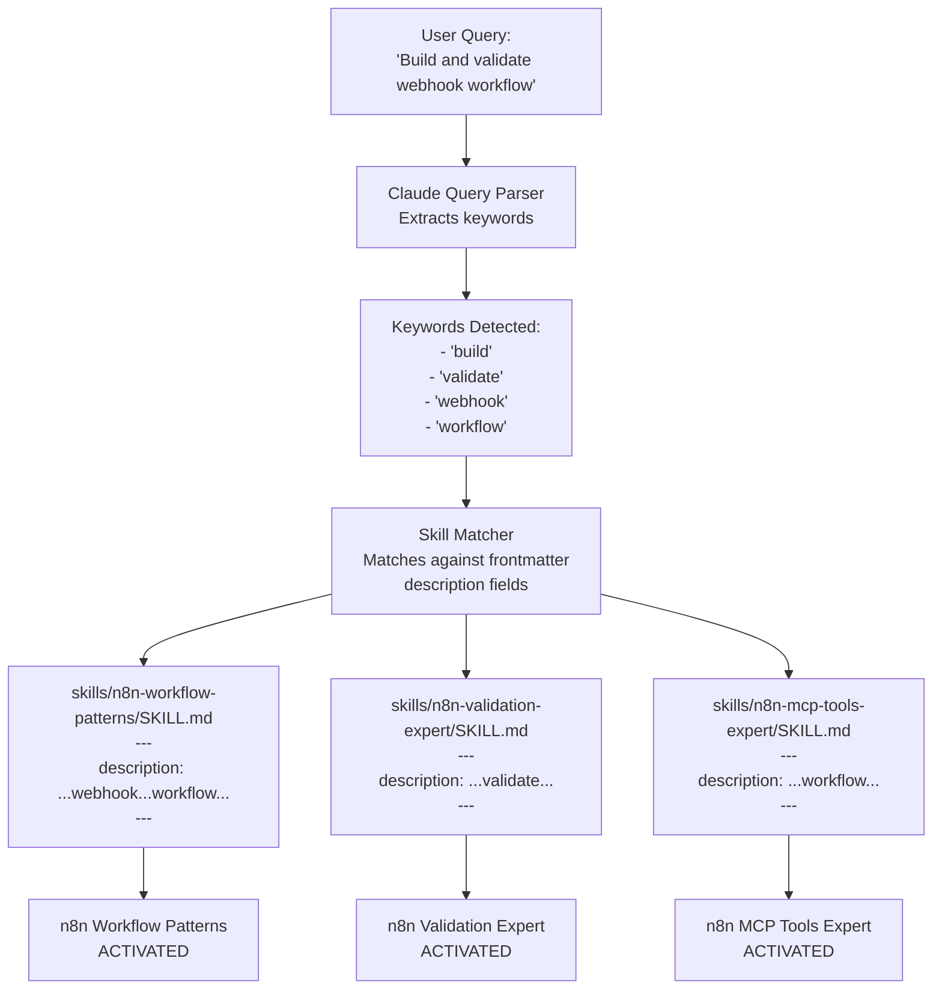
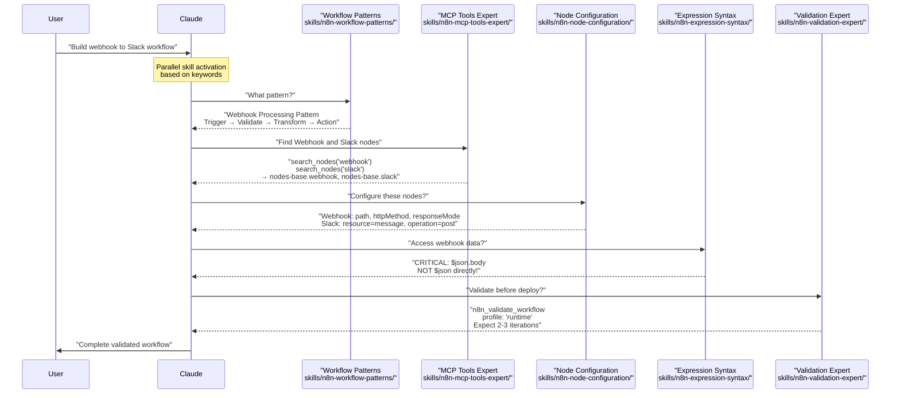
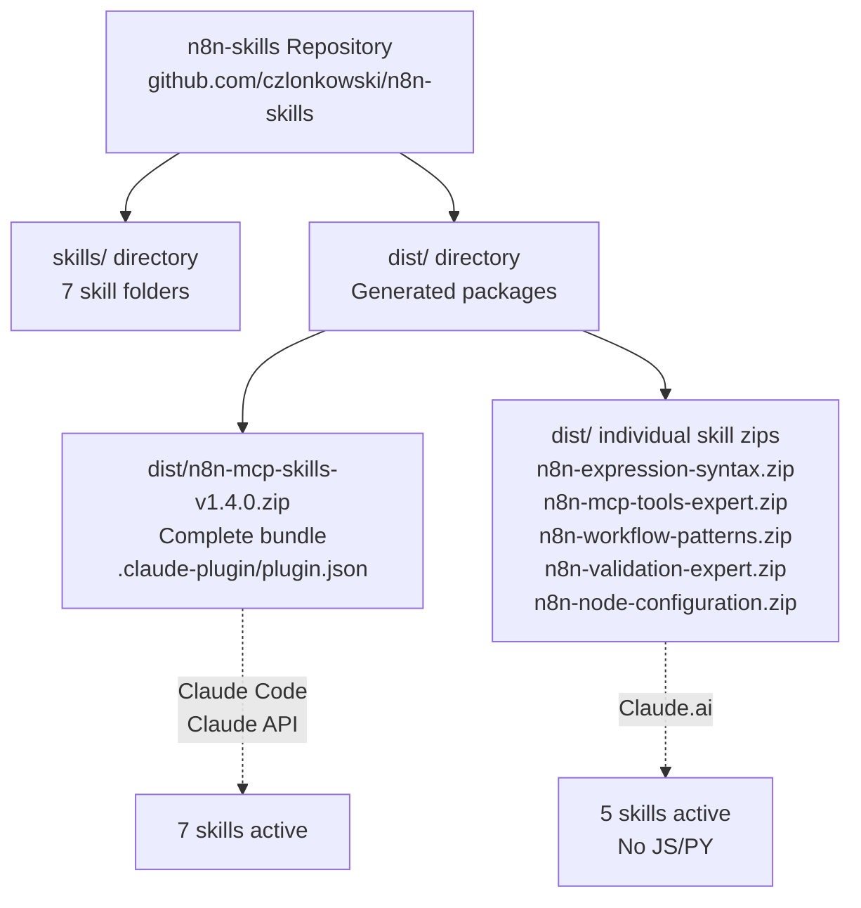

<!-- source: DeepWiki mcp.deepwiki.com · repo czlonkowski/n8n-skills · page 3 The Seven Skills · fetched 2026-10-26 -->

# The Seven Skills

<details>
<summary>Relevant source files</summary>

The following files were used as context for generating this wiki page:

- [.claude-plugin/marketplace.json](.claude-plugin/marketplace.json)
- [.claude-plugin/plugin.json](.claude-plugin/plugin.json)
- [CLAUDE.md](CLAUDE.md)
- [README.md](README.md)

</details>


## Purpose and Scope

This page provides a comprehensive overview of all seven Claude Code skills in the n8n-skills system, including their relationships, activation patterns, and how they compose together to teach Claude how to build n8n workflows using the n8n-mcp MCP server.

For detailed documentation of individual skills, see:
- [n8n Expression Syntax](#3.1)
- [n8n MCP Tools Expert](#3.2)
- [n8n Workflow Patterns](#3.3)
- [n8n Validation Expert](#3.4)
- [n8n Node Configuration](#3.5)
- [n8n Code JavaScript](#3.6)
- [n8n Code Python](#3.7)

For installation instructions, see [Installation](#2.1). For MCP server integration details, see [MCP Server Integration](#5).

---

## Skills Overview

The n8n-skills system consists of seven complementary skills organized into four categories:

| Skill | Category | Priority | Lines | Platform Support | Purpose |
|-------|----------|----------|-------|------------------|---------|
| **n8n Expression Syntax** | Foundation | Medium | ~350 | All | Expression syntax and variables ($json, $node, $now) |
| **n8n MCP Tools Expert** | Foundation | **HIGHEST** | ~1,150 | All | MCP tool usage, nodeType formats, validation profiles |
| **n8n Workflow Patterns** | Architecture | Medium | ~2,224 | All | 5 core workflow patterns and composition |
| **n8n Validation Expert** | Configuration | Medium | ~2,224 | All | Error interpretation and validation loop |
| **n8n Node Configuration** | Configuration | Medium | ~2,224 | All | Operation-aware configuration with dependencies |
| **n8n Code JavaScript** | Code | Low | ~350 | Code/API only | JavaScript code patterns for Code nodes (95% use cases) |
| **n8n Code Python** | Code | Low | ~350 | Code/API only | Python limitations and standard library patterns |

**Total**: ~8,872 lines across 7 skills, with 4 files per skill on average.

Sources: [README.md:31-118](), [CLAUDE.md:38-71]()

---

## Skill Categories and Hierarchy



**Dependency Analysis**: 

The skills form a directed acyclic graph (DAG) with two foundational skills at the root:

1. **Foundation Layer**: n8n Expression Syntax and n8n MCP Tools Expert are prerequisites for all other skills. [CLAUDE.md:151-159]()
2. **Architecture Layer**: n8n Workflow Patterns builds on both foundation skills to define the 5 core patterns (Webhook, HTTP API, Database, AI, Scheduled). [CLAUDE.md:51-54]()
3. **Configuration Layer**: n8n Node Configuration and n8n Validation Expert depend on foundation skills and each other to interpret errors and dependencies. [CLAUDE.md:55-63]()
4. **Code Layer**: Both code skills depend on n8n Expression Syntax but are functionally independent. [CLAUDE.md:64-71]()

Sources: [CLAUDE.md:13-17](), [CLAUDE.md:151-159](), [README.md:203-214]()

---

## Priority System

### Why MCP Tools Expert is HIGHEST Priority

The **n8n MCP Tools Expert** skill has HIGHEST priority because all other skills rely on correct MCP tool usage. Without understanding how to use MCP tools, the other skills cannot effectively guide Claude. [CLAUDE.md:45]()

**Telemetry Evidence** (from 447,557 real MCP tool invocations):

| Metric | Value | Implication |
|--------|-------|-------------|
| Most-used tool | `n8n_update_partial_workflow` | 38,287 uses (99.0% success) [CLAUDE.md:130-134]() |
| Second most-used | `search_nodes` | 9,835 uses (99.9% success) [CLAUDE.md:119-122]() |
| Validation checks | `n8n_validate_workflow` | 7,841 uses (95.5% success) [CLAUDE.md:124-128]() |

**Critical Tool Knowledge**:



**Key Distinctions the MCP Tools Expert Teaches**:

1. **nodeType formats**: `nodes-base.*` vs `n8n-nodes-base.*`. [README.md:56]()
2. **Tool selection**: Efficient use of `get_node` detail levels (minimal, standard, full). [CLAUDE.md:78]()
3. **Validation profiles**: `minimal`, `runtime`, `ai-friendly`, `strict`. [README.md:57]()
4. **Smart parameters**: Specific logic for tools like `n8n_update_partial_workflow` (19 operation types). [CLAUDE.md:86]()

Sources: [CLAUDE.md:45-50](), [CLAUDE.md:119-134](), [README.md:49-62]()

---

## Activation System

### Frontmatter Trigger Mechanism

Skills activate automatically based on trigger keywords in the `description` field of their frontmatter:



### Activation Trigger Reference

| Skill | Activation Triggers (from frontmatter description) |
|-------|---------------------------------------------------|
| **Expression Syntax** | `expression`, `{{}}`, `$json`, `$node`, `$now`, expression errors [README.md:41]() |
| **MCP Tools Expert** | `search`, `validate`, `MCP tools`, `template`, `workflow`, `tool selection` [README.md:52]() |
| **Workflow Patterns** | `build workflow`, `webhook`, `HTTP API`, `database`, `AI agent`, `scheduled` [README.md:66]() |
| **Validation Expert** | `validation error`, `validation failing`, `false positive`, `validation loop` [README.md:78]() |
| **Node Configuration** | `configure node`, `property dependencies`, `required fields`, `AI workflow` [README.md:90]() |
| **Code JavaScript** | `JavaScript`, `Code node`, `$helpers`, `$input`, date handling [README.md:101]() |
| **Code Python** | `Python`, `pandas`, `numpy`, `external libraries`, Python limitations [README.md:113]() |

Sources: [CLAUDE.md:146-150](), [README.md:178-201]()

---

## Cross-Skill Composition

Skills compose automatically when multiple activation triggers match. Each skill contributes specialized knowledge to the complete solution.

### Composition Pattern: Build and Validate Workflow



### Common Composition Patterns

**Pattern 1: Discovery + Configuration**
```
User: "How do I configure the HTTP Request node?"
→ Activates: MCP Tools Expert + Node Configuration
→ MCP: search_nodes, get_node (mode=info)
→ NC: operation-aware configuration guidance
```

**Pattern 2: Building + Validation**
```
User: "Build database sync workflow"
→ Activates: Workflow Patterns + MCP Tools Expert + Validation Expert
→ WP: Database Operations Pattern
→ MCP: search for database nodes
→ VE: validation loop guidance (n8n_autofix_workflow)
```

**Pattern 3: Expression + Code**
```
User: "Transform webhook data with JavaScript"
→ Activates: Expression Syntax + Code JavaScript + MCP Tools Expert
→ ES: $json.body for webhook data access
→ JS: $input.first().json.body, return [{json: {...}}]
→ MCP: Code node configuration
```

Sources: [README.md:203-214](), [CLAUDE.md:151-159]()

---

## Platform Availability

### Claude Platform Support Matrix

| Platform | Skills Available | Installation Method | Code Skills |
|----------|------------------|---------------------|-------------|
| **Claude Code** | All 7 skills | `/plugin install czlonkowski/n8n-skills` [README.md:139]() | ✅ JS + PY |
| **Claude.ai** | 5 core skills only | Manual upload via UI [README.md:165]() | ❌ No code execution |
| **Claude API/SDK** | All 7 skills | Via SDK loading [README.md:172]() | ✅ JS + PY |

**Why Code Skills Are Restricted on Claude.ai**:
Claude.ai does not support code execution skills for security reasons. The web interface cannot safely execute arbitrary JavaScript or Python code. [README.md:165-172]()

### Distribution Package Structure



Sources: [.claude-plugin/plugin.json:1-23](), [.claude-plugin/marketplace.json:1-36](), [CLAUDE.md:166-172]()

---

## Repository Structure

### Skills Directory Layout

```
n8n-skills/
├── skills/                                    # All skill source files [CLAUDE.md:24]()
│   ├── n8n-expression-syntax/                # Expression syntax variables
│   ├── n8n-mcp-tools-expert/                 # MCP tool usage (HIGHEST PRIORITY)
│   ├── n8n-workflow-patterns/                # 5 architectural patterns
│   ├── n8n-validation-expert/                # Error interpretation
│   ├── n8n-node-configuration/               # Property dependencies
│   ├── n8n-code-javascript/                  # JS patterns (95% use cases)
│   └── n8n-code-python/                      # Python limitations
├── evaluations/                               # Test scenarios for each skill [CLAUDE.md:32]()
├── docs/                                      # Documentation [CLAUDE.md:33]()
├── dist/                                      # Distribution packages [CLAUDE.md:34]()
└── .claude-plugin/                            # Claude Code plugin configuration [CLAUDE.md:35]()
```

### Metadata and Keywords

The project is defined as `n8n-mcp-skills` version `1.4.0`. [.claude-plugin/plugin.json:2-3]()

**Core Keywords**:
- `n8n`, `workflow`, `automation`, `mcp`, `validation`, `expressions`, `code`, `javascript`, `python`. [.claude-plugin/plugin.json:10-20]()

Sources: [CLAUDE.md:20-36](), [.claude-plugin/plugin.json:1-23]()

---

