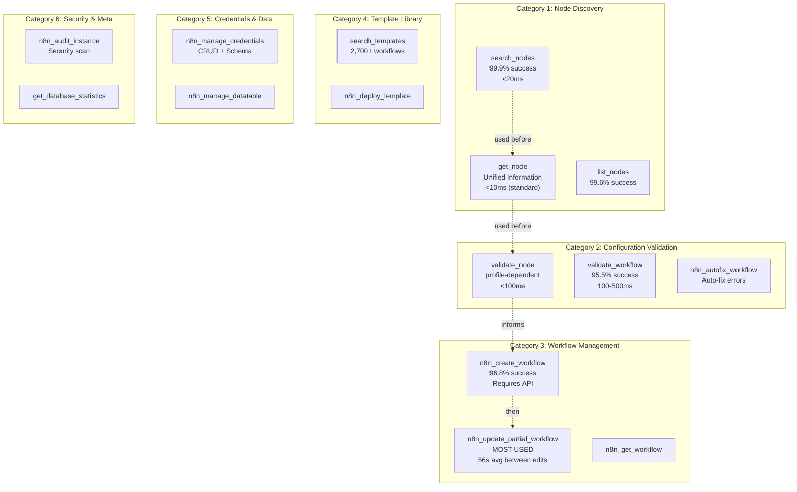
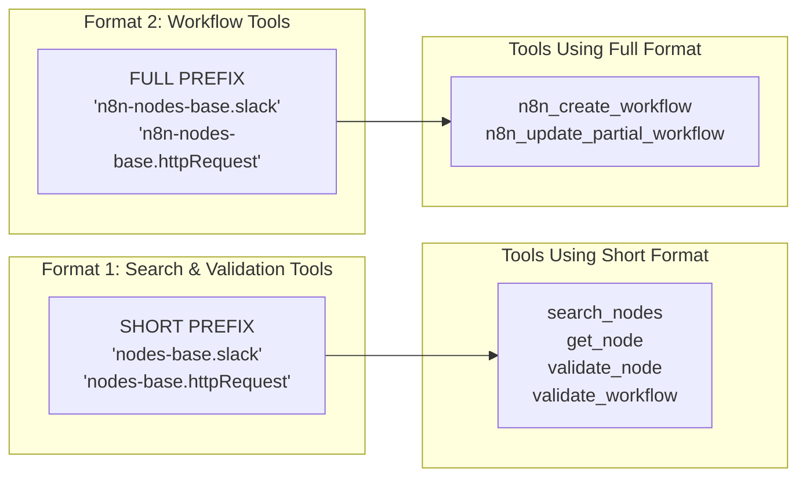
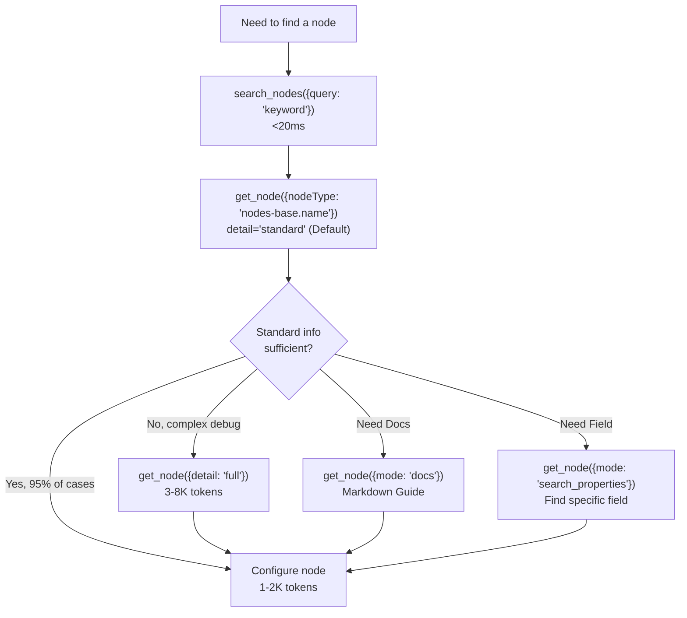
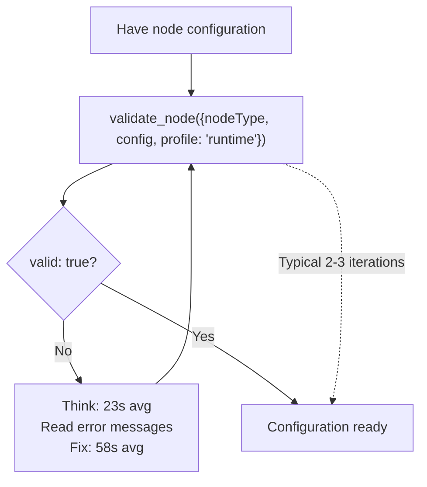
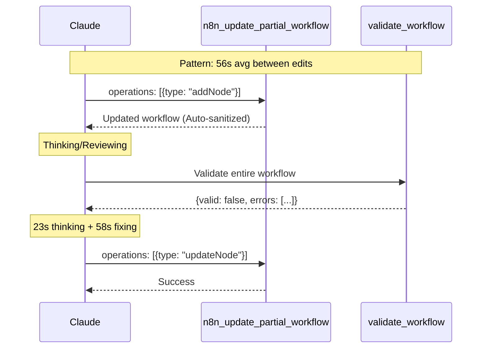

<!-- source: DeepWiki mcp.deepwiki.com · repo czlonkowski/n8n-skills · page 3.2 n8n MCP Tools Expert · fetched 2026-10-26 -->

# n8n MCP Tools Expert

<details>
<summary>Relevant source files</summary>

The following files were used as context for generating this wiki page:

- [skills/n8n-mcp-tools-expert/README.md](skills/n8n-mcp-tools-expert/README.md)
- [skills/n8n-mcp-tools-expert/SEARCH_GUIDE.md](skills/n8n-mcp-tools-expert/SEARCH_GUIDE.md)
- [skills/n8n-mcp-tools-expert/SKILL.md](skills/n8n-mcp-tools-expert/SKILL.md)
- [skills/n8n-mcp-tools-expert/WORKFLOW_GUIDE.md](skills/n8n-mcp-tools-expert/WORKFLOW_GUIDE.md)
- [skills/n8n-validation-expert/ERROR_CATALOG.md](skills/n8n-validation-expert/ERROR_CATALOG.md)
- [skills/n8n-validation-expert/FALSE_POSITIVES.md](skills/n8n-validation-expert/FALSE_POSITIVES.md)
- [skills/n8n-validation-expert/README.md](skills/n8n-validation-expert/README.md)

</details>


## Purpose and Scope

The n8n MCP Tools Expert skill provides authoritative guidance for using the 40+ MCP tools provided by the n8n-mcp server. This skill is marked as **HIGHEST PRIORITY** among the seven n8n skills because all other skills rely on correct MCP tool usage to function effectively.

This page documents:
- The eight tool categories and their specific tools.
- Critical `nodeType` format differences between tool groups.
- Tool selection strategies based on task requirements.
- Usage patterns derived from 447,557 real MCP tool invocations.
- Performance characteristics and reliability metrics.
- Common mistakes and their corrections.

**Sources:** [skills/n8n-mcp-tools-expert/SKILL.md:1-10](), [skills/n8n-mcp-tools-expert/README.md:26-29]()

---

## Tool Categories and Organization

The n8n-mcp server provides tools organized into functional categories. Each category serves a distinct purpose in the workflow development lifecycle.

### Tool Category Overview



**Diagram 1:** MCP Tool Categories and Common Tool Sequencing

**Sources:** [skills/n8n-mcp-tools-expert/SKILL.md:12-24](), [skills/n8n-mcp-tools-expert/SKILL.md:28-43]()

### Tool Availability by API Requirement

| Tool Category | Requires n8n API | Notes |
|---------------|------------------|-------|
| Node Discovery (`search_nodes`, `get_node`) | ❌ No | Always available via indexed metadata. |
| Configuration Validation (`validate_node`) | ❌ No | Validates structure only, not against live instance. |
| Template Library | ❌ No | 2,700+ workflows available for search. |
| Workflow Management | ✅ Yes | Requires `N8N_API_URL` + `N8N_API_KEY`. |
| Credential Management | ✅ Yes | Full CRUD operations on credentials. |
| Data Tables | ✅ Yes | Manage n8n data tables and rows. |
| Security & Audit | ✅ Yes | Instance security auditing with deep scan. |

**Sources:** [skills/n8n-mcp-tools-expert/WORKFLOW_GUIDE.md:7-11](), [skills/n8n-mcp-tools-expert/SKILL.md:12-24]()

---

## nodeType Format: Critical Distinction

The most common source of "Node not found" errors is using the wrong `nodeType` format. The MCP server uses **two different prefix formats** depending on the tool category.

### Format Distinction Diagram



**Diagram 2:** nodeType Format Requirements by Tool Category

### Conversion Pattern

The `search_nodes` tool returns both formats to facilitate conversion:

```javascript
// search_nodes response structure
{
  "nodeType": "nodes-base.slack",           // For search/validate tools
  "workflowNodeType": "n8n-nodes-base.slack" // For workflow tools
}
```

**Sources:** [skills/n8n-mcp-tools-expert/SKILL.md:101-141]()

---

## Tool Selection Strategy

### Node Discovery Workflow

The `get_node` tool is the unified entry point for node details, replacing legacy "essentials" and "info" splits with `detail` levels.



**Diagram 3:** Node Discovery Decision Tree

**Sources:** [skills/n8n-mcp-tools-expert/SEARCH_GUIDE.md:51-61](), [skills/n8n-mcp-tools-expert/SKILL.md:47-73]()

### Validation Workflow

Validation typically requires 2-3 cycles (7,841 validation checks observed).



**Diagram 4:** Validation Loop Pattern

**Sources:** [skills/n8n-validation-expert/README.md:13-19](), [skills/n8n-mcp-tools-expert/SKILL.md:75-84]()

---

## Common Usage Patterns

### Pattern 1: Edit-Validate Loop (Iterative Building)

The most common pattern (38,287 occurrences) is the incremental workflow update cycle using `n8n_update_partial_workflow`.



**Diagram 5: Code Entity Space - Workflow Operations**

**Sources:** [skills/n8n-mcp-tools-expert/WORKFLOW_GUIDE.md:78-86](), [skills/n8n-mcp-tools-expert/SKILL.md:86-97]()

### Pattern 2: AI Workflow Connections

Full support for AI Agent workflows involves 8 specific connection types.

| Connection Type | Source Output Name | Target Input Name |
|-----------------|--------------------|-------------------|
| Language Model  | `ai_languageModel` | `AI Agent`        |
| Tool            | `ai_tool`          | `AI Agent`        |
| Memory          | `ai_memory`        | `AI Agent`        |
| Vector Store    | `ai_vectorStore`   | `AI Agent`        |

**Sources:** [skills/n8n-mcp-tools-expert/WORKFLOW_GUIDE.md:165-203]()

---

## Tool-Specific Guidance

### Validation Profiles

The skill recommends explicit profile specification to balance error detection with false positive reduction.

| Profile | Use Case | Strictness |
|---------|----------|------------|
| `minimal` | Quick checks for required fields. | Low |
| `runtime` | **Recommended** for pre-deployment checks. | Moderate |
| `ai-friendly` | Reduces false positives by 60% for AI workflows. | Low |
| `strict` | Maximum validation for production safety. | High |

**Sources:** [skills/n8n-mcp-tools-expert/SKILL.md:183-199](), [skills/n8n-validation-expert/README.md:35-39]()

### Smart Parameters

Use semantic parameters instead of manual `sourceIndex` or `sourceOutput` for multi-output nodes.

| Node Type | Smart Parameter | Values |
|-----------|-----------------|--------|
| **IF**    | `branch`        | `"true"`, `"false"` |
| **Switch**| `case`          | `0, 1, 2, 3...` |

**Sources:** [skills/n8n-mcp-tools-expert/WORKFLOW_GUIDE.md:129-164]()

### Surgical String Edits: `patchNodeField`

Unlike `updateNode`, `patchNodeField` is strict: it errors if the find string is missing or ambiguous (multiple matches).

```javascript
// Surgical replacement in Code node
{
  type: "patchNodeField",
  nodeName: "Code",
  fieldPath: "parameters.jsCode",
  patches: [{
    find: "const limit = 10;",
    replace: "const limit = 50;"
  }]
}
```

**Sources:** [skills/n8n-mcp-tools-expert/WORKFLOW_GUIDE.md:228-251]()

---

## Auto-Sanitization System

Auto-sanitization runs on **every workflow update**, affecting **all nodes** in the workflow.

- **Binary Operators** (equals, contains): Removes `singleValue`.
- **Unary Operators** (isEmpty, isNotEmpty): Adds `singleValue: true`.
- **IF/Switch Nodes**: Adds missing metadata automatically.

**Sources:** [skills/n8n-mcp-tools-expert/SKILL.md:201-219](), [skills/n8n-validation-expert/README.md:41-46]()

---

## Summary of Common Mistakes

| Mistake | Consequence | Solution |
|---------|-------------|----------|
| Using `detail: "full"` by default | Token waste, slow response | Use `detail: "standard"` (1-2K tokens). |
| Missing `nodes-base.` prefix | "Node not found" error | Always use the short prefix for discovery tools. |
| Using short prefix in workflow tools | "Invalid node type" error | Use `n8n-nodes-base.` for `n8n_create_workflow`. |
| Manual `sourceIndex` for IF nodes | Brittle connections | Use `branch: "true"` smart parameter. |

**Sources:** [skills/n8n-mcp-tools-expert/SKILL.md:145-171](), [skills/n8n-mcp-tools-expert/SKILL.md:221-245]()

---

