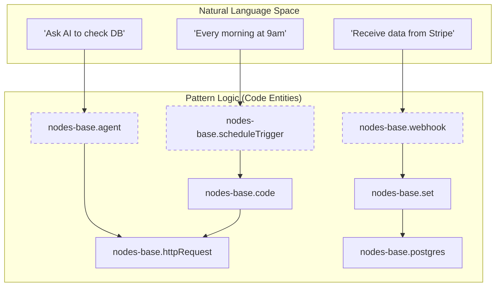
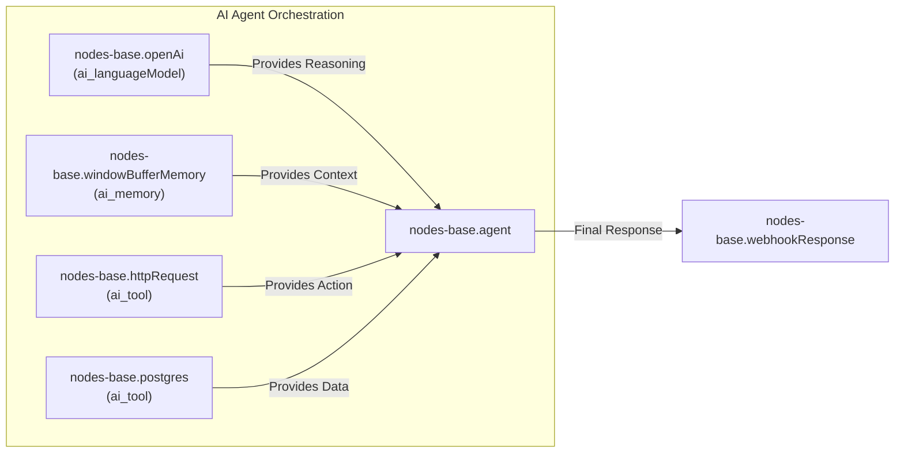

<!-- source: DeepWiki mcp.deepwiki.com · repo czlonkowski/n8n-skills · page 3.3 n8n Workflow Patterns · fetched 2026-10-26 -->

# n8n Workflow Patterns

Relevant source files

The following files were used as context for generating this wiki page:

- [skills/n8n-mcp-tools-expert/VALIDATION_GUIDE.md](skills/n8n-mcp-tools-expert/VALIDATION_GUIDE.md)
- [skills/n8n-node-configuration/README.md](skills/n8n-node-configuration/README.md)
- [skills/n8n-workflow-patterns/README.md](skills/n8n-workflow-patterns/README.md)
- [skills/n8n-workflow-patterns/SKILL.md](skills/n8n-workflow-patterns/SKILL.md)
- [skills/n8n-workflow-patterns/ai_agent_workflow.md](skills/n8n-workflow-patterns/ai_agent_workflow.md)
- [skills/n8n-workflow-patterns/database_operations.md](skills/n8n-workflow-patterns/database_operations.md)
- [skills/n8n-workflow-patterns/http_api_integration.md](skills/n8n-workflow-patterns/http_api_integration.md)
- [skills/n8n-workflow-patterns/scheduled_tasks.md](skills/n8n-workflow-patterns/scheduled_tasks.md)
- [skills/n8n-workflow-patterns/webhook_processing.md](skills/n8n-workflow-patterns/webhook_processing.md)

## Purpose and Scope

This page documents the **n8n Workflow Patterns** skill, a high-priority architectural guide within the n8n-skills system. This skill codifies five proven architectural patterns derived from the analysis of over 2,653 real-world n8n templates and common search behaviors (e.g., 813 unique searches for webhook processing) [skills/n8n-workflow-patterns/README.md:32-32](), [skills/n8n-workflow-patterns/README.md:218-221]().

It provides a structured framework for:
- Selecting the correct workflow architecture based on triggers and data goals [skills/n8n-workflow-patterns/SKILL.md:38-40]().
- Mapping business requirements to specific n8n node types [skills/n8n-workflow-patterns/SKILL.md:74-77]().
- Implementing standard data flow logic (Linear, Branching, Looping, etc.) [skills/n8n-workflow-patterns/SKILL.md:142-143]().
- Avoiding frequent implementation "gotchas" such as nested webhook data structures [skills/n8n-workflow-patterns/SKILL.md:181-182]().

**Sources:** [skills/n8n-workflow-patterns/SKILL.md:1-10](), [skills/n8n-workflow-patterns/README.md:1-10]()

---

## The 5 Core Patterns

The system identifies five primary patterns that account for the vast majority of automated workflows.

### 1. Webhook Processing (Event-Driven)
The most common pattern (35% of workflows). It creates an HTTP endpoint to receive data from external systems (Stripe, GitHub, Typeform) and process it instantly [skills/n8n-workflow-patterns/README.md:128-128](), [skills/n8n-workflow-patterns/webhook_processing.md:3-3]().
- **Core Node**: `nodes-base.webhook` [skills/n8n-workflow-patterns/webhook_processing.md:19-19]()
- **Data Flow**: `Webhook` → `Validate` → `Transform` → `Action` → `Respond` [skills/n8n-workflow-patterns/webhook_processing.md:9-10]()
- **Critical Detail**: Payload data is always nested under `$json.body` [skills/n8n-workflow-patterns/webhook_processing.md:32-33]().

### 2. HTTP API Integration (Data Fetching)
Used for fetching data from REST APIs, transforming it, and synchronizing it with other services [skills/n8n-workflow-patterns/http_api_integration.md:3-3]().
- **Core Node**: `nodes-base.httpRequest` [skills/n8n-workflow-patterns/http_api_integration.md:25-25]()
- **Data Flow**: `Trigger` → `HTTP Request` → `Transform` → `Action` → `Error Handler` [skills/n8n-workflow-patterns/http_api_integration.md:9-10]()
- **Key Concerns**: Authentication (Bearer, OAuth2), Pagination, and Rate Limiting [skills/n8n-workflow-patterns/http_api_integration.md:156-157](), [skills/n8n-workflow-patterns/http_api_integration.md:248-248]().

### 3. Database Operations (Persistence)
Focused on reading, writing, and syncing data between databases (Postgres, MySQL, MongoDB) [skills/n8n-workflow-patterns/database_operations.md:3-3]().
- **Core Nodes**: `nodes-base.postgres`, `nodes-base.mySql`, etc. [skills/n8n-workflow-patterns/database_operations.md:25-33]()
- **Data Flow**: `Trigger` → `Query` → `Transform` → `Write` → `Verify` [skills/n8n-workflow-patterns/database_operations.md:9-10]()
- **Security**: Mandatory use of parameterized queries to prevent SQL injection [skills/n8n-workflow-patterns/database_operations.md:158-163]().

### 4. AI Agent Workflow (Reasoning)
A specialized pattern using Large Language Models (LLMs) with access to tools and memory [skills/n8n-workflow-patterns/ai_agent_workflow.md:3-3]().
- **Core Node**: `nodes-base.agent` [skills/n8n-workflow-patterns/ai_agent_workflow.md:40-41]()
- **Connections**: Utilizes 8 specific AI connection types (e.g., `ai_languageModel`, `ai_tool`, `ai_memory`) [skills/n8n-workflow-patterns/ai_agent_workflow.md:17-28]().
- **Capability**: Any n8n node can be converted into an AI Tool by connecting to the `ai_tool` port [skills/n8n-workflow-patterns/ai_agent_workflow.md:73-74]().

### 5. Scheduled Tasks (Recurring)
Automation that runs periodically based on time intervals or Cron expressions (28% of workflows) [skills/n8n-workflow-patterns/README.md:129-129](), [skills/n8n-workflow-patterns/scheduled_tasks.md:3-3]().
- **Core Node**: `nodes-base.scheduleTrigger` [skills/n8n-workflow-patterns/scheduled_tasks.md:19-19]()
- **Modes**: `Interval`, `Cron`, or `Days & Hours` [skills/n8n-workflow-patterns/scheduled_tasks.md:22-25]().
- **Use Cases**: Daily reports, database cleanup, website uptime monitoring [skills/n8n-workflow-patterns/scheduled_tasks.md:152-153]().

**Sources:** [skills/n8n-workflow-patterns/SKILL.md:12-35](), [skills/n8n-workflow-patterns/README.md:49-76]()

---

## Pattern Implementation & Data Flow

This diagram bridges the conceptual "Pattern Space" to the specific "Code Entity Space" by mapping workflow stages to their corresponding n8n node types.

### Architectural Mapping Diagram

**Sources:** [skills/n8n-workflow-patterns/SKILL.md:74-107](), [skills/n8n-workflow-patterns/README.md:127-141]()

---

## Advanced Pattern Composition

Workflows often combine multiple data flow patterns to handle complexity.

| Pattern Type | Mermaid Representation | Primary Use Case |
| :--- | :--- | :--- |
| **Linear Flow** | `Trigger → Transform → Action` | Simple notifications or single API updates [skills/n8n-workflow-patterns/SKILL.md:144-148](). |
| **Branching** | `Trigger → IF → [True/False]` | Conditional logic (e.g., "Only notify if price > $100") [skills/n8n-workflow-patterns/SKILL.md:150-155](). |
| **Parallel** | `Trigger → [Branch 1 & 2] → Merge` | Simultaneous updates to multiple systems [skills/n8n-workflow-patterns/SKILL.md:157-162](). |
| **Looping** | `Split in Batches → Process → Loop` | Processing large datasets without memory timeouts [skills/n8n-workflow-patterns/SKILL.md:164-168](). |
| **Error Handler** | `Main Flow → [Error Trigger]` | Centralized alerting for workflow failures [skills/n8n-workflow-patterns/SKILL.md:170-175](). |

### AI Agent Pattern: Tool and Connection Architecture
The AI Agent pattern is unique because it uses non-linear port connections.

**Sources:** [skills/n8n-workflow-patterns/ai_agent_workflow.md:17-28](), [skills/n8n-workflow-patterns/ai_agent_workflow.md:52-55](), [skills/n8n-workflow-patterns/ai_agent_workflow.md:73-74]()

---

## Workflow Creation & Validation Cycle

Workflow creation is an iterative process characterized by a "Configuration → Validation" loop. Real-world telemetry shows an average of 56 seconds between configuration edits and 2-3 validation cycles per node [skills/n8n-node-configuration/README.md:15-18](), [skills/n8n-node-configuration/README.md:43-44]().

### The Development Loop
1. **Identify Pattern**: Select one of the 5 core patterns [skills/n8n-workflow-patterns/SKILL.md:115-115]().
2. **Discovery**: Use `search_nodes` to find the correct `nodeType` [skills/n8n-workflow-patterns/SKILL.md:116-116]().
3. **Configure**: Use `get_node` (Standard Detail) to identify required fields. 91.7% of nodes are successfully configured using standard detail without needing the full schema [skills/n8n-node-configuration/README.md:15-16](), [skills/n8n-node-configuration/README.md:132-132]().
4. **Validate**: Run `validate_node` with the `runtime` profile to catch type mismatches [skills/n8n-mcp-tools-expert/VALIDATION_GUIDE.md:57-57](), [skills/n8n-mcp-tools-expert/VALIDATION_GUIDE.md:73-76]().
5. **Sanitize**: The system automatically runs `auto-sanitization` on every update to fix common logic errors (e.g., binary vs unary operator conflicts) [skills/n8n-mcp-tools-expert/VALIDATION_GUIDE.md:228-236]().

**Sources:** [skills/n8n-workflow-patterns/SKILL.md:110-138](), [skills/n8n-mcp-tools-expert/VALIDATION_GUIDE.md:182-196](), [skills/n8n-node-configuration/README.md:36-40]()

---

## Critical Gotchas and Best Practices

- **Webhook Nesting**: Always use `{{$json.body.field}}` to access incoming data. Accessing `{{$json.field}}` directly is the #1 cause of webhook failures [skills/n8n-workflow-patterns/SKILL.md:181-188]().
- **Authentication**: Never hardcode keys in node parameters. Use the `authentication` property to link to n8n credentials (e.g., `nodeCredentialType: "httpHeaderAuth"`) [skills/n8n-workflow-patterns/SKILL.md:199-206](), [skills/n8n-workflow-patterns/http_api_integration.md:165-175]().
- **Execution Order**: Use Connection-based execution (v1) rather than the legacy Top-to-Bottom (v0) for predictable data flow [skills/n8n-workflow-patterns/SKILL.md:207-213]().
- **AI Tool Descriptions**: When connecting a node as an `ai_tool`, the `description` is the most critical field. The LLM uses this text to decide when and how to call the tool [skills/n8n-workflow-patterns/ai_agent_workflow.md:241-243]().

**Sources:** [skills/n8n-workflow-patterns/SKILL.md:179-220](), [skills/n8n-workflow-patterns/README.md:150-180]()

---

