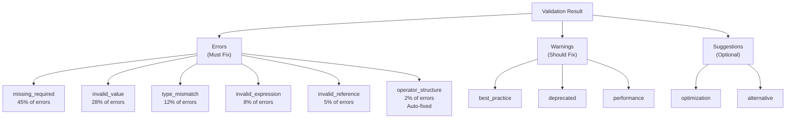
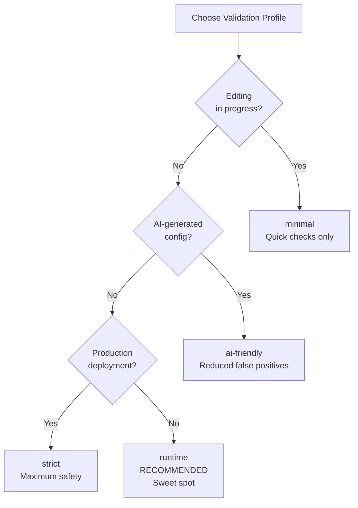
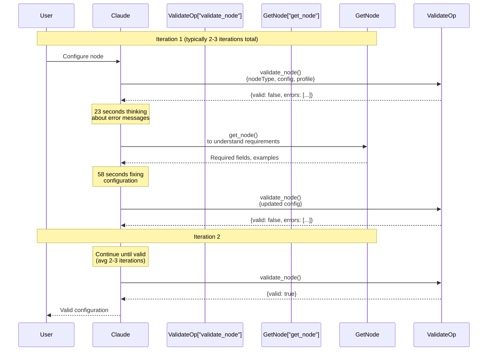
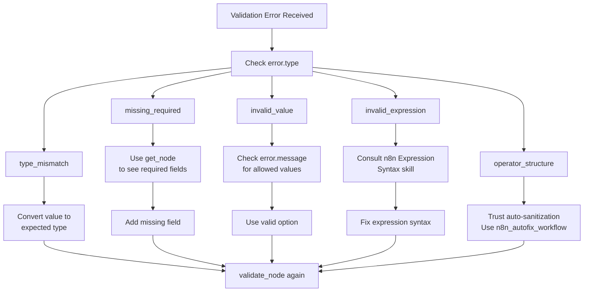
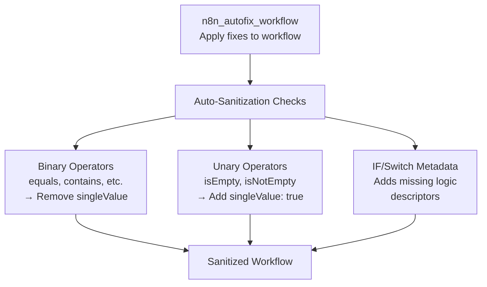
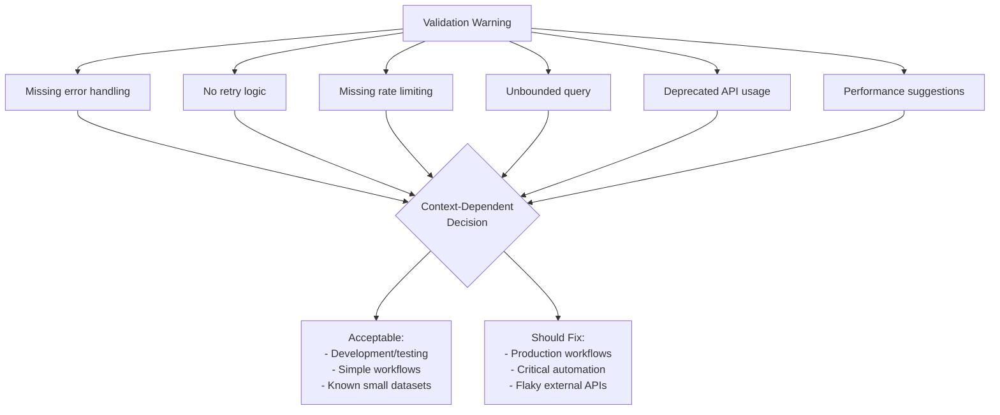

<!-- source: DeepWiki mcp.deepwiki.com · repo czlonkowski/n8n-skills · page 3.4 n8n Validation Expert · fetched 2026-10-26 -->

# n8n Validation Expert

<details>
<summary>Relevant source files</summary>

The following files were used as context for generating this wiki page:

- [skills/n8n-mcp-tools-expert/README.md](skills/n8n-mcp-tools-expert/README.md)
- [skills/n8n-mcp-tools-expert/SEARCH_GUIDE.md](skills/n8n-mcp-tools-expert/SEARCH_GUIDE.md)
- [skills/n8n-validation-expert/ERROR_CATALOG.md](skills/n8n-validation-expert/ERROR_CATALOG.md)
- [skills/n8n-validation-expert/FALSE_POSITIVES.md](skills/n8n-validation-expert/FALSE_POSITIVES.md)
- [skills/n8n-validation-expert/README.md](skills/n8n-validation-expert/README.md)
- [skills/n8n-validation-expert/SKILL.md](skills/n8n-validation-expert/SKILL.md)

</details>


## Purpose and Scope

This page documents the **n8n Validation Expert** skill, which teaches Claude how to interpret and systematically fix n8n validation errors. This skill provides expert guidance on the validation loop process, error classification, auto-sanitization behavior, and false positive recognition.

**Related pages**:
- For MCP tool usage including validation tools: see [n8n MCP Tools Expert](3.2)
- For node configuration requirements that cause validation errors: see [n8n Node Configuration](3.5)
- For expression syntax errors: see [n8n Expression Syntax](3.1)
- For validation system architecture: see [Validation System](5.2)

**Scope**: This page covers the skill itself—what it teaches Claude, not the underlying MCP validation tools. For the MCP server's validation implementation, see [Validation System](5.2).

Sources: [skills/n8n-validation-expert/README.md:1-10](), [skills/n8n-validation-expert/SKILL.md:1-22]()

---

## Core Validation Philosophy

The Validation Expert skill is built on a fundamental principle observed from telemetry data: **validation is an iterative process, not a one-shot operation**.

### Key Statistics from Real Usage

| Metric | Value | Interpretation |
|--------|-------|----------------|
| Total validation cycles | 7,841 | From 447,557 MCP events |
| Average iterations | 2-3 | Until valid configuration achieved |
| Thinking time | 23 seconds | Per validation cycle |
| Fixing time | 58 seconds | Per validation cycle |
| Total cycle time | 81 seconds | Average per iteration |
| Validation leads to feedback loops | 79% | Most validations trigger edits |

This iterative pattern is **expected and normal**—the skill teaches Claude not to be discouraged by multiple validation cycles but to embrace them as part of the development workflow [skills/n8n-validation-expert/SKILL.md:12-22]().

Sources: [skills/n8n-validation-expert/SKILL.md:12-22](), [skills/n8n-validation-expert/README.md:11-19]()

---

## Error Severity Levels

The skill teaches a three-tier severity classification system that determines how validation results should be interpreted and acted upon [skills/n8n-validation-expert/SKILL.md:25-72]().

### Error Classification Table

| Severity | Blocks Execution | Must Fix | Common Types | Action Required |
|----------|------------------|----------|--------------|-----------------|
| **Errors** | Yes | Yes | `missing_required`, `invalid_value`, `type_mismatch`, `invalid_expression`, `invalid_reference` | Fix before activation |
| **Warnings** | No | No | `best_practice`, `deprecated`, `performance` | Context-dependent |
| **Suggestions** | No | No | `optimization`, `alternative` | Optional improvements |

### Error Types Deep Dive



**Priority Distribution**: The error frequency percentages (45%, 28%, 12%, etc.) are derived from real validation events and guide the skill's teaching priorities [skills/n8n-validation-expert/ERROR_CATALOG.md:72-79](). `missing_required` and `invalid_value` account for 73% of all errors, making them the primary focus.

Sources: [skills/n8n-validation-expert/SKILL.md:25-72](), [skills/n8n-validation-expert/README.md:98-106](), [skills/n8n-validation-expert/ERROR_CATALOG.md:11-18]()

---

## Validation Profiles

The skill teaches four distinct validation profiles, each optimized for different stages of workflow development [skills/n8n-validation-expert/SKILL.md:137-188]().

### Profile Comparison

| Profile | Use Case | Validates | Speed | False Positive Rate |
|---------|----------|-----------|-------|---------------------|
| `minimal` | Quick checks during editing | Required fields only | Fastest | Highest (most permissive) |
| `runtime` | **Pre-deployment (RECOMMENDED)** | Required + types + values | Fast | Balanced |
| `ai-friendly` | AI-generated configurations | Same as runtime + tolerance | Fast | 60% lower than runtime |
| `strict` | Production/critical workflows | Everything + best practices | Slower | Highest (most warnings) |

### Profile Selection Flowchart



### Profile Details

**`runtime` (Recommended)**: The skill explicitly teaches this as the "sweet spot" for most use cases [skills/n8n-validation-expert/SKILL.md:151-163](). It catches real errors without excessive noise.

**`ai-friendly`**: Specifically designed to reduce false positives when Claude generates configurations. Reduces false positive warnings from 40% to 16% (60% reduction) [skills/n8n-validation-expert/README.md:46-51]().

Sources: [skills/n8n-validation-expert/SKILL.md:137-188](), [skills/n8n-validation-expert/README.md:119-123](), [skills/n8n-validation-expert/FALSE_POSITIVES.md:13-16]()

---

## The Validation Loop Pattern

The skill teaches a systematic, iterative validation workflow based on observed real-world usage patterns [skills/n8n-validation-expert/SKILL.md:74-91]().

### Standard Validation Loop



### Iteration Example from Skill Documentation

The skill teaches this concrete example to illustrate the normal multi-iteration pattern [skills/n8n-validation-expert/SKILL.md:93-131]():

**Iteration 1**:
```javascript
let config = {
  resource: "channel",
  operation: "create"
};
// validate_node → Error: Missing "name"
```

**Iteration 2** (after 23s thinking):
```javascript
config.name = "general";
// validate_node → Error: Missing "text"
```

**Iteration 3** (after 58s fixing):
```javascript
config.text = "Hello!";
// validate_node → Valid! ✅
```

This pattern is taught to set proper expectations: multiple iterations are **normal, not a failure** [skills/n8n-validation-expert/README.md:110-112]().

Sources: [skills/n8n-validation-expert/SKILL.md:74-134](), [skills/n8n-validation-expert/README.md:128-149](), [skills/n8n-mcp-tools-expert/SEARCH_GUIDE.md:243-268]()

---

## Error Catalog: 9 Error Types

The skill maintains a comprehensive error catalog with 9 distinct error types, each with specific fixing strategies [skills/n8n-validation-expert/ERROR_CATALOG.md:7-19]().

### Error Type Table

| Error Type | Priority | Frequency | Auto-Fix | Typical Cause | Primary Tool for Fix |
|------------|----------|-----------|----------|---------------|---------------------|
| `missing_required` | Highest | 45% | No | Required field not provided | `get_node` |
| `invalid_value` | High | 28% | No | Value not in allowed options | Error message lists options |
| `type_mismatch` | Medium | 12% | No | Wrong data type | Convert to expected type |
| `invalid_expression` | Medium | 8% | No | n8n expression syntax error | n8n Expression Syntax skill |
| `invalid_reference` | Low | 5% | No | Referenced node doesn't exist | Check node names in workflow |
| `operator_structure` | Low | 2% | **Yes** | Binary/unary operator mismatch | `n8n_autofix_workflow` |
| `patchNodeField` | High | <1% | No | Partial update failure | Correct field path/value |

### Error Resolution Workflow



### Example Error Structures

The skill teaches Claude to read error structures returned by validation tools [skills/n8n-validation-expert/SKILL.md:37-45]():

```javascript
// missing_required example
{
  "type": "missing_required",
  "property": "channel",
  "message": "Channel name is required",
  "fix": "Provide a channel name (lowercase, no spaces, 1-80 characters)"
}

// invalid_value example
{
  "type": "invalid_value",
  "property": "operation",
  "message": "Operation must be one of: post, update, delete",
  "current": "send"
}

// type_mismatch example
{
  "type": "type_mismatch",
  "property": "limit",
  "message": "Expected number, got string",
  "current": "100"
}
```

Sources: [skills/n8n-validation-expert/SKILL.md:189-299](), [skills/n8n-validation-expert/README.md:98-106](), [skills/n8n-validation-expert/ERROR_CATALOG.md:24-348]()

---

## Auto-Sanitization System

The skill teaches that n8n automatically fixes certain error types, particularly operator structure issues [skills/n8n-validation-expert/README.md:41-45]().

### What Auto-Sanitization Fixes



### Auto-Fix Workflow Example

The skill teaches how to use the `n8n_autofix_workflow` tool [skills/n8n-validation-expert/README.md:181-196]():

```javascript
// Step 1: Preview fixes
const preview = n8n_autofix_workflow({
  id: "workflow-id",
  applyFixes: false  // Preview mode
});
console.log(`Can auto-fix: ${preview.fixCount} issues`);

// Step 2: Apply fixes
if (preview.fixCount > 0) {
  n8n_autofix_workflow({
    id: "workflow-id",
    applyFixes: true
  });
}
```

Sources: [skills/n8n-validation-expert/README.md:41-45](), [skills/n8n-validation-expert/README.md:181-196](), [skills/n8n-validation-expert/README.md:116-118]()

---

## False Positive Handling

The skill teaches when validation warnings are **acceptable in context** [skills/n8n-validation-expert/FALSE_POSITIVES.md:1-12]().

### False Positive Statistics

| Metric | Value | Context |
|--------|-------|---------|
| Warnings that are false positives | 40% | In `runtime` profile |
| Warnings that are false positives | 16% | In `ai-friendly` profile |
| Reduction with ai-friendly | 60% | Compared to runtime |

### Six Common False Positive Patterns



### Decision Framework

**"Missing error handling" warning** [skills/n8n-validation-expert/FALSE_POSITIVES.md:42-143]():
- **Acceptable when**: Testing workflows where failures should be obvious, non-critical notifications, or manual trigger workflows.
- **Must fix when**: Production automation handling customer orders or critical payments.

**"No retry logic" warning** [skills/n8n-validation-expert/FALSE_POSITIVES.md:147-219]():
- **Acceptable when**: APIs have built-in retry (like Stripe), idempotent GET operations, or local internal services.
- **Must fix when**: Known flaky external APIs or non-idempotent POST operations.

Sources: [skills/n8n-validation-expert/FALSE_POSITIVES.md:1-219](), [skills/n8n-validation-expert/README.md:47-52](), [skills/n8n-validation-expert/README.md:113-115]()

---

## Validation Tools and Profiles

The skill teaches the usage of validation tools and their associated profiles [skills/n8n-validation-expert/SKILL.md:137-188]().

### Validation Tool Usage

The skill teaches the `validate_node` tool as the primary interface for single-node validation [skills/n8n-validation-expert/SKILL.md:101-131]().

```javascript
validate_node({
  nodeType: "nodes-base.slack",    // SHORT prefix format
  config: {
    resource: "channel",
    operation: "create",
    name: "general"
  },
  profile: "runtime"                // minimal | runtime | ai-friendly | strict
})
```

### Profile Use Cases

| Profile | Primary Use Case |
|---------|------------------|
| `minimal` | Quick checks during editing to find missing fields [skills/n8n-validation-expert/SKILL.md:141-150](). |
| `runtime` | **Recommended** for pre-deployment to catch real errors [skills/n8n-validation-expert/SKILL.md:151-163](). |
| `ai-friendly` | Reducing noise in AI-generated configurations [skills/n8n-validation-expert/SKILL.md:165-175](). |
| `strict` | Final production check for maximum safety [skills/n8n-validation-expert/SKILL.md:176-187](). |

Sources: [skills/n8n-validation-expert/SKILL.md:137-188](), [skills/n8n-validation-expert/README.md:35-40](), [skills/n8n-mcp-tools-expert/README.md:80-80]()

---

## File Structure and Activation

The Validation Expert skill is organized into four primary files [skills/n8n-validation-expert/README.md:53-93]().

### File Organization

- **SKILL.md**: Core validation concepts, philosophy, and the validation loop pattern.
- **ERROR_CATALOG.md**: Detailed reference for 9 error types with examples and fixes.
- **FALSE_POSITIVES.md**: Decision framework for when to ignore validation warnings.
- **README.md**: Skill metadata, statistics, and activation triggers.

### Activation Triggers

The skill activates on phrases such as [skills/n8n-validation-expert/README.md:198-215]():
- "validation error"
- "validation failing"
- "what does this error mean"
- "false positive"
- "validation loop"
- "operator structure"
- "validation profile"

Sources: [skills/n8n-validation-expert/README.md:53-93](), [skills/n8n-validation-expert/README.md:198-215](), [skills/n8n-validation-expert/SKILL.md:1-4]()

---

