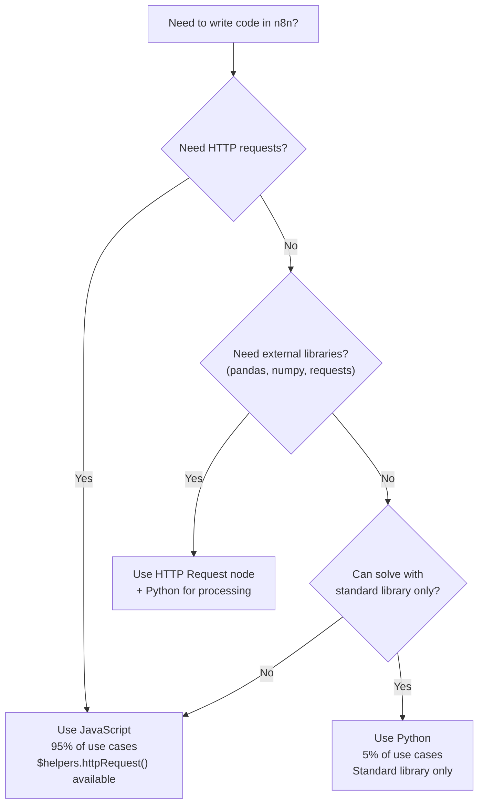
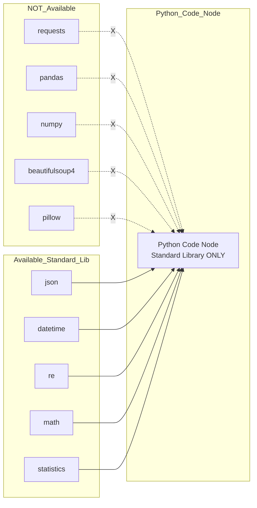
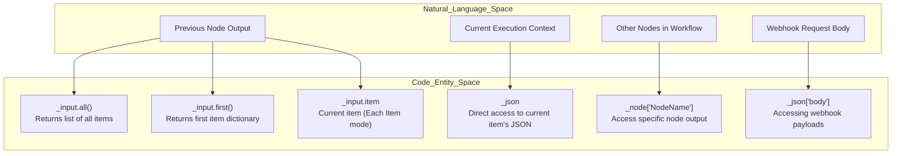
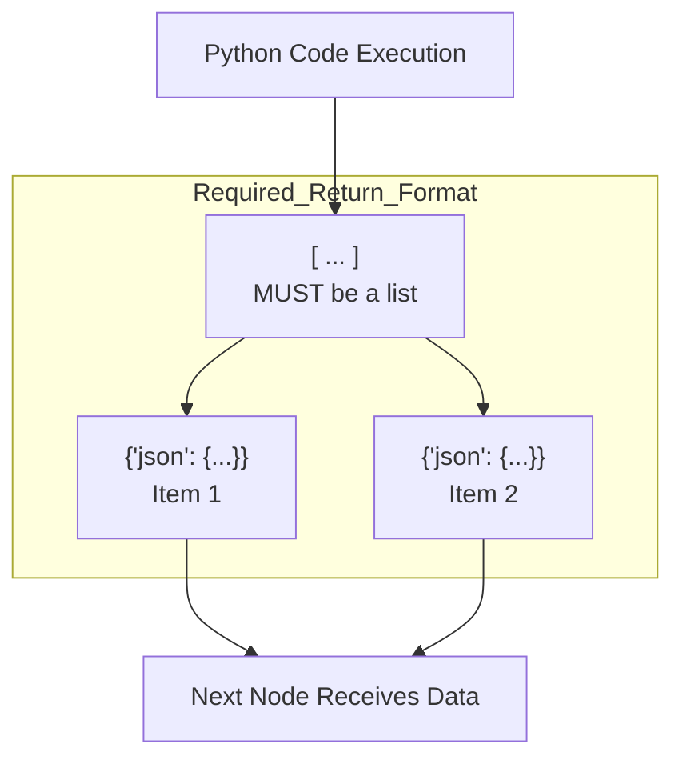

<!-- source: DeepWiki mcp.deepwiki.com · repo czlonkowski/n8n-skills · page 3.7 n8n Code Python · fetched 2026-10-26 -->

# n8n Code Python

<details>
<summary>Relevant source files</summary>

The following files were used as context for generating this wiki page:

- [skills/n8n-code-python/COMMON_PATTERNS.md](skills/n8n-code-python/COMMON_PATTERNS.md)
- [skills/n8n-code-python/DATA_ACCESS.md](skills/n8n-code-python/DATA_ACCESS.md)
- [skills/n8n-code-python/ERROR_PATTERNS.md](skills/n8n-code-python/ERROR_PATTERNS.md)
- [skills/n8n-code-python/README.md](skills/n8n-code-python/README.md)
- [skills/n8n-code-python/SKILL.md](skills/n8n-code-python/SKILL.md)
- [skills/n8n-code-python/STANDARD_LIBRARY.md](skills/n8n-code-python/STANDARD_LIBRARY.md)

</details>


## Purpose and Scope

This document covers the **n8n Code Python** skill, which provides technical guidance for writing Python code within n8n Code nodes. This skill emphasizes a **critical limitation**: Python Code nodes have **NO external library support** (no `pip` packages like `requests`, `pandas`, or `numpy`)—only Python's standard library is available [skills/n8n-code-python/README.md:11-12](). Due to these constraints and the availability of advanced helper functions in JavaScript, Python is recommended for only approximately 5% of Code node use cases [skills/n8n-code-python/SKILL.md:14-17]().

For JavaScript code in n8n (which handles 95% of use cases with full HTTP request support and helper functions), see [n8n Code JavaScript](). For general node configuration guidance, see [n8n Node Configuration]().

**Sources:** [skills/n8n-code-python/README.md:1-23](), [skills/n8n-code-python/SKILL.md:6-25]()

---

## When to Use Python vs JavaScript

The most critical decision when working with Code nodes is choosing between Python and JavaScript. JavaScript is the preferred language in n8n because it includes the `Luxon` library for dates and the `$helpers.httpRequest` method [skills/n8n-code-python/SKILL.md:19-23]().

### Language Selection Logic

Title: n8n Code Language Selection Logic


**Key Decision Factors:**

| Factor | JavaScript | Python |
|--------|-----------|--------|
| **HTTP Requests** | ✅ Built-in `$helpers.httpRequest()` | ❌ No `requests` library [skills/n8n-code-python/ERROR_PATTERNS.md:31-36]() |
| **External Libraries** | ✅ Luxon included | ❌ None available [skills/n8n-code-python/STANDARD_LIBRARY.md:9-11]() |
| **Data Processing** | ✅ Full n8n helpers | ⚠️ Standard library only |
| **Use Case Coverage** | 95% [skills/n8n-code-python/README.md:9]() | 5% |

**Sources:** [skills/n8n-code-python/README.md:7-22](), [skills/n8n-code-python/SKILL.md:12-25](), [skills/n8n-code-python/ERROR_PATTERNS.md:89-99]()

---

## Critical Limitations: No External Libraries

The **most important limitation** of Python Code nodes is the complete absence of external library support. Attempting to import these will result in a `ModuleNotFoundError` [skills/n8n-code-python/ERROR_PATTERNS.md:21-26]().

Title: Python Code Node Environment


**Common Library Replacements:**

| Need | ❌ External Library | ✅ n8n Alternative |
|------|-------------------|----------------|
| HTTP requests | `requests` | HTTP Request node or JS `$helpers.httpRequest` [skills/n8n-code-python/ERROR_PATTERNS.md:93]() |
| Data analysis | `pandas` | Python list comprehensions [skills/n8n-code-python/ERROR_PATTERNS.md:94]() |
| Database | `psycopg2` | n8n Database nodes (Postgres, MySQL, etc.) [skills/n8n-code-python/ERROR_PATTERNS.md:95]() |
| Web scraping | `bs4` | HTML Extract node [skills/n8n-code-python/ERROR_PATTERNS.md:96]() |

**Sources:** [skills/n8n-code-python/STANDARD_LIBRARY.md:7-35](), [skills/n8n-code-python/ERROR_PATTERNS.md:21-40](), [skills/n8n-code-python/ERROR_PATTERNS.md:89-99]()

---

## Python Data Access Patterns

Python Code nodes use underscore-prefixed variables for data access. There are two modes: **Python (Beta)**, which includes helper syntax, and **Python (Native)**, which uses pure Python variables [skills/n8n-code-python/SKILL.md:109-112]().

### Data Access Variable Mapping

Title: Python Code Entity Space Mapping


### Essential Access Syntax

| Pattern | Mode | Use Case |
|---------|------|----------|
| `_input.all()` | Beta | Process all items from previous node [skills/n8n-code-python/DATA_ACCESS.md:29-31]() |
| `_input.first()` | Beta | Get only the first item [skills/n8n-code-python/DATA_ACCESS.md:172-174]() |
| `_input.item` | Beta | Access current item in "Run Once for Each Item" mode [skills/n8n-code-python/DATA_ACCESS.md:273-275]() |
| `_items` | Native | Equivalent to `_input.all()` in Native mode [skills/n8n-code-python/SKILL.md:133-134]() |
| `_node["Name"]` | Beta | Access specific node's output [skills/n8n-code-python/SKILL.md:215-217]() |

**CRITICAL: Webhook Data Structure**
A common mistake is accessing webhook data directly. Webhook node wraps request data under a `body` property [skills/n8n-code-python/SKILL.md:238-241]().
```python
# ✅ CORRECT - Webhook data is under ["body"]
name = _json["body"]["name"] 
# ✅ SAFER - Use .get()
body = _json.get("body", {})
```

**Sources:** [skills/n8n-code-python/DATA_ACCESS.md:7-26](), [skills/n8n-code-python/SKILL.md:109-153](), [skills/n8n-code-python/SKILL.md:238-256]()

---

## Return Format Requirements

Python Code nodes **must** return a list of dictionaries where each dictionary contains a `"json"` key [skills/n8n-code-python/SKILL.md:51]().

Title: Python Return Format Validation


**Correct vs Incorrect Examples:**
```python
# ❌ INCORRECT: Returns dict directly
return {"id": 1} 

# ❌ INCORRECT: Missing 'json' key
return [{"id": 1}] 

# ✅ CORRECT: List of dicts with 'json' key
return [{"json": {"id": 1}}] 
```

**Sources:** [skills/n8n-code-python/SKILL.md:262-281](), [skills/n8n-code-python/ERROR_PATTERNS.md:323-338]()

---

## Standard Library Reference

The following modules are available and prioritized by utility within n8n [skills/n8n-code-python/STANDARD_LIBRARY.md:41-66]().

| Module | Use Case | Implementation Example |
|--------|----------|---------|
| `json` | Parsing/Generating JSON | `json.loads(string)` [skills/n8n-code-python/STANDARD_LIBRARY.md:73-80]() |
| `datetime` | Date manipulation | `datetime.now().isoformat()` [skills/n8n-code-python/STANDARD_LIBRARY.md:167-179]() |
| `re` | Regex pattern matching | `re.findall(r'#(\w+)', text)` [skills/n8n-code-python/STANDARD_LIBRARY.md:295-308]() |
| `base64` | Encoding/Decoding | `base64.b64encode(data)` [skills/n8n-code-python/STANDARD_LIBRARY.md:364-375]() |
| `hashlib` | Security/Hashing | `hashlib.sha256(data).hexdigest()` [skills/n8n-code-python/STANDARD_LIBRARY.md:417-431]() |
| `statistics` | Math/Stats | `statistics.mean(amounts)` [skills/n8n-code-python/README.md:261]() |

**Sources:** [skills/n8n-code-python/STANDARD_LIBRARY.md:41-66](), [skills/n8n-code-python/STANDARD_LIBRARY.md:69-331]()

---

## Common Error Patterns

| Error | Cause | Fix |
|-------|-------|-----|
| `ModuleNotFoundError` | Importing `requests`, `pandas`, etc. | Use n8n nodes or JS [skills/n8n-code-python/ERROR_PATTERNS.md:21-26]() |
| `KeyError` | Direct dict access `data["key"]` | Use `data.get("key", default)` [skills/n8n-code-python/ERROR_PATTERNS.md:181-186]() |
| `IndexError` | Accessing `list[0]` on empty list | Check `if list:` first [skills/n8n-code-python/ERROR_PATTERNS.md:279-284]() |
| Missing Return | No `return` statement | Always return at end of script [skills/n8n-code-python/ERROR_PATTERNS.md:118-122]() |

**Sources:** [skills/n8n-code-python/ERROR_PATTERNS.md:7-17](), [skills/n8n-code-python/ERROR_PATTERNS.md:181-275]()

---

