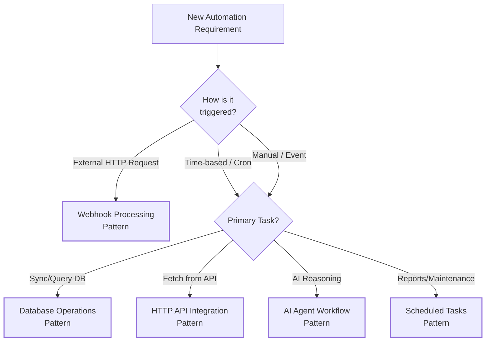
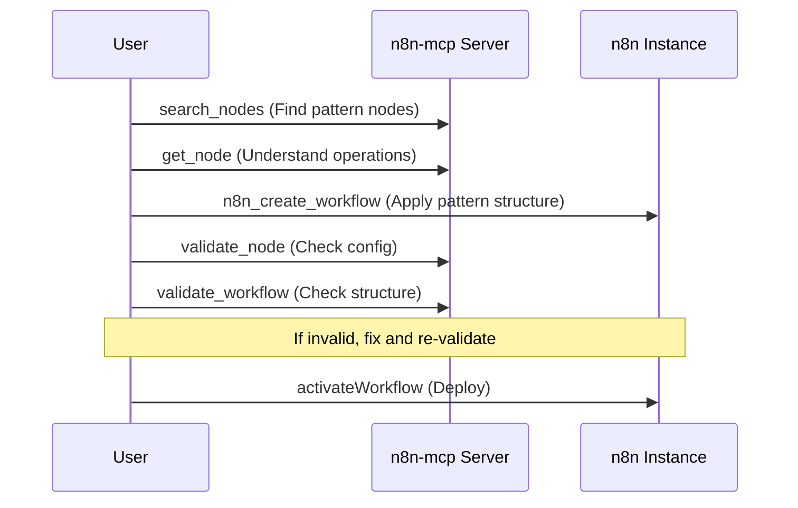

<!-- source: DeepWiki mcp.deepwiki.com · repo czlonkowski/n8n-skills · page 4 Workflow Patterns Deep Dive · fetched 2026-10-26 -->

# Workflow Patterns Deep Dive

Relevant source files

The following files were used as context for generating this wiki page:

- [evaluations/workflow-patterns/eval-001-webhook-workflow.json](evaluations/workflow-patterns/eval-001-webhook-workflow.json)
- [evaluations/workflow-patterns/eval-002-http-api-workflow.json](evaluations/workflow-patterns/eval-002-http-api-workflow.json)
- [evaluations/workflow-patterns/eval-003-database-sync.json](evaluations/workflow-patterns/eval-003-database-sync.json)
- [evaluations/workflow-patterns/eval-004-ai-agent.json](evaluations/workflow-patterns/eval-004-ai-agent.json)
- [evaluations/workflow-patterns/eval-005-scheduled-report.json](evaluations/workflow-patterns/eval-005-scheduled-report.json)
- [skills/n8n-mcp-tools-expert/VALIDATION_GUIDE.md](skills/n8n-mcp-tools-expert/VALIDATION_GUIDE.md)
- [skills/n8n-workflow-patterns/README.md](skills/n8n-workflow-patterns/README.md)
- [skills/n8n-workflow-patterns/SKILL.md](skills/n8n-workflow-patterns/SKILL.md)
- [skills/n8n-workflow-patterns/database_operations.md](skills/n8n-workflow-patterns/database_operations.md)
- [skills/n8n-workflow-patterns/http_api_integration.md](skills/n8n-workflow-patterns/http_api_integration.md)
- [skills/n8n-workflow-patterns/scheduled_tasks.md](skills/n8n-workflow-patterns/scheduled_tasks.md)
- [skills/n8n-workflow-patterns/webhook_processing.md](skills/n8n-workflow-patterns/webhook_processing.md)

This document provides a high-level exploration of the five core workflow patterns that address over 90% of n8n automation use cases. These patterns provide the architectural foundation for building reliable, scalable, and maintainable workflows.

**Sources:** [skills/n8n-workflow-patterns/SKILL.md:1-10](), [skills/n8n-workflow-patterns/README.md:7-9]()

---

## The 5 Core Patterns

Based on analysis of real-world usage and over 2,600 templates, n8n automation typically follows one of these five structural patterns.

| Pattern | Primary Use Case | Key Characteristic |
|:---|:---|:---|
| **[Webhook Processing Pattern](#4.1)** | Receiving data from external systems | Instant, event-driven response |
| **[HTTP API Integration Pattern](#4.2)** | Fetching data from REST APIs | External data fetching & transformation |
| **[Database Operations Pattern](#4.3)** | Read/Write/Sync database data | Data persistence and ETL |
| **[AI Agent Workflow Pattern](#4.4)** | AI agents with tools and memory | Multi-step reasoning and LLM logic |
| **[Scheduled Tasks Pattern](#4.5)** | Recurring automation tasks | Time-based automated execution |

**Sources:** [skills/n8n-workflow-patterns/SKILL.md:12-35](), [skills/n8n-workflow-patterns/README.md:50-76]()

---

## Pattern Selection Guide

Choosing the right pattern depends on your trigger source and the primary goal of the automation.

### Selection Logic

**Sources:** [skills/n8n-workflow-patterns/SKILL.md:38-71](), [skills/n8n-workflow-patterns/README.md:123-149]()

---

## Core Pattern Summaries

### 4.1 Webhook Processing Pattern
The most common pattern (35% of triggers). It creates an HTTP endpoint to receive data from services like Stripe, GitHub, or Typeform.
*   **Critical Detail:** Incoming data is always nested under `$json.body`.
*   **Components:** Webhook Trigger → Validation → Transform → Action → Response.
*   For details, see [Webhook Processing Pattern](#4.1).

**Sources:** [skills/n8n-workflow-patterns/webhook_processing.md:1-15](), [skills/n8n-workflow-patterns/SKILL.md:181-189]()

### 4.2 HTTP API Integration Pattern
Used to fetch data from REST APIs (45% of workflow outputs). It handles the complexities of external communication.
*   **Key Features:** Authentication (OAuth2, API Keys), Pagination, and Rate Limiting.
*   **Structure:** Trigger → HTTP Request → Transform → Action → Error Handler.
*   For details, see [HTTP API Integration Pattern](#4.2).

**Sources:** [skills/n8n-workflow-patterns/http_api_integration.md:1-14](), [skills/n8n-workflow-patterns/README.md:57-61]()

### 4.3 Database Operations Pattern
Focuses on data persistence and synchronization between different database engines (Postgres, MySQL, MongoDB, etc.).
*   **Key Features:** Parameterized queries to prevent SQL injection, batch processing for large datasets, and transactions.
*   **Structure:** Trigger → Query → Transform → Write → Verify.
*   For details, see [Database Operations Pattern](#4.3).

**Sources:** [skills/n8n-workflow-patterns/database_operations.md:1-14](), [skills/n8n-workflow-patterns/README.md:62-66]()

### 4.4 AI Agent Workflow Pattern
A specialized pattern for building LLM-powered agents that can interact with other n8n nodes as "tools."
*   **Architecture:** Uses 8 specific AI connection types (e.g., `ai_languageModel`, `ai_tool`, `ai_memory`).
*   **Capabilities:** Multi-step reasoning where the agent decides which tools to call.
*   For details, see [AI Agent Workflow Pattern](#4.4).

**Sources:** [skills/n8n-workflow-patterns/ai_agent_workflow.md:1-15](), [skills/n8n-workflow-patterns/README.md:67-71]()

### 4.5 Scheduled Tasks Pattern
Used for recurring automations (28% of all workflows) such as daily reports or periodic system maintenance.
*   **Modes:** Interval, Cron, and Days & Hours.
*   **Considerations:** Timezone handling and execution locks to prevent overlapping runs.
*   For details, see [Scheduled Tasks Pattern](#4.5).

**Sources:** [skills/n8n-workflow-patterns/scheduled_tasks.md:1-15](), [skills/n8n-workflow-patterns/README.md:72-76]()

---

## Workflow Creation Lifecycle

Regardless of the pattern chosen, every workflow should follow a standardized implementation lifecycle to ensure quality and reliability.

### Pattern Implementation Flow

### Implementation Checklist
1.  **Planning:** Identify pattern and list required nodes using `search_nodes`. [skills/n8n-workflow-patterns/SKILL.md:114-119]()
2.  **Implementation:** Configure nodes and authentication. [skills/n8n-workflow-patterns/SKILL.md:120-126]()
3.  **Validation:** Use `validate_node` and `validate_workflow` to catch errors before deployment. [skills/n8n-workflow-patterns/SKILL.md:128-133]()
4.  **Deployment:** Review settings and activate the workflow. [skills/n8n-workflow-patterns/SKILL.md:134-139]()

**Sources:** [skills/n8n-workflow-patterns/SKILL.md:110-141](), [skills/n8n-mcp-tools-expert/VALIDATION_GUIDE.md:134-154]()

---

## Data Flow Patterns

Patterns are further composed of specific data flow structures:

*   **Linear Flow:** Simple `Trigger → Transform → Action`. [skills/n8n-workflow-patterns/SKILL.md:144-149]()
*   **Branching Flow:** Using `IF` or `Switch` nodes for conditional paths. [skills/n8n-workflow-patterns/SKILL.md:150-156]()
*   **Parallel Processing:** Multiple branches merging back together. [skills/n8n-workflow-patterns/SKILL.md:157-162]()
*   **Loop Pattern:** Using `Split In Batches` for large datasets. [skills/n8n-workflow-patterns/SKILL.md:164-169]()
*   **Error Handler Pattern:** Dedicated flows triggered by `Error Trigger`. [skills/n8n-workflow-patterns/SKILL.md:170-176]()

**Sources:** [skills/n8n-workflow-patterns/SKILL.md:142-177]()

---

