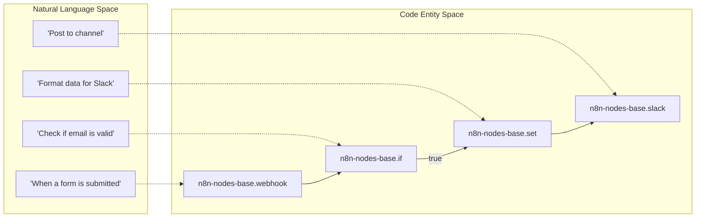
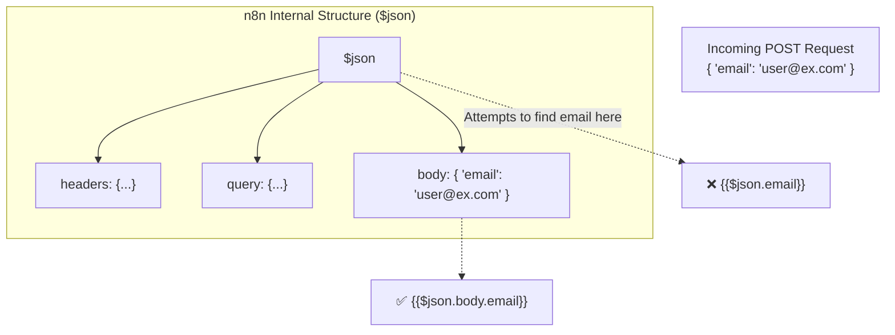

<!-- source: DeepWiki mcp.deepwiki.com · repo czlonkowski/n8n-skills · page 4.1 Webhook Processing Pattern · fetched 2026-10-26 -->

# Webhook Processing Pattern

<details>
<summary>Relevant source files</summary>

The following files were used as context for generating this wiki page:

- [evaluations/expression-syntax/eval-004-node-reference.json](evaluations/expression-syntax/eval-004-node-reference.json)
- [evaluations/workflow-patterns/eval-001-webhook-workflow.json](evaluations/workflow-patterns/eval-001-webhook-workflow.json)
- [evaluations/workflow-patterns/eval-002-http-api-workflow.json](evaluations/workflow-patterns/eval-002-http-api-workflow.json)
- [evaluations/workflow-patterns/eval-003-database-sync.json](evaluations/workflow-patterns/eval-003-database-sync.json)
- [evaluations/workflow-patterns/eval-004-ai-agent.json](evaluations/workflow-patterns/eval-004-ai-agent.json)
- [evaluations/workflow-patterns/eval-005-scheduled-report.json](evaluations/workflow-patterns/eval-005-scheduled-report.json)
- [skills/n8n-expression-syntax/COMMON_MISTAKES.md](skills/n8n-expression-syntax/COMMON_MISTAKES.md)
- [skills/n8n-expression-syntax/EXAMPLES.md](skills/n8n-expression-syntax/EXAMPLES.md)
- [skills/n8n-expression-syntax/README.md](skills/n8n-expression-syntax/README.md)
- [skills/n8n-mcp-tools-expert/VALIDATION_GUIDE.md](skills/n8n-mcp-tools-expert/VALIDATION_GUIDE.md)
- [skills/n8n-workflow-patterns/SKILL.md](skills/n8n-workflow-patterns/SKILL.md)

</details>


## Purpose and Scope

This page documents the **Webhook Processing Pattern**, the most common workflow architecture in n8n (appearing in approximately 35% of workflows). This pattern enables instant, event-driven processing of HTTP requests from external systems.

**Scope**: Webhook trigger configuration, critical `$json.body` data access, validation strategies, response modes (`onReceived` vs `lastNode`), and security implementations including signature verification.

**Sources**: [skills/n8n-workflow-patterns/SKILL.md:16-18](), [skills/n8n-workflow-patterns/webhook_processing.md:1-14]()

---

## Pattern Structure

The Webhook Processing Pattern follows a linear or branching flow designed for immediate event ingestion and processing.

### Data Flow Overview
The following diagram maps the conceptual "Natural Language" requirements to the specific "Code Entity" nodes used in n8n.



**Pattern Characteristics**:
- **Instant execution**: Triggered immediately by external HTTP calls.
- **Event-driven**: Ideal for Slack commands, Stripe payments, or GitHub hooks.
- **Synchronous or Asynchronous**: Configurable response behavior via `responseMode`.

**Sources**: [skills/n8n-workflow-patterns/SKILL.md:42-46](), [skills/n8n-workflow-patterns/webhook_processing.md:1-14]()

---

## Webhook Node Configuration

The `n8n-nodes-base.webhook` node creates an HTTP endpoint. Key configuration parameters include:

| Property | Type | Description |
|----------|------|-------------|
| `path` | string | URL segment (e.g., `form-submit`). Must be static; expressions are not supported in paths. |
| `httpMethod` | string | `GET`, `POST` (most common), `PUT`, `DELETE`. |
| `responseMode` | string | `onReceived` (immediate 200 OK) or `lastNode` (waits for `n8n-nodes-base.webhookResponse`). |
| `responseData` | string | `allEntries` or `firstEntryJson`. |

**Sources**: [skills/n8n-workflow-patterns/webhook_processing.md:19-31](), [skills/n8n-expression-syntax/COMMON_MISTAKES.md:271-291]()

---

## Critical Data Access: $json.body

### The Webhook Nesting "Gotcha"
The most frequent error in n8n development is attempting to access webhook data directly at the root of `$json`. Webhook nodes wrap incoming payloads under a `.body` property.



### Accessing Different Sections

| Section | Expression Syntax | Example |
|---------|------------------|---------|
| **Body** | `{{$json.body.fieldName}}` | `{{$json.body.email}}` |
| **Headers** | `{{$json.headers['header-name']}}` | `{{$json.headers['x-api-key']}}` |
| **Query Params** | `{{$json.query.paramName}}` | `{{$json.query.id}}` |

**Sources**: [skills/n8n-workflow-patterns/SKILL.md:181-189](), [skills/n8n-expression-syntax/COMMON_MISTAKES.md:27-61](), [skills/n8n-expression-syntax/EXAMPLES.md:13-36]()

---

## Validation and Security

### Signature Verification (Code Node)
For high-security integrations (Stripe, GitHub), developers must verify the HMAC signature in a `n8n-nodes-base.code` node using the `crypto` library.

```javascript
// Implementation in n8n-nodes-base.code
const crypto = require('crypto');
const signature = $input.item.json.headers['x-hub-signature-256'];
const secret = 'your_webhook_secret';

const hmac = crypto.createHmac('sha256', secret)
                   .update(JSON.stringify($input.item.json.body))
                   .digest('hex');

if (signature !== `sha256=${hmac}`) {
    throw new Error('Invalid signature');
}
return $input.item;
```

### Configuration Validation
Use the `validate_node` and `validate_workflow` tools to ensure webhook configurations are sound before deployment.

- **`validate_node`**: Checks for missing `path` or invalid `httpMethod`. [skills/n8n-mcp-tools-expert/VALIDATION_GUIDE.md:15-61]()
- **`n8n_autofix_workflow`**: Can automatically generate UUIDs for webhook nodes missing paths (`webhook-missing-path` fix type). [skills/n8n-mcp-tools-expert/VALIDATION_GUIDE.md:265-295]()

**Sources**: [skills/n8n-workflow-patterns/webhook_processing.md:241-284](), [skills/n8n-mcp-tools-expert/VALIDATION_GUIDE.md:289-290]()

---

## Response Modes

### 1. onReceived (Asynchronous)
- **Behavior**: n8n sends an immediate `200 OK` acknowledgment.
- **Use Case**: Long-running processes where the sender doesn't need the result (e.g., logging, background sync).
- **Sources**: [skills/n8n-workflow-patterns/webhook_processing.md:287-302]()

### 2. lastNode (Synchronous)
- **Behavior**: The HTTP connection remains open until the workflow reaches a `n8n-nodes-base.webhookResponse` node.
- **Use Case**: API endpoints that must return data (e.g., fetching a user profile, Slack Slash commands).
- **Sources**: [skills/n8n-workflow-patterns/webhook_processing.md:303-332]()

---

## Common Implementation Mistakes

| Mistake | Description | Fix |
|---------|-------------|-----|
| **Missing Braces** | Using `$json.body.id` instead of `{{$json.body.id}}`. | Wrap expressions in double curly braces. [skills/n8n-expression-syntax/COMMON_MISTAKES.md:7-24]() |
| **Case Sensitivity** | Referencing `{{$node["webhook"].json}}` when node is named `Webhook`. | Node names are case-sensitive. [skills/n8n-expression-syntax/COMMON_MISTAKES.md:108-126]() |
| **Direct Access in Code** | Using `{{}}` inside a Code node. | Use direct object access: `$input.item.json.body`. [skills/n8n-expression-syntax/COMMON_MISTAKES.md:171-194]() |
| **Space in Names** | `{{$node.Webhook Node.json}}` | Use bracket notation: `{{$node["Webhook Node"].json}}`. [skills/n8n-expression-syntax/COMMON_MISTAKES.md:86-106]() |

**Sources**: [skills/n8n-expression-syntax/COMMON_MISTAKES.md:1-380]()

---

