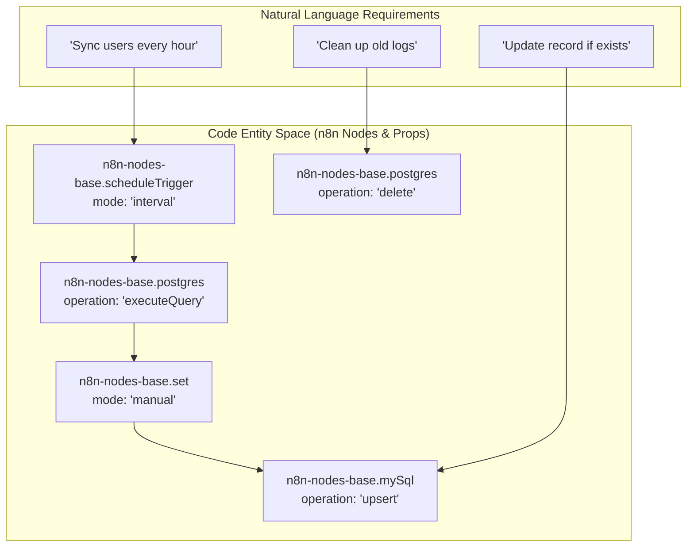

<!-- source: DeepWiki mcp.deepwiki.com · repo czlonkowski/n8n-skills · page 4.3 Database Operations Pattern · fetched 2026-10-26 -->

# Database Operations Pattern

<details>
<summary>Relevant source files</summary>

The following files were used as context for generating this wiki page:

- [evaluations/workflow-patterns/eval-001-webhook-workflow.json](evaluations/workflow-patterns/eval-001-webhook-workflow.json)
- [evaluations/workflow-patterns/eval-002-http-api-workflow.json](evaluations/workflow-patterns/eval-002-http-api-workflow.json)
- [evaluations/workflow-patterns/eval-003-database-sync.json](evaluations/workflow-patterns/eval-003-database-sync.json)
- [evaluations/workflow-patterns/eval-004-ai-agent.json](evaluations/workflow-patterns/eval-004-ai-agent.json)
- [evaluations/workflow-patterns/eval-005-scheduled-report.json](evaluations/workflow-patterns/eval-005-scheduled-report.json)
- [skills/n8n-workflow-patterns/README.md](skills/n8n-workflow-patterns/README.md)
- [skills/n8n-workflow-patterns/database_operations.md](skills/n8n-workflow-patterns/database_operations.md)
- [skills/n8n-workflow-patterns/http_api_integration.md](skills/n8n-workflow-patterns/http_api_integration.md)
- [skills/n8n-workflow-patterns/scheduled_tasks.md](skills/n8n-workflow-patterns/scheduled_tasks.md)
- [skills/n8n-workflow-patterns/webhook_processing.md](skills/n8n-workflow-patterns/webhook_processing.md)

</details>


## Purpose and Scope
This document covers the Database Operations Pattern for n8n workflows, focusing on reading, writing, synchronizing, and managing data across database systems. This pattern is one of the five core workflow patterns documented in the system.

**In Scope:**
- Database node configuration (Postgres, MySQL, MongoDB, SQLite, Redis, Microsoft SQL) [skills/n8n-workflow-patterns/database_operations.md:25-33]()
- Query operations (SELECT, INSERT, UPDATE, DELETE, UPSERT) [skills/n8n-workflow-patterns/database_operations.md:44-49]()
- Batch processing and pagination strategies [skills/n8n-workflow-patterns/database_operations.md:290-315]()
- Transaction handling for multi-step operations [skills/n8n-workflow-patterns/database_operations.md:348-351]()
- Data transformation between schemas [skills/n8n-workflow-patterns/database_operations.md:35-42]()

**Sources:** [skills/n8n-workflow-patterns/database_operations.md:1-50](), [skills/n8n-workflow-patterns/README.md:62-66]()

---

## Pattern Structure

The Database Operations Pattern follows a standard flow for data persistence and synchronization workflows.

### Natural Language to Code Entity Space: Data Flow
This diagram maps common database requirements to the specific n8n nodes and operations used to implement them.


**Sources:** [skills/n8n-workflow-patterns/database_operations.md:9-11](), [skills/n8n-workflow-patterns/database_operations.md:62-74]()

---

## Core Components

### 1. Database Read Operations
Reading data involves selecting records based on specific criteria, often for synchronization or reporting.

| Database | Operation | Parameter Syntax |
|----------|-----------|------------------|
| **Postgres** | `executeQuery` | `$1`, `$2` |
| **MySQL** | `executeQuery` | `?` |
| **MongoDB** | `find` | JSON Object |

**Example SELECT (Postgres):**
```javascript
{
  operation: "executeQuery",
  query: "SELECT id, name FROM users WHERE created_at > $1 LIMIT $2",
  parameters: ["={{$json.since_date}}", "100"]
}
```
**Sources:** [skills/n8n-workflow-patterns/database_operations.md:154-164](), [skills/n8n-workflow-patterns/database_operations.md:219-233]()

### 2. Database Write Operations
Write operations manage the persistence of data. n8n nodes support several standard operations:

- **INSERT**: Creates new records. Fails on duplicate keys [skills/n8n-workflow-patterns/database_operations.md:45]().
- **UPDATE**: Modifies existing records using an `updateKey` [skills/n8n-workflow-patterns/database_operations.md:46]().
- **UPSERT**: Inserts a record or updates it if it already exists [skills/n8n-workflow-patterns/database_operations.md:47]().
- **DELETE**: Removes records based on a condition [skills/n8n-workflow-patterns/database_operations.md:48]().

**Sources:** [skills/n8n-workflow-patterns/database_operations.md:43-49](), [skills/n8n-workflow-patterns/database_operations.md:183-197]()

---

## Implementation Patterns

### 1. Incremental Data Synchronization
This pattern fetches only new or updated records since the last execution.


**Sources:** [skills/n8n-workflow-patterns/database_operations.md:62-74](), [skills/n8n-workflow-patterns/scheduled_tasks.md:180-204]()

### 2. Batch Processing (Large Datasets)
To avoid memory issues with large datasets, workflows must process data in chunks.

- **Split In Batches**: Useful when the initial query returns a large array [skills/n8n-workflow-patterns/database_operations.md:292-301]().
- **Cursor-based Pagination**: Preferred for datasets with millions of records. It uses a `WHERE id > last_id` approach to iterate through the table [skills/n8n-workflow-patterns/database_operations.md:325-344]().

**Sources:** [skills/n8n-workflow-patterns/database_operations.md:290-344]()

### 3. Transaction Handling
Transactions ensure atomicity. In n8n, this is implemented using explicit SQL commands:

1. **BEGIN**: Start the transaction [skills/n8n-workflow-patterns/database_operations.md:353-356]().
2. **Operations**: Perform writes with `continueOnFail: true` [skills/n8n-workflow-patterns/database_operations.md:363-365]().
3. **COMMIT/ROLLBACK**: Finalize based on whether an error occurred in previous nodes [skills/n8n-workflow-patterns/database_operations.md:368-372]().

**Sources:** [skills/n8n-workflow-patterns/database_operations.md:348-372]()

---

## Security and Performance

### Parameterized Queries
**Never** use string concatenation for queries. Always use the `parameters` field to prevent SQL Injection.

- **Incorrect**: `SELECT * FROM users WHERE id = '{{$json.id}}'` [skills/n8n-workflow-patterns/database_operations.md:673-676]().
- **Correct**: `SELECT * FROM users WHERE id = $1` with `parameters: ["={{$json.id}}"]` [skills/n8n-workflow-patterns/database_operations.md:678-682]().

### Performance Checklist
- **Use LIMIT**: Prevent unbounded result sets from crashing the workflow [skills/n8n-workflow-patterns/database_operations.md:481-493]().
- **Indexes**: Ensure columns used in `WHERE` or `ORDER BY` clauses are indexed [skills/n8n-workflow-patterns/database_operations.md:472-479]().
- **Batch Writes**: Use the "Insert" operation with an array of objects to perform a single bulk insert instead of a loop [skills/n8n-workflow-patterns/database_operations.md:511-524]().

**Sources:** [skills/n8n-workflow-patterns/database_operations.md:467-540](), [skills/n8n-workflow-patterns/README.md:163-168]()

---

## Code Entity Reference: Database Node Properties

This table maps logical operations to specific property configurations in database nodes.

| Logical Operation | n8n Property | Code Value / Syntax |
|-------------------|--------------|---------------------|
| Execute Raw SQL | `operation` | `"executeQuery"` |
| Target Table | `table` | `"users"` |
| Update Identifier | `updateKey` | `"id"` |
| Batch Size | `batchSize` | `100` |
| Error Handling | `continueOnFail`| `true` |

**Sources:** [skills/n8n-workflow-patterns/database_operations.md:154-197](), [skills/n8n-workflow-patterns/database_operations.md:554-558]()

---

